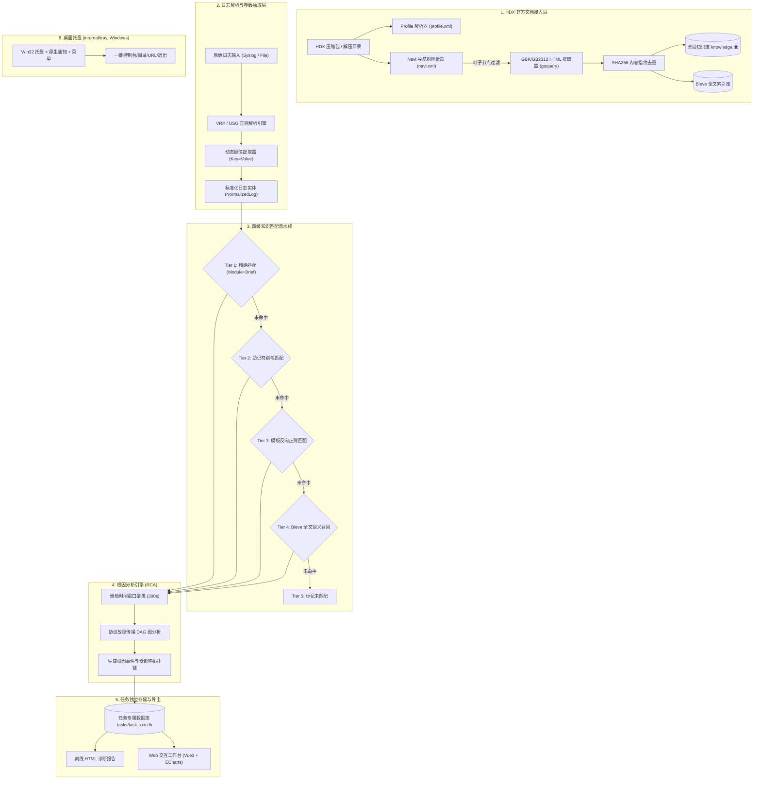

<div align="center">

# 🚀 LogAuditorGo (华为网络设备日志智能分析平台)

**Windows 桌面单机的华为网络设备日志语义分析与故障排查工具：离线解析日志、匹配官方知识、注入现场参数、沉淀可交接的排障结论**

[](https://golang.org)
[](https://vuejs.org/)
[](https://vitejs.dev/)
[](https://github.com/blevesearch/bleve)
[](https://modernc.org/sqlite)
[](LICENSE)

[功能特性](#-核心特性) • [系统架构](#-系统架构) • [快速开始](#-快速开始) • [使用指南](#-使用指南) • [API 规范](#-restful-api-规范) • [目录结构](#-项目工程目录) • [演进路线](#-演进路线图)

</div>

---

## 📖 项目背景与定位

### 痛点与挑战
主流通用日志分析平台（如 ELK、Graylog、Splunk、Loki 等）长于海量日志的集中采集、时序存储与检索可视化，但缺乏针对华为网络设备（CloudEngine 交换机、HiSecEngine 防火墙、NetEngine 路由器等）的**深度语义解析**、**设备动态参数结构化抽取**以及与**官方故障知识库的智能关联**能力。

网络工程师在排查故障时，往往需要在日志平台检索出报错后，再手动翻阅数千页的华为官方 Hedex/HDX 文档、排查手册，或者凭借个人经验排查，效率低下且技术门槛极高。

### 平台定位
**LogAuditorGo** 是一款专为华为网络设备打造的离线智能故障分析平台：
1. **自动化解构华为官方 HDX 产品文档**：流式解析 `profile.xml` 与 `navi.xml` 目录树，提取 Log Reference 与 Alarm/Trap Reference，利用 SHA-256 内容哈希实现多版本全局去重与知识库构建；
2. **高精度日志解析**：纯 Go 原生解析华为 VRP Syslog、USG 安全日志，自动抽取插槽卡号及 `Key=Value` 动态参数；
3. **四级置信度知识匹配引擎**：通过精确匹配、助记符别名容错、模板反向正则、Bleve 全文语义检索实现知识库与日志流的毫秒级对齐；
4. **关联事件（实验性）**：基于时间滑动窗口与内置协议故障传播规则聚合关联日志；该能力只保留、不演进，默认关闭且不自动运行；
5. **案例级存储物理隔离**：每次排障任务独立生成 SQLite 数据库，支持灵活归档、导出与无残留清理。

---

## 🌟 核心特性

- ⚡ **高性能 & 纯 Go 原生**：零 CGO 依赖，单二进制分发，低内存占用，秒级启动与极速解析。
- 🔒 **100% 纯离线运行**：面向高安全等级的生产内网、隔离机房，不依赖任何外部云端服务与公网连接。
- 📚 **日志与告警（Syslog/Trap）双模知识库**：
  - **Log Reference**：日志标识、日志模板、含义解释、动态参数、可能原因、处理步骤。
  - **Alarm Reference**：Trap OID、MIB 模块、告警级别、系统影响、可能原因、处理步骤。
- 🗂️ **多产品线与多版本无缝适配 & 去重**：
  - 支持 CloudEngine 数据中心交换机、HiSecEngine 防火墙等多产品系列。
  - 知识条目内容哈希去重，支持智能版本回退（同型号最新版本 $\rightarrow$ 同系列相近版本 $\rightarrow$ 全局通用协议知识）。
- 🔍 **Bleve 原生嵌入式全文检索**：支持多字段布尔检索、中文关键词分词匹配、错误代码秒级召回。
- 🧩 **高精度四级匹配流水线**：
  - **Tier 1 (EXACT, 1.0)**：模块与助记符完全一致。
  - **Tier 2 (MNEMONIC, 0.90)**：助记符别名与常见状态后缀（`_active`, `_fail`, `_down` 等）模糊匹配。
  - **Tier 3 (TEMPLATE, 0.80)**：参数占位符转义与日志正文模板反向匹配。
  - **Tier 4 (BLEVE, 0.50~0.75)**：基于 Bleve 倒排索引的语义打分召回。
- 🌐 **关联事件（实验性，默认关闭）**：
  - **重叠滑动窗口聚类**（300s 窗口 + 60s 边缘重叠）避免硬边界切断跨窗口的长时序链。
  - 内置 5 条常见故障传播规则（物理链路中断 $\rightarrow$ BFD Down $\rightarrow$ 路由邻居中断 $\rightarrow$ 路由撤销；光模块异常 $\rightarrow$ CRC 错包 $\rightarrow$ 端口 Down；RADIUS 故障 $\rightarrow$ 认证失败 $\rightarrow$ 批量下线；M-LAG Peerlink $\rightarrow$ DAD $\rightarrow$ 端口隔离等）。
  - 基于倒排索引的 O(k·m) BFS 推导 + 全局排他认领，保证每条日志归属唯一关联起点。
  - **产品决策**：只保留、不演进；设置页“实验室功能”开启后，仅在工作台“高级”抽屉中手动触发，不进入主导航、任务 KPI 与主报告。
- 🖥️ **多设备协同关联分析**：
  - 设备维度建模与按 Hostname 自动归属（仅绑定未归属记录，不覆盖人工设置）。
  - 多设备联合时间线（按绝对时间升序归并）、跨设备影响面报告。
  - 单设备时间线与 CSV / HTML 报表导出。
- 🏷️ **日志标签与专家筛选**：任务内日志打标/批量标签/按标签过滤；专家级组合筛选（白名单字段算子 + KV 参数过滤 + faceted 计数 + sparkline 时序预览）并可保存为筛选预设。
- ⚙️ **关联事件异步调度（实验性）**：开启后不再阻塞导入响应，由独立调度器（可配置并发数）后台执行，具备 PENDING/QUEUED/RUNNING/COMPLETED/TIMEOUT/FAILED 状态机、计算超时部分结果保存与进程重启自愈；**默认关闭时不会自动运行**。
- 💼 **任务管理与多文件导入**：支持空任务创建、多文件批量追加导入、覆盖/跳过/重命名同名文件冲突策略、服务端本地目录直读导入、单文件删除与文档批量删除。
- 📂 **Windows 原生对话框 + 统一导入向导（v1.2）**：后端直接弹原生文件/文件夹对话框（全路径零拷贝），非 Windows/COM 不可用时自动回退 Web 路径选择器；向导统一「任务信息 → 日志来源 → 导入预览 → 开始分析」四步。
- 🔎 **导入预览（v1.2）**：选完即展示文件清单、检测到的设备与行数分布、时间范围、同名冲突与预计耗时；预览只读，不写任务库。
- 🧾 **诊断摘要（v1.2）**：导入完成后先看一页“这次到底发生了什么”——概览指标、匹配质量六档分布、严重度分布、高频模块 Top5、未匹配热点 Top10 与下一步建议，可一键跳到过滤后的日志。
- 📝 **案例结论（v1.2）**：任务升级为案例，支持结论、案例状态、备注、工单号与标签；结论草稿由统计确定性生成（不调用模型），可人工修改后保存。
- 📦 **报告与证据包（v1.2）**：报告含执行摘要/关键证据/未匹配/处置建议/方法与局限；支持复制 Markdown 交接摘要与流式 ZIP 证据包（报告 + 全量 CSV + 元数据 + 说明），文件名可读。
- 📤 **分类流式导出**：CSV 按行游标流式写出、JSON 流式数组拼装、HTML 指标 SQL 聚合 + 明细采样，内存占用恒定，不再受导出条数上限掣肘。
- 📊 **长任务全流程进度追踪**：SSE 实时推送 + HTTP 指数退避轮询双通道，支持一键终止长任务；弹窗关闭后转入后台继续追踪，顶栏常驻任务徽标可随时调回。
- 🖼️ **Windows 桌面托盘**（`internal/tray`）：纯 Win32 API 直调（零第三方 GUI 库）实现托盘常驻、原生通知、一键打开控制台/数据目录/复制 URL/退出，图标程序化生成；`--no-tray` 可禁用，非 Windows 平台编译期自动降级为空实现。
- 🔐 **离线安全基线**：导入类接口路径白名单守卫（`storage.allowed_roots`）、文件系统浏览接口限定本机回环、5xx 响应脱敏并附 `X-Request-ID`、跨域来源白名单校验、任务 ID 正则校验、SQLite 自定义 `REGEXP` 有界缓存。
- 🖥️ **现代 Web 工作台**：基于 Vue 3 + Element Plus + ECharts 构建，收敛为“日志分析 / 事件时间线 / 分析报告”三个一级 Tab + 设备/高级抽屉；前端状态由 Pinia 统一管理。
- 🧭 **v1.1 信息架构**：RCA 退出主航道（设置页实验室开关 + 高级抽屉），任务列表升级为“案例库”（关键词/状态/时间范围检索 + 分页 + 操作收纳），设置页补齐“数据与存储 / 知识库与索引 / 实验室功能 / 关于与诊断”分区，并新增单实例保护。

---

## 🏗️ 系统架构



---

## 🛠️ 技术选型

### 后端技术栈
| 组件 / 模块 | 技术选型 | 说明 |
| :--- | :--- | :--- |
| **开发语言** | Go 1.26+ | 高性能、原生轻量并发、跨平台编译 |
| **Web 框架** | Gin (`github.com/gin-gonic/gin`) | 高性能 RESTful 路由与中间件 |
| **ORM** | GORM (`gorm.io/gorm`) | 对象关系映射与事务支持 |
| **嵌入式数据库** | `github.com/glebarez/sqlite`（modernc.org/sqlite 纯 Go 驱动） | 无 CGO 依赖的 SQLite |
| **全文搜索引擎** | Bleve v2 (`github.com/blevesearch/bleve/v2`) | 纯 Go 原生倒排索引，支持中文与多字段组合检索 |
| **HTML/DOM 解析** | goquery (`github.com/PuerkitoBio/goquery`) | 类 jQuery 语法的 CSS 选择器解析 |
| **编码转换** | `golang.org/x/text` | GBK / GB2312 / GB18030 转 UTF-8 转码支持 |
| **配置管理** | Viper (`github.com/spf13/viper`) + `goccy/go-yaml` | YAML 配置文件解析与默认值回退 |
| **日志记录** | Zap (`go.uber.org/zap`) | 高性能结构化分级日志 |
| **Windows 托盘** | `golang.org/x/sys/windows` | 纯 Win32 API 直调，零第三方 GUI 库 |

### 前端技术栈
| 组件 / 模块 | 技术选型 | 说明 |
| :--- | :--- | :--- |
| **前端框架** | Vue 3.5 (Composition API, `<script setup>`) | 响应式组件化开发 |
| **构建工具** | Vite 6.4 | 极速冷启动与热更新构建，四拆分包 + 按需注册 |
| **UI 组件库** | Element Plus 2.14 (`element-plus`) | 企业级中后台 UI 库 |
| **图表可视化** | ECharts 5.6 (`echarts`) | 级别分布图、时序趋势图、RCA 拓扑图 |
| **路由与状态** | Vue Router 4.6 + Pinia 2.3 | 单页路由管理与全局状态响应 |

---

## 🚀 快速开始

### 方式一：直接运行预编译版本 (Windows)
1. 进入 `build/` 目录；
2. 运行 `LogAuditorGo.exe`（默认启用系统托盘，右键菜单可打开控制台/数据目录，并自动拉起系统默认浏览器打开 Web 控制台；无头场景加 `--no-tray`，不想自动开浏览器加 `--no-browser`，需用局域网其他机器访问加 `-host 0.0.0.0`）；
3. 打开浏览器访问：`http://localhost:8080`（端口被占用时会自动顺延，控制台与托盘提示实际端口）。

### 方式二：从源码编译构建

#### 1. 环境准备
- **Go**: 1.26+ 安装并配置好 `GOPATH` / `GOROOT`
- **Node.js**: 18.0+ & **npm**: 9.0+

#### 2. 克隆项目
```bash
git clone <repository_url>
cd LogAuditorGo
```

#### 3. 构建前端并打包为纯单二进制（推荐）

##### Windows 环境：
直接运行根目录下的 `build.bat` 脚本，将自动完成前端构建并将 `web/dist` 通过 Go `embed.FS` 嵌入二进制：
```cmd
build.bat
```

##### Linux / macOS 环境：
```bash
chmod +x build.sh
./build.sh
```

##### 手动逐步构建：
```bash
# 1. 编译前端
cd web
npm install
npm run build
cd ..

# 2. 编译 Go 纯单二进制（会自动将 web/dist 嵌入可执行文件中）
go build -ldflags="-s -w" -o build/LogAuditorGo.exe cmd/LogAuditorGo/main.go
```
> 💡 **说明**：通过 Go 标准库 `embed.FS` 机制，前端 Vite 构建产物已被完整嵌入 `LogAuditorGo.exe` 中，生成的可执行文件为**真正的独立单二进制文件**，可直接拷贝至任意机器或目录独立运行，无需携带额外的 `web/` 或前端文件。

#### 4. 访问系统
服务默认监听 `8080` 端口，打开浏览器访问：
```text
http://localhost:8080
```

---

## 💻 使用指南

### 1. 导入华为 HDX 产品文档
1. 进入 **「文档管理」** 页面，点击「导入 HDX 文档」；
2. **选择文件夹自动扫描**：指定服务器本地存放 HDX 文档的文件夹绝对路径，系统将自动递归扫描该目录下的所有 `.hdx` / `.zip` 压缩包与包含 `profile.xml` 的已解压文档目录，并实时展示文档全称、适用型号、版本及入库状态；
3. **一键批量入库**：勾选待导入文档后点击「开始导入并入库」，系统对压缩包以流式读取方式（零磁盘解压占用）并对解压目录执行并发解析，自动完成 XML 导航树扫描、HTML 字段提取、跨版本全局去重与 Bleve 索引构建；
4. 导入完成后，可在 **「知识库中心」** 检索验证已解析的日志参考与告警参考。

### 2. 创建排障任务（统一导入向导）
1. 进入 **「概览」/「排障工作台」/「案例库」** 点击「新建排障任务」，统一进入 `/audit/new`；
2. **任务信息**：填写任务名（设备型号无需选择，系统按 Hostname 自动识别）；
3. **日志来源**：优先使用 Windows 原生「选择文件/文件夹」对话框；不可用时自动回退 Web 路径选择器，也可粘贴文本或绝对路径；
4. **导入预览**：确认文件、设备分布、时间范围、同名冲突与预计耗时后点击「开始分析」；
5. 导入完成后自动进入 **诊断摘要**，可一键「开始逐条排查」或「写结论」。

### 3. 三栏式排障分析
- **顶栏**：任务选择 + 状态 + 设备/日志 + 知识覆盖率 + 时间范围；右侧为导入 / 导出 / **设备** / **高级** / 更多（刷新、文件、重新分析、删除）；
- **一级 Tab**：日志分析（默认）、事件时间线、分析报告；
- **左栏（日志流与多维过滤）**：支持按严重级别、模块、主机名、关键词、时间范围及匹配状态快速筛选；专家筛选收进“高级”抽屉，支持字段/算子白名单组合、KV 动态参数过滤、分面计数与 sparkline，并可保存为筛选预设；
- **中栏（结构化报文详情）**：标准化时间戳、插槽卡号、事件简名、`Key=Value` 动态参数字典与标签；
- **右栏（官方知识库）**：匹配层级（精确/助记符/模板/语义）、匹配置信度、来源文档、官方含义、可能原因与参考排查建议；未匹配时给出“去知识库检索 / 复制模块助记符 / 补充本地知识（后续阶段）”等下一步动作。
- **关联事件（实验性）**：不在右栏常驻；开启实验室功能后，从“高级”抽屉手动分析，展示疑似根因/关联起点与关联日志。


### 4. 多设备协同关联分析
1. 在工作台点击顶栏 **「设备」** 按钮打开设备抽屉，添加设备（名称 / Hostname / 型号 / 角色）；
2. 使用 **「自动归属」** 按日志 Hostname 批量绑定（仅绑定尚未归属的记录，不会覆盖人工设置）；
3. 在 **「事件时间线」** Tab 中勾选设备与模块，按绝对时间升序查看跨设备事件流；
4. **「分析报告」** Tab 中展开“多设备对比诊断”，支持导出多设备 HTML 报表与时间线 CSV。

### 5. 长任务进度追踪与终止
- 导入 / 重分析 / RCA 重算 / 文档导入 / 索引重建均会弹出全流程阶段进度窗口，优先走 SSE 实时推送，网络受限时自动降级为指数退避轮询；
- 点击 **「后台运行」** 或直接关闭弹窗，任务会在后台继续执行，完成后推送系统通知；
- 顶栏常驻 **「运行中任务」** 徽标（旋转图标 + 数量），点击即可随时调回进度窗口；
- 需要中止时点击 **「终止任务」**，服务端会在下一个阶段检查点停止并清理临时状态。

### 6. Windows 桌面托盘（可选）
- Windows 平台默认启用系统托盘：右键菜单可**打开控制台**（浏览器访问 Web 工作台）、**打开数据目录**、**复制访问 URL**、**退出服务**；
- 启动参数 `--no-tray` 可禁用托盘（无头服务器/容器场景）；`--no-browser` 可禁用程序启动后自动拉起系统默认浏览器；`--tray-theme` 可切换盾牌/终端/雷达三种程序化生成的图标主题；
- 非 Windows 平台编译期自动降级为空实现，行为与旧版一致。

### 7. 诊断摘要、结论与导出报告
- 导入完成后进入 **诊断摘要**（`/audit/:id/summary`）：匹配质量、严重度分布、高频模块、未匹配热点与下一步建议；
- 工作台顶栏 **「结论」** 抽屉可填写案例状态、结论、备注、工单号与标签，并一键生成结论草稿；
- **「导出」** 支持 HTML / JSON / CSV、**证据包 ZIP**（报告 + 全量 CSV + 元数据 + 说明）与 **复制 Markdown 交接摘要**；
- 报告含执行摘要、关键证据、未匹配/待补充、处置建议与方法局限；文件名使用「任务名_日期」；
- **不做脱敏**：导出文件包含原始日志，外发前请自行评估敏感性。

### 8. 系统设置与索引维护
- **常规**：日志级别/格式/留存策略与文件清理；
- **数据与存储**：知识库数据库、Bleve 索引、任务库、日志目录的实际占用与文件数；
- **知识库与索引**：mapping 版本、索引文档数、是否漂移，并可一键重建（临时目录全量重建后原子替换，期间不影响检索）；
- **实验室功能**：关联事件（实验性）开关，默认关闭；
- **关于与诊断**：版本、配置文件与数据目录、单实例保护说明。

---

## ⚙️ 配置文件说明

默认配置文件位于 `LogAuditorGoData/config.yaml`（首次启动时会自动生成默认模板）：

```yaml
server:
  host: 127.0.0.1    # 监听主机: 127.0.0.1 (仅本机) 或 0.0.0.0 (全部网卡)
  port: 8080        # HTTP 服务监听端口（冲突时自动顺延，最多 5 次）
  mode: release     # 运行模式: release (生产) / debug (调试) / test / info

storage:
  data_dir: "LogAuditorGoData"                          # 默认数据根目录
  knowledge_db: "LogAuditorGoData/knowledge.db"         # 全局知识库 SQLite 路径
  bleve_index: "LogAuditorGoData/bleve/knowledge.bleve"  # Bleve 全文检索索引目录
  task_dir: "LogAuditorGoData/tasks"                    # 任务专属 SQLite 存储目录
  upload_dir: "LogAuditorGoData/uploads"                # 临时文件上传目录
  # 导入类接口允许读取的服务端根目录白名单（安全加固，可选）
  # 留空 = 不限制（本地单机工具默认行为）；配置后，任何跳出这些根目录的路径都会被拒绝并返回 403
  allowed_roots:
    - "D:/logs"
    - "D:/hdx"

log:
  level: info       # 日志级别: debug, info, warn, error
  format: console   # 日志格式: console (控制台彩色) 或 json (结构化 JSON)
  dir: "LogAuditorGoData/log"  # 日志存放目录
  max_size_mb: 1024            # 日志最大保留总大小 (MB)
  max_days: 180                # 日志最大保留天数

rca:
  timeout: 300       # RCA 单次分析计算超时（秒），超时保存部分结果并标记 TIMEOUT
  concurrency: 2     # RCA 异步调度并发数（同时执行根因分析的任务数）

task:
  parse_workers: 0   # 日志分行解析并发协程数，0 = 自适应 CPU 核心数

# 产品功能开关（v1.1 新增）
features:
  rca: false                  # 关联事件（实验性）：默认关闭；开启后仅手动触发，不自动运行
  native_file_dialog: true    # Windows 原生文件/文件夹对话框
  browser_upload: false       # 产品明确不做
  lan_mode: false             # 产品明确不做
  masking: false              # 产品明确不做
```

> 🛡️ **安全提示**：`storage.allowed_roots` 留空时行为与旧版本一致（不限制）。若在多用户环境或需要限制读取范围，请显式配置该白名单，服务启动时会校验并忽略无效的目录项。
>
> ⚙️ `rca` 节控制关联事件（实验性）异步调度器（详见 docs/架构与模块说明书.md 5.12/5.15）：默认关闭，导入/重分析不会自动派发；开启后由用户在“高级”抽屉手动触发。`browser_upload`/`lan_mode`/`masking` 属于产品明确不做项，置 true 不会改变行为，接口也会拒绝开启。
>
> 🔒 **单实例保护**：同一数据目录重复启动时，第二个进程会打开已运行实例的控制台后退出，避免双写 SQLite。调试可用 `LOGAUDITORGO_DISABLE_SINGLE_INSTANCE=1` 关闭。

---

## 📡 RESTful API 规范

### 1. 系统与文档管理
| 方法 | 路径 | 描述 |
| :--- | :--- | :--- |
| `GET` | `/api/v1/system/stats` | 获取全局统计数据（文档总数、知识总数、任务总数等） |
| `GET` | `/api/v1/system/config` | 获取当前系统配置与日志状态 |
| `PUT`/`POST` | `/api/v1/system/config/log` | 动态更新日志级别/格式/留存策略 |
| `GET` | `/api/v1/system/logs` | 日志文件统计与清单 |
| `POST` | `/api/v1/system/logs/clean` | 手动清理历史日志 |
| `GET`/`PUT` | `/api/v1/system/features` | 读取/更新功能开关（实验室功能）；明确不做的能力会被拒绝 |
| `GET` | `/api/v1/system/storage` | 存储占用与运行环境概览（知识库/索引/任务库/日志） |
| `GET` | `/api/v1/fs/dialog/capability` | 原生对话框能力探测（不弹窗） |
| `POST` | `/api/v1/fs/dialog` | 打开原生文件/文件夹对话框并返回绝对路径（仅回环） |
| `POST` | `/api/v1/documents/scan` | 递归智能扫描本地文件夹下的 `.hdx` 压缩包与 `profile.xml` 文档包并解析元数据 |
| `POST` | `/api/v1/documents/import-dir` | 指定服务端本地目录或 `.hdx` / `.zip` 压缩包路径导入 HDX 产品文档（压缩包采用流式读取，不解压） |
| `GET` | `/api/v1/documents` | 获取已导入文档列表及元数据 |
| `DELETE` | `/api/v1/documents/:id` | 删除指定文档及其版本映射 |
| `POST` | `/api/v1/documents/batch-delete` | 批量删除文档 |

### 2. 知识库检索
| 方法 | 路径 | 描述 |
| :--- | :--- | :--- |
| `GET` | `/api/v1/knowledge/search` | 全文与多字段组合检索（支持 `keyword`, `module`, `entry_type`, `severity`, `page` 等参数） |
| `GET` | `/api/v1/knowledge/:id` | 获取单条知识详情（含跨版本适用映射） |
| `GET` | `/api/v1/system/knowledge-index/status` | 查询 Bleve 索引健康状态与文档数量一致性 |
| `POST` | `/api/v1/knowledge/reindex` | 触发索引物理重建（默认异步，返回 `job_id` 供进度追踪） |

### 3. 任务审计与 RCA
| 方法 | 路径 | 描述 |
| :--- | :--- | :--- |
| `POST` | `/api/v1/tasks` | 创建审计任务（支持空任务、文本或服务端路径导入） |
| `GET` | `/api/v1/tasks` | 获取所有任务列表及状态（裸数组，供工作台选择器复用） |
| `GET` | `/api/v1/tasks/query` | 案例库分页检索（keyword / status / case_status / start_from / start_to / sort_by / order / page / page_size） |
| `POST` | `/api/v1/tasks/:id/import/preview` | 导入预览（文件/设备/时间范围/冲突/预计耗时，只读） |
| `GET` | `/api/v1/tasks/:id/summary` | 诊断摘要（概览/匹配质量/严重度/高频模块/未匹配热点/建议） |
| `GET` | `/api/v1/tasks/:id/summary/markdown` | 可复制的 Markdown 交接摘要 |
| `PATCH` | `/api/v1/tasks/:id/case` | 更新案例字段（结论/状态/备注/工单号/标签） |
| `GET` | `/api/v1/tasks/:id/conclusion/draft` | 基于统计生成结论草稿（不落库、不调用模型） |
| `GET` | `/api/v1/tasks/:id/export/package` | 流式 ZIP 证据包（报告 + CSV + 元数据 + 说明） |
| `GET` | `/api/v1/tasks/:id` | 获取单个任务元信息 |
| `PATCH`/`PUT` | `/api/v1/tasks/:id` | 更新任务元信息（PATCH 与 PUT 等价） |
| `GET` | `/api/v1/tasks/:id/files` | 获取指定任务已导入的文件列表 |
| `DELETE` | `/api/v1/tasks/:id/files/:file_id` | 删除任务内单个已导入文件 |
| `POST` | `/api/v1/tasks/:id/import` | 向已有任务导入/追加日志文件（支持 `conflict_mode=overwrite/skip/rename`） |
| `GET` | `/api/v1/tasks/:id/logs` | 分页及多条件过滤查询任务日志与匹配结果 |
| `POST` | `/api/v1/tasks/:id/logs/query` | 统一日志查询（高级筛选条件） |
| `POST` | `/api/v1/tasks/:id/logs/sparkline` | 日志时序迷你图聚合 |
| `GET` | `/api/v1/tasks/:id/modules` | 获取任务内出现的模块清单（用于筛选下拉） |
| `GET` | `/api/v1/tasks/:id/facets` | 筛选分面计数（模块/级别/主机名等） |
| `GET`/`POST`/`DELETE` | `/api/v1/tasks/:id/presets[/:preset_id]` | 专家筛选预设的列表/保存/删除 |
| `POST` | `/api/v1/tasks/:id/reanalyze` | 重分析任务（批量回写匹配结果） |
| `GET` | `/api/v1/tasks/:id/rca` | 获取指定任务的关联事件（实验性）与受影响链路 |
| `POST` | `/api/v1/tasks/:id/rca/reanalyze` | 手动触发关联事件分析（异步调度；默认不自动运行） |
| `GET`/`POST` | `/api/v1/tasks/:id/export` | 导出任务报告（`format=html` / `json` / `csv`，流式生成） |
| `DELETE` | `/api/v1/tasks/:id` | 删除任务及对应的物理 SQLite 数据库文件 |

### 3.1 日志标签
| 方法 | 路径 | 描述 |
| :--- | :--- | :--- |
| `GET`/`POST` | `/api/v1/tasks/:id/tags` | 任务标签列表 / 创建标签 |
| `PUT`/`DELETE` | `/api/v1/tasks/:id/tags/:tag_id` | 更新 / 删除标签 |
| `POST`/`DELETE` | `/api/v1/tasks/:id/tags/:tag_id/logs` | 批量打标 / 批量取消标签 |
| `POST`/`DELETE` | `/api/v1/tasks/:id/logs/:log_id/tags[/:tag_id]` | 单条日志打标 / 取消标签 |

### 4. 设备与多设备协同分析
| 方法 | 路径 | 描述 |
| :--- | :--- | :--- |
| `POST` | `/api/v1/tasks/:id/devices` | 在任务下创建设备 |
| `GET` | `/api/v1/tasks/:id/devices` | 获取任务的设备列表 |
| `GET` | `/api/v1/tasks/:id/devices/:device_id` | 获取单个设备详情 |
| `PUT` | `/api/v1/tasks/:id/devices/:device_id` | 更新设备（字段白名单 DTO，禁止裸 map 直写） |
| `DELETE` | `/api/v1/tasks/:id/devices/:device_id` | 删除设备（解绑日志与删除设备同事务） |
| `POST` | `/api/v1/tasks/:id/devices/:device_id/import` | 向指定设备导入日志 |
| `POST` | `/api/v1/tasks/:id/devices/auto-assign` | 按 Hostname 自动归属未绑定日志 |
| `POST` | `/api/v1/tasks/:id/multi-device/logs` | 多设备联合日志查询与分页 |
| `POST` | `/api/v1/tasks/:id/multi-device/timeline` | 多设备联合时间线 |
| `POST` | `/api/v1/tasks/:id/multi-device/report` | 多设备协同影响面报告 |
| `GET` | `/api/v1/tasks/:id/multi-device/export` | 导出多设备报表（`html` / `csv`） |

### 5. 进度追踪与文件系统浏览
| 方法 | 路径 | 描述 |
| :--- | :--- | :--- |
| `GET` | `/api/v1/progress/:job_id` | 查询长任务进度快照（HTTP 轮询通道） |
| `GET` | `/api/v1/progress/:job_id/stream` | 订阅长任务进度（SSE 实时推送通道） |
| `DELETE` | `/api/v1/progress/:job_id` | 终止正在运行的长任务 |
| `GET` | `/api/v1/fs/roots` | 获取服务端可选根目录与快捷方式（**仅本机回环可访问**） |
| `GET` | `/api/v1/fs/browse` | 分页浏览服务端目录（支持扩展名过滤与关键字筛选） |
| `POST` | `/api/v1/fs/stat` | 批量查询路径元信息 |

> 🔒 `/api/v1/fs/*` 全部经 `RequireLoopback()` 中间件限定为本机回环访问；导入类接口的路径另经 `storage.allowed_roots` 白名单守卫校验。

---

## 📂 项目工程目录

```text
LogAuditorGo/
├── assets/                        # 托盘图标候选资产（程序化生成为主，见 internal/tray）
├── cmd/
│   └── LogAuditorGo/
│       ├── main.go                     # 程序主入口（初始化配置、DB、索引、业务引擎、托盘并启动 Web）
│       └── server_test.go              # 服务集成与路由测试
├── internal/
│   ├── api/                            # HTTP API 路由与控制器（约 60 条路由）
│   │   ├── document_handler.go         # 文档导入、扫描、列表、删除与批量删除处理
│   │   ├── knowledge_handler.go        # 知识库检索、详情与索引重建处理
│   │   ├── task_handler.go             # 任务生命周期、设备、多设备、RCA、标签、预设处理
│   │   ├── tag_handler.go              # 日志标签系统处理
│   │   ├── system_handler.go           # 系统配置与日志管理处理
│   │   ├── stats_handler.go            # 仪表盘统计处理（15s TTL 缓存）
│   │   ├── fs_handler.go               # 服务端本地文件系统只读浏览
│   │   ├── progress_handler.go         # 长任务进度查询/SSE/终止
│   │   ├── enrichment.go               # 富化类型别名与转发（业务在 internal/enrich）
│   │   ├── middleware.go               # RequestID、错误脱敏、回环校验、CORS 中间件
│   │   ├── response.go                 # 统一 API 返回结构封装
│   │   └── router.go                   # Gin 路由与中间件装配
│   ├── browser/                        # 跨平台系统默认浏览器拉起（Windows ShellExecute / open / xdg-open）
│   │   ├── browser.go                  # Open(url) 统一入口
│   │   ├── browser_windows.go          # Windows ShellExecute 直调（无黑框）
│   │   └── browser_other.go            # macOS open / Linux xdg-open 回退
│   ├── config/                         # 系统配置解析 (Viper + goccy/go-yaml)
│   ├── fsx/                            # 路径安全守卫与文件系统浏览
│   │   ├── guard.go                    # 白名单根目录校验 (SecurePathGuard)
│   │   ├── fsx.go                      # 浏览数据结构与 Roots/Browse/Stat 实现
│   │   ├── roots_windows.go            # Windows 逻辑盘符枚举
│   │   └── roots_other.go              # 非 Windows 根目录枚举
│   ├── enrich/                         # 日志富化流水线
│   │   ├── service.go                  # 富化业务编排（ARCH-12 自 api 层下沉）
│   │   └── enrich.go                   # 参数融合、模板实例化与上下文注入
│   ├── hdx/                            # HDX 文档解构引擎
│   │   ├── scanner.go                  # 递归扫描 .hdx/.zip 与解压目录元数据
│   │   ├── source.go                   # 目录/压缩包双源抽象 + 压缩包内存索引
│   │   ├── archive.go                  # 并发解压（Zip Slip/解压炸弹防护）
│   │   ├── extractor.go                # 文档目录扫描与 profile.xml 解析
│   │   ├── navigator.go                # navi.xml 导航树递归与叶子过滤
│   │   ├── html_parser.go              # goquery HTML 日志/告警字段抽取
│   │   └── charset.go                  # GBK/GB2312/GB18030 自动转码支持
│   ├── knowledge/                      # 知识库服务与去重逻辑
│   │   ├── deduplicator.go             # 两级哈希（标识键 + SHA256 内容指纹）与版本映射
│   │   ├── reindex.go                  # Bleve 索引物理重建与原子热替换
│   │   └── service.go                  # 知识库 CRUD、导入流水线、多版本回退与删除纳管
│   ├── logparser/                      # 华为日志解析引擎
│   │   ├── parser.go                   # 解析器统一接口与注册表
│   │   ├── vrp_parser.go               # 华为 VRP Syslog 正则解析器
│   │   ├── sec_parser.go               # USG 安全日志解析器
│   │   ├── comment_parser.go           # # 注释/元数据行解析
│   │   ├── sanitizer.go                # 行前置清洗（BOM/ANSI/控制符/非法 UTF-8）
│   │   ├── param_extractor.go          # Key=Value 动态参数抽取
│   │   └── time_parser.go              # 多格式时间戳标准化
│   ├── matcher/                        # 四级知识匹配流水线
│   │   ├── engine.go                   # 内存索引 + 三级 LRU + 精确/助记符/模板/Bleve 匹配调度
│   │   └── scoring.go                  # 置信度评分与版本分档模型
│   ├── model/                          # 全局领域数据模型
│   │   ├── document.go                 # 文档实体
│   │   ├── knowledge.go                # 知识库与版本映射实体
│   │   ├── log.go                      # 标准化日志实体与任务存储记录
│   │   ├── rca.go                      # 根因事件与影响链路模型
│   │   ├── task.go                     # 任务元信息、文件模型与 RCAStatus 状态机
│   │   ├── device.go                   # 设备实体
│   │   ├── tag.go                      # 日志标签多对多模型
│   │   ├── advanced_filter.go          # 专家筛选条件与预设实体
│   │   └── custom_time.go              # 多格式时间解析辅助
│   ├── netutil/                        # TCP 端口冲突自愈
│   │   └── port.go                     # ListenWithPortRetry 端口顺延重试
│   ├── rootcause/                      # 根因分析 (RCA) 引擎
│   │   ├── engine.go                   # 重叠窗口聚类 + 倒排 BFS 推导 + 多因子置信度
│   │   ├── topology_dag.go             # 网络协议故障传播 DAG 规则库（5 条规则 + 检环）
│   │   └── cluster.go                  # 重叠滑动窗口时序聚类
│   ├── search/                         # Bleve 全文搜索引擎
│   │   ├── bleve_indexer.go            # 倒排索引构建、分词与组合检索
│   │   └── rebuild.go                  # 索引重建底座（临时目录构建 + 原子替换）
│   ├── storage/                        # SQLite 存储管理 (GORM)
│   │   ├── knowledge_db.go             # 全局知识库连接与迁移
│   │   ├── task_db.go                  # 任务库引用计数连接池、驱逐与删除
│   │   └── sqlite_funcs.go             # SQLite REGEXP 自定义函数（有界编译缓存）
│   ├── summary/                        # 日志语义摘要引擎
│   │   ├── engine.go                   # 摘要编排与调度
│   │   ├── kb_summarizer.go            # 基于知识库的事件摘要生成
│   │   ├── alias_groups.go             # 18 组语义角色别名分档
│   │   ├── comment_summary.go          # 注释行中文友好文案
│   │   └── template_capture.go         # 知识库模板反向抽取现场参数
│   ├── task/                           # 任务业务层
│   │   ├── service.go                  # 任务编排、设备与多设备业务
│   │   ├── import_pipeline.go          # 导入流水线：并发解析与分批落库
│   │   ├── import_prepare.go           # 导入前置：流式扫描、解码与设备嗅探
│   │   ├── reanalyze_update.go         # 重分析批量回写（CASE WHEN 批量 UPDATE）
│   │   ├── rca_scheduler.go            # RCA 异步调度器（信号量 + 重启自愈）
│   │   ├── advanced_filter.go          # 专家级组合筛选（白名单 field/op + KV 过滤）
│   │   ├── tag_service.go              # 标签领域服务
│   │   ├── report_aggregate.go         # 报告指标 SQL 预聚合
│   │   ├── conclusion.go               # 结论文案数据驱动生成
│   │   ├── exporter.go                 # HTML / JSON / CSV 流式导出
│   │   └── templates/                  # 外置 HTML 报告模板 (go:embed)
│   └── tray/                           # Windows 系统托盘（Win32 直调，零第三方 GUI 库）
│       ├── tray.go                     # Tray 接口与公共骨架
│       ├── tray_windows.go             # Win32 实现（消息循环 + Shell_NotifyIconW）
│       ├── tray_other.go               # 非 Windows 空实现（编译期降级）
│       └── icon.go                     # 程序化图标生成（PNG/ICO 自绘 + 主题）
├── pkg/
│   ├── logger/                         # Zap 日志工具库（含自实现按大小/天数轮转）
│   ├── progress/                       # 长任务进度追踪器（JobTracker + Hub，context 级联取消）
│   └── cache/                          # 泛型 LRU 内存缓存（TTL 由调用方实现）
├── web/                                # Vue 3 前端工程
│   ├── src/
│   │   ├── api/                        # Axios HTTP 请求封装（差异化超时 + 取消支持）
│   │   ├── views/                      # 页面视图 (Dashboard, Tasks, AuditWorkbench, KnowledgeCenter, Documents, Settings, NotFound)
│   │   ├── components/                 # 业务组件 (RcaGraph / RcaCenter / ImportProgressModal / ServerPathPicker / MultiDevice* / DeviceManager / AdvancedFilter* / TagManager*)
│   │   │   └── workbench/              # 工作台子组件 (Header / NavBar / LogStream / LogDetailPanel / LogKnowledgePanel / 对话框)
│   │   ├── stores/                     # Pinia 状态层 (task / filter / tag / progress / workbenchUI)
│   │   ├── composables/                # 复用逻辑 (useWorkbenchTaskContext / useRequest / useRcaPolling / useReanalyze 等)
│   │   ├── plugins/                    # 按需引入 (echarts 仅 Bar+Graph / 46 个图标按需注册)
│   │   ├── constants/                  # 视图模式 / 设备类型 / 筛选预设 / 标签颜色
│   │   ├── utils/                      # format / logFormatter (结构化报文解析)
│   │   ├── styles/                     # 令牌化 CSS (tokens / severity / panels / dialog 等 7 个)
│   │   ├── router/                     # 路由配置（含 404 兜底）
│   │   ├── App.vue                     # 布局与顶栏"运行中任务"徽标
│   │   └── main.js
│   ├── package.json
│   └── vite.config.js                  # 四拆分包策略、相对路径 base、体积告警阈值
├── docs/                               # 架构与专题文档
│   ├── 架构与模块说明书.md              # 全量模块与数据流说明书（权威参考）
│   ├── 前端样式规范.md
│   ├── RCA演进计划.md
│   └── WLAN与无线AC设备日志解析与知识匹配适配方案.md
├── build/                              # 编译输出目录
├── go.mod
└── go.sum
```

---

## 🧪 自动化测试

项目内置了完备的单元测试与集成测试：

```bash
# 运行全量测试套件
go test ./... -count=1

# 运行指定模块测试 (如 RCA 根因分析模块)
go test -v ./internal/rootcause/...

# 运行知识匹配测试
go test -v ./internal/matcher/...

# 竞态检测（需本机安装 gcc 并开启 CGO）
CGO_ENABLED=1 go test ./... -race -count=1

# 静态检查
go vet ./...

# 前端构建校验与前端契约脚本
cd web && npm run build && npm run test:unit
```

已覆盖的关键回归用例：

| 测试文件 | 覆盖内容 |
| :--- | :--- |
| `internal/logparser/time_parser_regression_test.go` | 多格式时间戳与时区解析边界 |
| `internal/logparser/variant_test.go` / `export_variant_test.go` | 华为变体日志（severity 0、缺省 type、多行粘包） |
| `internal/logparser/param_extractor_test.go` | Key=Value 空值、空格、中文键名、同名键 |
| `internal/matcher/export_test.go` | Tier1 软短路降级与版本分档打分 |
| `internal/rootcause/rca_regression_test.go` | 重叠窗口聚类、跨窗口链路完整性与排他认领 |
| `internal/task/task_test.go` | 导入流水线、冲突策略与任务删除生命周期 |
| `internal/task/rca_scheduler_test.go` / `rca_end_to_end_test.go` | RCA 异步调度、并发与重启自愈 |
| `internal/task/tag_service_test.go` / `advanced_filter_test.go` | 标签领域服务与专家筛选编译 |
| `internal/api/api_test.go` | 路由装配、中间件与统一响应契约 |
| `internal/api/red_route_test.go` | 四条红路线冒烟：导入→日志可见、知识命中可解释、报告可导出、案例可检索；并验证 RCA 默认关闭与手动触发 |
| `internal/config/features_test.go` | 功能开关默认值、运行时切换、持久化与"产品不做项"拒绝 |
| `internal/task/task_list_test.go` | 案例库检索：关键词/状态/时间范围/排序/分页/LIKE 转义 |
| `internal/task/phase1_test.go` | 单文件多 Hostname 归属、导入预览、诊断摘要、案例字段与结论草稿、交接摘要 |
| `internal/api/phase1_test.go` | 原生对话框能力/取消/回退、案例 API、摘要、证据包解压、友好文件名 |
| `internal/nativedialog/dialog_test.go` | 扩展名归一化、对话框实现注入与错误传播 |
| `web/scripts/verify-ui-contract.mjs` | 三 Tab 与旧视图迁移、状态中文化、证据强度与 LOW 筛选、匹配层级释义、案例状态 |

---

## 🗺️ 演进路线图

- [x] **Phase 1: MVP 核心构建**
  - [x] HDX 文档解包与 XML/HTML 解析引擎
  - [x] 知识库 GORM 建模与 SHA256 去重存储
  - [x] Bleve v2 全文检索与中文组合查询
  - [x] 华为 VRP Syslog / USG 高精正则解析器与动态参数提取
  - [x] 四级知识匹配流水线与置信度评分算法
  - [x] Vue 3 前端三栏工作台与基础 API 联调
  - [x] 任务级 SQLite 存储物理隔离与追加导入
- [x] **Phase 2: 根因分析与生产增强**
  - [x] 基于滑动窗口与网络协议 DAG 的 RCA 根因推导
  - [x] ECharts 动态根因拓扑图可视化
  - [x] 任务离线 HTML 诊断报告一键导出
- [x] **Phase 2.5: 工程化加固（已完成）**
  - [x] 导入流水线拆分与分批事务落库
  - [x] 任务库引用计数连接池，Windows 下删除无句柄残留
  - [x] 解析引擎 Tier1 软短路降级与 KV 抽取容错
  - [x] RCA 重叠滑动窗口聚类与倒排 BFS 推导
  - [x] Bleve 索引物理重建与原子热替换
  - [x] 长任务进度追踪、后台运行与一键终止
  - [x] 分类流式导出（CSV / JSON / HTML）
  - [x] 路径白名单守卫、5xx 脱敏与 RequestID 链路追踪
  - [x] 前端 Pinia 状态层、请求竞态守卫与令牌化样式体系
- [x] **Phase 2.6: 桌面化与协作分析（已完成）**
  - [x] Windows 系统托盘（Win32 直调 + 程序化图标 + 原生通知）
  - [x] 日志标签系统（打标/批量/过滤）与专家级组合筛选预设
  - [x] RCA 异步调度器（状态机 + 并发控制 + 重启自愈）
  - [x] 文档批量删除、任务文件删除、日志 sparkline / faceted 查询
  - [x] 系统配置与日志策略运行时热更新
- [x] **v1.1: 止血与降噪（本阶段）**
  - [x] 信息架构收敛为「日志分析 / 事件时间线 / 分析报告」三 Tab + 设备/高级抽屉
  - [x] RCA 退出主航道：设置页实验室开关（默认关闭）+ 高级抽屉手动触发 + 修证据强度/LOW 显示
  - [x] 案例库检索与操作收纳、状态中文化、任务级设备类型退出 UI
  - [x] 知识库空结果计数修复（排除 Bleve 映射哨兵）与错误态重试
  - [x] 设置页补齐存储概览、索引健康、实验室功能、关于与诊断
  - [x] 单实例保护与四条红路线自动化冒烟
- [x] **v1.2: 主链路打通（本阶段）**
  - [x] Windows 原生文件/文件夹对话框 + 能力探测 + Web 路径选择器回退
  - [x] 统一导入向导（新建/补充导入）与导入预览（文件/设备/时间/冲突/预计耗时）
  - [x] 诊断摘要页（概览/匹配质量/严重度/高频模块/未匹配热点/建议）
  - [x] 单文件多 Hostname 逐行设备归属，导入与重分析结果一致
  - [x] 案例结论/状态/备注/工单号/标签与确定性结论草稿
  - [x] 报告升级（执行摘要/关键证据/未匹配/建议/局限）、复制摘要、证据包 ZIP、友好文件名
- [ ] **后续阶段**：知识闭环、首启引导、日志浏览效率、性能基准（详见 docs/产品功能与体验优化分析及演进规划.md）
- [ ] **本年度明确不做**：浏览器上传、LAN 多用户/认证、脱敏、RCA 演进、实时 Syslog、本地 LLM、多厂商、移动端

---

## 📄 开源许可证

本项目基于 [MIT License](LICENSE) 开源发布。
