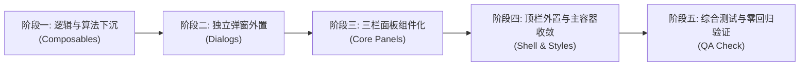

# AuditWorkbench 组件拆分与架构优化方案

> **文档标识**：ARCH-REFACTOR-01  
> **关联文件**：`web/src/views/AuditWorkbench.vue` (当前 3,198 行)  
> **适用版本**：Vue 3.x (Composition API, `<script setup>`), Pinia, Element Plus, Vite  
> **编制日期**：2026-10-12  

---

## 一、 背景与现状剖析

### 1.1 现状量化评估

当前日志审计工作台视图组件 [`web/src/views/AuditWorkbench.vue`](file:///d:/Document/GO/LogAuditorGo/web/src/views/AuditWorkbench.vue) 是全系统的核心主阵地。然而随着协议解析、知识库联动、高级筛选、多设备时序、根因分析 (RCA)、全屏沉浸式工作台 (Zen Mode) 等功能的快速迭代，该单文件代码急剧膨胀，目前已达 **3,198 行**。

代码构成分布如下：

| 代码区域 | 当前行数 | 占比 | 包含的核心业务内容 |
| :--- | :--- | :--- | :--- |
| **`<template>`** | 861 行 | 26.9% | 顶栏任务切换、视图模式导航、空任务引导、左栏日志流与工具条、中栏报文结构化解析、右栏知识库与 RCA、全屏居中弹窗、已分析文件清单弹窗、导入向导弹窗、冲突弹窗等 9 大区域 |
| **`<script setup>`** | 1,413 行 | 44.2% | 状态变量定义 (35+ 个)、计算属性 (15+ 个)、文本正则替换与高亮渲染函数 (8 个)、任务/文件/设备/日志/标签/RCA 数据拉取与 CRUD 方法 (30+ 个)、键盘快捷键监听与守卫 (120+ 行) |
| **`<style scoped>`** | 924 行 | 28.9% | 涉及工作台三栏布局、Zen Mode 自适应网格、参数卡片、知识库高亮、代码染色、弹窗网格与小胶囊标签等全量样式 |
| **总计** | **3,198 行** | 100% | **典型的超级“上帝组件 (God Component)”** |

```
+---------------------------------------------------------------------------------------------------------+
|                                    AuditWorkbench.vue (3,198 行)                                        |
+---------------------------------------------------------------------------------------------------------+
|  +---------------------------------------------------------------------------------------------------+  |
|  |  Template: 861 行 (9 个大型 UI 区域，4 个弹窗，2 个抽屉，2 个子视图)                                |  |
|  +---------------------------------------------------------------------------------------------------+  |
|  |  Script: 1,413 行 (35+ 状态变量，15+ 计算属性，30+ 业务方法，正则富文本引擎，全局键盘流)           |  |
|  +---------------------------------------------------------------------------------------------------+  |
|  |  Style: 924 行 (全工作台全局网格、弹窗、三栏、Zen 模式、参数卡片深度选择器)                       |  |
|  +---------------------------------------------------------------------------------------------------+  |
+---------------------------------------------------------------------------------------------------------+
```

### 1.2 核心痛点与维护瓶颈

1. **违背单一职责原则 (Single Responsibility Principle)**：
   - 既充当顶层路由页面容器（处理任务切换、路由参数、全屏状态）；
   - 又充当业务弹窗控制器（文件导入向导、文件列表查看、冲突检测、快捷打标）；
   - 兼职文本解析与参数渲染引擎（正则解析、占位符高亮替换、富文本拼接）；
   - 兼管底层事件总线与 DOM 快捷键侦听器（`j`/`k`/`f`/`Esc` 键盘穿梭与输入框守卫）。
2. **认知负荷超标与协作冲突严重**：
   - 开发人员排查一个局部的样式微调（如调整右栏知识库某行间距），需要在一个三千多行的文件中上下大幅度搜索定位；
   - 多人协同开发工作台不同功能（例如一人做 RCA 拓扑优化，一人做导入向导优化）时，极易产生 Git 冲突。
3. **状态透传链路冗长 (Prop Drilling) 与计算浪费**：
   - `renderedTemplateHtml`、`renderedKnowledgeHtml`、`enrichedParameters`、`kbParamDefs` 等在中栏、右栏以及居中全屏解析模态框 (`AuditLogDetailModal`) 中被重复引用或透传，造成数十行 Prop 参数透传链。
4. **单元测试与模块隔离性缺失**：
   - 诸如“模板参数高亮提取”、“占位符注入”、“快捷键拦截策略”等具备高纯度算法特征的核心逻辑深嵌于组件内部，无法单独抽离进行单元测试或模拟运行。

---

## 二、 重构目标与设计原则

### 2.1 重构量化目标

- **主入口大幅瘦身**：`AuditWorkbench.vue` 仅保留**顶层布局骨架、组件编排与路由联动**，单文件行数从 **3,198 行降低至 260 ~ 320 行**（代码量削减 **90% 以上**）。
- **粒度可控**：拆分出的每个专有子组件和 Composable 代码行数严格控制在 **100 ~ 350 行**，单文件只聚焦单一职责。
- **零行为回归 (Zero Regression)**：所有交互（键盘快捷键、全屏切换、筛选联动、数据轮询、打标及导入流程）保持 100% 行为一致与体验无缝兼容。

### 2.2 架构设计原则

1. **关注点分离 (Separation of Concerns)**：
   - **UI 呈现层**：下沉到专有组件（Components）；
   - **业务逻辑与副作用**：下沉到组合式函数（Composables）；
   - **全局与跨组件数据**：归集到 Pinia 存储库（Stores）；
   - **纯算法与文本处理**：下沉到工具函数（Utils）。
2. **高内聚、低耦合 (High Cohesion, Low Coupling)**：
   - 子组件内部的专用状态（如导入弹窗的步进状态、文件多选列表）由子组件或其专用 Composable 内部自闭环，不向上污染父容器；
   - 父子组件通过标准的 `v-model`、明确的 `props` 与语义化 `emits` 进行契约式通信。
3. **就近组织与可扩展性**：
   - 工作台特有的子组件收敛到 `web/src/components/workbench/` 独立子目录，避免平铺污染通用全局组件库。

---

## 三、 目标架构蓝图与目录规划

### 3.1 架构分层设计

```mermaid
flowchart TD
    subgraph ViewLayer["路由与视图容器 (Views)"]
        AW["AuditWorkbench.vue\n(主容器 ~280行)"]
    end

    subgraph ComponentLayer["工作台专有子组件 (components/workbench/)"]
        WBHeader["WorkbenchHeader.vue\n(顶栏与任务控制)"]
        WBNav["WorkbenchNavBar.vue\n(视图模式导航栏)"]
        WBEmpty["WorkbenchEmptyGuide.vue\n(空任务引导卡片)"]
        WBLogStream["WorkbenchLogStream.vue\n(左栏:日志流/卡片网格/分页)"]
        LogDetail["LogDetailPanel.vue\n(中栏:报文解析/参数卡片)"]
        LogKB["LogKnowledgePanel.vue\n(右栏:知识库/RCA排查)"]
        FilesDlg["TaskFilesDialog.vue\n(已导入文件管理弹窗)"]
        ImportDlg["TaskImportDialog.vue\n(日志导入向导弹窗)"]
    end

    subgraph ModalLayer["既有复用组件 (components/)"]
        DetailModal["AuditLogDetailModal.vue\n(沉浸式解析模态框)"]
        QuickTagModal["QuickTagModal.vue\n(快捷打标弹窗)"]
        AdvDrawer["AdvancedFilterDrawer.vue\n(高级筛选抽屉)"]
        SubViews["DeviceManager / MultiDeviceTimeline /\nRcaCenter / MultiDeviceReport"]
    end

    subgraph ComposableLayer["组合式业务逻辑 (composables/)"]
        UseFormatter["useLogDetailFormatter.js\n(参数提取/模板渲染/高亮)"]
        UseHotkeys["useWorkbenchHotkeys.js\n(全局键盘流/焦点守护/快捷键)"]
        UseImport["useTaskImport.js\n(导入状态机/路径选择/冲突检测)"]
        UseRcaPoll["useRcaPolling.js\n(RCA后台分析轮询与生命周期)"]
    end

    subgraph StoreLayer["共享状态 (stores/)"]
        TaskStore["useTaskStore"]
        FilterStore["useFilterStore"]
        UIStore["useWorkbenchUIStore"]
        TagStore["useTagStore"]
    end

    AW --> WBHeader
    AW --> WBNav
    AW --> WBEmpty
    AW --> WBLogStream
    AW --> LogDetail
    AW --> LogKB
    AW --> FilesDlg
    AW --> ImportDlg
    AW --> DetailModal
    AW --> QuickTagModal
    AW --> AdvDrawer
    AW --> SubViews

    WBHeader -.-> TaskStore
    WBLogStream -.-> FilterStore
    WBLogStream -.-> UIStore
    LogDetail --> UseFormatter
    LogKB --> UseFormatter
    DetailModal --> UseFormatter
    AW --> UseHotkeys
    ImportDlg --> UseImport
    AW --> UseRcaPoll
```



### 3.2 目录与文件清单设计

重构后的文件拓扑结构如下：

```
web/src/
├── views/
│   └── AuditWorkbench.vue                  # [重构瘦身] 主视图入口与骨架编排 (~280 行)
│
├── components/
│   ├── workbench/                          # [新增专有子目录] 工作台专属子组件
│   │   ├── WorkbenchHeader.vue             # 顶栏: 任务选择、新建/分析/导出按钮 (~140 行)
│   │   ├── WorkbenchNavBar.vue             # 导航条: 三栏/设备/时间线/RCA/报表模式切换 (~80 行)
│   │   ├── WorkbenchEmptyGuide.vue         # 空任务引导与快捷操作卡片 (~70 行)
│   │   ├── WorkbenchLogStream.vue          # 左栏: 筛选条、日志卡片流、Zen网格、分页 (~220 行)
│   │   ├── LogDetailPanel.vue              # 中栏: 结构化报文、参数卡片、模板代码高亮 (~260 行)
│   │   ├── LogKnowledgePanel.vue           # 右栏: 官方知识库指南、参数比对、COMMENT解析 (~240 行)
│   │   ├── TaskFilesDialog.vue             # 弹窗: 已分析文件清单与删除确认 (~150 行)
│   │   └── TaskImportDialog.vue            # 弹窗: 导入日志向导 (路径/粘贴/冲突拦截) (~260 行)
│   │
│   ├── AuditFilterBar.vue                  # [保持] 筛选控制面板
│   ├── AuditLogCard.vue                    # [保持] 单条日志卡片
│   ├── AuditLogDetailModal.vue             # [优化接入] 沉浸式居中解析模态框
│   ├── AdvancedFilterDrawer.vue            # [保持] 高级筛选抽屉
│   ├── QuickTagModal.vue                   # [保持] 快捷打标弹窗
│   └── ...                                 # 其余 DeviceManager, RcaGraph 等组件保持既有结构
│
├── composables/
│   ├── useLogDetailFormatter.js            # [新增] 提取变量、高亮占位符、富文本渲染算法 (~180 行)
│   ├── useWorkbenchHotkeys.js              # [新增] 键盘无障碍轮播、Esc分层退出、全屏守卫 (~120 行)
│   ├── useTaskImport.js                    # [新增] 日志导入生命周期、路径提取、冲突校验 (~130 行)
│   ├── useRcaPolling.js                    # [新增] RCA 异步分析状态自适应轮询与清理 (~70 行)
│   ├── useReanalyze.js                     # [既有] 任务重新分析编排
│   └── useRequest.js                       # [既有] 基础请求封装
```

---

## 四、 核心拆分子模块详细设计

### 4.1 逻辑层抽离 (Composables)

#### 4.1.1 `useLogDetailFormatter.js` —— 报文与知识库富文本格式化引擎

- **现状问题**：
  原 `AuditWorkbench.vue` 第 1046 ~ 1370 行中，包含了大量的纯算法计算（如 `parsedParameters`, `enrichedParameters`, `renderedTemplateHtml`, `renderContextualizedHtml`, `renderedKnowledgeHtml`, `kbParamDefs` 等），代码冗长且在 `AuditLogDetailModal.vue` 中再次重复透传。
- **职责**：
  接收选中的日志引用 `logRef` 和上下文注入开关 `contextualizeModeRef`，输出格式化后的衍生响应式数据与高亮 HTML。
- **接口设计**：
  ```javascript
  /**
   * 日志详情富文本格式化与参数计算
   * @param {import('vue').Ref<Object|null>} logRef 选中的日志对象
   * @param {import('vue').Ref<boolean>} contextualizeModeRef 是否开启现场参数注入模式
   */
  export function useLogDetailFormatter(logRef, contextualizeModeRef) {
    // 1. 结构化字段解析
    const parsedParameters = computed(() => { ... })
    // 2. 增强型参数列表 (合并现场值与知识库定义)
    const enrichedParameters = computed(() => { ... })
    // 3. 官方消息模板动态高亮渲染 HTML
    const renderedTemplateHtml = computed(() => { ... })
    // 4. 知识库排查步骤中动态注入现场参数后的 HTML (description, cause, solution)
    const renderedKnowledgeHtml = computed(() => { ... })
    // 5. 知识库参数定义列表
    const kbParamDefs = computed(() => { ... })
    // 6. 成功注入的匹配参数个数
    const matchedParamCount = computed(() => { ... })

    return {
      parsedParameters,
      enrichedParameters,
      renderedTemplateHtml,
      renderedKnowledgeHtml,
      kbParamDefs,
      matchedParamCount
    }
  }
  ```
- **核心收益**：
  - 彻底将 320 多行纯文本处理与正则表达式计算从 Vue 单文件中移出；
  - 中栏 `LogDetailPanel.vue`、右栏 `LogKnowledgePanel.vue` 和全屏弹窗 `AuditLogDetailModal.vue` 均可直接调用该 Composable，无需在主容器中维护并层层向下传递。

#### 4.1.2 `useWorkbenchHotkeys.js` —— 全局键盘审计流与快捷键守护

- **现状问题**：
  原 `AuditWorkbench.vue` 第 1882 ~ 1970 行，键盘监听包含输入法守卫、输入框焦点检测、层级弹窗优先级（模态框 > QuickLook > 全屏模式）等复杂逻辑，混在主组件中极为杂乱。
- **职责**：
  负责全局 `keydown`/`keyup` 监听、焦点守护、上下行日志轮播 (`j`/`k`/`↑`/`↓`)、全屏切换 (`f`/`Shift+F`)、空格预览与关闭 (`Esc`)。
- **接口设计**：
  ```javascript
  export function useWorkbenchHotkeys(options) {
    const {
      onPrevLog,
      onNextLog,
      onToggleFullscreen,
      onToggleBrowserFullscreen,
      onCloseActiveModal,
      onToggleQuickLook,
      canTriggerShortcuts // 可选的自定义守卫函数
    } = options

    // 内部实现 input/textarea/select 焦点判定与 repeat 过滤
    // 统一处理 Esc 层级分步退出
  }
  ```

#### 4.1.3 `useTaskImport.js` —— 导入向导业务流程与冲突拦截

- **职责**：
  封装服务器文件选择、手工文本导入、文件重名冲突检测、提交导入任务以及启动进度轮询。
- **接口设计**：
  ```javascript
  export function useTaskImport({ taskId, onImportSuccess }) {
    const showImportDialog = ref(false)
    const importTab = ref('server') // 'server' | 'text'
    const selectedPaths = ref([])
    const manualFileName = ref('')
    const manualLogText = ref('')
    const showConflictDialog = ref(false)
    const conflictingFileNames = ref([])

    const checkAndStartImport = async () => { ... }
    const executeImportWithConflict = async (skipConflicts) => { ... }
    const resetImportState = () => { ... }

    return {
      showImportDialog,
      importTab,
      selectedPaths,
      manualFileName,
      manualLogText,
      showConflictDialog,
      conflictingFileNames,
      checkAndStartImport,
      executeImportWithConflict,
      resetImportState
    }
  }
  ```

#### 4.1.4 `useRcaPolling.js` —— RCA 后台分析自适应轮询

- **职责**：
  针对大日志分析时后端 RCA 异步计算的特征，提供基于定时器的自适应状态检测、失败重试、自动停止与组件销毁前清理。

---

### 4.2 视图与组件层拆分 (Workbench Components)

#### 4.2.1 `WorkbenchHeader.vue` (顶栏与操作控制区)

- **行数预期**：约 140 行
- **职责**：
  - 展示当前任务下拉选单、任务状态徽标；
  - 触发新建任务、重新分析、导出多格式报表 (Excel/HTML/Markdown)；
  - 触发文件管理弹窗、导入日志向导；
  - 切换沉浸式/全屏工作台。
- **Props**：
  - `taskId`: 当前任务 ID
  - `taskList`: 任务列表数据
- **Emits**：
  - `update:taskId`: 切换选中任务
  - `create-task`: 打开新建任务对话框
  - `open-files`: 打开已导入文件清单
  - `open-import`: 打开导入日志向导
  - `reanalyze`: 触发重新分析
  - `export`: 触发报表导出

#### 4.2.2 `WorkbenchNavBar.vue` (视图模式导航栏)

- **行数预期**：约 80 行
- **职责**：
  - 渲染“三栏审计工作台”、“设备管理”、“多设备时序”、“根因分析 (RCA)”、“综合研判报表” 5 个视图模式的 Tab 导航条；
  - 展示协议联动事件数量等角标。
- **Props**：
  - `modelValue`: 当前选中的 `VIEW_MODE`
  - `rcaCount`: RCA 关联事件数
- **Emits**：
  - `update:modelValue`: 切换视图模式

#### 4.2.3 `WorkbenchLogStream.vue` (左栏：日志流与卡片网格)

- **行数预期**：约 220 行
- **职责**：
  - 集成 `AuditFilterBar`；
  - 工具条渲染：日志总数、高级筛选呼出按钮（带激活数量角标）；
  - 经典单列流与 Zen Mode 自适应多列卡片网格 (`--zen-cols`)；
  - 渲染 `AuditLogCard` 列表；
  - 分页组件（页码切换与单页容量切换 `50/100/200/500`）；
  - 空数据状态引导。
- **Props**：
  - `logRecords`: 日志列表数据
  - `totalLogs`: 日志总数
  - `loading`: 加载状态
  - `selectedLog`: 当前选中的日志
- **Emits**：
  - `select`: 单击选中日志
  - `hover-enter` / `hover-leave`: 悬浮事件（用于快捷预览）
  - `page-change` / `size-change`: 翻页与容量变更
  - `open-advanced-filter`: 打开高级筛选抽屉

#### 4.2.4 `LogDetailPanel.vue` (中栏：报文结构化解析面板)

- **行数预期**：约 260 行
- **职责**：
  - 顶部 RCA 协议联动提示条；
  - 面板标题与匹配度徽标；
  - 标签展示条：支持为当前日志添加已有标签、新建标签或移除标签；
  - 原始日志报文展示（支持一键复制）；
  - 事件中文智能总结高亮卡片；
  - 核心结构化字段（设备、级别、模块、时间等）；
  - 增强型参数提取网格 (`param-grid-enhanced`)，区分提取值、知识库类型与描述；
  - 官方模板占位符实例化展示；
  - RCA 根因事件警报卡片。
- **依赖与通信**：
  - 内部直接引入 `useLogDetailFormatter` 提取所需高亮 HTML；
  - 通过 `useTagStore` 完成打标交互。

#### 4.2.5 `LogKnowledgePanel.vue` (右栏：知识库解析与 RCA 拓扑)

- **行数预期**：约 240 行
- **职责**：
  - 知识库与 RCA 根因拓扑 Tab 切换；
  - 知识库头部卡片（模块、匹配层级、置信度、现场参数注入开关）；
  - 官方释义、可能原因、处理建议、潜在业务影响；
  - 知识库参数定义与实参比对表格；
  - `COMMENT` 纯注释日志专属解释卡片；
  - RCA 因果关系图谱 (`RcaGraph`) 与排查步骤指南。
- **依赖与通信**：
  - 内部同样复用 `useLogDetailFormatter`，保持中右两栏高亮逻辑的唯一数据源。

#### 4.2.6 `TaskFilesDialog.vue` (已分析文件清单管理弹窗)

- **行数预期**：约 150 行
- **职责**：
  - 独立承接原 `showFilesDialog` 对话框；
  - 文件总数、总行数、总存储大小汇总胶囊卡片；
  - 文件表格展现（文件名、大小、行数、导入时间）；
  - 单个文件删除逻辑与二次确认。

#### 4.2.7 `TaskImportDialog.vue` (日志导入向导弹窗)

- **行数预期**：约 260 行
- **职责**：
  - 独立承接原 `showImportDialog` 与 `showConflictDialog`；
  - 支持“服务器路径导入”与“直接粘贴文本导入”双 Tab；
  - 集成 `ServerPathPicker` 组件；
  - 待导入路径列表暂存与移除；
  - 导入前重名文件冲突拦截与覆盖/跳过策略确认；
  - 联动 `ImportProgressModal` 展示导入与分析进度。

---

### 4.3 重构后的 `AuditWorkbench.vue` 主容器形态

拆分完成后，`AuditWorkbench.vue` 将成为一个极度精简、逻辑一目了然的**协调者与布局容器**，核心结构示例如下：

```vue
<template>
  <div class="workbench-container" :class="{ 'is-immersive': workbenchUIStore.isImmersive }">
    <!-- 1. 顶栏操作区 -->
    <WorkbenchHeader
      v-show="!workbenchUIStore.isImmersive"
      v-model:task-id="taskStore.currentTaskId"
      :task-list="taskStore.taskList"
      @create-task="openNewTaskDialog"
      @open-files="taskFilesDialogRef?.open"
      @open-import="importDialogRef?.open"
      @reanalyze="handleReanalyze"
      @export="handleExport"
    />

    <!-- 2. 主视图模式导航栏 -->
    <WorkbenchNavBar
      v-if="taskStore.currentTaskId && !workbenchUIStore.isImmersive"
      v-model="currentViewMode"
      :rca-count="taskStore.rcaEvents.length"
    />

    <!-- 3. 多视图路由模式插槽 (设备管理 / 时间线 / RCA 全景 / 综合报表) -->
    <template v-if="taskStore.currentTaskId && currentViewMode !== VIEW_MODE.AUDIT">
      <DeviceManager v-if="currentViewMode === VIEW_MODE.DEVICES" />
      <MultiDeviceTimeline v-else-if="currentViewMode === VIEW_MODE.MULTI_TIMELINE" />
      <RcaCenter v-else-if="currentViewMode === VIEW_MODE.RCA" />
      <MultiDeviceReport v-else-if="currentViewMode === VIEW_MODE.MULTI_REPORT" />
    </template>

    <!-- 4. 核心三栏审计工作台 -->
    <div v-else class="workbench-main-viewport">
      <!-- 4.1 空任务引导 -->
      <WorkbenchEmptyGuide
        v-if="isTaskEmpty"
        @open-import="importDialogRef?.open"
      />

      <!-- 4.2 三栏实体内容 -->
      <div v-else class="workbench-body">
        <!-- 左栏：紧凑筛选 + 日志流 -->
        <WorkbenchLogStream
          :log-records="taskStore.logRecords"
          :total-logs="taskStore.logTotal"
          :selected-log="selectedLog"
          @select="selectLog"
          @open-advanced-filter="advFilterDrawerRef?.open"
        />

        <!-- 中栏：报文结构化解析 (非沉浸模式) -->
        <LogDetailPanel
          v-show="!workbenchUIStore.isImmersive"
          :log="selectedLog"
          :rca-events="taskStore.rcaEvents"
        />

        <!-- 右栏：官方知识库与 RCA 指南 (非沉浸模式) -->
        <LogKnowledgePanel
          v-show="!workbenchUIStore.isImmersive"
          :log="selectedLog"
          :matched-rca="matchedRCA"
        />
      </div>

      <!-- 5. 全屏沉浸式居中解析弹窗 -->
      <AuditLogDetailModal
        v-model:visible="showDetailModal"
        :log="selectedLog"
        :matched-rca="matchedRCA"
        @prev="handlePrevLog"
        @next="handleNextLog"
      />
    </div>

    <!-- 6. 业务弹窗群 (懒加载与按需呼出) -->
    <TaskFilesDialog ref="taskFilesDialogRef" />
    <TaskImportDialog ref="importDialogRef" />
    <AdvancedFilterDrawer ref="advFilterDrawerRef" />
    <QuickTagModal v-model:visible="showQuickTagModal" :log="quickTagLog" />
  </div>
</template>

<script setup>
// 仅保留顶层路由响应、Pinia Store 绑定、子组件 Ref 调度与全局快捷键挂载
import { ref, computed, onMounted } from 'vue'
import { useTaskStore } from '@/stores/task'
import { useWorkbenchUIStore } from '@/stores/workbenchUI'
import { useWorkbenchHotkeys } from '@/composables/useWorkbenchHotkeys'
// 导入各专属组件...

// 全局快捷键调度
useWorkbenchHotkeys({
  onPrevLog: handlePrevLog,
  onNextLog: handleNextLog,
  onToggleFullscreen: () => workbenchUIStore.toggleZenMode()
})
</script>

<style scoped>
/* 仅保留约 80 行主布局网格 Grid/Flex 容器样式，无任何特定面板的业务 CSS */
.workbench-container { display: flex; flex-direction: column; height: 100vh; overflow: hidden; }
.workbench-body { display: flex; flex: 1; min-height: 0; }
</style>
```

---

## 五、 实施路线图与阶段划分

为确保在快速迭代中不中断现有业务开发，并杜绝逻辑回归，重构采用**四阶段渐进式演进方案**：



### 阶段一：逻辑与纯算法下沉（低风险，无 DOM 变动）
1. 创建 [`web/src/composables/useLogDetailFormatter.js`](file:///d:/Document/GO/LogAuditorGo/web/src/composables/useLogDetailFormatter.js)：
   - 将原组件中 `parsedParameters`、`enrichedParameters`、`renderedTemplateHtml`、`renderedKnowledgeHtml`、`kbParamDefs` 迁移至此函数；
   - 编写针对参数高亮替换与 HTML 转义的测试用例验证；
   - 在 `AuditWorkbench.vue` 中直接引入使用，验证中栏/右栏/弹窗渲染正常。
2. 创建 [`web/src/composables/useWorkbenchHotkeys.js`](file:///d:/Document/GO/LogAuditorGo/web/src/composables/useWorkbenchHotkeys.js)：
   - 提取 `onGlobalKeydown`、焦点判定与快捷键分流逻辑，移出主组件。
3. 创建 [`web/src/composables/useRcaPolling.js`](file:///d:/Document/GO/LogAuditorGo/web/src/composables/useRcaPolling.js)：
   - 提取 RCA 轮询计时器与状态判定。

### 阶段二：弹窗与辅助对话框外置（界面解耦）
1. 新建目录 `web/src/components/workbench/`；
2. 提取 `TaskFilesDialog.vue`：
   - 迁出已导入文件列表展示、统计、删除逻辑及其对应样式；
3. 提取 `TaskImportDialog.vue`：
   - 迁出路径选择、文本导入、重名冲突检测、进度条触发及其对应样式；
4. 提取 `WorkbenchEmptyGuide.vue`：
   - 迁出未分析日志时的三张快捷引导卡片。

### 阶段三：三栏核心面板组件化（结构解耦）
1. 提取 `LogDetailPanel.vue` (中栏)：
   - 迁出报文展示、动态参数网格、标签添加/删除下拉菜单及对应样式；
2. 提取 `LogKnowledgePanel.vue` (右栏)：
   - 迁出知识库指南、参数定义比对、COMMENT 注释卡片、RCA 排查图谱及对应样式；
3. 提取 `WorkbenchLogStream.vue` (左栏)：
   - 迁出日志流顶部操作条、日志卡片网格列表、翻页与每页条数选择器。

### 阶段四：顶栏收敛与主容器瘦身（样式与骨架终结）
1. 提取 `WorkbenchHeader.vue` 与 `WorkbenchNavBar.vue`；
2. 在 `AuditWorkbench.vue` 中移除已下沉的全部 methods、computed、模板 DOM 和 800+ 行 scoped CSS；
3. 主组件仅保留对子组件的事件组装与布局网格样式，单文件最终控制在 280 行左右。

### 阶段五：全面回归测试与质量验收
1. 校验点详见第六节。

---

## 六、 风险把控与质量验收标准

### 6.1 关键风险与应对策略

| 风险类别 | 风险描述 | 应对防护措施 |
| :--- | :--- | :--- |
| **响应性丢失 (Reactivity Loss)** | 在向子组件传递选中的 `selectedLog` 或将 Composable 返回值解构时，可能破坏 Vue 3 响应式链条 | 1. 组合式函数传参一律传入 `Ref` 对象或使用 `toRefs` 传参；<br>2. 关键计算属性内部保持 `.value` 读取链路；<br>3. 避免在子组件内直接解构深层对象。 |
| **快捷键冲突与穿透** | 在抽屉或弹窗打开时，背景的快捷键可能误触发换页或全屏 | 1. `useWorkbenchHotkeys` 中严格校验当前最顶层激活的浮层优先级；<br>2. 在 `input`、`textarea` 聚焦以及输入法编辑时全局快捷键自动进入静默守卫。 |
| **组件样式隔离断裂** | 拆分到子组件后，原写在父级的部分全局或 `:deep()` 样式可能失效，导致布局跑偏 | 1. 拆分组件时将专属 CSS 完整迁移到对应子组件的 `<style scoped>`；<br>2. 涉及到弹窗（Teleport 到 body）的全局样式放入规范的专用 class 并在必要时使用 `:deep()` 精确匹配。 |
| **虚拟滚动/卡片滚动定位** | `scrollSelectedLogIntoView` 需要滚动列表容器，拆分后跨组件 ref 无法直接获取 DOM | 在 `WorkbenchLogStream.vue` 中暴露 `scrollToLog(logId)` 实例方法（使用 `defineExpose`），主组件通过组件实例 Ref 进行调用。 |

### 6.2 验收指标与验收用例清单

重构完成后需执行以下关键路径的验收验证：

- [ ] **代码行数指标**：`AuditWorkbench.vue` 行数 $\le 320$ 行，所有拆分子组件与 Composables 均 $\le 350$ 行。
- [ ] **构建体积与语法检查**：`npm run build` 成功无报错，无 ESLint 警告，无未使用的死代码。
- [ ] **任务切换与多视图测试**：
  - 切换任务后，文件数、设备数、日志流、RCA 状态全部实时刷新并自动同步；
  - 视图在“审计工作台”、“设备管理”、“时间线”、“RCA 全景”、“研判报告”之间无缝切换且状态保留。
- [ ] **日志排查与键盘审计流**：
  - 单击日志卡片，中栏、右栏同步展示结构化数据与知识库匹配；
  - 键盘 `j` / `k` 顺畅上下穿梭，选中的卡片自动滚动至可视视窗中央；
  - 按 `f` 键顺畅在“三栏模式”与“Zen Mode 沉浸网格”间切换；
  - 在全屏下按回车或点击弹出居中模态框，`Esc` 键能依次关闭模态框、退出全屏。
- [ ] **打标与标签管理**：
  - 中栏中添加标签、移除标签、新建标签操作正常，左栏卡片标签即时联动更新。
- [ ] **文件导入与冲突拦截**：
  - 从服务器路径选择日志导入能正常检测同名冲突；
  - 覆盖导入或跳过导入流程畅通，进度条弹窗正常轮询并展示导入阶段与耗时。

---

## 七、 收益总结对比

| 评估维度 | 重构前 (`AuditWorkbench.vue`) | 重构后 (组件化架构) | 提升效果 |
| :--- | :--- | :--- | :--- |
| **单文件行数** | 3,198 行 | **约 280 行** (主视图) | **单文件代码量削减 > 90%** |
| **平均模块行数** | 3,198 行 / 1 模块 | ~180 行 / 模块 (8 组件 + 4 Composables) | 模块粒度清晰，易于单屏阅读 |
| **代码可读性与职责** | 极度混合 (视图+弹窗+算法+全局事件) | 高度单一 (编排层、视图层、业务层、算法层清晰分界) | 降低认知负荷，新手可分钟级定位代码 |
| **协同开发冲突率** | 极高 (多人修改工作台任何功能必然冲突) | 极低 (各功能区物理文件隔离) | 团队开发效率大幅提升 |
| **复用性与可测试性** | 几乎无法独立复用或单测 | 算法与业务状态完全解耦为 Composables，天然支持自动化单测 | 质量保障能力显著增强 |
