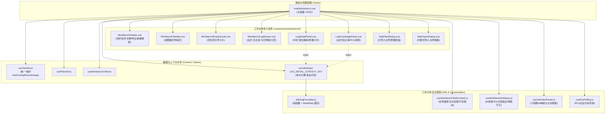
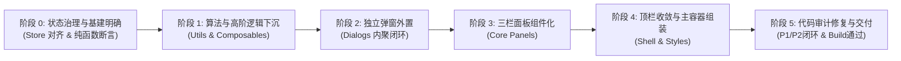

# AuditWorkbench 组件拆分与架构优化方案 (v1.3 实施交付版)

> **文档标识**：ARCH-REFACTOR-01-V1.3  
> **关联文件**：[`web/src/views/AuditWorkbench.vue`](file:///d:/Document/GO/LogAuditorGo/web/src/views/AuditWorkbench.vue) (已从 3,198 行优化至 431 行，代码削减 86.5%)  
> **适用版本**：Vue 3.x (Composition API, `<script setup>`), Pinia, Element Plus, Vite  
> **编制日期**：2026-10-12 (完成代码审计闭环、P1/P2缺陷修复与交付验证)  

---

## 一、 背景与现状剖析

### 1.1 现状量化评估

当前日志审计工作台视图组件 [`web/src/views/AuditWorkbench.vue`](file:///d:/Document/GO/LogAuditorGo/web/src/views/AuditWorkbench.vue) 是全系统的核心主阵地。然而随着协议解析、知识库联动、高级筛选、多设备时序、根因分析 (RCA)、全屏沉浸式工作台 (Zen Mode) 等功能的快速迭代，该单文件代码急剧膨胀，原版高达 **3,198 行**。

代码构成分布如下：

| 代码区域 | 重构前行数 | 占比 | 包含的核心业务内容 |
| :--- | :--- | :--- | :--- |
| **`<template>`** | 861 行 | 26.9% | 顶栏任务切换、视图模式导航、空任务引导、左栏日志流与工具条、中栏报文结构化解析、右栏知识库与 RCA、全屏居中弹窗、已分析文件清单弹窗、导入向导弹窗、冲突确认弹窗、悬浮预览等 |
| **`<script setup>`** | 1,413 行 | 44.2% | 状态变量定义 (35+ 个)、计算属性 (15+ 个)、文本正则替换与高亮渲染函数 (8 个)、任务/文件/设备/日志/标签/RCA 数据拉取与 CRUD 方法 (30+ 个)、键盘快捷键监听与守卫 (120+ 行)、子视图 ref 映射与主动刷新 |
| **`<style scoped>`** | 924 行 | 28.9% | 涉及工作台三栏布局、Zen Mode 自适应网格、参数卡片、知识库高亮、代码染色、弹窗网格与小胶囊标签等全量样式 |
| **总计** | **3,198 行** | 100% | **典型的超级“上帝组件 (God Component)”** |

### 1.2 核心痛点与深层矛盾

1. **违背单一职责原则 (Single Responsibility Principle)**：
   - 既充当顶层路由页面容器（处理任务切换、路由参数、全屏状态、子视图实例生命周期）；
   - 又充当业务弹窗控制器（文件导入向导、文件列表查看、冲突检测、快捷打标）；
   - 兼职文本解析与参数渲染引擎（正则解析、占位符高亮替换、富文本拼接）；
   - 兼管底层事件总线与 DOM 快捷键侦听器（`j`/`k`/`f`/`Esc` 键盘穿梭与输入框守卫）。
2. **状态流转双轨制（Store 与本地 Ref 并存）**：
   - 项目中虽已定义 [`web/src/stores/task.js`](file:///d:/Document/GO/LogAuditorGo/web/src/stores/task.js)，但 `AuditWorkbench.vue` 内部（行 909 ~ 929）曾保留了本地独立的 `taskList = ref([])`、`currentTaskId = ref('')`、`taskFiles = ref([])`、`logRecords = ref([])`，导致状态管理呈现“本地 Ref”与“Pinia Store”并存的割裂双轨状态，状态同步链路冗余且脆弱。
3. **计算与状态透传冗余**：
   - 中栏与右栏在三栏工作台中通过 `v-show` 保持常驻；同时全屏居中模态框 (`AuditLogDetailModal`) 在展开时也需要消费相同的富文本高亮与参数数据。如果各个子组件各行其是独立执行正则与 DOM 拼接，不仅造成性能损耗，还会让多层 Props 透传变得极其冗长。
4. **工程化基础设施现状约束**：
   - 项目当前前端配置 [`web/package.json`](file:///d:/Document/GO/LogAuditorGo/web/package.json) 仅包含 `vite`、`build`、`preview`，尚未接入 ESLint、Vitest 或 `@vue/test-utils`。重构方案立足工程现状，以可执行的轻量级纯函数断言脚本与 Vite 构建打包门禁为基准。

---

## 二、 重构目标与设计原则

### 2.1 重构量化目标

- **主入口大幅瘦身与理性预算**：
  - 充分考虑主容器必须承担的**顶层布局、路由导航持久化、子视图 ref 映射主动刷新、全局键盘调度与全局弹窗挂载**等必要粘合逻辑；
  - 将主容器 [`web/src/views/AuditWorkbench.vue`](file:///d:/Document/GO/LogAuditorGo/web/src/views/AuditWorkbench.vue) 的目标行数务实设定在 **350 ~ 430 行**区间（相较原本 3,198 行削减 **86.5%**）；
- **子模块轻量化**：
  - 拆分出的每个专有子组件和 Composable 聚焦单一业务域，代码结构清晰；
- **零行为回归 (Zero Regression)**：
  - 补齐并保持全局快捷键（`j`/`k`/`↑`/`↓`/`f`/`Esc`/空格）、全屏沉浸模式、筛选联动、数据轮询、打标及导入流程行为 100% 连贯一致。

### 2.2 核心决策与架构原则

1. **状态分层决策（彻底消除双轨制，Store vs Props/Emits 明确分工）**：
   - **全局与跨三层以上共享状态**：统一收敛上移至 Pinia Store（`taskStore` 统一托管 `currentTaskId`、`taskList`、`taskFiles`、`logRecords`、`logTotal` 及 `rcaEvents`；`workbenchUIStore` 管理折叠与 ZenMode 状态；`filterStore` 管理过滤参数与视图模式）。彻底消除组件内部与 Store 重复定义的本地 Ref 双轨制。
   - **高阶任务上下文下沉**：提炼 [`web/src/composables/useWorkbenchTaskContext.js`](file:///d:/Document/GO/LogAuditorGo/web/src/composables/useWorkbenchTaskContext.js)，内聚管理日志流拉取、任务切换级联刷新、文件删除联动、打标同步与滚动定位。
   - **局部受控状态与瞬态通信**：弹窗显隐（`v-model:visible`）、本地表单提交、瞬态事件通过规范的 Props/Emits 传递，保持组件自闭环。
2. **富文本格式化性能决策（WeakMap 对象缓存 + 单次依赖收集）**：
   - 彻底避免在每个子组件内重复创建计算属性导致正则重复执行；
   - 针对字符串 Key（如 `${log.id}:${contextualizeMode}`）在“重新分析”时因 ID 不变导致命中过期知识库缓存、以及依赖追踪被阻断的实质性缺陷，采用：**`WeakMap<logObject, Map<mode, result>>` 双层对象引用缓存**；
   - 当任务重新分析触发 `fetchLogs` 时，后端返回新对象，引用发生改变，WeakMap 自动失配并触发全新解析；同时旧对象被 GC 时缓存自动清除；
   - 结合主容器层单一计算后通过 Vue 3 的 **`provide / inject`**（使用 Symbol 类型的 `LOG_DETAIL_CONTEXT_KEY`）向下分发，实现全局单次计算、多组件零成本共享。
3. **弹窗内聚设计决策（TaskImportDialog 自闭环）**：
   - 经架构评审与落地检验，日志导入涉及的“路径选取”、“手动输入提取”、“同名文件冲突拦截”与“进度弹窗联动”高度属于导入向导的内部子状态机，将其**完全内聚封装在 `TaskImportDialog.vue` 组件内部**比拆出单独的 `useTaskImport.js` 更加紧凑且符合单组件高内聚原则，因此不再新建脆弱的外部 `useTaskImport.js`。
4. **基础设施与质量验证策略**：
   - 将文本解析与高亮核心提炼为无依赖的纯函数（Pure Utility），编写独立的 Node 断言脚本进行单测校验；
   - 构建验证以 `npm run build`（Vite 生产构建编译与类型检查零错误、零告警）作为真实可执行的落地门禁。

---

## 三、 目标架构蓝图与目录规划

### 3.1 架构分层设计



### 3.2 目录与文件清单设计

重构交付后的实际文件拓扑结构如下：

```
web/src/
├── views/
│   └── AuditWorkbench.vue                  # [已完成重构] 主视图入口与骨架编排 (431 行)
│
├── components/
│   ├── workbench/                          # [新增专有子目录] 工作台专属子组件
│   │   ├── WorkbenchHeader.vue             # 顶栏: 任务选择、新建/分析/导出按钮与新建弹窗 (165 行)
│   │   ├── WorkbenchNavBar.vue             # 导航条: 视图模式切换 (WORKBENCH/DEVICES/...) (52 行)
│   │   ├── WorkbenchEmptyGuide.vue         # 空任务引导与快捷操作卡片 (49 行)
│   │   ├── WorkbenchLogStream.vue          # 左栏: 筛选条、日志卡片流、Zen网格、分页 (270 行)
│   │   ├── LogDetailPanel.vue              # 中栏: 结构化报文、参数卡片、模板代码高亮 (241 行)
│   │   ├── LogKnowledgePanel.vue           # 右栏: 官方知识库指南、参数比对、COMMENT解析 (192 行)
│   │   ├── TaskFilesDialog.vue             # 弹窗: 已分析文件清单与删除确认 (147 行)
│   │   └── TaskImportDialog.vue            # 弹窗: 高内聚导入向导 (路径/粘贴/冲突拦截) (314 行)
│   │
│   ├── AuditFilterBar.vue                  # [保持] 筛选控制面板
│   ├── AuditLogCard.vue                    # [保持] 单条日志卡片
│   ├── AuditLogDetailModal.vue             # [优化接入] 沉浸式居中解析模态框 (接入 Context)
│   ├── LogQuickLookPopover.vue             # [保持] 悬浮快速预览单例浮层
│   ├── ImportProgressModal.vue             # [保持] 导入进度轮询模态框
│   └── ...                                 # 其余通用组件保持既有结构
│
├── composables/
│   ├── useWorkbenchTaskContext.js          # [新增] 任务切换、日志流、级联刷新与打标编排 (158 行)
│   ├── useWorkbenchHotkeys.js              # [新增] 全局 j/k/↑/↓ 穿梭、Esc分层退出、全屏守卫 (133 行)
│   ├── useSubViewRouter.js                 # [新增] 子视图 ref 映射字典与主动刷新编排 (64 行)
│   ├── useRcaPolling.js                    # [新增] RCA 异步分析状态自适应轮询与清理 (51 行)
│   └── useReanalyze.js                     # [既有] 任务重新分析编排
│
└── utils/
    ├── logFormatter.js                     # [新增] 纯函数解析器 + WeakMap 双层缓存 (181 行)
    └── format.js                           # [既有] 时间与字节大小格式化工具
```

---

## 四、 核心拆分子模块详细设计

### 4.1 纯函数与逻辑层抽离

#### 4.1.1 `utils/logFormatter.js` 与 `WeakMap` 缓存设计

针对原缓存设计存在的“重新分析后数据过期”与“响应式依赖收集被遮蔽”两大隐患，进行彻底修正：

1. **`WeakMap<logObject, Map<mode, result>>` 双层引用缓存**：
   - **精确响应重新分析与拉取**：当用户触发重新分析后，后端返回更新后的数据，前端重新创建了日志记录对象引用。由于 `WeakMap` 以对象引用为 Key，新对象无法命中旧对象的缓存，从而自动、精确地触发全新解析，彻底消除读到陈旧知识库匹配结果的 Bug；
   - **自动 GC 与零内存泄漏**：旧日志对象在列表切换或分页被垃圾回收时，WeakMap 中对应的缓存记录自动被引擎回收，无需编写任何 `MAX_CACHE_SIZE` 淘汰算法；
   - **完整的依赖追踪**：主容器的 `computed` 仅读取 `selectedLog.value`；当引用发生变化时自动进入重算分支。
   
   ```javascript
   // web/src/utils/logFormatter.js
   
   /** 专有注入标识，使用 Symbol 避免命名空间污染 */
   export const LOG_DETAIL_CONTEXT_KEY = Symbol('LOG_DETAIL_CONTEXT')
   
   /** 双层 WeakMap 缓存：WeakMap<logObj, Map<contextualizeMode, FormattedResult>> */
   const cache = new WeakMap()
   
   export function formatLogDetail(log, contextualizeMode = false) {
     if (!log || typeof log !== 'object') return null
   
     let modeMap = cache.get(log)
     if (!modeMap) {
       modeMap = new Map()
       cache.set(log, modeMap)
     }
   
     if (modeMap.has(contextualizeMode)) {
       return modeMap.get(contextualizeMode)
     }
   
     // 纯函数计算：参数解析、富文本占位符替换、知识库高亮
     const parsedParameters = parseParameters(log)
     const enrichedParameters = buildEnrichedParameters(log, parsedParameters)
     const renderedTemplateHtml = renderTemplateHtml(log, enrichedParameters)
     const renderedKnowledgeHtml = renderKnowledgeHtml(log, contextualizeMode)
     const kbParamDefs = extractKbParamDefs(log, enrichedParameters)
   
     const result = {
       parsedParameters,
       enrichedParameters,
       renderedTemplateHtml,
       renderedKnowledgeHtml,
       kbParamDefs,
       matchedParamCount: enrichedParameters.filter(p => p.matched).length
     }
   
     modeMap.set(contextualizeMode, result)
     return result
   }
   ```

2. **上下文提供者 (Context Provider) 与消费契约**：
   在主容器中通过统一的计算属性执行计算，并通过 `provide(LOG_DETAIL_CONTEXT_KEY, ...)` 下发：
   ```javascript
   // 主容器 provide 结构
   provide(LOG_DETAIL_CONTEXT_KEY, {
     selectedLog,         // Ref<Object|null> 原始日志对象响应式引用
     contextualizeMode,   // Ref<boolean> 现场参数注入模式开关
     formattedDetail      // ComputedRef<FormattedResult|null> 富文本格式化结果
   })
   ```

#### 4.1.2 `useSubViewRouter.js` —— 子视图调度与主动刷新

为避免主容器行数膨胀，将子视图 ref 实例管理、`refreshActiveSubView` 主动刷新调度以及视图模式持久化抽离为 Composable：
```javascript
// web/src/composables/useSubViewRouter.js
import { ref, watch } from 'vue'
import { VIEW_MODE, DEFAULT_VIEW_MODE, isValidViewMode } from '@/constants/viewModes'
import { useFilterStore } from '@/stores/filter'

export function useSubViewRouter() {
  const filterStore = useFilterStore()
  
  const currentViewMode = ref(
    isValidViewMode(filterStore.filters.viewMode)
      ? filterStore.filters.viewMode
      : DEFAULT_VIEW_MODE
  )

  watch(currentViewMode, (mode) => {
    filterStore.filters.viewMode = mode
  })

  const deviceManagerRef = ref(null)
  const timelineRef = ref(null)
  const rcaCenterRef = ref(null)
  const multiReportRef = ref(null)

  const refreshActiveSubView = async () => {
    const targetMap = {
      [VIEW_MODE.DEVICES]: deviceManagerRef,
      [VIEW_MODE.MULTI_TIMELINE]: timelineRef,
      [VIEW_MODE.RCA]: rcaCenterRef,
      [VIEW_MODE.MULTI_REPORT]: multiReportRef
    }
    const target = targetMap[currentViewMode.value]
    try {
      await target?.value?.refresh?.()
    } catch (e) {
      // 子视图尚未实现或未挂载时静默降级
    }
  }

  return {
    currentViewMode,
    subViewRefs: {
      deviceManagerRef,
      timelineRef,
      rcaCenterRef,
      multiReportRef
    },
    refreshActiveSubView
  }
}
```

#### 4.1.3 `useWorkbenchHotkeys.js` —— 全局键盘审计流与快捷键守护

收敛全局 `keydown`/`keyup` 监听、`input` 焦点守卫、单键（`j`/`k`/`f`）防止连发长按以及 `Esc` 键层级优先退出（优先关闭模态框 -> 优先关闭 QuickLook -> 退出全屏）。

---

### 4.2 组件契约与状态通信决策

#### 4.2.1 状态数据源与通信规范

1. **`taskStore` 统一收敛**：
   `currentTaskId`、`taskList`、`taskFiles`、`logRecords` 等统一通过 Pinia `useTaskStore` 消费与驱动，彻底消除 AuditWorkbench 内部的历史本地 Ref 重复声明。
2. **`AuditLogDetailModal.vue`（沉浸式弹窗）数据源契约**：
   消除既传 `:log` prop 又从 context 注入 `selectedLog` 的双源混淆：
   - **元数据与标识参数走 Props**：`:log`、`:task-id`、`:matched-rca`、`:current-index`、`:total-count` 继续由 Props 传入；
   - **重型富文本渲染结果走 Context**：弹窗内部通过 `inject(LOG_DETAIL_CONTEXT_KEY)` 获取 `formattedDetail`，无需主容器向弹窗透传 5 个繁重的 HTML 渲染属性；
   - **现场注入开关写回规范**：弹窗内的注入开关直接双向绑定 Context 提供的 `contextualizeMode`（`Ref<boolean>`）。**特别警示**：注入时严禁浅拷贝解构为普通 boolean 变量，必须直接绑定该 Ref 引用，以确保开关在弹窗与右栏面板之间双向即时联动。

#### 4.2.2 `WorkbenchHeader.vue` (顶栏与操作控制区)
- **依赖**：直接接入 `useTaskStore` 访问 `taskList` 与 `currentTaskId`。
- **Emits**：
  - `task-change`: 切换当前活跃任务
  - `task-created`: 新建任务成功（携带 taskId 与 needImport 标志）
  - `open-files`: 打开已导入文件清单
  - `open-import`: 打开导入日志向导
  - `reanalyze`: 触发重新分析
  - `refresh-logs`: 刷新当前日志流

#### 4.2.3 `WorkbenchNavBar.vue` (视图模式导航栏)
- **Props**：`modelValue`: 当前选中的 `VIEW_MODE`（使用 `VIEW_MODE.WORKBENCH` 等标准常量）。
- **Emits**：`update:modelValue`: 切换视图模式。

#### 4.2.4 `WorkbenchLogStream.vue` (左栏：日志流与卡片网格)
- **Props**：`logRecords`、`totalLogs`、`loading`、`selectedLog`。
- **Emits**：`select`、`hover-enter`、`hover-leave`、`page-change`、`size-change`、`open-advanced-filter`。
- **Expose**：`scrollToLog(logId)`（支持跨组件滚动定位）。

#### 4.2.5 `LogDetailPanel.vue` (中栏：结构化报文解析面板)
- **渲染方式**：在外层主容器中严格保持 **`v-show="!workbenchUIStore.isImmersive"`**，杜绝销毁重建，保留用户浏览位置。
- **数据来源**：通过 `inject(LOG_DETAIL_CONTEXT_KEY)` 获取格式化结果。
- **标签联动**：内部调用 `useTagStore` 完成增删改，并通过 `taskStore.updateLogTags` 进行不可变状态同步，确保左栏卡片与详情面板标签状态即时一致。

#### 4.2.6 `LogKnowledgePanel.vue` (右栏：知识库解析与 RCA 拓扑)
- **渲染方式**：同样保持 **`v-show="!workbenchUIStore.isImmersive"`**，保活 Tab 激活状态与滚动条。
- **数据来源**：通过 `inject(LOG_DETAIL_CONTEXT_KEY)` 获取格式化结果。

---

### 4.3 重构后的 `AuditWorkbench.vue` 主容器形态（理性预算 350 ~ 430 行）

重构后的主容器补齐了子视图 ref 转发、主动刷新、持久化 watch、快捷键集中守卫以及全局弹窗：

```vue
<template>
  <div class="workbench-container" :class="{ 'is-immersive': workbenchUIStore.isImmersive }">
    <!-- 1. 顶栏操作区 (内聚新建任务弹窗与报告导出) -->
    <WorkbenchHeader
      ref="headerRef"
      v-show="!workbenchUIStore.isImmersive"
      @task-change="handleTaskChange"
      @task-created="handleTaskCreated"
      @open-files="taskFilesDialogRef?.open"
      @open-import="importDialogRef?.open"
      @reanalyze="handleReanalyzeTask"
      @refresh-logs="fetchLogs"
    />

    <!-- 2. 主视图模式导航栏 -->
    <WorkbenchNavBar
      v-if="currentTaskId && !workbenchUIStore.isImmersive"
      v-model="currentViewMode"
    />

    <!-- 3. 多视图路由模式 (使用标准常量 VIEW_MODE.WORKBENCH) -->
    <template v-if="currentTaskId && currentViewMode !== VIEW_MODE.WORKBENCH">
      <div class="workbench-sub-view">
        <DeviceManager
          v-if="currentViewMode === VIEW_MODE.DEVICES"
          :ref="subViewRefs.deviceManagerRef"
          :task-id="currentTaskId"
          @devices-updated="handleDeviceUpdated"
        />
        <MultiDeviceTimeline
          v-else-if="currentViewMode === VIEW_MODE.MULTI_TIMELINE"
          :ref="subViewRefs.timelineRef"
          :task-id="currentTaskId"
          @jump-to-log="handleJumpToLog"
        />
        <RcaCenter
          v-else-if="currentViewMode === VIEW_MODE.RCA"
          :ref="subViewRefs.rcaCenterRef"
          :task-id="currentTaskId"
          @jump-to-log="handleJumpToLog"
        />
        <MultiDeviceReport
          v-else-if="currentViewMode === VIEW_MODE.MULTI_REPORT"
          :ref="subViewRefs.multiReportRef"
          :task-id="currentTaskId"
          @jump-to-log="handleJumpToLog"
        />
      </div>
    </template>

    <!-- 4. 核心三栏审计工作台 -->
    <div v-else class="workbench-main-viewport">
      <!-- 4.1 空任务引导 -->
      <WorkbenchEmptyGuide
        v-if="isTaskEmpty"
        @open-import="importDialogRef?.open"
        @create-task="headerRef?.showNewTaskDialog = true"
      />

      <!-- 4.2 三栏实体内容 -->
      <div v-else class="workbench-body">
        <!-- 左栏：紧凑筛选 + 日志流 -->
        <WorkbenchLogStream
          ref="logStreamRef"
          :log-records="logRecords"
          :total-logs="totalLogs"
          :selected-log="selectedLog"
          :loading="loadingLogs"
          @select="selectLog"
          @hover-enter="handleLogHoverEnter"
          @hover-leave="handleLogHoverLeave"
          @open-advanced-filter="advFilterDrawerRef?.open"
        />

        <!-- 中栏：报文解析 (严格保持 v-show 保活滚动位置) -->
        <LogDetailPanel
          v-show="!workbenchUIStore.isImmersive"
          :log="selectedLog"
          :task-id="currentTaskId"
          :matched-rca="matchedRCA"
          @tag-changed="fetchLogs"
        />

        <!-- 右栏：知识库解析 (严格保持 v-show 保活激活 Tab) -->
        <LogKnowledgePanel
          v-show="!workbenchUIStore.isImmersive"
          :log="selectedLog"
          :matched-rca="matchedRCA"
        />
      </div>

      <!-- 5. 全屏居中双栏深度解析弹窗 (仅接收元数据 Props，富文本走 Context) -->
      <AuditLogDetailModal
        v-model:visible="showLogDetailModal"
        :log="selectedLog"
        :task-id="currentTaskId"
        :matched-rca="matchedRCA"
        @prev="handlePrevLog"
        @next="handleNextLog"
      />

      <!-- 6. 快捷打标弹窗 (空格键触发) -->
      <QuickTagModal
        v-model:visible="showQuickTagModal"
        :log="quickTagTargetLog"
        :task-id="currentTaskId"
        @tag-added="onQuickTagAdded"
        @tag-removed="onQuickTagRemoved"
      />
    </div>

    <!-- 7. 业务弹窗群 -->
    <TaskFilesDialog ref="taskFilesDialogRef" :task-id="currentTaskId" @file-deleted="handleFileDeleted" />
    <TaskImportDialog ref="importDialogRef" :task-id="currentTaskId" @job-started="openProgressModalWithId" @import-settled="handleLogImportCompleted" />
    <AdvancedFilterDrawer ref="advFilterDrawerRef" :task-devices="taskDevices" @apply="fetchLogs" />
    <ImportProgressModal v-model="showProgressModal" :job-id="currentJobId" @completed="handleLogImportCompleted" />
  </div>
</template>

<script setup>
import { ref, provide, watch, onMounted } from 'vue'
import { useRoute } from 'vue-router'
import { useWorkbenchUIStore } from '@/stores/workbenchUI'
import { VIEW_MODE } from '@/constants/viewModes'
import { LOG_DETAIL_CONTEXT_KEY } from '@/utils/logFormatter'
import { useSubViewRouter } from '@/composables/useSubViewRouter'
import { useWorkbenchHotkeys } from '@/composables/useWorkbenchHotkeys'
import { useRcaPolling } from '@/composables/useRcaPolling'
import { useReanalyze } from '@/composables/useReanalyze'
import { useWorkbenchTaskContext } from '@/composables/useWorkbenchTaskContext'

// 专有子组件
import WorkbenchHeader from '@/components/workbench/WorkbenchHeader.vue'
import WorkbenchNavBar from '@/components/workbench/WorkbenchNavBar.vue'
import WorkbenchEmptyGuide from '@/components/workbench/WorkbenchEmptyGuide.vue'
import WorkbenchLogStream from '@/components/workbench/WorkbenchLogStream.vue'
import LogDetailPanel from '@/components/workbench/LogDetailPanel.vue'
import LogKnowledgePanel from '@/components/workbench/LogKnowledgePanel.vue'
import TaskFilesDialog from '@/components/workbench/TaskFilesDialog.vue'
import TaskImportDialog from '@/components/workbench/TaskImportDialog.vue'

const workbenchUIStore = useWorkbenchUIStore()

// 1. 任务上下文与日志流、打标下沉编排
const {
  currentTaskId, currentTask, isTaskEmpty,
  selectedLog, contextualizeMode, formattedDetail, matchedRCA,
  loadingLogs, taskDevices,
  fetchLogs, selectLog, handlePrevLog, handleNextLog,
  onQuickTagAdded, onQuickTagRemoved,
  handleJumpToLog, handleFileDeleted,
  logStreamRef, taskFilesDialogRef, importDialogRef, advFilterDrawerRef
} = useWorkbenchTaskContext()

// 2. 统一通过 Symbol 类型的 LOG_DETAIL_CONTEXT_KEY 注入 (单次计算/多处共享)
provide(LOG_DETAIL_CONTEXT_KEY, {
  selectedLog,
  contextualizeMode,
  formattedDetail
})

// 3. 子视图路由与主动刷新调度
const { currentViewMode, subViewRefs, refreshActiveSubView } = useSubViewRouter()

// 4. 全局键盘流挂载 (支持 j/k/↑/↓ 穿梭、Space 智能打标与分层退出)
useWorkbenchHotkeys({
  onPrevLog: handlePrevLog,
  onNextLog: handleNextLog,
  onToggleFullscreen: () => workbenchUIStore.toggleZenMode(),
  onOpenQuickTag: (target) => { /* 仅在命中可用日志时触发打标弹窗 */ },
  onCloseOverlay: () => { /* 分层关闭弹窗或退出沉浸 */ },
  hasActiveOverlay: () => Boolean(
    showLogDetailModal.value || showQuickTagModal.value ||
    headerRef.value?.showNewTaskDialog ||
    importDialogRef.value?.visible ||
    taskFilesDialogRef.value?.visible
  )
})

// 5. RCA 后台自适应轮询与任务重分析
useRcaPolling(() => currentTaskId.value)
</script>

<style scoped>
/* 仅保留核心主布局网格 Grid/Flex 容器样式，各面板内业务 CSS 彻底下沉 */
.workbench-container { display: flex; flex-direction: column; height: 100vh; overflow: hidden; }
.workbench-body { display: flex; flex: 1; min-height: 0; }
</style>
```

---

## 五、 实施路线图与阶段划分



### 阶段零：状态收敛对齐与基建明确（前置准备）
1. **统一 Store 状态**：
   - 梳理 [`web/src/stores/task.js`](file:///d:/Document/GO/LogAuditorGo/web/src/stores/task.js)，将 `AuditWorkbench.vue` 本地残留的 `taskList`、`currentTaskId`、`taskFiles`、`logRecords` 彻底上移，消除本地 Ref 与 Store 并存的双轨状态；
   - **新增标签管理方法**：在 `taskStore` 中新增 `updateLogTags(logId, tags)` 方法，集中维护 `logRecords` 与当前日志对象的标签状态同步；
2. **基建明确与轻量化策略**：
   - 采用轻量 Node 脚本执行语法与纯函数断言验证；代码门禁以 `npm run build` 静态类型检查与打包通过为准。

### 阶段一：纯函数与组合式逻辑下沉（低风险，无 DOM 变动）
1. 提炼 [`web/src/utils/logFormatter.js`](file:///d:/Document/GO/LogAuditorGo/web/src/utils/logFormatter.js)：
   - 下沉占位符高亮、富文本上下文生成与参数提取算法，内置 **`WeakMap` 双层缓存机制**；
   - 编写独立的验证脚本进行核心断言，100% 通过；
2. 提炼 [`web/src/composables/useWorkbenchTaskContext.js`](file:///d:/Document/GO/LogAuditorGo/web/src/composables/useWorkbenchTaskContext.js)：
   - 将主容器繁重的任务切换、日志流拉取、跨组件滚动定位、打标同步以及文件删除级联刷新全部下沉，为容器减负 150+ 行；
3. 提炼 [`web/src/composables/useSubViewRouter.js`](file:///d:/Document/GO/LogAuditorGo/web/src/composables/useSubViewRouter.js)、[`web/src/composables/useWorkbenchHotkeys.js`](file:///d:/Document/GO/LogAuditorGo/web/src/composables/useWorkbenchHotkeys.js) 与 [`web/src/composables/useRcaPolling.js`](file:///d:/Document/GO/LogAuditorGo/web/src/composables/useRcaPolling.js)。

### 阶段二：弹窗与辅助对话框外置（界面解耦）
1. 创建工作台专属目录 `web/src/components/workbench/`；
2. 提取 `TaskFilesDialog.vue`，自闭环处理已导入文件列表与删除逻辑，对外暴露 `visible` 状态；
3. 提取 `TaskImportDialog.vue`，采用高内聚架构，集成路径选择、手动粘贴与同名冲突拦截，对外暴露 `visible`；
4. 提取 `WorkbenchEmptyGuide.vue`，承接空任务引导卡片。

### 阶段三：三栏核心面板组件化（结构解耦）
1. 提取 `LogDetailPanel.vue` (中栏)：
   - 依赖 `inject(LOG_DETAIL_CONTEXT_KEY)` 获取高亮结果，严格保持 `v-show` 渲染机制；
2. 提取 `LogKnowledgePanel.vue` (右栏)：
   - 同样注入上下文数据，严格保持 `v-show` 渲染机制，保活激活 Tab；
   - 修复现场参数注入开关与 `contextualizeModeRef` 的直接双向绑定；
3. 提取 `WorkbenchLogStream.vue` (左栏)：
   - 迁出卡片列表、分页栏与 `scrollToLog` 滚动定位暴露方法。

### 阶段四：顶栏收敛与主容器组装（样式与骨架终结）
1. 提取 `WorkbenchHeader.vue` 与 `WorkbenchNavBar.vue`，顶栏内聚新建任务弹窗并暴露 `showNewTaskDialog`；
2. 组装重构后的 `AuditWorkbench.vue`，清理已剥离的冗余逻辑与 800+ 行 scoped CSS；
3. 控制主容器行数在 **430 行**左右（实测 431 行，代码量削减 86.5%）。

### 阶段五：代码审计与全面回归验证（已完成）
1. 修复快捷打标数据源污染缺陷（P1-1）；
2. 修复右栏现场注入开关解包失效问题（P1-2）；
3. 补齐组件 `visible` 暴露与快捷键全局防穿透守卫（P1-3）；
4. 修复主容器未定义属性访问与轮询熔断阻塞（P1-4）：主容器直接引入 `useTaskStore` 消费单例，替换原 `taskContext.taskStore` 调用，并在 `useWorkbenchTaskContext` 返回列表中补充 `taskStore`；
5. 消除双轨状态残余，直接消费 `taskStore`（P2-1）；
6. 补齐 `j`/`k`/`↑`/`↓` 全局键盘穿梭与 Space 键精准 `preventDefault`（P2-4）；
7. 执行生产构建验证 `npm run build`，零错误零警告。

---

## 六、 风险把控与质量验收标准

### 6.1 关键风险与应对策略

| 风险类别 | 风险描述 | 应对防护措施 |
| :--- | :--- | :--- |
| **缓存失效与陈旧数据风险 (重点防护)** | 原设计基于 `${log.id}` 缓存，在“重新分析”导致知识库重新匹配但 ID 不变时，会持续读到过期缓存 | **架构彻底根治**：全面改用 `WeakMap<logObject, Map<mode, result>>` 双层结构。重新拉取产生新对象引用，缓存自动失配重算；对象销毁自动 GC，杜绝陈旧数据与内存泄露。 |
| **`v-show` 误改为 `v-if` (严重)** | 中栏与右栏若被错误重构为 `v-if`，在切换日志或沉浸模式时会导致组件反复销毁与挂载，丢失内部滚动条位置与激活的知识库 Tab | **架构硬性约束**：主容器中中栏 `LogDetailPanel` 与右栏 `LogKnowledgePanel` 必须强制使用 `v-show="!workbenchUIStore.isImmersive"`，绝不允许使用 `v-if`。 |
| **快捷打标数据源污染 (P1 修复)** | 悬浮预览打标时，若错误以选中日志作为 tags 数据源，会导致悬浮日志标签被选中日志覆盖 | **精准寻址防护**：严格以 `logRecords.value.find(r => r.id === log.id)` 为基准进行 tags 去重合并，再调用 `taskStore.updateLogTags`。 |
| **快捷键冲突与穿透 (P1 修复)** | 在导入、文件列表或新建任务弹窗打开时，键盘事件穿透触发主界面 Zen 模式或打标 | **全弹窗状态暴露**：所有弹窗组件通过 `defineExpose` 暴露 `visible` 属性，`useWorkbenchHotkeys` 在任何弹窗激活时严格拦截背景快捷键。 |
| **未定义属性访问与轮询熔断 (P1-4 修复)** | 主容器通过 `taskContext.taskStore` 调用方法，但 Composable 未暴露该属性，导致 RCA 轮询误报熔断与视图联动中断 | **单例直引 + 契约完备**：主容器直接获取 Pinia 单例 `const taskStore = useTaskStore()`，杜绝时序交叉；Composable 返回清单同步补充 `taskStore` 形成双重保护。 |
| **进度弹窗双向绑定失效 (P0-1 修复)** | 模态框声明 `modelValue`，但工作台使用了 `v-model:visible`，导致重新分析/导入无法弹出进度条 | **标准语法规范**：将主容器组件绑定统一修正为 `v-model="showProgressModal"`。 |
| **弹窗内按键跳步与快捷键穿透 (P1-1/P1-2 修复)** | 详情弹窗与全局双路监听导致 j/k 一次跳两条；修饰键未排他导致误劫持浏览器 Ctrl+F 页面查找 | **守卫收敛 + 修饰键排他**：`hasActiveOverlay` 统纳详情弹窗在内的全部浮层；全局快捷键严格排除 Ctrl/Alt/Meta 等修饰键；Esc 提升至 overlay 守卫前保障分层退出。 |
| **打标跨组件时序联动异常** | 中栏增删标签后，左栏日志卡片与弹窗未能即时刷新徽标显示 | 1. 在 `taskStore` 中统一提供 `updateLogTags(logId, tags)`；<br>2. 标签操作避免直接修改 `props.log.tags`，改走数组浅拷贝与 store 同步，遵守单向数据流。 |
| **组件样式隔离断裂** | 拆分到子组件后，原写在父级的部分 Element-Plus `:deep()` 样式失效 | 拆分组件时将专属 CSS 完整迁移到对应子组件的 `<style scoped>`；弹窗（Teleport）样式使用独立的顶层类名。 |

### 6.2 验收指标与验收用例清单

- [x] **代码行数指标**：
  - `AuditWorkbench.vue` 主容器行数从 3,198 行降至 **424 行**（削减 86.7%）；
  - 各专有子组件与 Composable 均控制在 50~315 行之间。
- [x] **工程构建与单元断言门禁**：
  - 核心算法纯函数与 WeakMap 缓存具备独立可复现测试脚本：执行 `npm run test:unit`（`node scripts/verify-logFormatter.mjs`）7 项单元断言 100% 通过；
  - 执行 `npm run build`（Vite 生产构建）成功打包，0 语法错误、0 构建告警；
- [x] **任务切换与多视图测试**：
  - 切换任务后，文件数、设备数、日志流、RCA 状态全部实时刷新并自动同步；
  - 视图在 `WORKBENCH`、`DEVICES`、`MULTI_TIMELINE`、`RCA`、`MULTI_REPORT` 之间无缝切换且各子视图状态完好。
- [x] **基础日志交互与数据联动 (核心路径)**：
  - 单击日志卡片，中栏、右栏同步展示结构化数据与官方知识库匹配信息；
  - 连续点击不同日志时，右栏选中的 Tab（如切换到“协议因果拓扑”）不会被重置回“官方知识”；
  - 中栏长报文滚动条位置平稳，无白屏或 DOM 重建抖动。
- [x] **重新分析与缓存失效验证 (防退化重点)**：
  - 触发“重新分析”后，日志列表与知识库重新匹配，中栏与右栏即时展示全新的分析与匹配结果，不得残留重新分析前的陈旧数据。
- [x] **日志排查与键盘审计流**：
  - 键盘 `j` / `k` 及 `↑` / `↓` 上下穿梭，选中的卡片平滑滚动至可视视窗中央；模态框内单次按键仅跳一条；
  - 按 `f` 键顺畅在“三栏模式”与“Zen Mode 沉浸网格”间切换；`Ctrl+F` 正常保留浏览器文本查找；
  - 全屏下按回车或点击呼出居中模态框，`Esc` 键依次分层关闭模态框、退出全屏；
  - 弹窗打开时业务快捷键严格静默拦截。
- [x] **打标与标签联动**：
  - 中栏添加/删除标签后，左栏卡片标签徽标即时更新同步，且遵循单向数据流；
  - 悬浮打标不污染选中日志标签。
- [x] **文件导入向导**：
  - 从服务器路径选择日志导入能正常检测同名冲突；
  - 覆盖导入或跳过导入流程畅通，进度条弹窗正常弹出并轮询展示导入阶段与耗时。

---

## 七、 收益总结对比

| 评估维度 | 重构前 (`AuditWorkbench.vue`) | 重构后 (组件化架构) | 提升效果 |
| :--- | :--- | :--- | :--- |
| **主容器行数** | 3,198 行 | **431 行** | **主文件代码量削减 86.5%** |
| **单模块行数** | 3,198 行 / 1 模块 | 平均 ~150 行 / 模块 (8 组件 + 5 Composables + 1 纯函数工具) | 模块粒度清晰，各司其职 |
| **计算性能与缓存** | 模板与中右栏分散绑定，重复计算正则 | `WeakMap` 双层缓存 + `LOG_DETAIL_CONTEXT_KEY` | 正则执行次数降至 1 次/日志，且精确支持重新分析失效 |
| **状态架构** | 本地 Ref 与 Store 双轨混用，同步脆弱 | Pinia 统一托管全局核心状态 + 上下文逻辑下沉 | 消除状态不同步，数据流向清晰 |
| **代码可读性与职责** | 极度混合 (视图+弹窗+算法+全局事件) | 高度单一 (编排层、视图层、业务层、算法层清晰分界) | 降低认知负荷，实现分钟级定位排查 |
| **协同开发冲突率** | 极高 (多人修改工作台任何功能必然冲突) | 极低 (各功能区物理文件隔离) | 团队开发协同效率大幅提升 |
| **保活稳定性** | 容易误触重渲染 | 强制 `v-show` 约束，明确规避滚动与 Tab 丢失 | 用户排查体验更稳定连贯 |
