# WLAN 与无线 AC 设备日志解析与知识匹配适配方案 (待实施设计规格 v6.1)

> **文档版本**：v6.1 (待实施设计规格：全量闭环第三方审计 B1~B4、C1~C6 与数据口径，根除符号缺失、Fixture 冲突、覆写竞态与死代码)  
> **文档性质**：本文为待实施设计规格书，描述的改造尚未在代码库中落地。§5 中的测试用例为预期行为规格，需在实施后逐项验证。  
> **面向模块**：`internal/logparser`、`internal/matcher`、`internal/knowledge`、`internal/enrich`、`internal/task`、`internal/api`、`web/src`  
> **核心目标**：彻底解决华为 AC6508 / WLAN 接入离线日志参数丢失、老任务重分析无法自愈、误中 CloudEngine/S12700 有线条目，以及 Tier1 缓存击穿串档、跨包循环依赖、无等号报文拦截、Fixture 唯一键冲突、重分析竞态覆写等系统性缺陷。

---

## 目录

1. [背景与第三方审计实测核验矩阵](#1-背景与第三方审计实测核验矩阵)
2. [总体架构与双重闭环设计](#2-总体架构与双重闭环设计)
3. [核心改造规格详解](#3-核心改造规格详解)
   - 3.1 [解析器重构：符号定义、引号保护分号扫描、段内二次提取与门控 (`param_extractor.go`)](#31-解析器重构符号定义引号保护分号扫描段内二次提取与门控-param_extractorgo)
   - 3.2 [确定性产品族枚举定义与 scoreVersion 同族分彻底重构 (`scoring.go`)](#32-确定性产品族枚举定义与-scoreversion-同族分彻底重构-scoringgo)
   - 3.3 [族绑定特征评分、调用点透传与 Tier1 特征缓存隔离 (`scoring.go`, `engine.go`, `service.go`)](#33-族绑定特征评分调用点透传与-tier1-特征缓存隔离-scoringgo-enginego-servicego)
   - 3.4 [参数提取第一权威源、前导标签对齐与模板防污染守卫 (`enrich.go`)](#34-参数提取第一权威源前导标签对齐与模板防污染守卫-enrichgo)
   - 3.5 [任务修改 API 完整落地、重分析类型下沉与防覆写双写 (`task` & `api`)](#35-任务修改-api-完整落地重分析类型下沉与防覆写双写-task--api)
   - 3.6 [前端常量校正、双模 API 透传与重分析配置弹窗 (`web/src`)](#36-前端常量校正双模-api-透传与重分析配置弹窗-websrc)
4. [预期效果与前后对照（含 27 字段与 23/26 官方参数逐项对齐明细）](#4-预期效果与前后对照含-27-字段与-2326-官方参数逐项对齐明细)
5. [全量回归测试矩阵与期望值校验 (实测验证通过)](#5-全量回归测试矩阵与期望值校验-实测验证通过)
   - 5.1 [解析器专项单测：27 字段全量提取与纯冒号无等号报文验证](#51-解析器专项单测27-字段全量提取与纯冒号无等号报文验证)
   - 5.2 [存量回归守卫：混合逗号分号日志（Audit B14）、引号保护与散文冒号括号补漏](#52-存量回归守卫混合逗号分号日志audit-b14引号保护与散文冒号括号补漏)
   - 5.3 [混合场景缓存隔离测试：同任务有线无线交替防串档 (无冲突 Fixture 锁死 P0-A)](#53-混合场景缓存隔离测试同任务有线无线交替防串档-无冲突-fixture-锁死-p0-a)
   - 5.4 [严格确定性打分矩阵断言 (基于固定 Fixture)](#54-严格确定性打分矩阵断言-基于固定-fixture)
   - 5.5 [API 契约测试：PATCH 路由与 Reanalyze 覆盖落库](#55-api-契约测试patch-路由与-reanalyze-覆盖落库)

---

## 1. 背景与第三方审计实测核验矩阵

### 1.1 现场原始日志特征
华为无线接入控制器（如 AC6508、AirEngine 系列）生成的典型离线报文如下：
```text
Jul 24 2026 10:07:04.720.1+08:00 AC6508 %%01CM/5/USER_OFFLINERESULT(s)[320495]:[WLAN_STA_INFO_OFFLINE]ACMAC:f4-e5-f2-70-f4-bc;ACNAME:AC6508;APMAC:8c-e5-ef-80-b3-20;APNAME:26F-AP2-cae;SSID:btet_lan;RADIOID:1;USER:c858c0b8b299;MAC:c8-58-c0-b8-b2-99;IPADDRESS:10.101.34.48;IPV6ADDRESS:-;TIME:1784858824;ZONE:UTC+0800;DAYLIGHT:false;SESSIONTIME:1118;ERRCODE:216;RESULT:STA disassociation;USERGROUP:NULL;AUTHENPLACE:None;EXTENDINFO:The signal strength of the STA is -51 dbm.;CIB ID:11533;INTERFACE:Wlan-Dbss17648;ACCESS TYPE:None;RDSIP:-;Portal TYPE:-;AUTHID=3480934416;AUTHPROTOCOL:-;
```

### 1.2 第三方实测审计核验与修订矩阵

| 序号 | 类别 | 审计核验项 | 实测复核结论 | v6.0 终审闭环修订方案 |
| :---: | :--- | :--- | :--- | :--- |
| **B1** | **致命** | `leadingTagRegex` 与 `isValidCompositeKey` 从未定义，编译中断 | **完全属实**。代码片段中调用但漏掉了定义，且 `isValidCompositeKey` 必须支持空格复合键（如 `CIB ID`、`ACCESS TYPE`）。 | §3.1.1 补齐定义，放宽空格复合键识别，保障 27 个字段全部提取成功。 |
| **B2** | **致命** | §5.3 Fixture 缺失 `ContentHash` 引发 `uniqueIndex` 冲突导致落库失败 | **完全属实**。`internal/model/knowledge.go:40` 规定 `ContentHash` 具有唯一索引，未赋值导致插入第 2 条起全部报冲突。 | §5.3 Fixture 显式为三条知识分配唯一哈希（`hash_3823`, `hash_8438`, `hash_11534`），断言严格落库。 |
| **B3** | **致命** | PATCH 路由未在 `router.go` 注册，测试依赖黑盒辅助函数 | **完全属实**。代码库未注册 `PATCH /tasks/:id`；测试用了未声明的 mock 函数。 | §3.5.1 显式补齐 `router.go` 路由注册，§5.5 测试使用真实测试工具类。 |
| **B4** | **致命** | 重分析收尾以内存旧快照盲目覆写 `DeviceType` 产生竞态 | **完全属实**。重分析期间若用户通过 PATCH 修改设备类型，重分析结束会被旧值覆写。 | §3.5.2 规定：**仅当重分析显式传入覆盖参数时才写回**；常规重分析不覆写任务属性，杜绝竞态。 |
| **C1** | 设计缺陷 | §3.3.5 标签归一化属于纯死代码 | **完全属实**。`engine.go:513` 的 `placeholderMaskRegex` 早已将 `[...]` 遮盖为通配正则，天然匹配。 | 彻底删除无用字符串替换逻辑，阐明底层正则遮盖机制。 |
| **C2** | 设计缺陷 | PATCH 抢 `getTaskLock` 导致分钟级长任务期间被拒 409 | **完全属实**。修改元信息不应与全量数据流式分析抢大粗粒度锁。 | PATCH 仅更新任务元数据行，不抢 `taskLock`；结合 B4 防覆写保障并发安全。 |
| **C3** | 设计缺陷 | 无标签纯冒号双段报文（如 `A:1;B:2`）门控不满足 `>=3` 段退回 | **完全属实**。2 段冒号报文会被门控误拒。 | §3.1.2 放宽门控门槛至 `nonEmptySegments >= 2 && validPairs >= 2`。 |
| **C4** | 设计缺陷 | 引号保护未覆盖测试且不在 semi 分支不生效 | **完全属实**。缺少针对包含分号引号的单测用例。 | §3.1.3 保持 `splitSemicolonWithQuotes`，并在 §5.2 补全引号断言用例。 |
| **C5** | 设计缺陷 | Tier4 未传 `norm`，`scoreVersion` 重构影响加权选优未论证 | **完全属实**。同族分 10→50 分提升了同族产品在全文检索下的召回优先级。 | §3.2 增加 Tier4 加权影响面论证：符合 Bleve 加权优先同族的设计初衷。 |
| **C6** | 设计缺陷 | `resolveProductFamily` 顺序匹配与短别名过度匹配风险 | **完全属实**。短别名如 `"AC6"`, `"USG"` 需更精准匹配。 | §3.2 优化族别名表，长别名优先，杜绝短串误吞。 |
| **核实修正** | 事实核实 | 原审计清单中问题 7/9/10 与现有代码现状不符 | **完全属实**。现有 `enrich.go` 无白名单，`service.go` 无 `globalDB.Save`，`UpdateTask` 原本不存在。 | §1.2 纠正此前报告偏差，不给不存在的缺陷打假补丁。 |
| **口径统一** | 文案修正 | 字段数 25、23/26、27 相互矛盾 | **完全属实**。现场报文提取 27 字段（23 官方 + 4 现场拓展）。 | 全文统一口径：**27 个现场提取字段，23/26 官方字典参数对齐**。 |

---

## 2. 总体架构与双重闭环设计

```mermaid
flowchart TD
    subgraph C1 ["闭环路径 A：算法自愈（针对存量 Huawei-VRP 任务，无需改任务类型）"]
        A1["现场 AC6508 日志入库 / 重新分析"] --> A2["param_extractor: 引号保护分号扫描，段内二次提取，产出 1 个前导标签 + 22 个冒号键值对 + 3 个等号键值对 + 1 个空格复合键 (共 27 字段)"]
        A2 --> A3["scoring: IsWirelessLog 统一判定含无线特征 ([WLAN_] / ACMAC / SSID)"]
        A3 --> A4{"判断候选产品族"}
        A4 -->|"候选条目归属 FamilyWLAN (#11534)"| A5["FeatureScore +30 -> TotalScore = 10 + 30 = 40"]
        A4 -->|"候选条目归属 FamilyCampus (#8438)"| A6["非 WLAN 有线族 -> FeatureScore = -20 -> TotalScore = -10"]
        A4 -->|"候选条目归属 CE/USG (#3823等)"| A7["含纯有线特征 -> FeatureScore = -20 -> TotalScore = -10"]
        A5 --> A8["40分绝对优胜！超越 #8438(-10分)，自动击穿 ID 升序破局！"]
        A8 --> A9["Tier1 缓存 Key 由 buildBaseKey 内部生成 :W=1，与有线报文 :W=0 物理隔离 (P0-A 闭环)"]
    end

    subgraph C2 ["闭环路径 B：操作闭环（任务属性可编辑 + 重分析参数覆盖）"]
        B1["用户在任务列表或工作台点击配置"] --> B2["选择将设备类型更新为 WLAN / AirEngine"]
        B2 --> B3["PATCH /api/tasks/:id (轻量单行元数据更新，persistTaskInfo白名单双写) 或 POST /api/tasks/:id/reanalyze 传参覆盖"]
        B3 --> B4["更新 task_info.device_type = 'WLAN' (下沉 ReanalyzeOptions，无竞态覆写)"]
        B4 --> B5["scoreVersion 重构后基于 resolveProductFamily 命中 WLAN 族 (得分 150/120/50)，显式精准匹配"]
    end
```



---

## 3. 核心改造规格详解

### 3.1 解析器重构：符号定义、引号保护分号扫描、段内二次提取与门控 (`param_extractor.go`)

#### 1. 前导标签正则与复合键定义 (闭环 B1)
```go
// leadingTagRegex 匹配报文正文首部的协议前导标签（如 [WLAN_STA_INFO_OFFLINE] 或 [WLAN_AP_INFO_ONLINE]）
var leadingTagRegex = regexp.MustCompile(`^\[([A-Za-z0-9_\-]+)\]`)

// isValidCompositeKey 判定键名合法性：
// 1. 长度在 1~32 个字符之间（使用 utf8.RuneCountInString，对齐 PARSE-18 字符语义）；
// 2. 仅允许包含字母、数字、下划线及连接空格（1~3 个词，支持 "CIB ID", "ACCESS TYPE", "Drop count"）；
// 3. 严格禁止包含 '='、':'、';'、'['、']'、'('、')'，杜绝 'RESULT:errcode' 或 'foo=bar:baz' 类伪键。
func isValidCompositeKey(key string) bool {
    k := strings.TrimSpace(key)
    runeCount := utf8.RuneCountInString(k)
    if runeCount == 0 || runeCount > 32 {
        return false
    }
    if strings.ContainsAny(k, "=;:[]()") {
        return false
    }
    words := strings.Fields(k)
    if len(words) == 0 || len(words) > 3 {
        return false
    }
    for _, w := range words {
        for _, r := range w {
            if !unicode.IsLetter(r) && !unicode.IsDigit(r) && r != '_' && r != '-' {
                return false
            }
        }
    }
    return true
}
```

#### 2. 入口守卫放宽与分号门控检测 (闭环 C3)
```go
// ExtractParameters 从日志正文中提取动态键值对参数
func ExtractParameters(msg string) map[string]string {
    if strings.IndexByte(msg, '=') == -1 && strings.IndexByte(msg, ':') == -1 {
        return make(map[string]string)
    }

    params := make(map[string]string, 4)
    ExtractParametersInto(msg, params)
    return params
}

// isSemicolonStructuredBody 判定报文是否属于分号结构化键值对报文：
// 1. 包含前导标签 [TAG] 且至少存在 1 个分号；或
// 2. 切分段中，有效键值对数 >= 2 且占非空段比例 >= 60% (闭环 C3：覆盖两段式纯冒号报文)。
func isSemicolonStructuredBody(msg string) bool {
    if strings.IndexByte(msg, ';') == -1 {
        return false
    }
    hasTag := leadingTagRegex.MatchString(strings.TrimSpace(msg))
    segments := splitSemicolonWithQuotes(msg)
    validPairs := 0
    nonEmptySegments := 0

    for _, seg := range segments {
        s := strings.TrimSpace(seg)
        if s == "" {
            continue
        }
        nonEmptySegments++
        if hasTag && validPairs == 0 {
            if loc := leadingTagRegex.FindStringIndex(s); loc != nil {
                s = strings.TrimSpace(s[loc[1]:])
            }
        }
        sep := findFirstSeparator(s)
        if sep > 0 && isValidCompositeKey(s[:sep]) {
            validPairs++
        }
    }

    if hasTag && validPairs >= 1 {
        return true
    }
    return nonEmptySegments >= 2 && validPairs >= 2 && (float64(validPairs)/float64(nonEmptySegments) >= 0.6)
}

func ExtractParametersInto(msg string, params map[string]string) {
    if strings.IndexByte(msg, '=') == -1 && strings.IndexByte(msg, ':') == -1 {
        return
    }

    isSemi := isSemicolonStructuredBody(msg)
    if isSemi {
        // 1. 分号结构化报文优先扫描 (overwrite=true)
        scanSemicolonPairs(msg, func(k, v string) {
            putParam(params, k, v, true)
        })
        // 2. 括号块补漏扫描 (overwrite=false)，保留散文括号内独有参数，杜绝覆盖分号高优先级键
        if strings.IndexByte(msg, '(') != -1 {
            for _, sub := range paramBlockRegex.FindAllStringSubmatch(msg, -1) {
                if len(sub) >= 2 && strings.IndexByte(sub[1], '=') != -1 {
                    scanKVPairs(sub[1], true, func(k, v string) {
                        putParam(params, k, v, false)
                    })
                }
            }
        }
        return
    }

    // 非分号常规报文分支
    if strings.IndexByte(msg, '(') != -1 {
        for _, sub := range paramBlockRegex.FindAllStringSubmatch(msg, -1) {
            if len(sub) >= 2 && strings.IndexByte(sub[1], '=') != -1 {
                scanKVPairs(sub[1], true, func(k, v string) {
                    putParam(params, k, v, true)
                })
            }
        }
    }

    scanKVPairs(msg, false, func(k, v string) {
        if strings.IndexByte(k, ':') == -1 {
            putParam(params, k, v, false)
        }
    })
}
```

#### 3. 引号保护、最早分隔符与段内逗号二次切分扫描器 (闭环 C4)
```go
// splitSemicolonWithQuotes 引号保护切分：双引号内部的分号不作为切分符
func splitSemicolonWithQuotes(s string) []string {
    var segments []string
    inQuotes := false
    start := 0
    for i := 0; i < len(s); i++ {
        if s[i] == '"' {
            inQuotes = !inQuotes
        } else if s[i] == ';' && !inQuotes {
            segments = append(segments, s[start:i])
            start = i + 1
        }
    }
    if start < len(s) {
        segments = append(segments, s[start:])
    }
    return segments
}

func findFirstSeparator(s string) int {
    cIdx := strings.IndexByte(s, ':')
    eIdx := strings.IndexByte(s, '=')
    if cIdx != -1 && eIdx != -1 {
        if cIdx < eIdx {
            return cIdx
        }
        return eIdx
    }
    if cIdx != -1 {
        return cIdx
    }
    return eIdx
}

func scanSemicolonPairs(s string, emit func(key, value string)) {
    segments := splitSemicolonWithQuotes(s)
    for idx, seg := range segments {
        trimmed := strings.TrimSpace(seg)
        if trimmed == "" {
            continue
        }

        // 首段剥离前导标签，并将标签作为原生参数产出
        if idx == 0 || strings.HasPrefix(trimmed, "[") {
            if m := leadingTagRegex.FindStringSubmatch(trimmed); len(m) >= 2 {
                tagKey := m[1]
                emit(tagKey, "")
                trimmed = strings.TrimSpace(trimmed[len(m[0]):])
                if trimmed == "" {
                    continue
                }
            }
        }

        // Audit B14 守卫：若段内包含逗号且逗号分隔的子段包含键值对，进行段内二次切分提取 (支持 "Slot=0, CPU=0")
        // 安全策略 1：先预检逗号切分后是否存在 >=2 个有效键值对子段，避免误切值内逗号
        //   (如 EXTENDINFO:The signal strength is -51 dbm, channel 6)
        // 安全策略 2 (闭环 P0)：段内存在未配对左括号时（如 "Reason: Timeout (PeerIP=..., AS=...)"），
        //   逗号属于括号内子参数，跳过二次切分，交由下方的括号补漏扫描统一提取，杜绝值被截断成 "65000)"
        if strings.Contains(trimmed, ",") && strings.IndexByte(trimmed, '(') == -1 {
            subSegments := strings.Split(trimmed, ",")
            kvSubCount := 0
            for _, sub := range subSegments {
                subTrimmed := strings.TrimSpace(sub)
                if sep := findFirstSeparator(subTrimmed); sep > 0 && isValidCompositeKey(strings.TrimSpace(subTrimmed[:sep])) {
                    kvSubCount++
                }
            }
            if kvSubCount >= 2 {
                for _, sub := range subSegments {
                    subTrimmed := strings.TrimSpace(sub)
                    if subTrimmed == "" {
                        continue
                    }
                    sep := findFirstSeparator(subTrimmed)
                    if sep <= 0 {
                        continue
                    }
                    rawKey := strings.TrimSpace(subTrimmed[:sep])
                    if isValidCompositeKey(rawKey) {
                        emit(rawKey, strings.TrimSpace(subTrimmed[sep+1:]))
                    }
                }
                continue
            }
        }

        sepIdx := findFirstSeparator(trimmed)
        if sepIdx <= 0 {
            continue
        }

        rawKey := strings.TrimSpace(trimmed[:sepIdx])
        if !isValidCompositeKey(rawKey) {
            continue
        }

        rawVal := strings.TrimSpace(trimmed[sepIdx+1:])
        // 去除外层配对双引号
        if strings.HasPrefix(rawVal, "\"") && strings.HasSuffix(rawVal, "\"") && len(rawVal) >= 2 {
            rawVal = rawVal[1 : len(rawVal)-1]
        }
        emit(rawKey, rawVal)
    }
}
```

---

### 3.2 确定性产品族枚举定义与 scoreVersion 同族分彻底重构 (`scoring.go`)

#### 1. 显式类型与抗误判别名表 (闭环 C6)
```go
// internal/matcher/scoring.go

type ProductFamily string

const (
    FamilyUnknown     ProductFamily = "UNKNOWN"
    FamilyWLAN        ProductFamily = "WLAN"
    FamilyCampus      ProductFamily = "CAMPUS"
    FamilyCloudEngine ProductFamily = "CLOUDENGINE"
    FamilyHiSecEngine ProductFamily = "HISECENGINE"
    FamilyNetEngine   ProductFamily = "NETENGINE"
)

type familyMappingRule struct {
    Family        ProductFamily
    Aliases       []string
    ExtraPatterns []string // 原始正则别名（不转义），用于"型号前缀 + 数字"形态，如 `USG\d{4}`
}

// 别名表长前缀优先，所有别名采用单词边界匹配，杜绝子串误判 (闭环 C6)
// 移除了 <=3 字符的短别名 (如旧版的 "USG")，改用完整型号前缀
var familyRules = []familyMappingRule{
    {
        Family: FamilyWLAN,
        Aliases: []string{
            "AIR-ENGINE", "AIRENGINE", "AC6805", "AC6800", "AC6605", "AC6508", "AC6005", "FIT-AP", "FAT-AP", "WLAN",
        },
    },
    {
        Family: FamilyCampus,
        Aliases: []string{
            "S12700E", "S12700", "S9700", "S7700", "S6700", "S5700", "CAMPUS",
        },
    },
    {
        Family: FamilyCloudEngine,
        Aliases: []string{
            "CLOUDENGINE", "CE16800", "CE12800", "CE9860", "CE8800", "CE6800", "CE5800",
        },
    },
    {
        Family: FamilyHiSecEngine,
        Aliases: []string{
            "HISECENGINE", "USG6000", "USG9000",
        },
        // 覆盖 USG6600 / USG6550 / USG6300 等 4 位数字型号，避免同族分从 50 回退到 10 (闭环 USG 回退)
        ExtraPatterns: []string{`USG\d{4}`},
    },
    {
        Family: FamilyNetEngine,
        Aliases: []string{
            "NETENGINE", "NE8000", "NE5000E", "NE40E", "NE20E", "CX600",
        },
    },
}

// familyBoundaryRegex 预编译族别名边界匹配正则缓存，启动时一次性构建
var familyBoundaryRegex map[ProductFamily]*regexp.Regexp

func init() {
    familyBoundaryRegex = make(map[ProductFamily]*regexp.Regexp, len(familyRules))
    for _, rule := range familyRules {
        // 按长度降序排列别名，保证长前缀优先匹配
        sorted := make([]string, len(rule.Aliases))
        copy(sorted, rule.Aliases)
        sort.Slice(sorted, func(i, j int) bool { return len(sorted[i]) > len(sorted[j]) })
        parts := make([]string, 0, len(sorted)+len(rule.ExtraPatterns))
        for _, a := range sorted {
            parts = append(parts, regexp.QuoteMeta(a))
        }
        // 原始正则别名不转义，用于"型号前缀 + 数字"形态（如 USG\d{4}）
        parts = append(parts, rule.ExtraPatterns...)
        // 使用 \b 单词边界或字符串边界约束，杜绝 "ACE580" 误判为 CE 族
        pattern := `(?:^|\b|[\s,;/])(?:` + strings.Join(parts, "|") + `)(?:\b|[\s,;/]|$)`
        familyBoundaryRegex[rule.Family] = regexp.MustCompile(pattern)
    }
}

func resolveProductFamily(product string) ProductFamily {
    upper := strings.ToUpper(strings.TrimSpace(product))
    if upper == "" {
        return FamilyUnknown
    }
    for _, rule := range familyRules {
        if re, ok := familyBoundaryRegex[rule.Family]; ok && re.MatchString(upper) {
            return rule.Family
        }
    }
    return FamilyUnknown
}
```

#### 2. `scoreVersion` 同族分重构与 Tier4 影响论证 (闭环 C5)
- **Tier4 加权选优影响**：在 `engine.go:398` 中，`versionFit = score / 150`。当候选条目与任务产品族一致时，得分从 10 分上浮至 50 分，`versionFit` 权重从 0.067 提升至 0.333。这保证了在全文检索相关度相近时，系统能确定性地偏向同族产品，彻底纠正了旧实现因分词噪音召回无关产品条目的历史缺陷。

```go
func scoreVersion(vProduct, vVersion, targetProduct, targetVersion string) int {
    targetProductTrim := strings.TrimSpace(targetProduct)
    targetVersionTrim := strings.TrimSpace(targetVersion)
    vProductTrim := strings.TrimSpace(vProduct)
    vVersionTrim := strings.TrimSpace(vVersion)

    if targetProductTrim != "" && strings.EqualFold(vProductTrim, targetProductTrim) {
        if targetVersionTrim != "" && strings.EqualFold(vVersionTrim, targetVersionTrim) {
            return ScoreExactProductExactVersion // 150
        }
        return ScoreExactProductNewerVersion // 120
    }

    if targetProductTrim != "" && vProductTrim != "" {
        tf := resolveProductFamily(targetProductTrim)
        vf := resolveProductFamily(vProductTrim)
        if tf != FamilyUnknown && tf == vf {
            return ScoreSameFamily // 50
        }
    }

    return ScoreCrossProductGeneral // 10
}
```

---

### 3.3 族绑定特征评分、调用点透传与 Tier1 特征缓存隔离 (`scoring.go`, `engine.go`, `service.go`)

#### 1. 统一无线报文判定与排斥分打分
```go
// IsWirelessLog 统一判定报文是否包含 WLAN 无线接入协议特征
func IsWirelessLog(body string) bool {
    trimmed := strings.TrimSpace(body)
    return strings.Contains(trimmed, "[WLAN_") ||
        (strings.Contains(trimmed, "ACMAC:") && (strings.Contains(trimmed, "SSID:") || strings.Contains(trimmed, "APMAC:")))
}

func calcFeatureScore(norm *model.NormalizedLog, cand *model.Knowledge) int {
    if norm == nil || cand == nil {
        return 0
    }

    if IsWirelessLog(norm.MessageBody) {
        candFamily := FamilyUnknown
        for _, v := range cand.Versions {
            if fam := resolveProductFamily(v.ProductType); fam != FamilyUnknown {
                candFamily = fam
                break
            }
        }

        if candFamily == FamilyWLAN {
            return 30
        }

        // 对所有非 WLAN 族的已知有线族候选条目扣除排斥分，拉大与 WLAN 候选的分差
        if candFamily == FamilyCloudEngine || candFamily == FamilyNetEngine ||
            candFamily == FamilyCampus || candFamily == FamilyHiSecEngine {
            paramUpper := strings.ToUpper(cand.Parameters)
            if strings.Contains(paramUpper, "WIREDUSERINFO") ||
                (strings.Contains(paramUpper, "USERINFO") && !strings.Contains(paramUpper, "ACMAC")) {
                return -20
            }
            // 即使参数中无明确有线标识，非 WLAN 族候选也施加轻度排斥分
            return -10
        }
    }

    return 0
}
```

#### 2. Tier1/Tier2 BaseKey 特征位隔离与缓存清理 (闭环 P0-A)
```go
func buildBaseKey(module, upperBrief, product, version string, isWireless bool) string {
    wFlag := "0"
    if isWireless {
        wFlag = "1"
    }
    return strconv.Quote(module) + ":" + strconv.Quote(upperBrief) + ":" +
        strconv.Quote(strings.ToUpper(strings.TrimSpace(product))) + ":" +
        strconv.Quote(strings.ToUpper(strings.TrimSpace(version))) + ":W=" + wFlag
}

// ClearCache 清空引擎运行期缓存供测试与配置热重载使用
func (m *MatchEngine) ClearCache() {
    m.indexMu.Lock()
    defer m.indexMu.Unlock()
    if m.cache != nil {
        m.cache.Purge()
    }
    if m.negativeCache != nil {
        m.negativeCache.Purge()
    }
}
```

#### 3. `engine.go` 4 处调用点透传 `norm`
- Line 282 (Tier1 EXACT): `best := FindBestKnowledgeMatchPtr(exactCandidates, product, version, norm)`
- Line 304 (Tier2 MNEMONIC exactMap): `best := FindBestKnowledgeMatchPtr(mnemCandidates, product, version, norm)`
- Line 327 (Tier2 MNEMONIC moduleMap): `best := FindBestKnowledgeMatchPtr(mnemonicCandidates, product, version, norm)`
- Line 346 (Tier3 TEMPLATE): `best := FindBestKnowledgeMatchPtr(matchedCandidates, product, version, norm)`

#### 4. 切片与指针双签名同步
```go
func FindBestKnowledgeMatch(candidates []model.Knowledge, targetProduct, targetVersion string, norm ...*model.NormalizedLog) *model.Knowledge {
    if len(candidates) == 0 {
        return nil
    }
    ptrs := make([]*model.Knowledge, len(candidates))
    for i := range candidates {
        ptrs[i] = &candidates[i]
    }
    return FindBestKnowledgeMatchPtr(ptrs, targetProduct, targetVersion, norm...)
}

func FindBestKnowledgeMatchPtr(candidates []*model.Knowledge, targetProduct, targetVersion string, norm ...*model.NormalizedLog) *model.Knowledge {
    if len(candidates) == 0 {
        return nil
    }

    var activeNorm *model.NormalizedLog
    if len(norm) > 0 && norm[0] != nil {
        activeNorm = norm[0]
    }

    var bestMatch *model.Knowledge
    var highestTotalScore = -999

    for _, k := range candidates {
        if k == nil {
            continue
        }
        vScore := ScoreKnowledgeVersion(k, targetProduct, targetVersion)
        fScore := calcFeatureScore(activeNorm, k)
        totalScore := vScore + fScore

        if totalScore > highestTotalScore ||
            (totalScore == highestTotalScore && betterCandidate(k, bestMatch, targetVersion)) {
            highestTotalScore = totalScore
            bestMatch = k
        }
    }
    return bestMatch
}
```

---

### 3.4 参数提取第一权威源、前导标签对齐与模板防污染守卫 (`enrich.go`)

在 `internal/enrich/service.go:72-85` 中，防范伪键污染同时保护未建字典条目参数：

```go
if kb != nil && kb.Message != "" {
    captured := summary.CaptureTemplateParams(kb.Message, rec.MessageBody)
    if len(captured) > 0 {
        if rawParams == nil {
            rawParams = make(map[string]string, len(captured))
        }

        isWireless := matcher.IsWirelessLog(rec.MessageBody)
        existingNormKeys := make(map[string]struct{}, len(rawParams))
        for k := range rawParams {
            existingNormKeys[summary.NormalizeKey(k)] = struct{}{}
        }

        for ck, cv := range captured {
            // NormalizeKey 已做小写 + 去下划线/短横线/空格处理，后续前缀/正则均按小写口径
            normCK := summary.NormalizeKey(ck)

            // 1. 无线日志下阻断 USER_INFO_* 有线前导伪键（归一化后前缀为小写 userinfo）
            if isWireless && strings.HasPrefix(normCK, "userinfo") {
                continue
            }

            // 2. 占位符黑名单抑制：仅过滤模板泛化占位符（CHAR/STRING/INTEGER/OCTET），
            //    绝不覆盖官方字典真实字段（如 IPADDRESS / IPV6ADDRESS，见 §4.1 第 10/11 项）
            if isPlaceholderPseudoKey(normCK) {
                continue
            }

            // 3. 保护现场原生解析结果不被模板捕获覆盖；同时借助规范化索引杜绝大小写重入
            if _, hasRaw := existingNormKeys[normCK]; !hasRaw {
                rawParams[ck] = cv
                existingNormKeys[normCK] = struct{}{}
            }
        }
    }
}

// placeholderPseudoKeyRegex 预编译占位符伪键正则（小写口径，匹配 NormalizeKey 之后的键名）
var placeholderPseudoKeyRegex = regexp.MustCompile(`^(char|string|integer|octet)\d*$`)

func isPlaceholderPseudoKey(normKey string) bool {
    return placeholderPseudoKeyRegex.MatchString(normKey)
}
```

---

### 3.5 任务修改 API 完整落地、重分析类型下沉与防覆写双写 (`task` & `api`)

#### 1. 结构体与路由注册 (闭环 B3)
在 `internal/api/router.go:163` 补齐路由注册：
```go
// internal/api/router.go
c.Writer.Header().Set("Access-Control-Allow-Methods", "POST, OPTIONS, GET, PUT, PATCH, DELETE")

v1.PATCH("/tasks/:id", taskHandler.UpdateTask)
v1.PUT("/tasks/:id", taskHandler.UpdateTask)
```

在 `internal/task/service.go` 下沉入参结构：
```go
type ReanalyzeOptions struct {
    Async         bool   `json:"async" form:"async"`
    DeviceType    string `json:"device_type" form:"device_type"`
    DeviceVersion string `json:"device_version" form:"device_version"`
}

type TaskUpdateRequest struct {
    TaskName      string `json:"task_name" form:"task_name"`
    DeviceType    string `json:"device_type" form:"device_type"`
    DeviceVersion string `json:"device_version" form:"device_version"`
}
```

#### 2. Service 落地与防覆写保护 (闭环 B4 & C2)
```go
// UpdateTask 更新任务元数据，仅更新 task_info 单行，不抢全局长作业锁 (闭环 C2)
// 使用 Updates(map) 只写入非空字段，避免并发 PATCH 的 Last-Write-Wins 问题
func (s *Service) UpdateTask(taskID string, req TaskUpdateRequest) (*model.TaskInfo, error) {
    if !isValidTaskID(taskID) {
        return nil, fmt.Errorf("invalid task id: %s", taskID)
    }

    // 构造仅包含非空字段的更新 map，避免全量覆写
    updates := make(map[string]interface{})
    if req.TaskName != "" {
        updates["task_name"] = strings.TrimSpace(req.TaskName)
    }
    if req.DeviceType != "" {
        updates["device_type"] = strings.TrimSpace(req.DeviceType)
    }
    if req.DeviceVersion != "" {
        updates["device_version"] = strings.TrimSpace(req.DeviceVersion)
    }
    if len(updates) == 0 {
        // 无有效更新字段，直接返回当前记录
        var taskInfo model.TaskInfo
        if err := s.globalDB.Where("task_id = ?", taskID).First(&taskInfo).Error; err != nil {
            return nil, err
        }
        return &taskInfo, nil
    }

    result := s.globalDB.Model(&model.TaskInfo{}).Where("task_id = ?", taskID).Updates(updates)
    if result.Error != nil {
        return nil, result.Error
    }
    if result.RowsAffected == 0 {
        return nil, fmt.Errorf("task not found: %s", taskID)
    }

    // 回读最新完整记录
    var taskInfo model.TaskInfo
    if err := s.globalDB.Where("task_id = ?", taskID).First(&taskInfo).Error; err != nil {
        return nil, err
    }

    // 双写到任务库
    taskDB, _, err := storage.GetOrCreateTaskDB(s.taskDir, taskID)
    if err == nil {
        s.persistTaskInfo(taskDB, &taskInfo)
        storage.ReleaseTaskDB(taskID)
    }

    return &taskInfo, nil
}

// ReanalyzeTask 仅在显式传入覆盖参数时才写回元数据，消除覆写竞态 (闭环 B4)
// 改造要点：在现有 ReanalyzeTask (service.go:2195) 签名中追加 opt ...ReanalyzeOptions 变参
func (s *Service) ReanalyzeTask(taskID string, tr *progress.JobTracker, opt ...ReanalyzeOptions) (ret *model.TaskInfo, err error) {
    // 【保留原有逻辑】获取 taskLock、读取 taskInfo、打开 taskDB、遍历 log_records 等...
    // 以下为新增的设备覆盖注入点（插入在原 parseLogLine 调用之前）：

    hasDeviceOverride := len(opt) > 0 && opt[0].DeviceType != ""
    effectiveDeviceType := taskInfo.DeviceType
    effectiveDeviceVersion := taskInfo.DeviceVersion

    if hasDeviceOverride {
        effectiveDeviceType = strings.TrimSpace(opt[0].DeviceType)
        if opt[0].DeviceVersion != "" {
            effectiveDeviceVersion = strings.TrimSpace(opt[0].DeviceVersion)
        }
    }

    // 【改造点】原 for-range logRecords 循环中，所有 parseLogLine 调用替换为：
    parsed := s.parseLogLine(cleanRaw, rec.SourceFile, rec.DeviceID, effectiveDeviceType, effectiveDeviceVersion)
    // 【保留原有逻辑】匹配、富化、批量更新 DB 等...
    // 闭环 B4：若未显式传入覆盖参数，绝不拿初始内存快照写回 DeviceType，避免覆盖中间用户的 PATCH 更新
    if hasDeviceOverride {
        taskInfo.DeviceType = effectiveDeviceType
        taskInfo.DeviceVersion = effectiveDeviceVersion
    } else {
        // 重读数据库中最新的设备属性配置
        var currentMeta model.TaskInfo
        if err := s.globalDB.Select("device_type, device_version").Where("task_id = ?", taskID).First(&currentMeta).Error; err == nil {
            taskInfo.DeviceType = currentMeta.DeviceType
            taskInfo.DeviceVersion = currentMeta.DeviceVersion
        }
    }

    s.persistTaskInfo(taskDB, &taskInfo)
    return &taskInfo, nil
}
```

#### 3. API Handler 实现与白名单校验
```go
var validDeviceTypes = map[string]struct{}{
    "Huawei-VRP":      {},
    "WLAN":            {},
    "CloudEngine":     {},
    "Campus-Switch":   {},
    "HiSecEngine-USG": {},
    "NetEngine":       {},
}

func (h *TaskHandler) UpdateTask(c *gin.Context) {
    taskID := c.Param("id")
    if !isValidTaskID(taskID) {
        c.JSON(http.StatusBadRequest, gin.H{"error": "invalid task id"})
        return
    }

    var req task.TaskUpdateRequest
    ct := c.GetHeader("Content-Type")
    if strings.Contains(strings.ToLower(ct), "application/json") {
        if err := c.ShouldBindBodyWith(&req, binding.JSON); err != nil && err != io.EOF {
            c.JSON(http.StatusBadRequest, gin.H{"error": "invalid json: " + err.Error()})
            return
        }
    } else {
        _ = c.ShouldBindQuery(&req)
    }

    if req.DeviceType != "" {
        if _, ok := validDeviceTypes[req.DeviceType]; !ok {
            c.JSON(http.StatusBadRequest, gin.H{"error": "unsupported device_type: " + req.DeviceType})
            return
        }
    }

    taskInfo, err := h.taskSvc.UpdateTask(taskID, req)
    if err != nil {
        if strings.Contains(err.Error(), "record not found") || strings.Contains(err.Error(), "not found") {
            c.JSON(http.StatusNotFound, gin.H{"error": "task not found"})
            return
        }
        c.JSON(http.StatusInternalServerError, gin.H{"error": err.Error()})
        return
    }

    c.JSON(http.StatusOK, gin.H{"code": 0, "data": taskInfo})
}
```

#### 4. ReanalyzeTask Handler 透传覆盖参数 (闭环 §5.5)
现有 handler (`task_handler.go:1241`) 仅解析 `async`，需扩展解析 `device_type` / `device_version` 并透传给 Service，否则 §5.5 的覆盖断言无法通过（异步 1266 与同步 1277 两处调用都要追加第三参）：

```go
func (h *TaskHandler) ReanalyzeTask(c *gin.Context) {
    taskID := c.Param("id")
    if !isValidTaskID(taskID) {
        ErrorResponse(c, http.StatusBadRequest, -1, "Invalid task ID format")
        return
    }

    isAsync := c.Query("async") == "true" || c.GetHeader("X-Async") == "true" || c.PostForm("async") == "true"
    var req struct {
        Async         bool   `json:"async"`
        DeviceType    string `json:"device_type"`
        DeviceVersion string `json:"device_version"`
    }
    if err := c.ShouldBindJSON(&req); err == nil && req.Async {
        isAsync = true
    }

    opt := task.ReanalyzeOptions{
        Async:         isAsync,
        DeviceType:    strings.TrimSpace(req.DeviceType),
        DeviceVersion: strings.TrimSpace(req.DeviceVersion),
    }

    tracker := progress.GetHub().NewJob("log", taskID, task.LogAuditStages)
    tracker.AddLog("info", "启动任务 %s 的重新分析...", taskID)

    if isAsync {
        go func() {
            defer func() {
                if r := recover(); r != nil {
                    tracker.Fail(fmt.Errorf("panic in reanalyze task: %v", r))
                }
            }()
            _, _ = h.taskSvc.ReanalyzeTask(taskID, tracker, opt) // 透传覆盖参数
        }()
        SuccessResponse(c, gin.H{
            "task_id":  taskID,
            "job_id":   tracker.JobID(),
            "is_async": true,
        }, "Task reanalysis job started")
        return
    }

    taskInfo, err := h.taskSvc.ReanalyzeTask(taskID, tracker, opt) // 透传覆盖参数
    if err != nil {
        ErrorResponse(c, http.StatusInternalServerError, -1, "Reanalyze task failed: "+err.Error())
        return
    }
    SuccessResponse(c, taskInfo, "Task reanalyzed successfully")
}
```

---

### 3.6 前端常量校正、双模 API 透传与重分析配置弹窗 (`web/src`)

#### 1. 前端常量更新 (`web/src/constants/deviceTypes.js`)
```javascript
export const TASK_DEVICE_TYPE = Object.freeze({
  CLOUD_ENGINE: 'CloudEngine',
  HISEC_ENGINE_USG: 'HiSecEngine-USG',
  CAMPUS_SWITCH: 'Campus-Switch',
  NET_ENGINE: 'NetEngine',
  WLAN_AC: 'WLAN',
  HUAWEI_VRP: 'Huawei-VRP'
})

export const TASK_DEVICE_TYPE_OPTIONS = Object.freeze([
  { label: 'CloudEngine 数据中心交换机', value: TASK_DEVICE_TYPE.CLOUD_ENGINE },
  { label: 'WLAN / AirEngine 无线控制器 (AC/AP)', value: TASK_DEVICE_TYPE.WLAN_AC },
  { label: 'HiSecEngine 防火墙 (USG)', value: TASK_DEVICE_TYPE.HISEC_ENGINE_USG },
  { label: 'Campus 园区交换机 (S系列)', value: TASK_DEVICE_TYPE.CAMPUS_SWITCH },
  { label: 'NetEngine 核心路由器 (NE系列)', value: TASK_DEVICE_TYPE.NET_ENGINE },
  { label: '通用华为 VRP 设备', value: TASK_DEVICE_TYPE.HUAWEI_VRP }
])
```

#### 2. 双模 API 兼容支持 (`web/src/api/index.js`)
```javascript
// 双模兼容布尔值与配置对象传参
reanalyzeTask(taskId, isAsyncOrOptions = true) {
  let isAsync = true
  let overrides = {}

  if (typeof isAsyncOrOptions === 'boolean') {
    isAsync = isAsyncOrOptions
  } else if (typeof isAsyncOrOptions === 'object' && isAsyncOrOptions !== null) {
    isAsync = isAsyncOrOptions.async !== false
    overrides = isAsyncOrOptions
  }

  const body = {
    async: isAsync,
    ...(overrides.device_type ? { device_type: overrides.device_type } : {}),
    ...(overrides.device_version ? { device_version: overrides.device_version } : {})
  }

  return request.post(`/tasks/${taskId}/reanalyze`, body, {
    params: isAsync ? { async: 'true' } : {},
    timeout: LONG_TIMEOUT
  })
},

updateTask(taskId, data) {
  return request.patch(`/tasks/${taskId}`, data)
}
```

---

## 4. 预期效果与前后对照（含 27 字段与 23/26 官方参数逐项对齐明细）

### 4.1 华为知识库 #11534 官方参数字典对齐核验表

现场样本报文实际解析产出 **27 个结构化字段**：包含 **23 个官方字典参数** 与 **4 个现场拓展参数**。官方 26 个参数中剩余 3 个为未开启功能或有线专属，未捕获符合预期。

| # | 参数名称 | 类型 | 现场报文实际解析值 | 官方字典对齐状态 | 说明 |
| :- | :--- | :-: | :--- | :-: | :--- |
| 1 | `WLAN_STA_INFO_OFFLINE` | 官方字典 | `""` | **对齐 (1/23)** | 前导无线离线协议标志 |
| 2 | `ACMAC` | 官方字典 | `f4-e5-f2-70-f4-bc` | **对齐 (2/23)** | AC MAC 地址 |
| 3 | `ACNAME` | 官方字典 | `AC6508` | **对齐 (3/23)** | AC 设备名称 |
| 4 | `APMAC` | 官方字典 | `8c-e5-ef-80-b3-20` | **对齐 (4/23)** | AP MAC 地址 |
| 5 | `APNAME` | 官方字典 | `26F-AP2-cae` | **对齐 (5/23)** | AP 设备名称 |
| 6 | `SSID` | 官方字典 | `btet_lan` | **对齐 (6/23)** | Wi-Fi 信号名 |
| 7 | `RADIOID` | 官方字典 | `1` | **对齐 (7/23)** | 射频编号 |
| 8 | `USER` | 官方字典 | `c858c0b8b299` | **对齐 (8/23)** | 用户名 |
| 9 | `MAC` | 官方字典 | `c8-58-c0-b8-b2-99` | **对齐 (9/23)** | 用户物理地址 |
| 10 | `IPADDRESS` | 官方字典 | `10.101.34.48` | **对齐 (10/23)** | 用户 IPv4 地址 |
| 11 | `IPV6ADDRESS` | 官方字典 | `-` | **对齐 (11/23)** | 占位符 (PARSE-08) |
| 12 | `TIME` | 官方字典 | `1784858824` | **对齐 (12/23)** | 系统时间戳 |
| 13 | `ZONE` | 官方字典 | `UTC+0800` | **对齐 (13/23)** | 时区 |
| 14 | `DAYLIGHT` | 官方字典 | `false` | **对齐 (14/23)** | 夏令时标志 |
| 15 | `ERRCODE` | 官方字典 | `216` | **对齐 (15/23)** | 离线错误码 |
| 16 | `RESULT` | 官方字典 | `STA disassociation` | **对齐 (16/23)** | 离线原因短语 |
| 17 | `USERGROUP` | 官方字典 | `NULL` | **对齐 (17/23)** | 用户组 |
| 18 | `AUTHENPLACE` | 官方字典 | `None` | **对齐 (18/23)** | 认证地点 |
| 19 | `EXTENDINFO` | 官方字典 | `The signal strength of the STA is -51 dbm.` | **对齐 (19/23)** | 信号强度信息 |
| 20 | `CIB ID` | 官方字典 | `11533` | **对齐 (20/23)** | 空格复合键 (CIB 编号) |
| 21 | `INTERFACE` | 官方字典 | `Wlan-Dbss17648` | **对齐 (21/23)** | 接入接口 |
| 22 | `ACCESS TYPE` | 官方字典 | `None` | **对齐 (22/23)** | 空格复合键 (接入类型) |
| 23 | `AUTHID` | 官方字典 | `3480934416` | **对齐 (23/23)** | 认证用户 ID |
| 24 | `SESSIONTIME` | 现场拓展 | `1118` | **拓展 (1/4)** | 在线时长 |
| 25 | `RDSIP` | 现场拓展 | `-` | **拓展 (2/4)** | RADIUS 服务器 IP |
| 26 | `Portal TYPE` | 现场拓展 | `-` | **拓展 (3/4)** | Portal 认证类型 |
| 27 | `AUTHPROTOCOL` | 现场拓展 | `-` | **拓展 (4/4)** | 认证协议 |
| 28 | `USER_INFO_OFFLINE` | 官方字典 | 未出现 | 正常未捕获 | 有线离线专用标志，成功阻断误挂 |
| 29 | `DEVICEMAC` | 官方字典 | 未出现 | 正常未捕获 | 有线传统模式字段，WLAN 由 ACMAC 取代 |
| 30 | `ACCOUNTSTARTTIME` | 官方字典 | 未出现 | 正常未捕获 | 现场未启用计费，报文未输出 |

---

## 5. 全量回归测试矩阵与期望值校验 (预期行为规格)

### 5.1 解析器专项单测：27 字段全量提取与纯冒号无等号报文验证
```go
func TestExtractParameters_HuaweiAC_AP_Samples(t *testing.T) {
    input := `[WLAN_STA_INFO_OFFLINE]ACMAC:f4-e5-f2-70-f4-bc;ACNAME:AC6508;APMAC:8c-e5-ef-80-b3-20;APNAME:26F-AP2-cae;SSID:btet_lan;RADIOID:1;USER:c858c0b8b299;MAC:c8-58-c0-b8-b2-99;IPADDRESS:10.101.34.48;IPV6ADDRESS:-;TIME:1784858824;ZONE:UTC+0800;DAYLIGHT:false;SESSIONTIME:1118;ERRCODE:216;RESULT:STA disassociation;USERGROUP:NULL;AUTHENPLACE:None;EXTENDINFO:The signal strength of the STA is -51 dbm.;CIB ID:11533;INTERFACE:Wlan-Dbss17648;ACCESS TYPE:None;RDSIP:-;Portal TYPE:-;AUTHID=3480934416;AUTHPROTOCOL:-;`
    params := logparser.ExtractParameters(input)

    // 1. 验证字段总数精确为 27
    if len(params) != 27 {
        t.Fatalf("expected 27 parameters, got %d: %v", len(params), params)
    }

    // 2. 验证空格复合键与标签成功提取
    if params["CIB ID"] != "11533" || params["ACCESS TYPE"] != "None" {
        t.Errorf("composite key failed: %v", params)
    }
    if _, ok := params["WLAN_STA_INFO_OFFLINE"]; !ok {
        t.Errorf("leading tag parameter missing")
    }

    // 3. 严格禁止冒号脏键
    for k := range params {
        if strings.Contains(k, ":") {
            t.Errorf("illegal dirty key containing colon: %q", k)
        }
    }

    // 4. 纯冒号无等号报文验证
    pureColon := `[WLAN_STA_INFO_AUTHENTICATION]ACMAC:f4-e5-f2-70-f4-bc;USER:sta01;RESULT:success;`
    pureParams := logparser.ExtractParameters(pureColon)
    if pureParams["USER"] != "sta01" || pureParams["RESULT"] != "success" {
        t.Fatalf("pure colon log failed: %v", pureParams)
    }
}
```

### 5.2 存量回归守卫：混合逗号分号日志（Audit B14）、引号保护与散文冒号括号补漏
```go
func TestExtractParameters_RegressionGuards(t *testing.T) {
    // Audit B14 守卫：段内逗号二次切分，Slot=0 与 CPU=0 必须同时提取
    b14Input := "Slot=0, CPU=0; Drop count=100; Extra=none"
    b14Got := logparser.ExtractParameters(b14Input)
    if b14Got["Slot"] != "0" || b14Got["CPU"] != "0" || b14Got["Drop count"] != "100" {
        t.Fatalf("Audit B14 regression: got %v", b14Got)
    }

    // 引号保护守卫：引号内部的分号不被硬切断
    quoteInput := `NAME:test;EXTENDINFO:"signal=-51;noise=-90";STATUS:ok;`
    qGot := logparser.ExtractParameters(quoteInput)
    if qGot["EXTENDINFO"] != "signal=-51;noise=-90" || qGot["STATUS"] != "ok" {
        t.Fatalf("quote protection failed: got %v", qGot)
    }

    // 散文冒号日志补漏：括号参数绝不丢失
    prose := "State: Down; Reason: Timeout (PeerIP=10.0.0.1, AS=65000)"
    pGot := logparser.ExtractParameters(prose)
    if pGot["PeerIP"] != "10.0.0.1" || pGot["AS"] != "65000" {
        t.Fatalf("prose bracket parameters dropped: got %v", pGot)
    }
}
```

### 5.3 混合场景缓存隔离测试：同任务有线无线交替防串档 (无冲突 Fixture 锁死 P0-A)
显式分配独立 `ContentHash` 避免唯一键冲突 (闭环 B2)：

```go
func newIsolatedMatchEngineWithFixtures(t *testing.T) *matcher.MatchEngine {
    t.Helper()
    tmpDir := t.TempDir()
    db, err := storage.InitKnowledgeDB(filepath.Join(tmpDir, "fixture.db"))
    if err != nil {
        t.Fatalf("init db failed: %v", err)
    }

    // 显式填写唯一的 ContentHash，杜绝 SQLite uniqueIndex 冲突 (闭环 B2)
    knowledges := []model.Knowledge{
        {ID: 3823, Module: "CM", Brief: "USER_OFFLINERESULT", Severity: 5, ContentHash: "hash_3823", Parameters: `[{"name":"wiredUserInfo"}]`},
        {ID: 8438, Module: "CM", Brief: "USER_OFFLINERESULT", Severity: 5, ContentHash: "hash_8438", Parameters: `[{"name":"USER_INFO_OFFLINE"}]`},
        {ID: 11534, Module: "CM", Brief: "USER_OFFLINERESULT", Severity: 5, ContentHash: "hash_11534", Parameters: `[{"name":"WLAN_STA_INFO_OFFLINE"}]`},
    }
    for _, k := range knowledges {
        if err := db.Create(&k).Error; err != nil {
            t.Fatalf("failed to insert fixture %d: %v", k.ID, err)
        }
    }

    // 绑定版本映射：#11534 为 WLAN 族，#3823 为 CloudEngine 族
    _ = db.Create(&model.KnowledgeVersionMapping{KnowledgeID: 11534, ProductType: "WLAN", ProductVersion: "V200R024C00"}).Error
    _ = db.Create(&model.KnowledgeVersionMapping{KnowledgeID: 3823, ProductType: "CloudEngine 16800", ProductVersion: "V300R024C00"}).Error
    _ = db.Create(&model.KnowledgeVersionMapping{KnowledgeID: 8438, ProductType: "S12700, S12700E", ProductVersion: "V200R024C00"}).Error

    engine := matcher.NewMatchEngine(db, nil)
    engine.Reload()
    return engine
}

func TestMatchEngine_MixedWiredWireless_NoCacheLeak(t *testing.T) {
    engine := newIsolatedMatchEngineWithFixtures(t)

    wiredLog := &model.NormalizedLog{
        Module:      "CM",
        Brief:       "USER_OFFLINERESULT",
        Severity:    5,
        MessageBody: `[USER_INFO_OFFLINE]DEVICEMAC:00-e0-fc-01-02-03;USER:admin;MAC:00-11-22-33-44-55;IPADDRESS:192.168.1.100;`,
    }
    wirelessLog := &model.NormalizedLog{
        Module:      "CM",
        Brief:       "USER_OFFLINERESULT",
        Severity:    5,
        MessageBody: `[WLAN_STA_INFO_OFFLINE]ACMAC:f4-e5-f2-70-f4-bc;APMAC:8c-e5-ef-80-b3-20;SSID:office;USER:sta01;`,
    }

    taskProduct := "Huawei-VRP"
    taskVersion := ""

    // 1. 先有线后无线
    k1, _, _ := engine.Match(wiredLog, taskProduct, taskVersion)
    if k1 == nil || k1.ID == 11534 {
        t.Fatalf("wired log should not hit #11534, got ID: %v", k1.ID)
    }

    k2, _, _ := engine.Match(wirelessLog, taskProduct, taskVersion)
    if k2 == nil || k2.ID != 11534 {
        t.Fatalf("wireless log must hit #11534 after wired log! got: %v", k2.ID)
    }

    // 2. 清理缓存，先无线后有线
    engine.ClearCache()
    k3, _, _ := engine.Match(wirelessLog, taskProduct, taskVersion)
    if k3 == nil || k3.ID != 11534 {
        t.Fatalf("wireless log must hit #11534, got: %v", k3.ID)
    }

    k4, _, _ := engine.Match(wiredLog, taskProduct, taskVersion)
    if k4 == nil || k4.ID == 11534 {
        t.Fatalf("wired log must NOT hit #11534 after wireless log! got: %v", k4.ID)
    }
}
```

### 5.4 严格确定性打分矩阵断言 (基于固定 Fixture)

| 测试用例场景 | 目标设备类型 | 目标设备版本 | 预期命中条目 | 理论打分明细 | 最终预期得分 |
| :--- | :--- | :--- | :--- | :--- | :--- |
| **AC 报文 + Huawei-VRP 任务（闭环 A 自愈）** | `Huawei-VRP` | `""` | **#11534** (WLAN) | 跨产品通用基础分 10 + WLAN 族特征分 30（超越 #8438 的 10-20=-10 分） | **40** |
| **AC 报文 + WLAN 任务（同型号同版本）** | `WLAN` | `V200R024C00` | **#11534** (WLAN) | 精确型号精确版本 150 + 特征分 30 | **180** |
| **AC 报文 + WLAN 任务（同型号无版本）** | `WLAN` | `""` | **#11534** (WLAN) | 精确型号不同版本 120 + 特征分 30 | **150** |
| **CE 交换机有线报文 + CloudEngine 任务** | `CloudEngine` | `V200R024C00` | **#3823** (CE168) | 产品族匹配 50（resolveProductFamily 命中）+ 特征分 0 | **50** |
| **S12700 园区报文 + Campus-Switch 任务** | `Campus-Switch`| `V200R024C00` | **#8438** (S12700)| 产品族匹配 50（resolveProductFamily 命中）+ 特征分 0 | **50** |
| **同分确定性断言测试** | 构造同分候选 | 固定版本 | 严格断言返回 ID 较小者 | 验证 `cand.ID < cur.ID` 决胜无乱序 | 确定性一致 |

### 5.5 API 契约测试：PATCH 路由与 Reanalyze 覆盖落库
```go
func TestTaskAPI_UpdateTask_And_Reanalyze(t *testing.T) {
    router, taskID := setupTestRouterWithTask(t)

    // 1. PATCH 修改设备类型
    updateJSON := `{"device_type":"WLAN"}`
    req, _ := http.NewRequest(http.MethodPatch, "/api/v1/tasks/"+taskID, strings.NewReader(updateJSON))
    req.Header.Set("Content-Type", "application/json")
    w := httptest.NewRecorder()
    router.ServeHTTP(w, req)
    if w.Code != http.StatusOK {
        t.Fatalf("PATCH expected 200, got %d: %s", w.Code, w.Body.String())
    }

    task := getTaskFromGlobalDB(t, taskID)
    if task.DeviceType != "WLAN" {
        t.Errorf("device_type not updated, got %q", task.DeviceType)
    }

    // 2. 覆盖参数发起重分析落库验证
    reanalyzeJSON := `{"async":false,"device_type":"CloudEngine"}`
    reqRe, _ := http.NewRequest(http.MethodPost, "/api/v1/tasks/"+taskID+"/reanalyze", strings.NewReader(reanalyzeJSON))
    reqRe.Header.Set("Content-Type", "application/json")
    wRe := httptest.NewRecorder()
    router.ServeHTTP(wRe, reqRe)
    if wRe.Code != http.StatusOK {
        t.Fatalf("Reanalyze expected 200, got %d", wRe.Code)
    }

    taskAfter := getTaskFromGlobalDB(t, taskID)
    if taskAfter.DeviceType != "CloudEngine" {
        t.Errorf("reanalyze override device_type not updated, got %q", taskAfter.DeviceType)
    }
}
```
