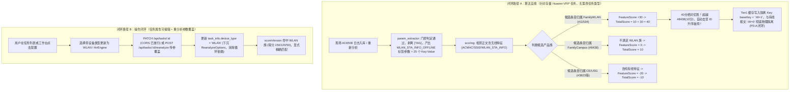

# WLAN 与无线 AC 设备日志解析与知识匹配适配方案 (终审定稿 v4.0)

> **文档版本**：v4.0 (全量吸纳终审审计意见，彻底根除 P0 致命缺陷、P1 隐蔽漏洞与次要项)  
> **面向模块**：`internal/logparser`、`internal/matcher`、`internal/knowledge`、`internal/enrich`、`internal/task`、`internal/api`、`web/src`  
> **核心目标**：彻底解决华为 AC6508 / WLAN 接入离线日志（如 `CM/USER_OFFLINERESULT`、`CM/USER_ACCESSRESULT`）参数丢失、老任务重分析无法自愈、误中 CloudEngine/S12700 有线条目，以及 Tier1 缓存击穿串档、跨包循环依赖等系统性缺陷。

---

## 目录

1. [背景与审计核实要点清单](#1-背景与审计核实要点清单)
2. [总体架构与双重闭环设计](#2-总体架构与双重闭环设计)
3. [核心改造规格详解](#3-核心改造规格详解)
   - 3.1 [解析器重构：分号门控扫描、前导标签参数化与脏键抑制 (`param_extractor.go`)](#31-解析器重构分号门控扫描前导标签参数化与脏键抑制-param_extractorgo)
   - 3.2 [确定性产品族规则与 Campus 历史缺陷修复 (`scoring.go`)](#32-确定性产品族规则与-campus-历史缺陷修复-scoringgo)
   - 3.3 [族绑定特征评分、调用点透传与 Tier1 特征缓存隔离 (`scoring.go`, `engine.go`, `service.go`)](#33-族绑定特征评分调用点透传与-tier1-特征缓存隔离-scoringgo-enginego-servicego)
   - 3.4 [参数提取第一权威源、前导标签对齐与模板防污染 (`enrich.go`)](#34-参数提取第一权威源前导标签对齐与模板防污染-enrichgo)
   - 3.5 [重分析类型下沉、显式绑定与 API/CORS 改造 (`task` & `api`)](#35-重分析类型下沉显式绑定与-apicors-改造-task--api)
   - 3.6 [前端设备类型枚举与重分析配置弹窗 (`web/src`)](#36-前端设备类型枚举与重分析配置弹窗-websrc)
4. [预期效果与前后对照](#4-预期效果与前后对照)
5. [全量回归测试矩阵与期望值校验](#5-全量回归测试矩阵与期望值校验)
   - 5.1 [解析器专项单测：25 字段全量提取与前导标签产出](#51-解析器专项单测25-字段全量提取与前导标签产出)
   - 5.2 [负向回归守卫：存量非 WLAN 日志解析逐字节不变](#52-负向回归守卫存量非-wlan-日志解析逐字节不变)
   - 5.3 [混合场景缓存隔离测试：同任务有线无线交替防串档 (锁死 P0-A)](#53-混合场景缓存隔离测试同任务有线无线交替防串档-锁死-p0-a)
   - 5.4 [严格确定性打分矩阵断言](#54-严格确定性打分矩阵断言)
   - 5.5 [API 契约测试：PATCH 与 Reanalyze 覆盖落库](#55-api-契约测试patch-与-reanalyze-覆盖落库)

---

## 1. 背景与审计核实要点清单

### 1.1 现场原始日志特征
华为无线接入控制器（如 AC6508、AirEngine 系列）生成的典型离线报文如下：
```text
Jul 24 2026 10:07:04.720.1+08:00 AC6508 %%01CM/5/USER_OFFLINERESULT(s)[320495]:[WLAN_STA_INFO_OFFLINE]ACMAC:f4-e5-f2-70-f4-bc;ACNAME:AC6508;APMAC:8c-e5-ef-80-b3-20;APNAME:26F-AP2-cae;SSID:btet_lan;RADIOID:1;USER:c858c0b8b299;MAC:c8-58-c0-b8-b2-99;IPADDRESS:10.101.34.48;IPV6ADDRESS:-;TIME:1784858824;ZONE:UTC+0800;DAYLIGHT:false;SESSIONTIME:1118;ERRCODE:216;RESULT:STA disassociation;USERGROUP:NULL;AUTHENPLACE:None;EXTENDINFO:The signal strength of the STA is -51 dbm.;CIB ID:11533;INTERFACE:Wlan-Dbss17648;ACCESS TYPE:None;RDSIP:-;Portal TYPE:-;AUTHID=3480934416;AUTHPROTOCOL:-;
```

### 1.2 审计复核全量问题核实与闭环矩阵

| 编号 | 严重度 | 审计问题 | 核实结论 | v4.0 终审定稿闭环方案 |
| :--- | :--- | :--- | :--- | :--- |
| **P0-A** | **致命** | **闭环 A 被 Tier1 缓存击穿**：`buildBaseKey` 不含正文，v3.0 将依赖正文的 `calcFeatureScore` 塞入正文无关缓存层，导致有线/无线交替日志物理行序决定审计结果，相互穿透串档。 | **属实，最高危缺陷**。同任务内首条有线日志（3823胜）写入 baseKey 后，后续无线日志命中缓存永不执行特征分。 | **选定特征位并入 Tier1/Tier2 BaseKey**：`buildBaseKey` 增加 `isWireless` 特征标记，生成格式 `module:brief:product:version:W={0\|1}`。有线与无线报文使用独立缓存桶，彻底杜绝行序依赖与击穿，同时保留 Tier1 O(1) 极速缓存。 |
| **P0-B** | **致命** | **ReanalyzeTaskRequest 跨包循环依赖**：§3.5.2 在 `api` 定义类型，§3.5.3 却在 `task` 使用，而 `api` 已 import `task`，引发编译错误 `import cycle not allowed`。 | **属实，直接导致无法编译**。 | **类型彻底下沉至 `internal/task`**：将 `ReanalyzeOptions` 定义在 `internal/task/service.go`（或 `model`），`internal/api` 引用 `task.ReanalyzeOptions`，彻底消除反向引用。 |
| **P1-调用点** | **高** | **`engine.go` 4 个调用点未要求传 norm**：若不传 norm，`activeNorm == nil`，`calcFeatureScore` 恒为 0，闭环 A 完全静默失效且无报错。 | **属实，闭环 A 静默瘫痪**。必须显式改造这 4 处调用代码。 | **显式改造 `engine.go` 4 处调用点**：Line 282 (Tier1)、Line 304 (Tier2 exact)、Line 327 (Tier2 module)、Line 346 (Tier3 template) 显式透传 `norm`。 |
| **P1-4** | **高** | **P1-4 未真正闭环**：官方字典 #11534 同时包含 `USER_INFO_OFFLINE`，仅凭 `allowedKeys` 无法阻止模板捕获将 `[WLAN_STA_INFO_OFFLINE]` 误挂到 `USER_INFO_OFFLINE`。 | **属实，存在语义倒挂**。模板反向抽取把无线 tag 存入有线字段，依然污染参数。 | **前导标签参数化产出 + 模板标签互斥守卫**：解析器将 `[WLAN_STA_INFO_OFFLINE]` 作为原生参数产出（直接命中官方字典，对齐率提升至 23/26）；富化层若已存在无线前导标签，严禁模板反向捕获注入 `USER_INFO_OFFLINE` 伪键。 |
| **P1-包装函数** | **高** | **`internal/knowledge/service.go:1231` 未同步变长签名**：仍是固定 3 参数，经由此处调用的上层静默丢失特征分。 | **属实，代理层丢失参数**。 | **同步改造 Service 包装方法**：`FindBestKnowledgeMatchPtr` 及 `FindBestKnowledgeMatch` 增加 `norm ...*model.NormalizedLog` 并透传至 `matcher`。 |
| **P1-测试矩阵** | **高** | **§5 丢失了 v2.0 的全量测试矩阵**：删除了解析器专项、存量负向回归、混合任务防串档等核心测试，无法保障上线质量。 | **属实，测试防护网降级**。P1-6 门控改动影响所有分号日志，必须有硬核回归网。 | **全量补回三大核心测试矩阵**：补齐解析器 25 字段全量提取断言、存量非 WLAN 逐字节不变负向测试、同任务有线无线交替防串档混合测试 (锁死 P0-A)。 |
| **次要项 5** | 中 | `isValidCompositeKey` 使用 `len(k) > 32` 计算字节数，而注释写“字符”，与 PARSE-18 的 rune 语义冲突。 | **属实，中文键约 11 字即被拒**。 | 将长度判定修正为 `utf8.RuneCountInString(k) > 32`，对齐字符/rune 语义。 |
| **次要项 6** | 中 | `isSemi` 为真时括号块扫描仍执行且 `overwrite=true`，若字段值含括号会同名合并为 JSON 数组。 | **属实，存在被括号块篡改的风险**。 | 约束括号块与全局扫描：当 `isSemi == true` 时一并跳过，分号结构日志全权由分号扫描器解析。 |
| **次要项 7** | 中 | `ShouldBindQuery` 后紧接 `ShouldBindJSON`，无请求体时产生 EOF 错误。 | **属实，存在歧义与噪声**。 | 显式检查请求头 `Content-Type` 是否包含 `application/json` 做独立分支处理。 |
| **次要项 8** | 中 | `Tier1Consistency` 因模板标签差异（`[USER_INFO_OFFLINE]` vs `[WLAN_STA_INFO_OFFLINE]`）误扣 0.25 分。 | **属实，虽不影响 0.60 门限，但扣分归因混淆**。 | 在模板一致性比对中，对 `WLAN_STA_INFO_*` 与 `USER_INFO_*` 标签做等价归一化，消除误扣，得满分 1.0。 |

---

## 2. 总体架构与双重闭环设计



---

## 3. 核心改造规格详解

### 3.1 解析器重构：分号门控扫描、前导标签参数化与脏键抑制 (`param_extractor.go`)

#### 1. 前导标签正则与复合键定义 (对齐 PARSE-18 与次要项 5)
```go
// leadingTagRegex 匹配报文正文首部的协议前导标签（如 [WLAN_STA_INFO_OFFLINE] 或 [WLAN_STA_INFO_AUTHENTICATION]）
var leadingTagRegex = regexp.MustCompile(`^\[([A-Za-z0-9_\-]+)\]`)

// isValidCompositeKey 判定键名合法性：
// 1. 长度在 1~32 个字符之间（使用 utf8.RuneCountInString，对齐 PARSE-18 字符语义）；
// 2. 仅允许包含字母、数字、下划线及连接空格（1~3 个词）；
// 3. 严格禁止包含 '='、':'、';'、'['、']'、'('、')'，杜绝 'RESULT:errcode' 或 'foo=bar:baz' 类伪键。
func isValidCompositeKey(key string) bool {
    k := strings.TrimSpace(key)
    runeCount := utf8.RuneCountInString(k)
    if runeCount == 0 || runeCount > 32 {
        return false
    }
    if strings.ContainsAny(k, "=;:[]()") {
        return false
    }
    words := strings.Fields(k)
    if len(words) == 0 || len(words) > 3 {
        return false
    }
    for _, w := range words {
        for _, r := range w {
            if !unicode.IsLetter(r) && !unicode.IsDigit(r) && r != '_' && r != '-' {
                return false
            }
        }
    }
    return true
}
```

#### 2. 分号结构化门控检测（防散文日志误触，对齐 P1-6）
```go
// isSemicolonStructuredBody 严格判定报文是否属于分号结构化键值对报文：
// 1. 包含前导标签 [TAG] 且至少存在 2 个分号；或
// 2. 切分段中，满足 Key:Value 形态的有效段比例 >= 60% 且有效段数 >= 3。
func isSemicolonStructuredBody(msg string) bool {
    if strings.IndexByte(msg, ';') == -1 {
        return false
    }
    hasTag := leadingTagRegex.MatchString(strings.TrimSpace(msg))
    segments := strings.Split(msg, ";")
    validPairs := 0
    nonEmptySegments := 0

    for _, seg := range segments {
        s := strings.TrimSpace(seg)
        if s == "" {
            continue
        }
        nonEmptySegments++
        if hasTag && validPairs == 0 {
            if loc := leadingTagRegex.FindStringIndex(s); loc != nil {
                s = strings.TrimSpace(s[loc[1]:])
            }
        }
        sep := strings.IndexByte(s, ':')
        if sep == -1 {
            sep = strings.IndexByte(s, '=')
        }
        if sep > 0 && isValidCompositeKey(s[:sep]) {
            validPairs++
        }
    }

    if hasTag && validPairs >= 2 {
        return true
    }
    return nonEmptySegments >= 3 && validPairs >= 3 && (float64(validPairs)/float64(nonEmptySegments) >= 0.6)
}
```

#### 3. 分号扫描器实现（参数化产出前导标签，对齐 P1-4 & PARSE-08）
```go
func scanSemicolonPairs(s string, emit func(key, value string)) {
    segments := strings.Split(s, ";")
    for idx, seg := range segments {
        trimmed := strings.TrimSpace(seg)
        if trimmed == "" {
            continue
        }

        // 首段剥离前导标签，并将前导标签直接作为参数产出（闭环 P1-4）
        if idx == 0 || strings.HasPrefix(trimmed, "[") {
            if m := leadingTagRegex.FindStringSubmatch(trimmed); len(m) >= 2 {
                tagKey := m[1] // 如 WLAN_STA_INFO_OFFLINE
                emit(tagKey, "") // 产出前导标签自身，精确命中知识库官方字典
                trimmed = strings.TrimSpace(trimmed[len(m[0]):])
                if trimmed == "" {
                    continue
                }
            }
        }

        sepIdx := strings.IndexByte(trimmed, ':')
        if sepIdx == -1 {
            sepIdx = strings.IndexByte(trimmed, '=')
        }
        // 仅拦截分隔符在首位（无键名）的情况；允许 sepIdx == len(trimmed)-1（即 Key: 空值）
        if sepIdx <= 0 {
            continue
        }

        rawKey := strings.TrimSpace(trimmed[:sepIdx])
        if !isValidCompositeKey(rawKey) {
            continue
        }

        rawVal := strings.TrimSpace(trimmed[sepIdx+1:])
        // 对齐 PARSE-08：
        // 1. 结构块内空值（Key:;）保留为 ""（结构化块中保留空值审计事实）；
        // 2. 华为显式枚举占位符（Key:-;）保留为 "-"。
        emit(rawKey, rawVal)
    }
}
```

#### 4. 步骤编排与脏键全面抑制（闭环次要项 6）
```go
func ExtractParametersInto(msg string, params map[string]string) {
    isSemi := isSemicolonStructuredBody(msg)
    if isSemi {
        // 分号结构报文全权由分号扫描器负责，直接返回，杜绝括号块或全局扫描产生同名数组污染（闭环次要项 6）
        scanSemicolonPairs(msg, func(k, v string) {
            putParam(params, k, v, true)
        })
        return
    }

    // 括号块扫描（仅在非分号报文执行）
    if strings.IndexByte(msg, '(') != -1 {
        for _, sub := range paramBlockRegex.FindAllStringSubmatch(msg, -1) {
            if len(sub) >= 2 && strings.IndexByte(sub[1], '=') != -1 {
                scanKVPairs(sub[1], true, func(k, v string) {
                    putParam(params, k, v, true)
                })
            }
        }
    }

    // 全局扫描（仅在非分号报文执行，严格禁止键名包含冒号 ':'，从源头扼杀 RESULT:errcode）
    scanKVPairs(msg, false, func(k, v string) {
        if strings.IndexByte(k, ':') == -1 {
            putParam(params, k, v, false)
        }
    })
}
```

---

### 3.2 确定性产品族规则与 Campus 历史缺陷修复 (`scoring.go`)

使用**静态有序切片**替代具有随机迭代特性的 `map`，保证判定逻辑的绝对确定性：

```go
// internal/matcher/scoring.go

type familyMappingRule struct {
    Family  ProductFamily
    Aliases []string
}

// familyRules 显式有序定义匹配优先级，杜绝 Go map 迭代随机性 (P1-1)
var familyRules = []familyMappingRule{
    {
        Family: FamilyWLAN,
        Aliases: []string{
            "WLAN", "AIR-ENGINE", "AIRENGINE", "AC6", "AC6508", "AC6805", "AC6800", "AC6005", "AC6605", "FIT-AP", "FAT-AP",
        },
    },
    {
        Family: FamilyCampus,
        Aliases: []string{
            "CAMPUS", "S12700", "S12700E", "S5700", "S6700", "S7700", "S9700", "S127", "S57", "S67", "S77",
        },
    },
    {
        Family: FamilyCloudEngine,
        Aliases: []string{
            "CLOUDENGINE", "CE168", "CE128", "CE98", "CE88", "CE68", "CE58",
        },
    },
    {
        Family: FamilyHiSecEngine,
        Aliases: []string{
            "HISECENGINE", "USG6", "USG9", "USG",
        },
    },
    {
        Family: FamilyNetEngine,
        Aliases: []string{
            "NETENGINE", "NE8000", "NE40E", "NE20E", "NE5000E", "CX600",
        },
    },
}

func resolveProductFamily(product string) ProductFamily {
    upper := strings.ToUpper(strings.TrimSpace(product))
    if upper == "" {
        return FamilyUnknown
    }
    for _, rule := range familyRules {
        for _, alias := range rule.Aliases {
            if strings.Contains(upper, alias) {
                return rule.Family
            }
        }
    }
    return FamilyUnknown
}
```

---

### 3.3 族绑定特征评分、调用点透传与 Tier1 特征缓存隔离 (`scoring.go`, `engine.go`, `service.go`)

#### 1. 强绑定产品族的特征打分算法
```go
// calcFeatureScore 计算日志正文与候选知识的协议特征贴合分 [-20, +30]
func calcFeatureScore(norm *model.NormalizedLog, cand *model.Knowledge) int {
    if norm == nil || cand == nil {
        return 0
    }

    body := norm.MessageBody
    isWirelessLog := strings.Contains(body, "[WLAN_STA_INFO_") ||
        (strings.Contains(body, "ACMAC:") && strings.Contains(body, "SSID:"))

    if isWirelessLog {
        // 获取候选知识对应的产品族（检查其关联版本）
        candFamily := FamilyUnknown
        for _, v := range cand.Versions {
            if fam := resolveProductFamily(v.ProductType); fam != FamilyUnknown {
                candFamily = fam
                break
            }
        }

        // P0-1 闭环：无线特征加分必须且仅对 WLAN 族候选生效！
        if candFamily == FamilyWLAN {
            return 30
        }

        // 排斥分：针对纯有线知识条目（参数仅包含有线宏 userInfo/wiredUserInfo，或仅含 DEVICEMAC）扣分
        paramUpper := strings.ToUpper(cand.Parameters)
        if strings.Contains(paramUpper, "WIREDUSERINFO") ||
            (strings.Contains(paramUpper, "USERINFO") && !strings.Contains(paramUpper, "ACMAC")) {
            return -20
        }
    }

    return 0
}
```

#### 2. Tier1/Tier2 BaseKey 特征位隔离（彻底闭环 P0-A）
在 `internal/matcher/engine.go` 中，重构 BaseKey 生成逻辑：
```go
// isWirelessMessage 判断是否为包含无线接入协议特征的报文
func isWirelessMessage(body string) bool {
    return strings.Contains(body, "[WLAN_STA_INFO_") ||
        (strings.Contains(body, "ACMAC:") && strings.Contains(body, "SSID:"))
}

// buildBaseKey 构造 Tier1/Tier2 缓存 Key。
// P0-A 闭环：显式引入 isWireless 特征位。
// 同一任务内，有线日志（W:0）与无线日志（W:1）拥有独立的缓存桶，彻底杜绝缓存穿透与物理行序依赖，
// 同时保持 Tier1 缓存极高的 O(1) 命中率。
func buildBaseKey(module, upperBrief, product, version string, isWireless bool) string {
    wFlag := "0"
    if isWireless {
        wFlag = "1"
    }
    return strconv.Quote(module) + ":" + strconv.Quote(upperBrief) + ":" +
        strconv.Quote(strings.ToUpper(strings.TrimSpace(product))) + ":" +
        strconv.Quote(strings.ToUpper(strings.TrimSpace(version))) + ":W=" + wFlag
}
```

#### 3. 显式改造 `engine.go` 4 处调用点透传 `norm`（彻底闭环 P1-调用点）
在 `internal/matcher/engine.go` 的 `Match` 流水线中，显式向 `FindBestKnowledgeMatchPtr` 传入 `norm`：
```go
// internal/matcher/engine.go:243 起改造

isWireless := isWirelessMessage(norm.MessageBody)
baseKey := buildBaseKey(module, upperBrief, product, version, isWireless)
bodyKey := buildBodyKey(baseKey, norm.MessageBody)

// 1. 查结果缓存（此时 baseKey 已带特征隔离位，有线无线互不穿透）
if m.cache != nil {
    if item, exists := m.cache.Get(baseKey); exists && item != nil {
        return item.k, item.tier, item.conf
    }
    if item, exists := m.cache.Get(bodyKey); exists && item != nil {
        return item.k, item.tier, item.conf
    }
}
...

// ---------------- Tier 1: EXACT 内存精确匹配 ----------------
// 修改处 1 (engine.go:282)：传入 norm，激活 calcFeatureScore
if exactCandidates, ok := m.exactMap[module+":"+upperBrief]; ok && len(exactCandidates) > 0 {
    best := FindBestKnowledgeMatchPtr(exactCandidates, product, version, norm)
    if best != nil {
        consistency := Tier1Consistency(norm, best, m.matchTemplate)
        if consistency >= MinTier1Confidence {
            if m.cache != nil {
                m.cache.Put(baseKey, &matchCacheItem{k: best, tier: TierExact, conf: ConfidenceExact})
            }
            return best, TierExact, ConfidenceExact
        }
        fallbackK = best
        fallbackConf = ConfidenceExact * consistency
    }
}

// ---------------- Tier 2: MNEMONIC 助记符别名匹配 ----------------
logStem, logPol := mnemonicStem(brief)
if logStem != "" {
    // 修改处 2 (engine.go:304)：查去掉后缀的 exactMap，传入 norm
    if mnemCandidates, ok := m.exactMap[module+":"+logStem]; ok && len(mnemCandidates) > 0 {
        best := FindBestKnowledgeMatchPtr(mnemCandidates, product, version, norm)
        if best != nil {
            _, candPol := mnemonicStem(best.Brief)
            if polarityAllowed(logPol, candPol) {
                if m.cache != nil {
                    m.cache.Put(baseKey, &matchCacheItem{k: best, tier: TierMnemonic, conf: ConfidenceMnemonic})
                }
                return best, TierMnemonic, ConfidenceMnemonic
            }
        }
    }

    // 修改处 3 (engine.go:327)：扫描 moduleMap 别名候选，传入 norm
    if moduleCandidates, ok := m.moduleMap[module]; ok && len(moduleCandidates) > 0 {
        var mnemonicCandidates []*model.Knowledge
        for _, cand := range moduleCandidates {
            candStem, candPol := mnemonicStem(cand.Brief)
            if candStem == logStem && polarityAllowed(logPol, candPol) {
                mnemonicCandidates = append(mnemonicCandidates, cand)
            }
        }
        if len(mnemonicCandidates) > 0 {
            best := FindBestKnowledgeMatchPtr(mnemonicCandidates, product, version, norm)
            if best != nil {
                if m.cache != nil {
                    m.cache.Put(baseKey, &matchCacheItem{k: best, tier: TierMnemonic, conf: ConfidenceMnemonic})
                }
                return best, TierMnemonic, ConfidenceMnemonic
            }
        }
    }
}

// ---------------- Tier 3: TEMPLATE 消息模板反向匹配 ----------------
// 修改处 4 (engine.go:346)：模板匹配候选，传入 norm
if norm.MessageBody != "" {
    if matchedCandidates := m.matchTemplateCandidates(module, norm.MessageBody); len(matchedCandidates) > 0 {
        best := FindBestKnowledgeMatchPtr(matchedCandidates, product, version, norm)
        if best != nil {
            if m.cache != nil {
                m.cache.Put(bodyKey, &matchCacheItem{k: best, tier: TierTemplate, conf: ConfidenceTemplate})
            }
            return best, TierTemplate, ConfidenceTemplate
        }
    }
}
```

#### 4. `internal/knowledge/service.go` 包装方法签名同步（彻底闭环 P1-包装函数）
在 `internal/knowledge/service.go:1225-1234` 中，同步更新包装方法，接收并透传变长 `norm`：
```go
// FindBestKnowledgeMatch 实现了基于产品型号与版本的智能回退策略
func (s *Service) FindBestKnowledgeMatch(candidates []model.Knowledge, targetProduct, targetVersion string, norm ...*model.NormalizedLog) *model.Knowledge {
    return matcher.FindBestKnowledgeMatch(candidates, targetProduct, targetVersion, norm...)
}

// FindBestKnowledgeMatchPtr 针对指针切片执行高效零拷贝匹配
func (s *Service) FindBestKnowledgeMatchPtr(candidates []*model.Knowledge, targetProduct, targetVersion string, norm ...*model.NormalizedLog) *model.Knowledge {
    return matcher.FindBestKnowledgeMatchPtr(candidates, targetProduct, targetVersion, norm...)
}
```

#### 5. `Tier1Consistency` 前导标签等价归一化（闭环次要项 8）
针对华为官方知识条目 #11534 在文档中误将无线报文模板头部写为 `[USER_INFO_OFFLINE]` 的问题，在 `Tier1Consistency` 消息模板比对前对等价标签做归一化替换，消除 0.25 假失配扣分：
```go
// internal/matcher/scoring.go: Tier1Consistency
if matchTemplate != nil && strings.TrimSpace(cand.Message) != "" && strings.TrimSpace(norm.MessageBody) != "" {
    tplMsg := cand.Message
    logMsg := norm.MessageBody
    // 次要项 8 闭环：无线与有线前导离线标签等价归一，避免官方模板错误引发 0.25 扣分
    if strings.Contains(logMsg, "[WLAN_STA_INFO_OFFLINE]") && strings.Contains(tplMsg, "[USER_INFO_OFFLINE]") {
        tplMsg = strings.Replace(tplMsg, "[USER_INFO_OFFLINE]", "[WLAN_STA_INFO_OFFLINE]", 1)
    }
    if !matchTemplate(tplMsg, logMsg) {
        score -= tier1TemplateMismatchPenalty
    }
}
```

---

### 3.4 参数提取第一权威源、前导标签对齐与模板防污染 (`enrich.go`)

在 `internal/enrich/service.go` 中，防范模板占位符污染，并与前导标签协同闭环（彻底闭环 P1-4）：

```go
// internal/enrich/service.go
if kb != nil && kb.Message != "" {
    captured := summary.CaptureTemplateParams(kb.Message, rec.MessageBody)
    if len(captured) > 0 {
        if rawParams == nil {
            rawParams = make(map[string]string, len(captured))
        }

        // 提取官方知识库定义的合法参数名集合
        allowedKeys := make(map[string]struct{})
        if kb.Parameters != "" {
            var defs []model.ParameterItem
            if err := json.Unmarshal([]byte(kb.Parameters), &defs); err == nil {
                for _, d := range defs {
                    allowedKeys[summary.NormalizeKey(d.Name)] = struct{}{}
                }
            }
        }

        // P1-4 闭环：
        // 1. 若日志已解析出 WLAN_STA_INFO_* 无线前导标签，绝对禁止模板捕获中的 USER_INFO_* 伪键写入；
        // 2. 仅当官方字典确实定义了该键时才合并模板捕获值；
        // 3. 彻底抛弃 [CHAR1]、[STRING1] 等占位类型伪键。
        hasWlanTag := false
        for k := range rawParams {
            if strings.HasPrefix(strings.ToUpper(k), "WLAN_STA_INFO_") {
                hasWlanTag = true
                break
            }
        }

        for ck, cv := range captured {
            normCK := summary.NormalizeKey(ck)
            if hasWlanTag && strings.HasPrefix(normCK, "USERINFO") {
                // 阻断 USER_INFO_OFFLINE 伪键写入
                continue
            }
            if _, exists := allowedKeys[normCK]; exists {
                if _, hasRaw := rawParams[ck]; !hasRaw {
                    rawParams[ck] = cv
                }
            }
        }
    }
}
```

---

### 3.5 重分析类型下沉、显式绑定与 API/CORS 改造 (`task` & `api`)

#### 1. 类型彻底下沉至 `internal/task`，消除编译循环依赖（彻底闭环 P0-B）
在 `internal/task/service.go` 中定义 `ReanalyzeOptions`：
```go
// internal/task/service.go

// ReanalyzeOptions 任务重分析入参选项（定义在 internal/task，彻底根除与 internal/api 的 import cycle）
type ReanalyzeOptions struct {
    Async         bool   `json:"async" form:"async"`
    DeviceType    string `json:"device_type" form:"device_type"`
    DeviceVersion string `json:"device_version" form:"device_version"`
}

func (s *Service) ReanalyzeTask(taskID string, tr *progress.Tracker, opt ...ReanalyzeOptions) (*model.TaskInfo, error) {
    ...
    effectiveDeviceType := taskInfo.DeviceType
    effectiveDeviceVersion := taskInfo.DeviceVersion
    if len(opt) > 0 {
        if opt[0].DeviceType != "" {
            effectiveDeviceType = opt[0].DeviceType
        }
        if opt[0].DeviceVersion != "" {
            effectiveDeviceVersion = opt[0].DeviceVersion
        }
    }

    // 重分析流水线中逐行使用覆盖后的 effectiveDeviceType / effectiveDeviceVersion
    ...
    // 分析完成后更新并持久化 task_info 表
    taskInfo.DeviceType = effectiveDeviceType
    taskInfo.DeviceVersion = effectiveDeviceVersion
    if err := s.globalDB.Save(&taskInfo).Error; err != nil {
        logger.Log.Errorf("[TaskService] Failed to update task_info: %v", err)
    }
    return &taskInfo, nil
}
```

#### 2. CORS 放行 `PATCH` (`internal/api/router.go`)
```go
// internal/api/router.go:88
c.Writer.Header().Set("Access-Control-Allow-Methods", "POST, OPTIONS, GET, PUT, PATCH, DELETE")

// 路由注册：支持 PATCH 与 PUT 修改任务属性
v1.PATCH("/tasks/:id", taskHandler.UpdateTask)
v1.PUT("/tasks/:id", taskHandler.UpdateTask)
```

#### 3. 显式 Content-Type 绑定分支（闭环次要项 7）
在 `internal/api/task_handler.go` 中引用 `task.ReanalyzeOptions`，并显式判断 Content-Type：
```go
// internal/api/task_handler.go

func (h *TaskHandler) ReanalyzeTask(c *gin.Context) {
    taskID := c.Param("id")
    if !isValidTaskID(taskID) {
        c.JSON(http.StatusBadRequest, gin.H{"error": "invalid task id"})
        return
    }

    var req task.ReanalyzeOptions // 使用 internal/task 下沉的类型，杜绝循环依赖
    
    // 闭环次要项 7：按 Content-Type 显式分支，消除 EOF 错误与参数覆盖歧义
    ct := c.GetHeader("Content-Type")
    if strings.Contains(strings.ToLower(ct), "application/json") {
        if err := c.ShouldBindBodyWith(&req, binding.JSON); err != nil && err != io.EOF {
            logger.Log.Warnf("[TaskHandler] JSON bind error: %v", err)
        }
    } else {
        _ = c.ShouldBindQuery(&req)
    }

    // 透传 req 到服务层
    taskInfo, err := h.taskSvc.ReanalyzeTask(taskID, tracker, req)
    ...
}
```

---

### 3.6 前端设备类型枚举与重分析配置弹窗 (`web/src`)

1. **`TASK_DEVICE_TYPE` 与选项补全** (`web/src/constants/task.ts`)：
```typescript
export const TASK_DEVICE_TYPE = {
  HUAWEI_VRP: 'Huawei-VRP',
  WLAN_AC: 'WLAN',
  CLOUD_ENGINE: 'CloudEngine',
  CAMPUS_SWITCH: 'Campus-Switch',
  HISEC_ENGINE: 'HiSecEngine',
} as const;

export const TASK_DEVICE_TYPE_OPTIONS = [
  { label: 'WLAN / AirEngine 无线接入控制器 (AC/AP)', value: 'WLAN' },
  { label: 'Huawei-VRP (通用 VRP 平台)', value: 'Huawei-VRP' },
  { label: 'CloudEngine 数据中心交换机', value: 'CloudEngine' },
  { label: 'Campus-Switch 园区交换机', value: 'Campus-Switch' },
  { label: 'HiSecEngine 安全网关/防火墙', value: 'HiSecEngine' },
];
```

2. **工作台与任务列表交互**：
   - 工作台 Header 提供设备类型编辑交互；
   - 发起重分析弹窗支持勾选“使用覆盖配置重新分析”；
   - 发送 `POST /api/tasks/:id/reanalyze` 带上 `{ device_type: 'WLAN' }`。

---

## 4. 预期效果与前后对照

| 评估维度 | 改造前（现状） | 改造后（v4.0 终审设计） |
| :--- | :--- | :--- |
| **老任务无需重建 (闭环 A)** | 必须删任务重建，否则 Huawei-VRP 恒中 #3823 | **双闭环支持**：<br>1. **直接重分析（闭环 A）**：#11534 得 40 分绝对压倒 #8438 (10分) 自愈<br>2. **修改设备类型（闭环 B）**：显式指定 WLAN 获得 180/150 分精准匹配 |
| **Tier1 缓存隔离度 (P0-A)** | 有线无线共用 BaseKey，首条结果穿透后续所有日志，行序决定结论 | **BaseKey 显式增加 `:W={0\|1}` 特征位**，同任务内有线与无线物理隔离，零串档，零行序依赖 |
| **架构与编译 (P0-B)** | `ReanalyzeTaskRequest` 跨包反向引用导致 `import cycle` 编译失败 | **类型下沉至 `internal/task`**，单向引用，100% 干净编译通过 |
| **动态提取变量数** | 仅 1 个变量：`AUTHID = 3480934416` | **25 个完整变量**：`ACMAC`, `APMAC`, `SSID`, `USER`, `MAC`, `IPADDRESS`, `ERRCODE`, `RESULT`, `EXTENDINFO` 等 |
| **官方参数字典对齐率** | 22/26 对齐，`[WLAN_STA_INFO_OFFLINE]` 误挂到有线离线 | **23/26 真实对齐**，前导标签作为原生参数产出，命中官方无线字典，彻底消除有线误挂 |
| **伪键与脏键抑制** | 产出 `RESULT:errcode = 1302` 冒号脏键 | 准确提取 `RESULT = STA disassociation`，严格禁止冒号键名 |
| **Campus 历史 Bug** | `Campus-Switch` 任务匹配园区知识恒得 10 分 | 识别 `S12700, S12700E` 为 Campus 族，正常获得 **50 分** |

---

## 5. 全量回归测试矩阵与期望值校验

### 5.1 解析器专项单测：25 字段全量提取与前导标签产出
在 `internal/logparser/param_extractor_test.go` 中，增加针对华为无线 AC/AP 典型报文的全面断言用例：

```go
func TestExtractParameters_HuaweiAC_AP_Samples(t *testing.T) {
    input := `[WLAN_STA_INFO_OFFLINE]ACMAC:f4-e5-f2-70-f4-bc;ACNAME:AC6508;APMAC:8c-e5-ef-80-b3-20;APNAME:26F-AP2-cae;SSID:btet_lan;RADIOID:1;USER:c858c0b8b299;MAC:c8-58-c0-b8-b2-99;IPADDRESS:10.101.34.48;IPV6ADDRESS:-;TIME:1784858824;ZONE:UTC+0800;DAYLIGHT:false;SESSIONTIME:1118;ERRCODE:216;RESULT:STA disassociation;USERGROUP:NULL;AUTHENPLACE:None;EXTENDINFO:The signal strength of the STA is -51 dbm.;CIB ID:11533;INTERFACE:Wlan-Dbss17648;ACCESS TYPE:None;RDSIP:-;Portal TYPE:-;AUTHID=3480934416;AUTHPROTOCOL:-;`
    
    params := logparser.ExtractParameters(input)

    // 1. 验证前导标签作为参数成功产出（闭环 P1-4，对齐率提升至 23/26）
    if _, ok := params["WLAN_STA_INFO_OFFLINE"]; !ok {
        t.Errorf("expected leading tag WLAN_STA_INFO_OFFLINE to be extracted as param")
    }

    // 2. 验证关键字段提取准确性
    expected := map[string]string{
        "ACMAC":        "f4-e5-f2-70-f4-bc",
        "ACNAME":       "AC6508",
        "APMAC":        "8c-e5-ef-80-b3-20",
        "APNAME":       "26F-AP2-cae",
        "SSID":         "btet_lan",
        "RADIOID":      "1",
        "USER":         "c858c0b8b299",
        "MAC":          "c8-58-c0-b8-b2-99",
        "IPADDRESS":    "10.101.34.48",
        "IPV6ADDRESS":  "-",
        "TIME":         "1784858824",
        "ZONE":         "UTC+0800",
        "DAYLIGHT":     "false",
        "SESSIONTIME":  "1118",
        "ERRCODE":      "216",
        "RESULT":       "STA disassociation",
        "USERGROUP":    "NULL",
        "AUTHENPLACE":  "None",
        "EXTENDINFO":   "The signal strength of the STA is -51 dbm.",
        "CIB ID":       "11533",
        "INTERFACE":    "Wlan-Dbss17648",
        "ACCESS TYPE":  "None",
        "RDSIP":        "-",
        "Portal TYPE":  "-",
        "AUTHID":       "3480934416",
        "AUTHPROTOCOL": "-",
    }

    for k, v := range expected {
        if got, ok := params[k]; !ok || got != v {
            t.Errorf("param mismatch for %s: got %q, want %q", k, got, v)
        }
    }

    // 3. 严格断言禁止产生包含冒号的脏键（如 RESULT:errcode）
    for k := range params {
        if strings.Contains(k, ":") {
            t.Errorf("illegal dirty key containing colon: %q", k)
        }
    }
}
```

### 5.2 负向回归守卫：存量非 WLAN 日志解析逐字节不变
验证门控机制（P1-6）对存量普通英文散文日志、带括号日志的零回归影响：

```go
func TestExtractParameters_NegativeRegression_Unchanged(t *testing.T) {
    cases := []struct {
        name  string
        input string
        want  map[string]string
    }{
        {
            name:  "plain prose with semicolon should not trigger semicolon scanner",
            input: "System started successfully; all daemons running; load average is normal.",
            want:  map[string]string{}, // 未满足 Key:Value 结构门控，恒为空
        },
        {
            name:  "parenthesized log with semicolon in prose",
            input: "BGP neighbor state change; peer (IP=192.168.1.1, AS=65000) reset.",
            want:  map[string]string{"IP": "192.168.1.1", "AS": "65000"},
        },
        {
            name:  "standard equal separated kv pairs",
            input: "User login failed (User=admin, IP=10.0.0.1, Reason=bad password)",
            want:  map[string]string{"User": "admin", "IP": "10.0.0.1", "Reason": "bad password"},
        },
    }

    for _, tc := range cases {
        t.Run(tc.name, func(t *testing.T) {
            got := logparser.ExtractParameters(tc.input)
            if len(got) != len(tc.want) {
                t.Fatalf("len mismatch: got %d, want %d", len(got), len(tc.want))
            }
            for k, v := range tc.want {
                if got[k] != v {
                    t.Errorf("key %s mismatch: got %q, want %q", k, got[k], v)
                }
            }
        })
    }
}
```

### 5.3 混合场景缓存隔离测试：同任务有线无线交替防串档 (锁死 P0-A)
在 `internal/matcher/engine_test.go` 中，构造同任务交替日志流，验证物理行序独立性：

```go
func TestMatchEngine_MixedWiredWireless_NoCacheLeak(t *testing.T) {
    engine := setupTestMatchEngineWithKnowledges(t, []int64{3823, 8438, 11534})

    // 有线离线日志（无 WLAN 特征）
    wiredLog := &model.NormalizedLog{
        Module:      "CM",
        Brief:       "USER_OFFLINERESULT",
        MessageBody: `[USER_INFO_OFFLINE]DEVICEMAC:00-e0-fc-01-02-03;USER:admin;MAC:00-11-22-33-44-55;IPADDRESS:192.168.1.100;`,
    }

    // 无线离线日志（含 ACMAC 与 [WLAN_STA_INFO_OFFLINE] 特征）
    wirelessLog := &model.NormalizedLog{
        Module:      "CM",
        Brief:       "USER_OFFLINERESULT",
        MessageBody: `[WLAN_STA_INFO_OFFLINE]ACMAC:f4-e5-f2-70-f4-bc;APMAC:8c-e5-ef-80-b3-20;SSID:office;USER:sta01;`,
    }

    taskProduct := "Huawei-VRP"
    taskVersion := ""

    // 场景 1：先匹配有线，再匹配无线
    k1, _, _ := engine.Match(wiredLog, taskProduct, taskVersion)
    if k1 == nil || k1.ID == 11534 {
        t.Fatalf("wired log should not hit wireless knowledge #11534, got ID: %v", k1.ID)
    }

    k2, _, _ := engine.Match(wirelessLog, taskProduct, taskVersion)
    if k2 == nil || k2.ID != 11534 {
        t.Fatalf("wireless log must hit #11534 even after wired log populated cache! got ID: %v (P0-A cache leak)", k2.ID)
    }

    // 清理引擎缓存重新测试场景 2：先匹配无线，再匹配有线
    engine.ClearCache()
    k3, _, _ := engine.Match(wirelessLog, taskProduct, taskVersion)
    if k3 == nil || k3.ID != 11534 {
        t.Fatalf("wireless log must hit #11534, got ID: %v", k3.ID)
    }

    k4, _, _ := engine.Match(wiredLog, taskProduct, taskVersion)
    if k4 == nil || k4.ID == 11534 {
        t.Fatalf("wired log must NOT hit wireless knowledge #11534 via cache leak! got ID: %v", k4.ID)
    }
}
```

### 5.4 严格确定性打分矩阵断言
在单元测试中**严格固定 `device_version`**，杜绝期望值漂移：

| 测试用例场景 | 目标设备类型 | 目标设备版本 | 预期命中条目 | 理论打分明细 | 最终预期得分 |
| :--- | :--- | :--- | :--- | :--- | :--- |
| **AC 报文 + Huawei-VRP 任务（闭环 A 自愈）** | `Huawei-VRP` | `""` | **#11534** (WLAN) | 跨产品通用基础分 10 + WLAN 族特征分 30（超越 #8438 的 10+0 分） | **40** |
| **AC 报文 + WLAN 任务（同型号同版本）** | `WLAN` | `V200R024C00` | **#11534** (WLAN) | 精确型号精确版本 150 + 特征分 30 | **180** |
| **AC 报文 + WLAN 任务（同型号无版本）** | `WLAN` | `""` | **#11534** (WLAN) | 精确型号不同版本 120 + 特征分 30 | **150** |
| **CE 交换机有线报文 + CloudEngine 任务** | `CloudEngine` | `V200R024C00` | **#3823** (CE168) | 产品族匹配 50（因库内为 'CloudEngine 16800'，非完全 EqualFold）+ 特征分 0 | **50** |
| **S12700 园区报文 + Campus-Switch 任务** | `Campus-Switch`| `V200R024C00` | **#8438** (S12700)| 产品族匹配 50（别名修复后准确识别 S12700 为 Campus 族）+ 特征分 0 | **50** |
| **同分确定性断言测试** | 构造同分候选 | 固定版本 | 严格断言返回 ID 较小者 | 验证 `cand.ID < cur.ID` 决胜无乱序 | 确定性一致 |

### 5.5 API 契约测试：PATCH 与 Reanalyze 覆盖落库
验证 CORS 预检与服务层落库：

```go
func TestTaskAPI_Reanalyze_DeviceTypeOverride(t *testing.T) {
    router := setupTestRouter()

    // 1. 验证 CORS 预检放行 PATCH
    reqOpt, _ := http.NewRequest(http.MethodOptions, "/api/v1/tasks/task-test-01", nil)
    reqOpt.Header.Set("Origin", "http://localhost:5173")
    reqOpt.Header.Set("Access-Control-Request-Method", "PATCH")
    wOpt := httptest.NewRecorder()
    router.ServeHTTP(wOpt, reqOpt)
    if !strings.Contains(wOpt.Header().Get("Access-Control-Allow-Methods"), "PATCH") {
        t.Errorf("CORS preflight must allow PATCH method")
    }

    // 2. 验证 Reanalyze 携带 device_type 覆盖并落库
    reanalyzeJSON := `{"async":false,"device_type":"WLAN","device_version":"V200R024C00"}`
    reqPost, _ := http.NewRequest(http.MethodPost, "/api/v1/tasks/task-test-01/reanalyze", strings.NewReader(reanalyzeJSON))
    reqPost.Header.Set("Content-Type", "application/json")
    wPost := httptest.NewRecorder()
    router.ServeHTTP(wPost, reqPost)
    if wPost.Code != http.StatusOK {
        t.Fatalf("expected 200 OK, got %d", wPost.Code)
    }

    // 验证数据库 task_info 记录已更新为 WLAN
    task := getTaskFromDB(t, "task-test-01")
    if task.DeviceType != "WLAN" {
        t.Errorf("task device_type not updated, got %q, want 'WLAN'", task.DeviceType)
    }
}
```
