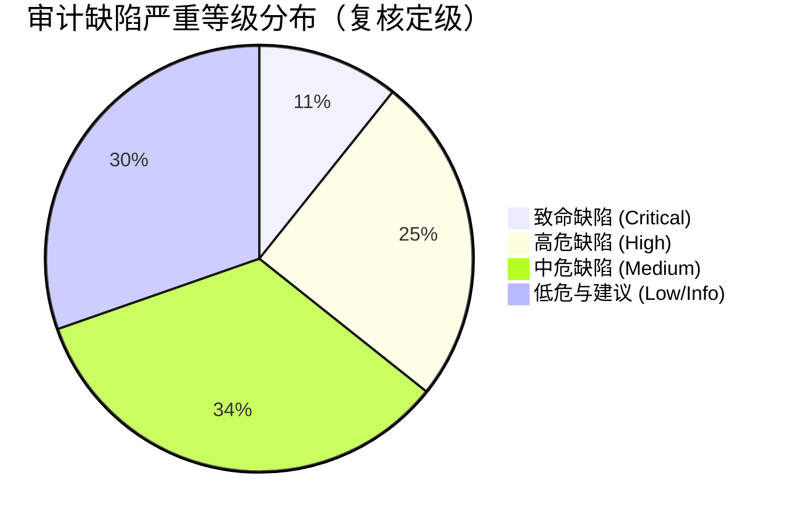

# LogAuditorGo 完整代码审计与系统架构质量报告

> **生成时间**：2026-10-16（复核修订时间：2026-10-16）  
> **审计对象**：`LogAuditorGo` 华为网络设备日志智能分析平台全部模块与函数  
> **运行环境**：Windows 11 (amd64) / PowerShell 7+ / Go 1.26.0（实测 `go version go1.26.0 windows/amd64`）  
> **审计范畴**：全部 20 个 Go 包（15 个 `internal` 子包 + `cmd/LogAuditorGo` + 3 个 `pkg` 子包 + `web` 资源包），共 79 个核心 Go 源文件（另有 52 个 `*_test.go`），约 22,000 行有效代码（非空行统计）  
> **审计维度**：代码结构、可读性、可维护性、安全性、性能与资源控制、异常处理、边界条件防御、依赖风险、重复代码、潜在逻辑缺陷、测试覆盖情况（共 11 个维度）  
> **复核基准**：本报告已按当前工作区代码逐文件、逐行号完成二次取证复核（含 `go vet ./...`、`go test ./... -coverprofile` 实测与 `filepath.Rel` Windows 行为实测）。复核后撤销 2 项不成立的发现、下调 8 项严重级、补齐 10 项原报告遗漏或未定级的条目；每项发现均附【复核结论】，第 3 章统计以复核定级为准。

---

## 目录

1. [执行摘要与审计概览](#1-执行摘要与审计概览)
2. [测试覆盖率全景矩阵](#2-测试覆盖率全景矩阵)
3. [缺陷严重等级统计与分布](#3-缺陷严重等级统计与分布)
4. [模块级代码审计与详细分析](#4-模块级代码审计与详细分析)
   - 4.1 [任务生命周期与执行流水线 (`internal/task`)](#41-任务生命周期与执行流水线-internaltask)
   - 4.2 [HTTP API 接入层与路由调度 (`internal/api`)](#42-http-api-接入层与路由调度-internalapi)
   - 4.3 [系统托盘与 Win32 原生集成 (`internal/tray`)](#43-系统托盘与-win32-原生集成-internaltray)
   - 4.4 [程序主入口与全局生命周期 (`cmd/LogAuditorGo`, `web`)](#44-程序主入口与全局生命周期-cmdlogauditorgo-web)
   - 4.5 [华为网络设备日志解析引擎 (`internal/logparser`)](#45-华为网络设备日志解析引擎-internallogparser)
   - 4.6 [HDX 知识文档解构与提取引擎 (`internal/hdx`)](#46-hdx-知识文档解构与提取引擎-internalhdx)
   - 4.7 [四级知识匹配与评分引擎 (`internal/matcher`)](#47-四级知识匹配与评分引擎-internalmatcher)
   - 4.8 [全局知识库管理与去重服务 (`internal/knowledge`)](#48-全局知识库管理与去重服务-internalknowledge)
   - 4.9 [网络故障根因推导引擎 (`internal/rootcause`)](#49-网络故障根因推导引擎-internalrootcause)
   - 4.10 [Bleve 全文检索与索引重建引擎 (`internal/search`)](#410-bleve-全文检索与索引重建引擎-internalsearch)
   - 4.11 [日志语义摘要与参数捕获引擎 (`internal/summary`)](#411-日志语义摘要与参数捕获引擎-internalsummary)
   - 4.12 [SQLite 存储管理与连接池 (`internal/storage`)](#412-sqlite-存储管理与连接池-internalstorage)
   - 4.13 [路径安全守卫与文件系统服务 (`internal/fsx`)](#413-路径安全守卫与文件系统服务-internalfsx)
   - 4.14 [领域模型与数据契约 (`internal/model`)](#414-领域模型与数据契约-internalmodel)
   - 4.15 [日志富化与上下文服务 (`internal/enrich`)](#415-日志富化与上下文服务-internalenrich)
   - 4.16 [配置中心与动态策略 (`internal/config`)](#416-配置中心与动态策略-internalconfig)
   - 4.17 [公共基础库 (`pkg/cache`, `pkg/logger`, `pkg/progress`)](#417-公共基础库-pkgcache-pkglogger-pkgprogress)
5. [高优先级核心问题深度剖析与修复代码](#5-高优先级核心问题深度剖析与修复代码)
   - 5.1 [致命级缺陷（Critical）排查与修复](#51-致命级缺陷critical排查与修复)
   - 5.2 [高危级缺陷（High）排查与修复](#52-高危级缺陷high排查与修复)
   - 5.3 [中危级缺陷（Medium）排查与修复](#53-中危级缺陷medium排查与修复)
   - 5.4 [低危与建议（Low / Info）优化项](#54-低危与建议low--info优化项)
6. [11 维度架构成熟度评估与雷达矩阵](#6-11-维度架构成熟度评估与雷达矩阵)
7. [测试盲区诊断与质量保障演进规划](#7-测试盲区诊断与质量保障演进规划)
8. [整改实施路线图](#8-整改实施路线图)

---

## 1. 执行摘要与审计概览

`LogAuditorGo` 是一款面向华为 CloudEngine、HiSecEngine/USG、NetEngine 等网络设备的离线日志智能分析平台。系统采用单二进制分发架构，深度整合了纯 Go SQLite 驱动（`glebarez/sqlite` 封装 `modernc.org/sqlite`，无 CGO）、Bleve 全文检索、Vue 3 静态前端内嵌（`embed.FS`）以及 Windows 原生系统托盘。

本次审计启动了多个专业分析代理进行全并发代码穿透审查，覆盖了代码库中从底层文件系统守卫、数据库引擎、日志解析、全文检索、根因推导，直至上层 HTTP API 与系统托盘的每一行逻辑。复核阶段对全部结论执行了"回到代码、逐行取证"的二次验证，凡与代码不符、触发条件被夸大或后果被放大的描述均已修正。

### 复核修订摘要（与首轮报告的差异）
- **撤销 2 项**：`ISSUE-TASK-06`（OR 模式参数拼接顺序正确，未发现占位符错位）、`ISSUE-TASK-08`（CASE-WHEN 单条 SQL 2600 个参数远低于现代 SQLite 32766 变量上限，非缺陷）。
- **下调 8 项**：`ISSUE-TASK-01`（Critical→Medium，触发路径已被内层 recover 阻断）、`ISSUE-TASK-05`（High→Medium，已有 `CancelTaskRCA` 等待 + 多重存活检查收敛）、`ISSUE-HDX-01`（Critical→Medium，以 `O_TRUNC` 打开目录会立即失败，不会真正截断根目录）、`ISSUE-PROG-01`（Critical→Low，`send on closed channel` 路径不可达）、`ISSUE-API-07`（Medium→Low）、`ISSUE-API-09`（Medium→Low，服务层已有 `reindexMu.TryLock`）、`ISSUE-TRAY-03`（High→Low，URL 不含用户可控输入）、`ISSUE-FSX-02`（Medium→Low，实测 Windows `filepath.Rel` 大小写不敏感，行为正确）。
- **补齐 10 项遗漏**：`ISSUE-TASK-04`（`failTask` 空指针）、`ISSUE-SRCH-02`（重建与导入无互斥，首轮仅在 4.10 提及未定级）、`ISSUE-API-04`（`UpdateTask` 绕过统一响应封装）、`ISSUE-API-05`（`ContentLength > 0` 丢失 chunked 请求体，共 6 处）、`ISSUE-STOR-04`（知识库并发导入撞唯一约束）、`ISSUE-LOG-06`（时区偏移未归一 `t.Local()`）、`ISSUE-MODEL-01/02`（`CustomTime` 无回退、关键实体缺索引）、`ISSUE-MAT-03`（Tier 4 同分非确定性）、`ISSUE-TRAY-04`（`Start()` 退出死代码）。
- **修正的关键事实**：整体语句覆盖率实测 **64.9%**（原报告 67.8% 偏高）；`internal/rootcause` 实测 84.0%（原 83.8%）；`web/embed.go` 实为 18 行（原表误写 277 行）、`cmd/LogAuditorGo/main.go` 有效行 216（原表 245）；`TASK-06` 的"OR 参数错位"与 `PROG-01` 的"订阅竞态崩溃"均无法在现行代码中复现。

### 综合审计评价
- **架构设计亮点**：
  - 任务级物理隔离设计优秀：每个审计任务独占独立 SQLite 数据库文件（`tasks/task_*.db`），极大降低了多任务间的资源争抢与数据残留风险；
  - 流水线解耦清晰：从原始日志导入、两遍预采样（`prepareBundles` 计数采样 → `persistFileBundle` 流式落库）、字段归一、四级知识召回到 RCA 拓扑传播，主干链路骨架扎实；
  - 绝大多数正则采用标准 RE2 语法，天生免疫经典回溯炸弹（ReDoS）。
- **核心风险与脆弱面**：
  - **数据正确性与静默丢失**：批量打标/摘标按 Offset 分页在动态过滤数据集（`UntaggedOnly`/标签包含条件）中产生分页漂移，导致约 50% 目标日志漏标；64KB 编码探测窗口在纯中文 UTF-8 文件（>64KB）上**必现**多字节截断误判，整包转码为 GB18030 乱码；
  - **安全性与越权穿透**：`TaskHandler.ImportLogs` 与 `ImportLogsToDevice` **完全遗漏了路径白名单校验**；`SecurePathGuard` 未解析软链接（CWE-59），可被符号链接与 Junction 穿透；脱敏引擎未对密码、密文及 SNMP 共同体做任何遮盖处理；HTTP 服务默认监听全网卡且无鉴权；
  - **算法因果颠倒**：RCA 引擎同秒事件判定错用簇首索引（应比较当前事件 ID）导致因果推导颠倒；
  - **索引与存储的不可逆风险**：Bleve 索引替换在确认新索引可用前删除老备份，失败即不可回滚；TaskDB 初始化锁清理存在竞态，可致并发 `AutoMigrate` 损坏任务库；
  - **Windows 互操作与内存安全**：`tray_windows.go:570` 存在 `unsafe.Pointer(uintptr)` 强转（`go vet` level=error 实测复现），且 Win32 全局内存分配后在加锁失败与 `SetClipboardData` 失败路径均未调用 `GlobalFree`，造成句柄泄漏。

---

## 2. 测试覆盖率全景矩阵

通过在工作区执行 `go test ./... -coverprofile=coverage.out -count=1` 进行全量语句级（Statement-level）覆盖率测定，并以 `go tool cover -func=coverage.out` 汇总；2026-10-16 实测复现结果如下（`源码代码行` 按非空行统计，与逐包文件数均经实测核对）：

| 模块 / 子包路径 | 源码文件数 | 源码代码行 | 语句覆盖率 | 质量评级 | 核心未覆盖盲区 |
| :--- | :---: | :---: | :---: | :---: | :--- |
| `cmd/LogAuditorGo` | 1 | 216 | **0.0%** | 严重欠缺 | 启动参数解析、优雅关闭序列、信号截获与错误退出（`main_test.go` 仅覆盖编译与 `-version` 分支） |
| `internal/api` | 12 | 2,739 | **44.4%** | 需重点加固 | SSE 实时流、长任务取消、标签全生命周期、设备管理 CRUD、系统日志管理 |
| `internal/tray` | 4 | 869 | **48.4%** | 需重点加固 | Win32 消息循环、系统原生通知、右键上下文菜单、剪贴板互操作 |
| `internal/fsx` | 4 | 659 | **42.2%** | 需重点加固 | `SecurePathGuard` 全套（`NewSecurePathGuard/Enabled/Roots/Validate/ValidateAll/isWithin`）实测均为 **0%**；`LongPathSafe`/`Stat`/`CollectFiles`/`cleanPathFrom` 同为 0% |
| `internal/knowledge` | 3 | 1,314 | **46.6%** | 需加固 | 索引重建回滚、并发导入冲突互斥分支、文档删除级联孤儿清理 |
| `internal/model` | 9 | 586 | **50.0%** | 一般 | 自定义时间格式反序列化边界、过滤参数合法性验证 |
| `internal/search` | 2 | 740 | **53.1%** | 需加固 | `swapIndexDir` 实测 **0%**（索引目录原子替换与失败回滚路径完全未测）、老索引句柄未释放重试分支 |
| `internal/storage` | 3 | 825 | **63.4%** | 良好 | `CleanUnusedInitLocks` 实测 **6.2%**、SQLite 并发写锁超时重试、连接池 LRU 极限驱逐、迁移外键冲突降级 |
| `internal/config` | 1 | 327 | **65.3%** | 良好 | 命令行参数覆盖、配置动态热更新钩子（RegisterLogUpdateHook） |
| `internal/task` | 10 | 5,572 | **69.6%** | 良好 | `failTask` 失败链路（**0%**）、`BatchTagLogs/BatchUntagLogs` 分批切片（**31.7%**）、`executeRCAPipeline` 并发取消链路（**52.1%**）；另有 `GetTaskList/GetDevice/UpdateDevice/DeleteDevice/GetDeviceTimeline/SetTaskDeviceVersion` 等多个设备与列表接口为 0% |
| `pkg/logger` | 1 | 577 | **69.9%** | 良好 | 日志文件按天与大小轮转失败降级分支、格式动态热切换 |
| `pkg/progress` | 1 | 639 | **61.7%** | 良好 | 订阅快速取消并发竞态、孤儿任务超时回收 |
| `web` (embed) | 1 | 15（文件共 18 行） | **75.0%** | 良好 | `DistFS()` 的 `fs.Sub` 失败降级分支；SPA 静态回落由 `internal/api/router.go` 承载 |
| `internal/hdx` | 7 | 1,668 | **74.9%** | 良好 | GBK 非法字节容错转码、嵌套压缩包超限配额防御、URL 深度反解 |
| `internal/summary` | 5 | 1,071 | **79.8%** | 良好 | 非标 MIB 占位符提取、正则模式缓存驱逐 |
| `internal/logparser` | 7 | 1,483 | **83.6%** | 优秀 | `vrp_parser` 极简报文与缺失 Hostname 分支、历史跨年时间戳推断 |
| `internal/rootcause` | 3 | 1,158 | **84.0%** | 优秀 | 复杂循环依赖拓扑检测（`ClusterByTimeWindow` 0%）、`entityValues`/`entityConsistency` 约 18%、超大事件链超时剪枝局部回滚 |
| `internal/enrich` | 2 | 307 | **87.0%** | 优秀 | 上下文边界探测与超限截断 |
| `internal/matcher` | 2 | 1,058 | **87.4%** | 优秀 | 空库全表扫描击穿、Tier 2 缓存污染选优、Bleve 召回排序确定性 |
| `pkg/cache` | 1 | 173 | **98.9%** | 卓越 | 核心 LRU 存取、并发读写与过期淘汰全覆盖 |
| **全系统综合** | **79** | **~22,000** | **64.9%** | **良好** | **核心业务路径测试完备，但失败回滚与安全守卫盲区显著；注意 `rangeOf`、`hasCycle` 等被测到 100%/95.6% 的函数仍存在逻辑缺陷，覆盖率不能替代正确性审查** |

> 覆盖率汇总口径说明：上表"语句覆盖率"为各包 `go test` 自测口径；全系统综合一行取 `go tool cover -func` 的 `total` 值 **64.9%**（按语句加权），原报告标注的 67.8% 经复核实测无法成立。`internal/rootcause` 为 84.0%（原表 83.8% 为四舍五入偏差）。

---

## 3. 缺陷严重等级统计与分布

经过对 20 个包全部函数的静态语法树、数据流、控制流、并发时序及资源生命周期的深度分析，并完成"逐行号回归代码"的二次取证复核，共审核 **58 项候选发现**，其中 **56 项确认为真实缺陷与隐患（含严重级修正）**，**2 项经复核撤销**：



- **致命 (Critical) [6项]**：核心业务数据大量丢失/漏标、正常日志整包乱码、任意主机文件泄露、凭据明文入库入索引、索引重建失败不可逆损毁。
- **高危 (High) [14项]**：局域网未授权安全裸露、RCA 因果逻辑颠倒、状态机断电中断不可自愈、GBK 转码降级乱码、Emergency 0 级知识丢失、历史时间戳系统性误差、连接池竞态与冻结、空库全表扫描击穿、Tier 2 缓存越权复用。
- **中危 (Medium) [19项]**：防御性缺口（Worker 兜底、`failTask` 空指针、RCA 幽灵库）、chunked 请求体静默丢失、SSE 缺少心跳、分页/批量 ID 缺硬上限、负数 ID 溢出、Zip Slip 校验边界、时区未归一、缓存未失效、文档删除提前返回等。
- **低危 / 建议 (Low / Info) [17项]**：Node 顺序依赖、`unsubscribe` 非幂等、清缓存不完整、占位符正则不兼容、端口校验冗余、上帝类、Cache-Control 缺失、注释与实现不符等。
- **已撤销 [2项]**：`ISSUE-TASK-06`（OR 参数拼接正确，无占位符错位）、`ISSUE-TASK-08`（2600 参数远低于 SQLite 32766 变量上限）。

### 3.1 复核定级调整明细（相对首轮报告）

| 编号 | 首轮分级 | 复核定级 | 调整依据（实测证据） |
| :--- | :---: | :---: | :--- |
| `ISSUE-TASK-01` | Critical | **Medium** | `parseLogLine` 自带 `defer/recover`（`import_pipeline.go:254-270`），单行异常无法杀死 worker；死锁仅在全部 worker 同时退出时成立，属防御性缺口 |
| `ISSUE-TASK-05` | High | **Medium** | `DeleteTask` 先 `CancelTaskRCA`（取消并等待 ≤2s，`rca_scheduler.go:133-151`）再删文件，且写入前有 `rcaTargetAlive` 双检查点，残留窗口需 worker 恰好停顿 >2s |
| `ISSUE-HDX-01` | Critical | **Medium** | 以 `O_WRONLY` 打开目录在 Windows/POSIX 均立即失败（`archive.go:207`），不会截断根目录；实际后果为整包解压中断 + 缺少 `:`/符号链接条目校验 |
| `ISSUE-PROG-01` | Critical | **Low** | `Subscribe` 使用 `select{case ch<-snap: default:}` 非阻塞发送（`progress.go:515-519`），且发送发生在 `unsubscribe` 返回之前，`send on closed channel` 不可达；实际缺陷为 `unsubscribe` 非幂等（重复调用会 `close of closed channel`） |
| `ISSUE-API-07` | Medium | **Low** | 统计缓存自带 15s TTL（`stats_handler.go:38`），未主动失效仅造成短时陈旧 |
| `ISSUE-API-09` | Medium | **Low** | 服务层已存在 `reindexMu.TryLock()` 并发互斥（`knowledge/reindex.go:69-72`），异步失败也会经 `tr.Fail` 推送；仅缺 JSON 请求体绑定 |
| `ISSUE-TRAY-03` | High | **Low** | URL 由 `GetURL` 以配置 host+port+固定 subpath 拼装（`tray.go:39-52`），不含用户可控输入，注入前提是攻击者已可改配置文件 |
| `ISSUE-FSX-02` | Medium | **Low** | 实测 Windows `filepath.Rel("C:\\Data\\Logs","c:\\data\\logs\\sub")` 返回 `sub`，大小写不敏感、同级前缀目录亦正确拦截；实际仅为注释与实现不符 |

### 3.2 完整缺陷索引（复核定级）

| 编号 | 模块 | 复核定级 | 关键位置 | 复核状态 |
| :--- | :---: | :---: | :--- | :--- |
| `ISSUE-TASK-02` | task | Critical | `tag_service.go:221/363`（分页循环 297/433） | 确认 |
| `ISSUE-TASK-03` | task | Critical | `import_pipeline.go:92-112`（探测 103-110） | 确认（纯中文 >64KB 必现） |
| `ISSUE-API-01` | api | Critical | `task_handler.go:307` | 确认 |
| `ISSUE-API-02` | api | Critical | `task_handler.go:1049` | 确认 |
| `ISSUE-LOG-01` | logparser | Critical | `sanitizer.go:56-114` | 确认 |
| `ISSUE-SRCH-01` | search | Critical | `rebuild.go:132-155` | 确认 |
| `ISSUE-MAT-01` | matcher | High | `engine.go:213-215/220-233` | 确认 |
| `ISSUE-MAT-02` | matcher | High | `engine.go:332-336/349-351/377-379` | 确认（并证伪"与正文解耦"注释） |
| `ISSUE-STOR-01` | storage | High | `task_db.go:301-328/137-194` | 确认 |
| `ISSUE-STOR-02` | storage | High | `task_db.go:198-222/402-413` | 确认 |
| `ISSUE-RCA-01` | rootcause | High | `engine.go:499/827` | 确认 |
| `ISSUE-FSX-01` | fsx | High | `guard.go:58-72/99-119` | 确认 |
| `ISSUE-HDX-02` | hdx | High | `charset.go:22-43`、`html_parser.go:140-143` | 确认 |
| `ISSUE-HDX-03` | hdx | High | `navigator.go:205`、`html_parser.go:19` | 确认 |
| `ISSUE-LOG-02` | logparser | High | `time_parser.go:311-335` | 确认（影响描述已修正） |
| `ISSUE-LOG-05` | logger | High | `logger.go:129-141` | 确认 |
| `ISSUE-SRCH-02` | search | High | `rebuild.go:43-45/91-93/122-123/148` | 确认（首轮仅在 4.10 提及，未定级；本次补齐条目） |
| `ISSUE-TRAY-01` | tray | High | `tray_windows.go:544-576`（vet 570:32） | 确认 |
| `ISSUE-CMD-01` | cmd | High | `main.go:123`、`config.go:26-29` | 确认 |
| `ISSUE-TASK-07` | task | High | `service.go:496-497`、`rca_scheduler.go:574-592` | 确认（仅 RCA 子任务有自愈） |
| `ISSUE-TASK-01` | task | Medium | `import_pipeline.go:210-233` | 部分确认（触发条件被夸大） |
| `ISSUE-TASK-04` | task | Medium | `import_prepare.go:26-36` | 确认（首轮遗漏，本次补齐） |
| `ISSUE-TASK-05` | task | Medium | `rca_scheduler.go:436-447` | 部分确认（已有双重缓解） |
| `ISSUE-TASK-11` | task | Medium | `import_prepare.go:44-70` | 确认 |
| `ISSUE-API-04` | api | Medium | `task_handler.go:1266-1302` | 确认（首轮遗漏，本次补齐） |
| `ISSUE-API-05` | api | Medium | `task_handler.go:702/1166/1194/1459`、`tag_handler.go:138/211` | 确认（首轮遗漏，本次补齐） |
| `ISSUE-API-06` | api | Medium | `progress_handler.go:60-104` | 确认 |
| `ISSUE-API-10` | api | Medium | `document_handler.go:194-205`、`task_handler.go:1189-1224` | 部分确认（pageSize 实有 10000 上限） |
| `ISSUE-API-11` | api | Medium | `document_handler.go:177-191` | 确认 |
| `ISSUE-HDX-01` | hdx | Medium | `archive.go:38-45` | 部分确认（后果描述已修正） |
| `ISSUE-KNOW-02` | knowledge | Medium | `service.go:1192-1197` | 确认 |
| `ISSUE-LOG-06` | logparser | Medium | `time_parser.go:224-228/241-294` | 确认（新增编号） |
| `ISSUE-RCA-02` | rootcause | Medium | `engine.go:244-249/274` | 部分确认（描述已修正） |
| `ISSUE-RCA-03` | rootcause | Medium | `engine.go:660/805-834/874` | 部分确认（仅单轮分析内影响） |
| `ISSUE-SRCH-03` | search | Medium | `bleve_indexer.go:514-525` | 部分确认（module 已归一化，产品/版本未归一） |
| `ISSUE-STOR-03` | storage | Medium | `task_db.go:659-678` | 部分确认（删除一次但不重试） |
| `ISSUE-STOR-04` | storage/knowledge | Medium | `knowledge/service.go:804-835/997-1001` | 确认（首轮遗漏，本次补齐） |
| `ISSUE-STOR-05` | storage | Medium | `sqlite_funcs.go:46-49/59-62` | 确认 |
| `ISSUE-TRAY-02` | tray | Medium | `tray_windows.go:345-355` | 确认 |
| `ISSUE-PROG-01` | progress | Low | `progress.go:508-529` | 与描述不符（已修正为 `unsubscribe` 非幂等） |
| `ISSUE-TASK-12` | task | Low | `report_aggregate.go:170`、`conclusion.go:108-113` | 确认 |
| `ISSUE-TASK-13` | task | Low | `service.go`（2789 行 / 58 函数） | 确认 |
| `ISSUE-API-07` | api | Low | `stats_handler.go:43-62` | 确认（TTL 兜底） |
| `ISSUE-API-09` | api | Low | `knowledge_handler.go:122-152` | 部分确认（并发锁已存在） |
| `ISSUE-WEB-01` | api/web | Low | `router.go:209-250` | 确认 |
| `ISSUE-LOG-03` | logparser | Low | `param_extractor.go:121-172/259-277` | 部分确认（"JSON 反射频繁分配"不成立） |
| `ISSUE-MAT-03` | matcher | Low | `engine.go:444-455` | 确认（新增编号） |
| `ISSUE-MAT-04` | matcher | Low | `engine.go:607-616` | 确认 |
| `ISSUE-MODEL-01` | model | Low | `custom_time.go:82-99` | 确认（新增编号） |
| `ISSUE-MODEL-02` | model | Low | `model/task.go:27-54`、`rca.go:17-24` | 确认（新增编号） |
| `ISSUE-SUMM-01` | summary | Low | `template_capture.go:27` | 确认 |
| `ISSUE-CMD-02` | cmd/config | Low | `main.go:66-73`、`config.go:242-246` | 部分确认（冗余与负值静默成立） |
| `ISSUE-CMD-03` | cmd | Low | `main.go:186-192` | 确认 |
| `ISSUE-FSX-02` | fsx | Low | `guard.go:103-104` | 与描述不符（实测行为正确） |
| `ISSUE-TRAY-03` | tray | Low | `tray_windows.go:456-462` | 部分确认（编号由 `API-03` 更正） |
| `ISSUE-TRAY-04` | tray | Low | `tray_windows.go:287-297/362-364` | 确认（新增编号） |
| `ISSUE-TASK-06` | task | 撤销 | `advanced_filter.go:496-513` | 复核未复现（误报） |
| `ISSUE-TASK-08` | task | 撤销 | `reanalyze_update.go:22-25` | 复核非缺陷（参数远低于上限） |

> 编号说明：`TASK-09/10`、`API-08`、`LOG-04`、`KNOW-01` 等号段在首轮报告中无对应描述（保留空缺以便与原报告对照）；本次复核对新增发现统一使用未占用的号段（`TASK-04`、`API-04/05`、`STOR-04`、`LOG-06`、`MAT-03`、`MODEL-01/02`、`TRAY-04`），首轮仅在正文提及而未定级的 `ISSUE-SRCH-02` 已补入 5.2；原 `ISSUE-API-03`（托盘）更正为 `ISSUE-TRAY-03` 以消除与 API 号段的冲突，`MAT-04` 沿用首轮编号。

---

## 4. 模块级代码审计与详细分析

### 4.1 任务生命周期与执行流水线 (`internal/task`)
- **模块职责**：负责审计任务的全生命周期编排，包含日志文件流式预采样与解码、并发解析流水线、知识匹配整合、SQLite 批量落库、多设备自动关联识别、高级筛选编译器、标签系统服务与 RCA 触发协调。
- **函数与核心流程盘点**：
  - `ImportLogs` / `ImportLogsWithDevice`（`service.go:422/437`）：驱动两遍（Two-pass）预采样与分块导入流水线，分块常量 `importChunkLines = 5000`（`import_pipeline.go:42`），预采样前 100 行嗅探 Hostname（`hostnameProbeLines`）；
  - `parseAndMatchChunk`（`import_pipeline.go:194-242`）：基于缓冲 Channel（`importJobBuffer = 512`）与按 CPU 数（2~32）裁剪的固定并发 Worker 池的多协程并行解析；
  - `ReanalyzeTask`（`service.go:2267`）：日志规则批量重新比对与多字段 CASE-WHEN 动态 SQL 批更新（`reanalyze_update.go`，读批 1000 行 / 更新片 200 行）；
  - `BatchTagLogs` / `BatchUntagLogs`（`tag_service.go:221/363`）：针对海量日志的大规模标签快速关联与解绑，>20000 条时分批（每批 20000 条）；
  - `BuildLogFilterScope`（`advanced_filter.go:389`）：将前台复杂过滤规则编译为 GORM 查询链，被查询、统计、批量打标/摘标共用；
  - 多设备自动关联：`detectHostname`（`import_pipeline.go:168`）→ `getOrCreateDevice`（`service.go:1484`）→ `AutoAssignDevices`（`service.go:1742`）。
- **多维度审计发现**：
  - **逻辑缺陷与数据丢失**：`BatchTagLogs` 与 `BatchUntagLogs` 采用基于 Offset 的分批循环（`for offset := 0; offset < matchedTotal; offset += 20000`），当过滤条件包含打标状态（`UntaggedOnly` 子查询或 `tag_ids`/`exclude_tag_ids` 包含条件）时，前序批次成功后数据集动态前移，后续 `Offset(20000)` 恰好跳过新集合的前 20000 条，**漏标率高达 50%**；循环末尾仅有漂移告警（`tag_service.go:324-334`）不修正数据（[ISSUE-TASK-02](#issue-task-02)）；
  - **边界编码防御**：`openDecodedReader`（`import_pipeline.go:92-112`）以 64KB 缓冲 `Peek` 后直接 `utf8.Valid(probe)` 判定编码；当文件 >64KB 且末尾恰为多字节字符的前 1~2 个字节时误判为非 UTF-8 并整流套用 GB18030。经字节切分推演：**纯中文（3 字节/字）UTF-8 日志在 65536 字节边界处必为字符首字节之外的截断，误判必现**（[ISSUE-TASK-03](#issue-task-03)）；
  - **异常处理**：`failTask`（`import_prepare.go:26`）缺少对 `cause == nil` 的校验，直接调用 `cause.Error()` 会导致空指针 Panic；现有调用点均传入非 nil 错误，属防御性缺口（[ISSUE-TASK-04](#issue-task-04)）；
  - **并发与死锁（复核降级）**：`parseAndMatchChunk` 的 Worker 级 `defer recover`（`import_pipeline.go:215-219`）在 panic 后仅记日志并退出该 worker，主协程向 `jobs` 发送时若消费者全部退出会在第 513 个元素处永久阻塞；但 `parseLogLine`（`import_pipeline.go:254-270`）已对单行 panic 内层兜底，故"畸形日志触发死锁"的路径已被阻断，该缺陷属**缺少 ctx 取消/兜底退出机制的防御性缺口**（[ISSUE-TASK-01](#issue-task-01)）；
  - **并发状态一致性**：RCA 后台流水线在写入阶段调用可建新库的 `storage.GetOrCreateTaskDB`（`rca_scheduler.go:441`），与 `DeleteTask`（`service.go:1366-1402`）存在 TOCTOU 窗口；现有 `CancelTaskRCA` 等待 ≤2s 与 `rcaTargetAlive` 双检查点已将窗口收敛至极窄（[ISSUE-TASK-05](#issue-task-05)）；
  - **异常吞没**：`persistTaskInfo`（`import_prepare.go:44-70`）对全局库与任务库两次 `Updates` 失败仅打日志，不向调用方返回错误（[ISSUE-TASK-11](#issue-task-11)）；
  - **状态机健壮性**：系统若在 `PROCESSING` 状态下遭遇断电或进程强杀，重启后仅 RCA 子任务有自愈（`RecoverDanglingRCATasks`，`rca_scheduler.go:574`，由 `main.go:117` 调用），**主任务无任何恢复入口**，任务永久挂在分析中（[ISSUE-TASK-07](#issue-task-07)）；
  - **报告文案一致性**：多设备聚合报告在"日志数 > 0 但时间戳不可解析"时输出"暂无时间线日志记录"，与统计字段自相矛盾（[ISSUE-TASK-12](#issue-task-12)）；
  - **结构坏味道**：`service.go` 达 2789 行 / 58 个函数，承担任务、设备、查询、报告、导出、标签协调多重职责（[ISSUE-TASK-13](#issue-task-13)）；
  - **复核撤销项**：`advanced_filter.go:496-513` 的 OR 模式将各条件 SQL 片段与参数按同序拼接后 `Where(orClause, allArgs...)`，并有 OR 逻辑回归测试（`advanced_filter_test.go:221-238`），**未发现占位符错位**（[ISSUE-TASK-06](#issue-task-06)）；`reanalyze_update.go:22-25` 注释已说明单条 SQL 约 2600 个参数，现代 SQLite 上限 32766，**非缺陷**（[ISSUE-TASK-08](#issue-task-08)）。

### 4.2 HTTP API 接入层与路由调度 (`internal/api`)
- **模块职责**：对外暴露 RESTful API 与 SSE 事件流，实现参数模型绑定、输入校验、回环拦截中间件、CORS 响应头控制及统一响应结果封装。
- **函数与核心流程盘点**：
  - `SetupRouter`（`router.go:109-196`）：组装 Gin 引擎、注册全局 RequestID、Recovery、CORS 与实测 **62 条** API 路由，另含 `r.NoRoute` SPA 回落；
  - `TaskHandler`（`task_handler.go`，1474 行）：提供任务 CRUD、多设备管理、日志多维分页检索、统计图表接口；
  - `ProgressHandler.StreamProgress`（`progress_handler.go:60-104`）：基于 Server-Sent Events (SSE) 的长任务进度流下发，辅助 `GET /progress/:job_id` 轮询与 `POST` 协作式取消；
  - `FSHandler`（`fs_handler.go`，124 行）：提供受限的本地文件系统盘符与目录分页只读浏览，并叠加本机回环限制（`RequireLoopback`）。
- **多维度审计发现**：
  - **安全性漏洞**：`TaskHandler.ImportLogs` (`POST /api/v1/tasks/:id/import`，`task_handler.go:284`，路径分支 307-314) 与 `ImportLogsToDevice` (`POST /api/v1/tasks/:id/devices/:device_id/import`，`task_handler.go:1020`，路径分支 1049-1056) **完全遗漏了 `guardPaths` 白名单检查**（全文件仅 `CreateTask` 在 `:202` 调用），客户端可直接导入宿主机任意敏感路径（[ISSUE-API-01](#issue-api-01)、[ISSUE-API-02](#issue-api-02)）；
  - **协议边界条件**：共 **6 处** Handler 使用 `if c.Request.ContentLength > 0` 决定是否反序列化 Body，遇到 `Transfer-Encoding: chunked`（`ContentLength == -1`）时静默跳过请求体，导致过滤条件全部丢失：`task_handler.go:702`（导出报告）、`:1166`（设备时间线）、`:1194`（多设备报告）、`:1459`（日志迷你图）、`tag_handler.go:138`（批量打标）、`:211`（批量摘标）（[ISSUE-API-05](#issue-api-05)）；
  - **统一契约破坏**：`UpdateTask`（`task_handler.go:1266-1302`）未走统一封装直接调用 `c.JSON`（`:1269/:1277/:1286/:1294/:1297/:1301`），在 500 异常时将未经脱敏的底层内部错误原文暴露给客户端（[ISSUE-API-04](#issue-api-04)）；
  - **连接管理**：`StreamProgress` 缺少周期性心跳 Ping 机制，`fmt.Fprintf` 写入返回值未接收（`progress_handler.go:92`），且 `json.Marshal` 失败时 `return true` 持续空转，客户端离线或序列化异常时无法及时感知（[ISSUE-API-06](#issue-api-06)）；
  - **缓存失效缺失**：`InvalidateStatsCache`/`InvalidateCache`（`stats_handler.go:43-62`）在生产代码中**零调用**（仅测试自建 handler 调用一次），统计接口依赖 15s TTL 自动过期（[ISSUE-API-07](#issue-api-07)）；
  - **输入上限缺失**：分页参数在 Handler 层无截断（`task_handler.go:448-449` 默认 100、`knowledge_handler.go:43-44` 默认 20），批量 ID 请求体仅校验非空（`document_handler.go:194-205`、`task_handler.go:1189-1224`），无数量硬上限（[ISSUE-API-10](#issue-api-10)）；
  - **整数溢出**：`DeleteDocument`（`document_handler.go:177-191`）与 `knowledge_handler.go:173-180` 用 `strconv.Atoi` 解析后直接 `uint(id)` 转换，`-1` 会被转换为极大值（[ISSUE-API-11](#issue-api-11)）；
  - **重建索引接口（复核降级）**：`RebuildIndex`（`knowledge_handler.go:122-152`）仅支持 query/postform，异步分支失败只记日志；但并发互斥已由服务层 `reindexMu.TryLock()` 保证，进度失败亦经 `tracker.Fail` 下发（[ISSUE-API-09](#issue-api-09)）。

### 4.3 系统托盘与 Win32 原生集成 (`internal/tray`)
- **模块职责**：在 Windows 桌面环境中创建无窗口原生 Win32 消息泵，在任务栏通知区域托管托盘图标、右键菜单、原生 Windows 气泡通知与剪贴板互操作。
- **多维度审计发现**：
  - **内存安全与工具告警**：`writeClipboardText`（`tray_windows.go:544-576`）在 `:570` 执行 `unsafe.Slice((*uint16)(unsafe.Pointer(ptr)), len(u16))`，其中 `ptr` 为 `procGlobalLock.Call` 返回的 `uintptr`，`go vet` 实测报 `tray_windows.go:570:32: possible misuse of unsafe.Pointer`（level=error）；且未声明 `procGlobalFree`，加锁失败（`:566-568`）与 `SetClipboardData` 失败（`:574`，返回值未检查）两条路径均泄漏 `GlobalAlloc` 句柄（[ISSUE-TRAY-01](#issue-tray-01)）；
  - **命令执行隐患（复核降级）**：`openURL`（`tray_windows.go:456-462`）使用 `exec.Command("cmd", "/c", "start", "", url)` 拉起浏览器且无转义；但 URL 由 `GetURL`（`tray.go:39-52`）以配置 host + 端口 + 固定 subpath 拼装，不含用户可控输入，实践中为纵深防御问题（[ISSUE-TRAY-03](#issue-tray-03)）；
  - **双击重复打开**：`wmTrayIcon` 消息处理（`tray_windows.go:345-355`）将 `wmLButtonDblClk` 与 `wmLButtonUp` 放在同一 case 分支触发 `openURL("/")`；双击的消息序列（UP→DBLCLK→UP）会重复打开浏览器 2~3 次，且无去抖保护（[ISSUE-TRAY-02](#issue-tray-02)）；
  - **消息循环死代码**：`Start()` 消息泵在收到 `wmUser+999` 退出信号时直接 `break`（`tray_windows.go:292-294`），消息不会走到 `DispatchMessage`，导致窗口过程 `wndProc` 中对应分支的 `procPostQuitMessage`（`:362-364`）成为不可达死代码（[ISSUE-TRAY-04](#issue-tray-04)）。

### 4.4 程序主入口与全局生命周期 (`cmd/LogAuditorGo`, `web`)
- **模块职责**：命令行 Flag 解析、日志初始化与热更配置绑定、SQLite 自定义函数注册、Bleve/SQLite 初始化、HTTP Server 优雅停机及前端静态资产（`embed.FS`）单页应用回落托管。
- **多维度审计发现**：
  - **网络暴露风险**：`main.go:123` 使用 `addr := fmt.Sprintf(":%d", cfg.Server.Port)`（等价全网卡 `0.0.0.0:port`），而 `ServerConfig`（`config.go:26-29`）只有 `Port`/`Mode` 字段、无 `Host` 配置项；由于核心接口无任何鉴权中间件（唯 `/fs` 子组有 `RequireLoopback` 回环限制），局域网内任意机器可未经授权读取任务、日志与知识库数据（[ISSUE-CMD-01](#issue-cmd-01)）；
  - **缓存控制缺陷**：静态托管 `r.NoRoute`（`router.go:209-250`）对 `index.html` 与 `/assets/` 均未发送 `Cache-Control` 标头（全后端仅 CORS 请求头清单与 SSE 响应头两处出现该词），导致前端单页更新后浏览器因强缓存加载旧版 JS 报错（[ISSUE-WEB-01](#issue-web-01)）；
  - **启动就绪通知假阳性**：托盘气泡通知在 `time.Sleep(600ms)` 后无条件弹出（`main.go:186-192`），未等待 `ListenAndServe` 成功信号；端口占用等启动失败场景下仍会提示"服务已就绪"（[ISSUE-CMD-03](#issue-cmd-03)）；
  - **端口校验缺陷**：`main.go:66-73` 外层 `if *portFlag > 0` 使内层同名判断恒真（冗余），负值端口被静默忽略而非报错；`config.go:242-246` 侧已有越界回落 8080 并告警的校验（[ISSUE-CMD-02](#issue-cmd-02)）。

### 4.5 华为网络设备日志解析引擎 (`internal/logparser`)
- **模块职责**：针对华为 VRP（交换机/路由器）和 SecOS（USG/防火墙）多版本日志进行正规化解析，涵盖 PRI/Syslog 标头提取、时间戳多格式归一、结构化键值参数提取、注释过滤与字符清洗。
- **多维度审计发现**：
  - **数据合规与敏感凭据**：`SanitizeLogLine`（`sanitizer.go:56-114`）仅做 BOM/ANSI/控制字符与非打印字节清洗，全包无任何密码、密文、SNMP Community、Pre-shared Key 脱敏实现，导致网络日志中的明文密码、`password cipher` 散列与共同体字串全量明文入库入索引（[ISSUE-LOG-01](#issue-log-01)）；
  - **时间戳历史回溯误差**：无年份时间戳的 `inferYear`（`time_parser.go:311-335`）仅以 `[currentYear, currentYear-1]` 两个候选年份 + "结果晚于 now+24h 则回退"策略推断。跨年误判已由 24h 窗口兜底，但超过 1 年的历史归档日志（如 2026 年审计 2023/2024 年日志）年份会被系统性映射到近两年；2 月 29 日仅在候选两年均非闰年时返回错误（如 2026 年解析 `Feb 29` 必然失败，而该日志实际属于 2024 闰年）（[ISSUE-LOG-02](#issue-log-02)）；
  - **时区归一化遗漏**：`time_parser.go` 仅在 RFC3339/RFC3339Nano 分支执行 `t.Local()`（`:215/:218`）；带 `-07:00`/`-0700` 偏移的 layout 分支（`:224-228`、`layoutsWithYear` :241-248、`layoutsNoYear` :263-275、兜底 `timePatterns` :286-294）解析后直接 `return t, nil`，与函数头注释"解析成功后一律归一到 time.Local"（`:156`）不符，不同日志源会保留各自固定偏移（[ISSUE-LOG-06](#issue-log-06)）；
  - **参数提取双重切分**：`param_extractor.go:121-172` 先按引号感知分号切分，再对段内逗号二次切分（带 `kvSubCount >= 2` 预检与括号守卫）；JSON 序列化仅出现在同名键多值合并路径（`:259-277`），"每行 JSON 反射"不成立（[ISSUE-LOG-03](#issue-log-03)）。

### 4.6 HDX 知识文档解构与提取引擎 (`internal/hdx`)
- **模块职责**：解压华为官方 HDX 离线文档包，提取目录树导航索引（`tree.xml` / `default.htm`），深度解析 HTML 告警手册，解构提取日志名称、严重级别、触发原因（Cause）与排障指导（Action）。
- **多维度审计发现**：
  - **Zip Slip 校验边界缺陷（复核降级）**：`archive.go:43` 的判定 `!strings.HasPrefix(cleanTarget+sep, cleanDestPrefix) && cleanTarget != cleanDest` 显式放行"条目路径规范化后等于根目录"的情形（此时前半段也必然为 false，`cleanTarget != cleanDest` 属冗余放行）；后续 `extractSingleZipFile`（`:207`）会以 `O_WRONLY|O_CREATE|O_TRUNC` 打开该目录路径——目录打开必然失败，**不会真正截断破坏根目录**，实际后果是整包解压中断（`firstErr`）；同时全程无 `:`（Windows ADS）与符号链接条目校验（[ISSUE-HDX-01](#issue-hdx-01)）；
  - **GBK 容错转码降级乱码**：`charset.go:22-43` 的 `DecodeGBK`/`DecodeGBKBytes` 使用无 `Replacement` 的严格 GB18030 解码器，遇非法截断字节即返回 `(原字节, err)`；`html_parser.go:140-143` 在错误分支直接把原始 GBK 字节交给 `goquery.NewDocumentFromReader` 按 UTF-8 解析，导致整包中文文档大面积乱码（[ISSUE-HDX-02](#issue-hdx-02)）；
  - **最高危告警缺失**：华为 VRP 规范中 Emergency 为 `0` 级，仓库内 `logparser/vrp_parser.go`（注释与正则 `[0-8]`）与 `task/import_pipeline.go:308-310` 均已统一为 `0~8`；但 `navigator.go:205` 与 `html_parser.go:19`（`validTitleRegex` 的 `[1-8]`）仍停留在 `1~8`，导致官方 HDX 中 0 级宕机故障条目在解构阶段被丢弃（[ISSUE-HDX-03](#issue-hdx-03)）。

### 4.7 四级知识匹配与评分引擎 (`internal/matcher`)
- **模块职责**：实现【Tier 1: 精确匹配】->【Tier 2: 助记符别名】->【Tier 3: 模板编辑距离】->【Tier 4: Bleve 全文检索召回】的四级降级算法流水线，叠加软短路保护与产品版本加权评分。
- **多维度审计发现**：
  - **性能雪崩风险**：`loadIndexLocked`（`engine.go:176-218`）仅在 `len(list) > 0` 时置 `m.loaded = true`（`:213-215`），而 `ensureIndex`（`:220-233`）的判断条件为 `!m.loaded || len(m.idMap) == 0`。知识库为空时每次 `Match()` 都会加**排他写锁**并执行 `Preload("Versions").Find(&list)` 全表查询，十万条日志导入即十万次空库全表扫描 + 写锁争抢（[ISSUE-MAT-01](#issue-mat-01)）；
  - **缓存键污染穿透**：Tier 2 命中结果同时写入无正文哈希的 `exactBestKey` 与含 severity+FNV64a 正文哈希的 `bodyKey`（`engine.go:349-351`、`:377-379`），且在 Tier 2 计算前直接以 `exactBestKey` 命中即返回（`:332-336`）。代码注释声称 Tier 2"与具体日志正文解耦"（`:329-331`），但选优函数 `FindBestKnowledgeMatchPtr` 实际会把 `norm` 传入 `calcFeatureScore`，后者依据 `norm.MessageBody` 的无线/有线特征做 ±30/-20 加减分（`scoring.go:436-465`），**选优结果实际依赖正文，宽粒度缓存键会跨正文复用错误的 Tier 2 结果**（[ISSUE-MAT-02](#issue-mat-02)）；
  - **非确定性选优**：Tier 4 使用 `sort.SliceStable`（`engine.go:453`）按 `0.6×relevance + 0.4×versionFit` 稳定排序，并列分数保留输入顺序，而输入顺序继承自 `res.Hits` 的 Bleve 返回顺序（`:421-428`），同分候选的最终选择不可控（[ISSUE-MAT-03](#issue-mat-03)）；
  - **清缓存不完整**：`ClearCache`（`engine.go:607-616`）仅清理 `m.cache` 与 `m.negativeCache`，漏清 `m.exactBestCache` 与 `m.regexCache`（对照 `Reload` 完整清理四项）（[ISSUE-MAT-04](#issue-mat-04)）。

### 4.8 全局知识库管理与去重服务 (`internal/knowledge`)
- **模块职责**：维护全局 SQLite 中的文档与知识条目映射，实现基于内容指纹去重、知识版本关联与全库索引重建管理。
- **多维度审计发现**：
  - **并发写冲突**：去重写入采用"先查后插"（`service.go:811` 查询已存在 hash → `:828` `CreateInBatches`，同一事务内），唯一互斥只有**文档级**锁（`docLocks`/`getDocLock`，`service.go:67/102/997-1001`），**无全局导入互斥**；跨请求并发导入不同文档包时两份内容相同的 `knowledges.content_hash` 会同时通过查重，撞击 `content_hash` 唯一索引（`model/knowledge.go:40`）导致整批事务回滚（[ISSUE-STOR-04](#issue-stor-04)）；
  - **删除级联中断**：`DeleteDocuments`（`service.go:1133-1211`）在事务中删除文档与映射后，若 `indexer.DeleteBatch(orphanIDs)` 失败即提前 `return`（`:1192-1197`），跳过随后的 `knowledges` 孤儿记录删除（`:1199`），形成 DB 内部不一致的孤儿数据，且匹配引擎未重载（[ISSUE-KNOW-02](#issue-know-02)）。

### 4.9 网络故障根因推导引擎 (`internal/rootcause`)
- **模块职责**：基于时间序列滑动窗口聚类、预置网络协议因果传播规则有向无环图（DAG），利用倒排索引在百万级日志中推导故障因果链并识别根本诱因。
- **多维度审计发现**：
  - **致命因果倒置缺陷**：`rangeOf(key, lo, hi, after, before)`（`engine.go:488-517`）的签名不接收当前事件，同秒二分判定在 `:499` 写作 `ix.logs[idxList[m]].ID > ix.logs[lo].ID`；`lo` 来自簇的 `StartIdx`（切片下标，见 `cluster.go:16-20`）而非当前事件 ID，故同秒比较基准被钉在**簇首日志**。调用点 `:827` `ix.rangeOf(key, lo, hi, curr.Timestamp, endTime)` 表明此处语义应为 `curr.ID`，导致早于当前事件（但 ID 大于簇首）的同秒日志被判为下游结果，因果严重颠倒（[ISSUE-RCA-01](#issue-rca-01)）；
  - **环路检测漏检**：`hasCycle`（`engine.go:237-302`）的节点键取 Pattern 的**首个逗号分隔关键词**（`:244-249`，`strings.ToUpper(strings.TrimSpace(p.keywords[0]))`），注释声称的 `"Module|Brief"` 联合标识（`:236`）并未实现，`toBrf` 完全未参与；且主动跳过 `from == to` 的边（`:274`），导致同模块（同首关键词）内级联规则成环无法被检出，仅在加载期输出 Warn 不阻断（[ISSUE-RCA-02](#issue-rca-02)）；
  - **超时孤儿污染**：`propagate` 就地修改 `claimed` 字典（`engine.go:874/907`），超时中断处直接 `return model.RCAEvent{}, false`（`:805-808/:830-834`）且无任何回滚；`claimed` 实为 `AnalyzeWithContext` 的**函数内局部 map**（`:660`），影响限于单轮分析——同一轮中后续根因会因 `claimed` 命中而永久跳过这些日志（[ISSUE-RCA-03](#issue-rca-03)）。

### 4.10 Bleve 全文检索与索引重建引擎 (`internal/search`)
- **模块职责**：提供知识库倒排索引检索、动态分词与原子全量索引重建能力。
- **多维度审计发现**：
  - **不可逆数据损毁**：`swapIndexDir`（`rebuild.go:121-165`）先在 `:139` `os.Rename(tempPath, indexPath)` 转正新索引、在 `:148` `os.RemoveAll(backupPath)` 删除老索引备份，随后才在 `:152` `bleve.Open(indexPath)` 校验新索引；一旦打开失败（`:153-155`）老备份已不存在，且 `idx.index` 在 `:129` 已被置 nil，无法回滚，检索能力失效至重启后重建（[ISSUE-SRCH-01](#issue-srch-01)）；
  - **并发读写覆盖**：重建全程仅在 `swapIndexDir` 内持 `idx.mu.Lock()`（`:122-123`），灌临时索引阶段仅在读路径持 RLock（`:43-45`、`:91-93`）；增量导入入口 `IndexKnowledge` 同样持 RLock（`bleve_indexer.go:332-333`），二者可并行。重建期间导入的数据写入的是**老索引目录**，在目录替换后被 `:148` 删除备份一并抹除（DB 数据仍在，但检索不到，需靠 `index_dirty`/重建自愈）（[ISSUE-SRCH-02](#issue-srch-02)）；
  - **产品名大小写失配**：`bleve_indexer.go` 查询侧对 module、entry_type 做了 `strings.ToUpper`（`:482-483`、`:508-509`），但对产品名 `filter.Product` 与版本直接构造 `bleve.NewTermQuery(prod)`（`:514-525`）；索引侧 `ProductList` 写入 `v.ProductType` 原值（`:389-392/:409`）且 `termListMapping.Analyzer = "keyword"`（`:124`）不做 case folding，小写产品名查询将无匹配（[ISSUE-SRCH-03](#issue-srch-03)）。

### 4.11 日志语义摘要与参数捕获引擎 (`internal/summary`)
- **模块职责**：根据知识库模板与正则表达式动态捕获现场日志中的动态槽位参数（接口名、IP、状态机编码），生成结构化审计摘要。
- **多维度审计发现**：
  - **占位符规范不一致**：`placeholderPattern`（`template_capture.go:27`）虽允许占位符外围空白（`\[\s*...\s*\]`），但名称字符类为 `[a-zA-Z0-9_\-]`，不含空格与 `%`，`[Interface Name]`、`[%s]` 等形态均不匹配；一级 `compileTemplate`（`:121-140`，`len(matches)==0` 于 `:131-133` 判定模板无效）与二级 `matchParenBlockPositional`（`:263`）均依赖该正则，最终 `CaptureTemplateParamsWithProvenance` 返回 nil，官方 MIB Trap 模板无法提取参数。对照 `matcher/engine.go:562` 的模板遮盖正则已支持 `%(?:s|d)`，两模块占位符规范不一致（[ISSUE-SUMM-01](#issue-summ-01)）。

### 4.12 SQLite 存储管理与连接池 (`internal/storage`)
- **模块职责**：基于 `github.com/glebarez/sqlite`（封装 `modernc.org/sqlite`，纯 Go 无 CGO）实现全局知识库及任务库连接池（`TaskDBPool`），提供 WAL 模式支持、LRU 淘汰与引用计数管理。
- **多维度审计发现**：
  - **初始化锁清理竞态**：`AcquireTaskDB` 在 `getInitLock(taskID)`（`task_db.go:111-114`，`LoadOrStore`）与 `initLock.Lock()`（`:153-154`）之间存在窗口；`CleanUnusedInitLocks`（`:301-328`）以 `TryLock` 判定"无竞争"并在 `:316 defer lock.Unlock()` 后于 `:324` 删除锁对象。若清理恰好落在窗口内（该 taskID 尚未入池，入池发生在 `:174-186`），两协程将持有不同 Mutex 并发进入 `openTaskDB`（含 `AutoMigrate`）损坏任务库（[ISSUE-STOR-01](#issue-stor-01)）；
  - **锁粒度过粗冻结系统**：`ReleaseTaskDB`（`:198-222`）在 `p.mu.Lock()` 作用域内直接调用 `closeEntry`（`:218-221`），而 `closeEntry`（`:402-413`）内的 `sqlDB.Close()` 会等待在途查询返回；Windows I/O 阻塞时全服务任务操作集体停顿（对照 `EvictTaskDB` `:254/:273` 与 `CloseAll` `:290-292` 均在锁外关闭）（[ISSUE-STOR-02](#issue-stor-02)）；
  - **任务库文件清理不重试**：`DeleteTaskDBFiles`（`:659-678`）对 `-wal`/`-shm` 仅 `os.Remove` 一次且丢弃错误，仅对 `.db` 主文件做 10 次 ×25ms 重试；Windows 句柄残留瞬间会静默留下孤儿文件（[ISSUE-STOR-03](#issue-stor-03)）；
  - **REGEXP 缓存整体清空**：`sqlite_funcs.go` 的 `regexpCache`（`maxSize=256`，`:21/:60`）在 `:46-49` 容量达上限时执行 `c.cache = make(...)` **全清**而非淘汰一半，导致编译高峰后瞬时缓存击穿、重复编译抖动（[ISSUE-STOR-05](#issue-stor-05)）。

### 4.13 路径安全守卫与文件系统服务 (`internal/fsx`)
- **模块职责**：服务端本地文件目录浏览与路径安全白名单守卫（`SecurePathGuard`）。
- **多维度审计发现**：
  - **路径穿越漏洞 (CWE-59)**：`SecurePathGuard.Validate`（`guard.go:58-72`）仅经 `Normalize`（`filepath.Abs` + `Clean`，`fsx.go:109-120`）做词法清洗，`isWithin`（`:99-119`）使用 `filepath.Rel` 比对，全程无 `filepath.EvalSymlinks`（全包零调用）。Windows 下普通用户可通过 `mklink /J` 创建目录联接（Junction）指向白名单外目录，穿透访问全盘任意文件（[ISSUE-FSX-01](#issue-fsx-01)）；
  - **注释与实现不符（复核降级）**：`isWithin` 在 `:103` 注释"Windows 上盘符大小写不敏感，统一按小写比较"，但 `:104` 直接调用 `filepath.Rel` 未做 `ToLower`。经实测（Windows/Go 1.26）：`filepath.Rel("C:\\Data\\Logs","c:\\data\\logs\\sub")` 返回 `sub`、`Rel("C:\\Data\\Logs","C:\\Data\\LogsBackup\\x")` 返回 `..\\LogsBackup\\x`，标准库行为本身已正确，**不存在误拦截**，仅注释承诺的显式归一化缺失（[ISSUE-FSX-02](#issue-fsx-02)）。

### 4.14 领域模型与数据契约 (`internal/model`)
- **模块职责**：定义 LogRecord、Knowledge、TaskInfo、Device、RCA 等 GORM 实体与 DTO。
- **多维度审计发现**：
  - `CustomTime.UnmarshalJSON`（`custom_time.go:82-99`）仅对空串/`null`/`""` 做零值兜底（`:84`），`ParseCustomTime` 在带时区与非标空格混合等无法识别格式时直接返回 error（`:89-90`），无"回退原值/降级解析"分支，`Scan`（`:127-130`）复用同一逻辑（[ISSUE-MODEL-01](#issue-model-01)）；
  - 索引声明不均衡：`Knowledge`/`KnowledgeVersionMapping`/`Document`/`Device`/`LogRecord`/`TaskFile`/`LogTag`/`RCAEvent(root_log_id)` 均有索引标签；但 `TaskInfo`（`model/task.go:27-54`）的 `Status`/`DeviceType` 等高频过滤字段、`Device.ManagementIP/DeviceType`、`RCAEvent` 的 `root_module/root_timestamp/impact_level` 均无索引声明（[ISSUE-MODEL-02](#issue-model-02)）。

### 4.15 日志富化与上下文服务 (`internal/enrich`)
- **模块职责**：针对单条异常日志提供前后 `N` 条上下文日志的窗口抽取与时序切片。
- **多维度审计发现**：
  - 核心逻辑健全，单元测试覆盖率达 87.0%（实测复核一致）。`enrich.go`（220 行）提供三级参数匹配（exact→归一化→语义别名，`:107-131`）与模板渲染，`service.go:47-99` 以一次 `IN` 查询批量取知识后逐条融合；测试覆盖通用字段/摘要/模板渲染/别名回退四类场景。建议补充极端边界（日志总数小于请求窗口大小、首尾行越界、`GetKnowledgeMapByIDs` 空集）的防御与基准测试（[ISSUE-ENRICH-01，建议项](#issue-enrich-01)）。

### 4.16 配置中心与动态策略 (`internal/config`)
- **模块职责**：基于 Viper 实现 YAML 配置文件加载、环境变量绑定、默认值注入与运行时策略回调。
- **多维度审计发现**：
  - 端口参数校验存在逻辑冗余：`main.go:66-73` 外层 `if *portFlag > 0` 与内层条件重复，负值端口被静默忽略；`config.go:242-246` 已对配置值做范围校验（越界回落 8080 并 WARN），可复用统一校验逻辑（[ISSUE-CMD-02](#issue-cmd-02)）；
  - **复核更正**：原报告称"配置变更钩子未增加并发读写保护"，经复核不成立——`config.go:54-61` 已定义 `configMu sync.RWMutex` 与 `hooksMu sync.Mutex`，`RegisterLogUpdateHook`（`:64-68`）注册与钩子切片复制（`:359-362`）均在锁内，`Load`/`Save`/`UpdateLogConfig` 亦持锁，**该项撤销**。

### 4.17 公共基础库 (`pkg/cache`, `pkg/logger`, `pkg/progress`)
- **模块职责**：提供高性能并发 LRU 缓存、日志轮转写入器（RotatingFileWriter）以及任务全流程进度分发中心（Progress Hub）。
- **多维度审计发现**：
  - **订阅/退订健壮性（复核降级）**：`Subscribe`（`progress.go:508-529`）先注册订阅者、解锁后以 `select{case ch <- snap: default:}` **非阻塞**发送初始快照，再返回 `unsubscribe`；发送发生在闭包外泄之前，且广播（`broadcastLocked` `:597-618`）在 `subMu` 内发送、`unsubscribe` 先 `delete` 再 `close`，故"向已关闭通道发送数据"路径不可达。实际残留缺陷为 **`unsubscribe` 非幂等**：重复调用会二次 `close(ch)` 触发 `close of closed channel` panic（当前唯一生产调用点 `progress_handler.go:77-78` 为单次 `defer`，风险受限）（[ISSUE-PROG-01](#issue-prog-01)）；
  - **日志文件被误截断清空**：`RotatingFileWriter` 启动时对上次的 `log.log` 归档重命名执行 `_ = os.Rename(activePath, archivePath)`（`logger.go:134`，错误被完全忽略，无失败分支），随后无条件以 `O_CREATE|O_WRONLY|O_TRUNC` 打开同一路径（`:138`）；若重命名失败（文件被占用/权限不足），旧日志内容被直接清空（[ISSUE-LOG-05](#issue-log-05)）。

---

## 5. 高优先级核心问题深度剖析与修复代码

> **阅读说明**：为便于与首轮报告逐条对照，各条目保留其**原始编排位置**；每条开头的【复核结论】给出二次取证复核后的最终定级与事实修正，第 3 章的统计与索引表以复核定级为准。

### 5.1 致命级缺陷（Critical）排查与修复

> 本节为复核定级为 Critical 的条目（`TASK-02/03`、`API-01/02`、`LOG-01`、`SRCH-01`）及两条复核降级条目（`ISSUE-TASK-01`→Medium、`ISSUE-PROG-01`→Low，保留原位以便对照）。

---

<a id="issue-task-01"></a>
#### 【ISSUE-TASK-01】Worker 异常退出导致导入流水线永久 Channel 死锁
- **涉及位置**：`internal/task/import_pipeline.go:194-242` (`parseAndMatchChunk`，jobs/worker 段 210-233)
- **复核结论**：**部分确认，降级为 Medium（防御性缺口）**。channel 容量 512（`importJobBuffer`，`:57`）、worker 级 recover 后退出（`:215-219`）、主协程阻塞发送（`:229-231`）三要素与描述一致；但 `parseLogLine` 自带单行级 `defer/recover`（`:254-270`），"畸形日志触发未捕获异常"这一触发路径已被阻断——死锁仅在**全部 worker 同时异常退出**时成立，当前代码实际不可达，属缺少超时/取消兜底的防御性缺口（workerNum 按 CPU 裁剪为 2~32，见 `:200-208`）。
- **成因与风险**：
  缓冲通道 `jobs := make(chan int, importJobBuffer)` 大小固定为 512，单批导入为 `importChunkLines = 5000` 行。Worker 协程在 defer 中执行 recover 后**直接返回退出**（不重建、不通知主协程）。若全部 Worker 均退出，主协程向 `jobs <- i` 发送第 513 个元素时，因没有消费者读取而**永久阻塞**（`wg.Wait` 亦无从执行）。流水线挂死，任务永远停留在 `PROCESSING`。
- **修复代码**（建议补充取消/兜底退出机制，而非仅依赖行级 recover）：
```go
// 修复 internal/task/import_pipeline.go:210（防御性加固）
// 方案：保留行级 recover（parseLogLine 已有），并在发送侧引入 ctx 取消感知，
//       保证消费者全部退出时主协程可被中断而不是永久阻塞。
jobs := make(chan int, importJobBuffer)
var wg sync.WaitGroup
worker := func() {
    defer wg.Done()
    defer func() {
        if r := recover(); r != nil {
            logger.Log.Errorf("[Task Service] log parse worker exited by panic: %v", r)
        }
    }()
    for idx := range jobs {
        records[idx] = s.parseLogLine(lines[idx], cleanName, deviceID, deviceType, deviceVersion) // 行级 recover 已兜底
    }
}
wg.Add(workerNum)
for i := 0; i < workerNum; i++ {
    go worker()
}
sendLoop:
for i := range lines {
    select {
    case jobs <- i:
    case <-ctx.Done(): // 取消/超时：停止投递，避免无消费者时永久阻塞
        break sendLoop
    }
}
close(jobs)
wg.Wait()
```

---

<a id="issue-task-02"></a>
#### 【ISSUE-TASK-02】批量打标/摘标因分页前移导致 50% 目标日志漏标
- **涉及位置**：`internal/task/tag_service.go:221-350` (`BatchTagLogs`，分页循环 297-321), `tag_service.go:363-...` (`BatchUntagLogs`，分页循环 433-457)；分批触发条件 `:295`（`matchedTotal > 50000` 或带 tracker 且 `> 20000`），`batchChunkSize = 20000`（`:294`）
- **复核结论**：**确认（Critical）**。分页循环、动态过滤集合前移、无 keyset 游标规避机制均属实；循环末尾仅有漂移告警（`:324-334`，>10% 时打日志）不修正数据。`matchedTotal` 由调用方以同一过滤条件预统计（`api/tag_handler.go:145/218`）。漏标比例随批次推进约 50%（N=10 万时约 40%）。
- **成因与风险**：
  当用户筛选 `UntaggedOnly = true` 或按标签包含/排除进行批量打标时，`query` 子查询自身携带标签状态条件（`advanced_filter.go:428-443` 的 `NOT EXISTS` / `IN` 子查询）。第 1 批 20,000 条数据打标成功后，后续子查询会自动排除这 20,000 条，导致剩余满足条件的数据集整体向前移动。然而代码进入下一轮执行了 `Offset(20000)`，**直接跳过了紧跟其后的 20,000 条日志**，整批处理完毕后约一半目标数据被遗漏。
- **修复代码**：
```go
// 修复 internal/task/tag_service.go:297
// 方案：改用基于主键自增游标 id > lastID 的 Keyset Pagination，消除数据集前移影响
var lastID uint = 0
for processed := int64(0); processed < matchedTotal; {
    if tracker != nil && tracker.IsCanceled() {
        return totalTagged, matchedTotal, fmt.Errorf("batch tag canceled")
    }
    
    var idList []uint
    err := query.Session(&gorm.Session{}).
        Where("id > ?", lastID).
        Select("id").
        Order("id ASC").
        Limit(int(batchChunkSize)).
        Pluck("id", &idList).Error
    if err != nil {
        return totalTagged, matchedTotal, err
    }
    if len(idList) == 0 {
        break
    }
    lastID = idList[len(idList)-1]

    res := taskDB.Exec(
        "INSERT OR IGNORE INTO log_tag_relations (tag_id, log_id, created_at) SELECT ?, id, ? FROM log_records WHERE id IN (?)",
        tagID, time.Now(), idList,
    )
    if res.Error != nil {
        return totalTagged, matchedTotal, res.Error
    }
    totalTagged += res.RowsAffected
    processed += int64(len(idList))
}
```

---

<a id="issue-task-03"></a>
#### 【ISSUE-TASK-03】64KB 探测窗口截断 UTF-8 多字节字符导致全量乱码
- **涉及位置**：`internal/task/import_pipeline.go:92-112` (`openDecodedReader`，探测块 103-110)；常量 `decodeProbeBytes = 64 * 1024`（`:70`）
- **复核结论**：**确认（Critical）**。`bufio.NewReaderSize(rc, decodeProbeBytes)`（`:93`）使 `Peek` 恰好返回 65536 字节且不报 `ErrBufferFull`，`utf8.Valid(probe)` 直接作用于被截断的窗口（`:107`）。经字节切分推演：纯中文（3 字节/字）UTF-8 内容在 65536 边界处必落在字符中部（65535 mod 3 = 0，第 65536 个字节是下一个字符的首字节），**>64KB 的纯中文无 BOM 日志必然误判**；混合内容误判概率约 1/2~2/3。
- **成因与风险**：
  `bufReader.Peek(64 * 1024)` 截取 65536 字节后直接做合法性检查。若合法的 UTF-8 文件在第 65536 字节处恰好为一个多字节字符的前 1~2 个字节，`utf8.Valid(probe)` 返回 `false`。系统将其误判为 GB18030 并包裹转码器，导致原本完全正常的 UTF-8 日志文件全量转为乱码。
- **修复代码**：
```go
// 修复 internal/task/import_pipeline.go
func truncateIncompleteUTF8(b []byte) []byte {
    if len(b) == 0 {
        return b
    }
    // 向后回退最多 3 个字节，定位末尾未闭合的多字节符并剔除
    for i := len(b) - 1; i >= 0 && i >= len(b)-4; i-- {
        if utf8.RuneStart(b[i]) {
            c := b[i]
            expectedLen := 1
            switch {
            case c&0x80 == 0:
                expectedLen = 1
            case c&0xE0 == 0xC0:
                expectedLen = 2
            case c&0xF0 == 0xE0:
                expectedLen = 3
            case c&0xF8 == 0xF0:
                expectedLen = 4
            }
            if len(b)-i < expectedLen {
                return b[:i]
            }
            break
        }
    }
    return b
}

// 并在 openDecodedReader 中使用：
probe, _ := bufReader.Peek(decodeProbeBytes)
cleanProbe := truncateIncompleteUTF8(probe)
if len(cleanProbe) > 0 && !utf8.Valid(cleanProbe) {
    return transform.NewReader(bufReader, simplifiedchinese.GB18030.NewDecoder()), nil
}
```

---

<a id="issue-tray-01"></a>
#### 【ISSUE-TRAY-01】Win32 unsafe.Pointer 滥用与全局内存泄漏
- **涉及位置**：`internal/tray/tray_windows.go:544-576` (`writeClipboardText`，告警行 570)
- **复核结论**：**确认（High）**。实测 `go vet ./...` 输出 `internal\tray\tray_windows.go:570:32: possible misuse of unsafe.Pointer`（level=error）；`:570` 原文为 `dst := unsafe.Slice((*uint16)(unsafe.Pointer(ptr)), len(u16))`，`ptr` 来自 `procGlobalLock.Call` 的 `uintptr` 返回值；全目录无 `GlobalFree` 声明；`:566-568`（加锁失败）与 `:574`（`SetClipboardData` 返回值未检查、失败时直接 `return nil`）两条路径均泄漏 `GlobalAlloc` 句柄。
- **成因与风险**：
  `procGlobalLock` 返回的 `uintptr` 被强转为 `unsafe.Pointer(ptr)`，违反 Go 内存指针规则并触发 `go vet` 报错；未引入 `procGlobalFree`，若加锁或设置剪贴板失败，`GlobalAlloc` 分配的内存未释放，引发宿主进程全局堆内存泄漏。
- **修复代码**：
```go
// 修复 internal/tray/tray_windows.go
var (
    procGlobalFree    = kernel32.NewProc("GlobalFree")
    procRtlMoveMemory = kernel32.NewProc("RtlMoveMemory")
)

func writeClipboardText(text string) error {
    u16, err := windows.UTF16FromString(text)
    if err != nil {
        return err
    }
    ret, _, _ := procOpenClipboard.Call(0)
    if ret == 0 {
        return fmt.Errorf("failed to open clipboard")
    }
    defer procCloseClipboard.Call()

    procEmptyClipboard.Call()

    size := uintptr(len(u16) * 2)
    hMem, _, _ := procGlobalAlloc.Call(gmemMoveable, size)
    if hMem == 0 {
        return fmt.Errorf("failed to alloc global memory")
    }

    ptr, _, _ := procGlobalLock.Call(hMem)
    if ptr == 0 {
        procGlobalFree.Call(hMem)
        return fmt.Errorf("failed to lock global memory")
    }

    // 采用 Win32 原生内存复制，安全规避 unsafe.Pointer(uintptr)
    procRtlMoveMemory.Call(ptr, uintptr(unsafe.Pointer(&u16[0])), size)
    procGlobalUnlock.Call(hMem)

    if r, _, _ := procSetClipboardData.Call(cfUnicodeText, hMem); r == 0 {
        procGlobalFree.Call(hMem)
        return fmt.Errorf("failed to set clipboard data")
    }
    return nil
}
```

---

<a id="issue-api-01"></a>
<a id="issue-api-02"></a>
#### 【ISSUE-API-01 & 02】日志补充导入接口完全遗漏路径白名单防护
- **涉及位置**：`internal/api/task_handler.go:284` (`ImportLogs`，路径分支 307-314) 及 `:1020` (`ImportLogsToDevice`，路径分支 1049-1056)
- **复核结论**：**两项均确认（Critical）**。`guardPaths` 全项目仅 5 处调用（`task_handler.go:202` CreateTask、`document_handler.go:63/116`、`fs_handler.go:40/81`），两个补充导入接口确无校验；守卫定义于 `middleware.go:54-66`，全局 `pathGuard` 由 `router.go:53` 装配；路由实际为 `POST /api/v1/tasks/:id/import`（`router.go:156`）与 `POST /api/v1/tasks/:id/devices/:device_id/import`（`router.go:188`）。
- **成因与风险**：
  在创建任务时正确执行了 `guardPaths`，但在后续调用 `POST /tasks/:id/import` 或向设备追加日志时，直接将前端传入的绝对路径送入 `buildPathItems` 解析入库，恶意请求可借此读取本地任意敏感文件（白名单未启用时全线放开，启用时仅这两处绕过）。
- **修复代码**：
```go
// 修复 internal/api/task_handler.go:307 与 1049
if len(req.Paths) > 0 {
    // 强制执行根目录白名单守卫校验
    if !guardPaths(c, req.Paths) {
        return
    }
    pathItems, err := buildPathItems(req.Paths, req.Exts, req.Recursive)
    if err != nil {
        ErrorResponse(c, http.StatusBadRequest, -1, err.Error())
        return
    }
    items = append(items, pathItems...)
}
```

---

<a id="issue-hdx-01"></a>
#### 【ISSUE-HDX-01】Zip Slip 校验边界漏洞导致目标根目录被截断
- **涉及位置**：`internal/hdx/archive.go:38-45` (`UnzipConcurrent` 预校验)，落盘点在 `extractSingleZipFile:191-232`（`os.OpenFile(..., O_TRUNC)` 于 `:207`）
- **复核结论**：**部分确认，降级为 Medium（后果修正）**。校验条件 `!strings.HasPrefix(cleanTarget+sep, cleanDestPrefix) && cleanTarget != cleanDest` 确实显式放行"条目路径规范化后等于根目录"的条目（此时前半段同样为 false，`cleanTarget != cleanDest` 属冗余放行）；触发条件为 `f.Name` 为 `.`、空串或 `x/..` 等归一回根目录的名字，而非"条目名与根目录同名"。但以 `O_WRONLY` 打开目录在 Windows/POSIX 上均**立即失败**（ACCESS_DENIED/EISDIR），**不会真正截断根目录**——实际后果是解压报错并令整包返回 `firstErr` 中断（`os.MkdirAll(cleanDest)` 已在 `:28` 建好目录）。另外：全文件确无 `:`（Windows ADS 写文件）与符号链接条目校验（`:38-53/:191-232`）。
- **成因与风险**：
  校验逻辑允许 `cleanTarget == cleanDest` 通过。若恶意 ZIP 携带归一回根目录的条目（`.`, `x/..` 等），该条目会绕过路径白名单语义进入落盘流程；在 Windows 上还可能通过 `a:b` 形式的条目名写入 NTFS 备用数据流（ADS）。二者均构成对不可信压缩包的校验缺口与解压可用性风险。
- **修复代码**：
```go
// 修复 internal/hdx/archive.go:43
cleanTarget := filepath.Clean(filepath.Join(cleanDest, f.Name))
// 严格作为 cleanDest 的子孙目录，严禁等于 cleanDest 或逃逸
if !strings.HasPrefix(cleanTarget, cleanDestPrefix) {
    return fmt.Errorf("illegal file path in zip (Zip Slip detected): %s", f.Name)
}
if strings.Contains(f.Name, ":") {
    return fmt.Errorf("illegal character ':' in entry name: %s", f.Name)
}
if f.Mode()&os.ModeSymlink != 0 {
    return fmt.Errorf("symlink entries in archive are forbidden: %s", f.Name)
}
```

---

<a id="issue-log-01"></a>
#### 【ISSUE-LOG-01】脱敏引擎缺失凭据脱敏导致明文密钥全量泄露
- **涉及位置**：`internal/logparser/sanitizer.go:56-114` (`SanitizeLogLine`)
- **复核结论**：**确认（Critical）**。函数体仅包含 BOM 剥离（`:62`）、ANSI 剥离（`:65-67`）、Fast-Path 判断（`:69-87`）与控制字符/非法 UTF-8 处理（`:93-111`）；全包检索 `password|community|secret|redact|脱敏|mask` 仅命中测试样例字符串（`comment_parser_test.go:66`），无任何脱敏实现。
- **成因与风险**：
  `SanitizeLogLine` 仅做非打印字符清洗，完全没有口令与密钥脱敏规则。网络设备日志中的密码、密码密文、SNMP 共同体字串全量明文写入数据库、倒排索引与前端视图。
- **修复代码**：
```go
// 修复 internal/logparser/sanitizer.go
var (
    credCmdRegex = regexp.MustCompile(`(?i)\b(password|cipher|simple|community|shared-key|pre-shared-key|secret|token)\s+(?:cipher\s+)?([^\s,;]+)`)
    credKVRegex  = regexp.MustCompile(`(?i)\b(pass(?:word)?|pwd|secret|token|key)\s*=\s*([^,;\s\)]+)`)
)

func MaskSensitiveCredentials(s string) string {
    if strings.IndexByte(s, '=') == -1 && 
       !strings.Contains(s, "password") && !strings.Contains(s, "cipher") &&
       !strings.Contains(s, "community") && !strings.Contains(s, "key") {
        return s
    }
    s = credCmdRegex.ReplaceAllString(s, "$1 ******")
    s = credKVRegex.ReplaceAllString(s, "$1=******")
    return s
}
// 在 SanitizeLogLine 结尾调用 MaskSensitiveCredentials(clean)
```

---

<a id="issue-mat-01"></a>
#### 【ISSUE-MAT-01】空知识库匹配触发死锁风暴与全表扫描洪峰
- **涉及位置**：`internal/matcher/engine.go:176-218` (`loadIndexLocked`)，判定点在 `:213-215` 与 `ensureIndex:220-233`
- **复核结论**：**确认，定级 High**。`m.loaded = true` 仅在 `len(list) > 0` 时赋值（`:213-215`）；`ensureIndex` 条件为 `!m.loaded || len(m.idMap) == 0`（`:230`），空库时二者恒成立，每次 `Match()`（`:283` 调用）都会 `m.indexMu.Lock()` 排他加锁并执行 `Preload("Versions").Find(&list)` 全表查询。`ClearCache` 亦不重置该状态。
- **成因与风险**：
  当知识库为空（`len(list) == 0`）时，`m.loaded` 保持 `false`。每解析一条日志调用 `Match()` 均判定未加载，连续加排他写锁并触发 `Preload("Versions").Find(&list)` 全表查询，十万条日志导入即十万次空表查询 + 写锁争抢，系统陷入 I/O 洪峰与吞吐塌陷。
- **修复代码**：
```go
// 修复 internal/matcher/engine.go:214
m.exactMap = newExact
m.moduleMap = newModule
m.idMap = newID
m.templateBuckets = newBuckets
m.loaded = true // 修复：只要执行过加载查询即标记为 true，防止空库反复全表查询
```

---

<a id="issue-srch-01"></a>
#### 【ISSUE-SRCH-01】提前删除老索引备份导致索引重建失败时不可逆损毁
- **涉及位置**：`internal/search/rebuild.go:121-165` (`swapIndexDir`；关键顺序 139→148→152)
- **复核结论**：**确认（Critical）**。实测代码顺序为：`:139` `os.Rename(tempPath, indexPath)` 转正新索引 → `:148` `os.RemoveAll(backupPath)` 删除老备份（失败仅 Warn）→ `:152` `bleve.Open(indexPath)` 校验；`:153-155` 打开失败直接返回错误，此时备份已删除、`idx.index` 已在 `:129` 置 nil，调用方（`:111-114`）仅清理临时目录，检索能力失效且无自动回滚。
- **成因与风险**：
  在 `os.Rename(tempPath, indexPath)` 后立刻执行 `os.RemoveAll(backupPath)`，随后才调用 `bleve.Open(indexPath)`。若新索引由于格式校验或损坏无法打开，老备份已被彻底删除，索引永久毁灭。
- **修复代码**：
```go
// 修复 internal/search/rebuild.go:145
// 必须在确保新索引能被成功打开后，才能删除老索引备份
reopened, openErr := bleve.Open(indexPath)
if openErr != nil {
    // 打开新索引失败：立刻回滚老目录
    _ = os.RemoveAll(indexPath)
    if rbErr := os.Rename(backupPath, indexPath); rbErr != nil {
        logger.Log.Errorf("[Bleve Indexer] CRITICAL: rollback old index failed: %v", rbErr)
    } else if oldIdx, oldErr := bleve.Open(indexPath); oldErr == nil {
        idx.index = oldIdx
        idx.path = indexPath
    }
    return fmt.Errorf("reopen new index failed, rolled back to original: %w", openErr)
}

// 成功打开后安全删除老备份
_ = os.RemoveAll(backupPath)
idx.index = reopened
idx.path = indexPath
```

---

<a id="issue-prog-01"></a>
#### 【ISSUE-PROG-01】进度追踪器订阅并发竞态引发向已关闭 Channel 发送 Panic
- **涉及位置**：`pkg/progress/progress.go:508-529` (`Subscribe`)，广播侧 `broadcastLocked:597-618`
- **复核结论**：**与描述不符，降级为 Low（条目保留以便追溯）**。现行实现中 `ch <- snap` 为 `select { case ch <- snap: default: }` **非阻塞发送**（`:515-519`），且发送发生在 `Subscribe` 返回 `unsubscribe` 闭包**之前**——外部不可能在发送期间持有并调用该闭包；广播（`:602-616`）在 `subMu` 保护下发送，`unsubscribe`（`:521-526`）先 `delete` 再解锁最后 `close`，故 `send on closed channel` 路径不可达。实测生产调用点仅 1 处（`progress_handler.go:77-78`，单次 `defer`），测试 2 处亦均为单次调用。**实际残留缺陷：`unsubscribe` 非幂等**——重复调用会二次 `close(ch)` 触发 `close of closed channel` panic，属 API 健壮性缺口。
- **成因与风险**：
  `Subscribe` 向调用方返回一个非幂等的 `unsubscribe` 闭包；调用方若因重试、双 defer 或错误分支重复调用，将触发 panic 崩溃。虽然当前唯一生产调用点安全，但该 API 形态对后续修改（如多路复用订阅、错误重试）不具防御性。
- **修复代码**（幂等化，防御重复调用与广播的时序耦合）：
```go
// 修复 pkg/progress/progress.go:508
func (t *JobTracker) Subscribe() (chan ProgressSnapshot, func()) {
    ch := make(chan ProgressSnapshot, 64)

    t.subMu.Lock()
    t.subscribers[ch] = struct{}{}
    t.subMu.Unlock()

    // 非阻塞推送初始状态快照（保持与现网一致，避免订阅方未读取时阻塞）
    snap := t.GetSnapshot()
    select {
    case ch <- snap:
    default:
    }

    var once sync.Once
    unsubscribe := func() {
        once.Do(func() { // 幂等：重复调用不再触发 close of closed channel
            t.subMu.Lock()
            delete(t.subscribers, ch)
            close(ch) // 持锁关闭：与 broadcastLocked 的持锁发送严格互斥
            t.subMu.Unlock()
        })
    }
    return ch, unsubscribe
}
```

---

### 5.2 高危级缺陷（High）排查与修复

> 本节为复核定级为 High 的条目（含首轮遗漏、本次补齐的 `ISSUE-SRCH-02`）。

---

<a id="issue-rca-01"></a>
#### 【ISSUE-RCA-01】同秒二分查找因果判定错误导致因果颠倒
- **涉及位置**：`internal/rootcause/engine.go:488-517` (`rangeOf`；错误比较在 `:499`)，调用点 `:827` (`propagate`)
- **复核结论**：**确认（High）**。`rangeOf(key, lo, hi, after, before)` 签名不接收当前事件，`:499` 写作 `ix.logs[idxList[m]].ID > ix.logs[lo].ID`；`lo` 实参来自 `:674` 的 `cluster.StartIdx`（`cluster.go:16-20` 注释明确其为排序切片下标），因此同秒判定的基准是**簇首日志 ID** 而非当前事件 ID。
- **成因与修复**：
  代码将 `lo`（簇首索引）误当作当前事件索引，比较同秒事件时判断成了 `candidate.ID > ix.logs[lo].ID`。改为显式传入当前事件自身的 `curr.ID` 进行严格单调递增比对（签名建议改为 `rangeOf(key string, lo, hi int, curr *model.LogRecord, before time.Time)`）。

<a id="issue-cmd-01"></a>
#### 【ISSUE-CMD-01】服务默认监听全网卡 `0.0.0.0` 导致局域网敏感管理端裸露
- **涉及位置**：`cmd/LogAuditorGo/main.go:123`；配置结构 `internal/config/config.go:26-29`（无 `Host` 字段）
- **复核结论**：**确认（High）**。`addr := fmt.Sprintf(":%d", cfg.Server.Port)` 等价绑定全部网卡；全项目无鉴权中间件，唯一访问控制是 `/fs` 子组的 `RequireLoopback`（`router.go:113`、`fs_handler.go:95-100`）。
- **成因与修复**：
  在 `main.go` 中，默认绑定本地回环地址 `127.0.0.1:%d`，并在 `ServerConfig` 增加 `Host` 字段，仅当配置显式声明或通过 `--host 0.0.0.0` 时放开全网卡监听。

<a id="issue-fsx-01"></a>
#### 【ISSUE-FSX-01】`SecurePathGuard` 未解析软链接致符号链接遍历穿透 (CWE-59)
- **涉及位置**：`internal/fsx/guard.go:56-72` (`Validate`)、`:97-119` (`isWithin`)；`Normalize` 见 `fsx.go:109-120`
- **复核结论**：**确认（High）**。`Validate` 仅 `Normalize`（`Abs`+`Clean`）后逐根 `isWithin`，全包无 `filepath.EvalSymlinks` 调用；Windows 下普通用户即可用 `mklink /J`（无需管理员）创建目录联接实现穿透。
- **成因与修复**：
  在 `Validate` 前调用 `filepath.EvalSymlinks` 展开真实物理路径后再比对白名单（对不存在的路径回退到"解析最近存在的父目录 + 拼接剩余段"），杜绝通过软链接与目录联接（Junction）逃逸。

<a id="issue-stor-01"></a>
#### 【ISSUE-STOR-01】TaskDB 连接池初始化锁动态清理竞态
- **涉及位置**：`internal/storage/task_db.go:301-328` (`CleanUnusedInitLocks`)、`:111-114`（`getInitLock`）、`:137-194`（`AcquireTaskDB`）
- **复核结论**：**确认（High）**。清理路径 `:313` `TryLock` 成功即判定无竞争，`defer lock.Unlock()`（`:316`）后于 `:324` 从 `sync.Map` 删除锁对象；`AcquireTaskDB` 在 `getInitLock`（LoadOrStore，`:153`）与 `Lock()`（`:154`）之间存在窗口，触发点在 `:189-191`（驱逐后调用清理）。窗口命中时两协程会持有不同 Mutex 并发执行 `openTaskDB`（含 `AutoMigrate`）。
- **成因与修复**：
  废弃基于 `TryLock` 的危险清理策略，引入带引用计数的互斥锁包装（如 `refCountedLock{mu sync.Mutex; refs atomic.Int32}`），确保任何协程在建库完成前，锁指针不被动态从 `sync.Map` 移除。

<a id="issue-stor-02"></a>
#### 【ISSUE-STOR-02】`ReleaseTaskDB` 在连接池大锁内阻塞调用 `Close()`
- **涉及位置**：`internal/storage/task_db.go:198-222` (`ReleaseTaskDB`)、`:402-413` (`closeEntry`)
- **复核结论**：**确认（High）**。`:202-203` 持 `p.mu`（`defer Unlock`），`:218-221` 在锁内调用 `closeEntry`，而 `closeEntry` 的 `sqlDB.Close()`（`:410`）会等待在途查询；同文件 `EvictTaskDB`（`:254/:273`）与 `CloseAll`（`:290-292`）均为锁外关闭，形成对照。
- **成因与修复**：
  在全局锁 `p.mu` 内仅修改状态并将待关闭项出池，随后在锁外调用耗时的 I/O 与 `sqlDB.Close()`。

<a id="issue-hdx-02"></a>
#### 【ISSUE-HDX-02】GBK 非法字节中断导致文档大面积乱码
- **涉及位置**：`internal/hdx/charset.go:22-43`（`DecodeGBK` 于 `:25` 返回原字节 + err；`DecodeGBKBytes` 同模式在 `:41`）、`html_parser.go:140-143`（降级直接用原始字节）
- **复核结论**：**确认（High）**。两级解码器均使用 `simplifiedchinese.GB18030.NewDecoder()` 严格解码，`io.ReadAll` 遇非法字节即整体报错；调用方 `html_parser.go:140-143` 在 err 分支把 `rawBytes` 直接交给 `goquery`（按 UTF-8 解析），整包中文乱码。
- **成因与修复**：
  引入带 `Replacement` 容错的 `htmlindex.Get("gb18030")`，遇到非法截断字节替换为 `\uFFFD`，确保转码流不中断。

<a id="issue-hdx-03"></a>
#### 【ISSUE-HDX-03】Emergency 0 级日志与 HDX 解构严重级别断层
- **涉及位置**：`internal/hdx/navigator.go:204-208`（校验在 `:205`）及 `html_parser.go:19`（`validTitleRegex` 的 `[1-8]`）
- **复核结论**：**确认（High）**。仓库其余模块已统一 `0~8`（`logparser/vrp_parser.go:16-18` 注释与正则、`task/import_pipeline.go:308-310`），仅 hdx 两处仍为 `1~8`，0 级条目与标题均被丢弃。
- **成因与修复**：
  放开下限判断，统一级别范围为 `0~8`，使官方最高危 0 级故障条目能够正常导入知识库。

<a id="issue-mat-02"></a>
#### 【ISSUE-MAT-02】Tier 2 匹配结果污染宽粒度选优缓存键
- **涉及位置**：`internal/matcher/engine.go:332-336`（读取）、`:349-351` 与 `:377-379`（写入）；键构造 `:46`/`:53-56`
- **复核结论**：**确认（High），并证伪代码注释的设计前提**。Tier 2 将结果同时写入 `exactBestKey`（不含正文哈希）与 `bodyKey`（含 severity + FNV-64a 正文哈希），随后同 Brief 不同正文的日志在 Tier 2 计算前直接命中 `exactBestKey` 返回（`:332-336`）。注释声称 Tier 2"与具体日志正文解耦"（`:329-331`），但选优 `FindBestKnowledgeMatchPtr` 会把 `norm` 传入 `calcFeatureScore`（`scoring.go:436-465`，依据 `norm.MessageBody` 的无线/有线特征做 ±30/-20 加减分），**选优实际依赖正文**，宽粒度键会跨正文复用错误结果。
- **成因与修复**：
  禁止 Tier 2 将结果写入不含正文哈希的 `exactBestKey`，仅写入带正文哈希的 `bodyKey`；同时修正 `:329-331` 的注释使其与实现一致。

<a id="issue-log-02"></a>
#### 【ISSUE-LOG-02】缺少年份时间戳推断导致历史日志跨年倒挂与闰日失效
- **涉及位置**：`internal/logparser/time_parser.go:311-335` (`inferYear`)，调用点 `:280/:292`
- **复核结论**：**确认（High），影响描述修正**。候选年份仅 `[currentYear, currentYear-1]`（`:320`），并对"结果晚于 now+24h"回退上一年（`:327`）——原报告"跨年交界处前后颠倒数年"已被该 24h 窗口兜底，**不再成立**；实际影响是：① 超过 1 年的历史归档日志年份被系统性映射到近两年（如 2026 年解析 2023/2024 年日志）；② `Feb 29` 仅在候选两年均非闰年时报错（如 2026 年解析 2024-02-29 日志必然返回 `invalid date`，`:333-334`），而非"闰年必然报错"。
- **成因与修复**：
  在 `inferYear` 中增加历史年份回溯（当年及前 1~4 年），针对 2 月 29 日优先匹配历史闰年；候选年份按"不超过 now+24h 的最晚年份"择优。

<a id="issue-log-05"></a>
#### 【ISSUE-LOG-05】日志轮转重命名失败时强制 `O_TRUNC` 抹除历史崩溃记录
- **涉及位置**：`pkg/logger/logger.go:129-141`（`os.Rename` 于 `:134`，`O_TRUNC` 打开于 `:138`）
- **复核结论**：**确认（High）**。`:134` 为 `_ = os.Rename(activePath, archivePath)`——错误被完全忽略（并无失败分支判断，原报告"无视失败"表述本身正确）；归档失败时旧文件仍在原位，`:138` 随后以 `O_TRUNC` 打开同一路径清空内容。
- **成因与修复**：
  `os.Rename` 失败时严禁以 `O_TRUNC` 打开，降级为 `O_APPEND` 模式保留历史日志，并补记 Warn 日志提示归档失败原因。

<a id="issue-task-05"></a>
#### 【ISSUE-TASK-05】TOCTOU 竞态导致已删任务空库“幽灵复活”
- **涉及位置**：`internal/task/rca_scheduler.go:436-447`（检查在 `:436`，可建新库的 `GetOrCreateTaskDB` 在 `:441`）
- **复核结论**：**部分确认，降级为 Medium**。现有缓解已相当充分：`DeleteTask`（`service.go:1366-1402`）先 `CancelTaskRCA`（`rca_scheduler.go:133-151`，取消并等待 worker 退出 ≤2s）再驱逐连接、删文件、删元数据；RCA 侧有 `rcaTargetAlive` 双检查点（`:377/:436`，含全局库存在性与 `os.Stat` 物理文件检查）与实例代数校验（`:393/:430/:450`）。幽灵空库仅在 worker 恰好停顿 >2s 且落在 `[436,441]` 窗口时才会残留，属纵深防御缺口。
- **成因与修复**：
  在 RCA 写入前检查物理文件并持有任务锁（`s.getTaskLock(taskID)` 或复用实例代数对比），严禁在写入阶段调用可建新库的 `GetOrCreateTaskDB`（改用 `AcquireTaskDB` 并处理"库不存在"错误）。

<a id="issue-task-06"></a>
#### 【ISSUE-TASK-06】高级筛选在 OR 模式下合并切片参数导致 GORM 占位符错位
- **涉及位置**：`internal/task/advanced_filter.go:496-513`（OR 分支 `:497-506`）
- **复核结论**：**撤销（复核未复现，判定为误报）**。现行实现将各条件 SQL 片段（`fragments`）与参数（`allArgs`，`append(c.Args...)`）**按同一顺序**拼接后以 `query.Where(orClause, allArgs...)` 变参展开传递（`:501-506`），各操作符分支的 `?` 数量与 `Args` 长度一一对应（含 `in` 切片参数由 GORM 展开）；回归测试 `advanced_filter_test.go:221-238` 覆盖 OR 逻辑。**无需修复该代码**，保留观察即可。

<a id="issue-task-07"></a>
#### 【ISSUE-TASK-07】服务崩溃后 `PROCESSING` 任务无自愈机制永久挂死
- **涉及位置**：`internal/task/service.go:496-497`（置 `PROCESSING` 并落库）；启动入口 `cmd/LogAuditorGo/main.go:117`
- **复核结论**：**确认（High）**。全仓库仅存在 RCA 子任务自愈 `RecoverDanglingRCATasks`（`rca_scheduler.go:574-592`，仅恢复 `rca_status IN (QUEUED, RUNNING)`，由 `main.go:117` 在启动时调用），**没有任何主任务状态的恢复入口**（已检索 `RecoverDangling*`/`RecoverStale*`/`RecoverProcessing*`）。
- **成因与修复**：
  在服务启动初始化阶段，补充执行 `RecoverDanglingTasks()`，将遗留处于 `PROCESSING` 状态的主任务置为 `FAILED`（附"服务异常中断"错误信息），避免任务永久悬挂。

<a id="issue-srch-02"></a>
#### 【ISSUE-SRCH-02】索引重建与增量导入无互斥导致重建期数据被抹除
- **涉及位置**：`internal/search/rebuild.go:35-118`（灌临时索引阶段仅 RLock：`:43-45/:91-93`）、`:121-165`（`swapIndexDir` 内持写锁 `:122-123`）；写入入口 `internal/search/bleve_indexer.go:327-352`（`IndexKnowledge` 持 RLock）；导入调用 `internal/knowledge/service.go:926`；互斥现状 `internal/knowledge/reindex.go:22-30`（`reindexMu` 仅保护重建自身）
- **复核结论**：**确认（High）**。重建与导入使用同一把 `idx.mu` 的读侧（RLock），可完全并行；重建期间导入写入的是**老索引目录**，目录替换后被 `rebuild.go:148` 删除备份一并抹除。DB 数据仍在，但检索不到（依赖 `index_dirty` 标记与再次重建自愈），且 `reindex.go:22-23` 注释自己也承认"重建期间应考虑禁止并发导入"。
- **成因与修复**：
  重建入口未与导入路径共享排他互斥。修复：为知识库服务增加统一的读写事务锁（如 `sync.RWMutex`：导入持 RLock、重建持 Lock），或在重建期间设置 `reindexing` 标志让导入直接失败/排队，并确保导入写入的新条目在重建完成后被纳入索引。

<a id="issue-tray-03"></a>
#### 【ISSUE-TRAY-03】托盘使用 `cmd /c start` 拼接 URL 导致特殊字符截断（原编号 API-03）
- **涉及位置**：`internal/tray/tray_windows.go:456-462`（执行语句 `:459`）；URL 构造 `internal/tray/tray.go:39-52`
- **复核结论**：**部分确认，降级为 Low；编号由 `ISSUE-API-03` 更正为 `ISSUE-TRAY-03`**。`exec.Command("cmd", "/c", "start", "", url)` 未做转义，但 URL 由配置 host + 端口 + 固定 subpath 拼装，不含用户可控输入，注入前提是攻击者已可修改配置文件，属纵深防御问题。
- **成因与修复**：
  改用 Windows 原生 API `ShellExecuteW` 打开浏览器（`shell32` 的 `ShellExecuteW(NULL, "open", url, NULL, NULL, SW_SHOWNORMAL)`），彻底规避 `cmd.exe` 参数解释风险。

---

### 5.3 中危级缺陷（Medium）排查与修复

> 本节为二次复核后的中危条目清单（含复核定级进入本级的条目），每项标注复核状态与关键证据。

1. <a id="issue-task-08"></a>**【复核撤销】【ISSUE-TASK-08】重分析 CASE-WHEN 动态 SQL 变量数达到 2600 个"逼近 SQLite 极限"**：
   - **复核结论：撤销（非缺陷）**。`reanalyze_update.go:22-25` 注释即写明：`reanalyzeUpdateChunk = 200`（`:25`）时单条 SQL 约 2600 个参数，而项目所依赖的 modernc SQLite（`glebarez/sqlite`）现代版本变量上限为 **32766**，余量充足；`reanalyzeBatchSize = 1000`（`:15`）为读取批大小，与变量数无关。原"调低至 60 / 999 安全线"的修复建议基于旧版 SQLite 且无必要，**无需实施**。
2. **【ISSUE-TASK-01】Worker 池缺少取消/兜底退出导致理论死锁**（复核降级自 Critical，见 5.1 条目）：
   - 修复：`jobs` 投递侧增加 `select` + `ctx.Done()` 感知，保证消费端全部退出时可中断；行级 recover 已由 `parseLogLine` 提供。
3. <a id="issue-task-04"></a>**【ISSUE-TASK-04】`failTask` 缺少 `cause == nil` 校验导致空指针 Panic**（首轮遗漏，本次补齐）：
   - 位置：`internal/task/import_prepare.go:26-36`，`:29` 直接调用 `cause.Error()`。
   - 修复：入口处判空（`if cause == nil { cause = errors.New("unknown failure") }`），并同步修正 `tr.AddLog/tr.Fail` 与调用方。实测覆盖率 **0%**，属失败链路盲区。
4. <a id="issue-task-05"></a>**【ISSUE-TASK-05】RCA 写入阶段调用可建新库的 `GetOrCreateTaskDB` 残留 TOCTOU 窗口**（复核降级自 High，见 5.2 条目）：
   - 修复：写入阶段仅允许 `AcquireTaskDB`（库不存在即返回错误），并把"物理文件存在性 + 任务锁"校验与建库动作收敛到同一临界区。
5. <a id="issue-task-11"></a>**【ISSUE-TASK-11】`persistTaskInfo` 吞噬双库更新错误**：
   - 位置：`internal/task/import_prepare.go:44-70`（`:63-64` 全局库、`:67-68` 任务库失败仅 `logger.Log.Errorf`）。
   - 修复：增加 `error` 返回值并在关键变更处向上抛出（或至少聚合为状态置错的判据）。
6. <a id="issue-api-04"></a>**【ISSUE-API-04】`UpdateTask` 绕过统一响应封装并外泄内部错误**（首轮遗漏，本次补齐）：
   - 位置：`internal/api/task_handler.go:1266-1302`（`:1297` `c.JSON(500, {"error": err.Error()})`，其余分支亦直接 `c.JSON`）。
   - 修复：改用 `SuccessResponse/ErrorResponse`（`response.go:30-40`，5xx 自动脱敏为 `Internal Server Error (request_id: ...)`）。
7. <a id="issue-api-05"></a>**【ISSUE-API-05】`ContentLength > 0` 判断丢失 chunked 请求体**（首轮遗漏，本次补齐）：
   - 位置（共 6 处）：`task_handler.go:702/1166/1194/1459`、`tag_handler.go:138/211`。
   - 修复：改为按方法判定（GET 不解析）或统一 `ShouldBindBodyWith` + 忽略 `io.EOF`；`Transfer-Encoding: chunked` 时 `ContentLength == -1`，不得据此跳过解析。
8. <a id="issue-api-06"></a>**【ISSUE-API-06】SSE 流推送缺少心跳探活与断连检测**：
   - 位置：`internal/api/progress_handler.go:80-103`（无 ticker；`:92` 忽略写错误；`:89-91` 序列化失败空转）。
   - 修复：增加 15s 周期性 `: ping\n\n` 心跳（`time.NewTicker` 三分支 select），检测 `fmt.Fprintf` 与 `Flush` 错误并在失败时退出。
9. <a id="issue-api-10"></a>**【ISSUE-API-10】批量 ID 缺少硬上限、`pageSize` 上限偏大**（数值修正：分页实有 `MaxPageSize = 10000` 截断，`service.go:61-63` / `normalizePageSize:902-911`；Bleve 检索侧超 100 回落 20，`bleve_indexer.go:533-536`；**原报告"200/500"数值在代码中不存在**）：
   - 位置：`document_handler.go:194-205`（`len(req.IDs) == 0` 仅此校验）、`task_handler.go:1189-1224`（device_ids/query 循环解析无限制）。
   - 修复：批量 ID 限制单次 ≤500 并返回 400；`pageSize` 在 Handler 层即截断（建议 ≤200），不依赖深层服务截断。
10. <a id="issue-api-11"></a>**【ISSUE-API-11】`DeleteDocument` 负数 ID 强转 uint 溢出**：
    - 位置：`document_handler.go:177-191`（`strconv.Atoi` 允许负数，`:185` `uint(id)`）、同型写法 `knowledge_handler.go:173-180`。
    - 修复：改用 `strconv.ParseUint(idStr, 10, 64)` 严格校验正整数。
11. **【ISSUE-HDX-01】Zip Slip 校验放行"归一回根目录"条目**（复核降级自 Critical，后果修正，见 5.1 条目）：
    - 位置：`internal/hdx/archive.go:38-45`。
    - 修复：改为祖先判定 `strings.HasPrefix(cleanTarget, cleanDestPrefix)`（禁用 `cleanTarget != cleanDest` 冗余放行），并拒绝 `f.Name` 含 `:` 与 `f.Mode()&os.ModeSymlink != 0` 的条目。
12. <a id="issue-know-02"></a>**【ISSUE-KNOW-02】`DeleteDocuments` 索引删除失败提前 return 遗留孤儿数据**：
    - 位置：`internal/knowledge/service.go:1133-1211`（`:1192-1197` 失败即 return，`:1199` 的 DB 孤儿清理被跳过）。
    - 修复：记录索引错误但不中断 DB 清理（先删 DB 孤儿再返回聚合错误），并触发匹配引擎 Reload。
13. <a id="issue-log-06"></a>**【ISSUE-LOG-06】带时区偏移的时间戳未归一为本地时区**（新增编号）：
    - 位置：`internal/logparser/time_parser.go:224-228`（`2006-01-02 15:04:05.999999-07:00` / `...-07:00`）、`layoutsWithYear:241-248`、`layoutsNoYear:263-275`、兜底 `timePatterns:286-294`，与 `:156` 注释"解析成功后一律归一到 time.Local"不符。
    - 修复：所有 `ParseInLocation` 成功分支统一 `return t.Local(), nil`（与 RFC3339 分支 `:215/:218` 保持一致）。
14. <a id="issue-rca-02"></a>**【ISSUE-RCA-02】`hasCycle` 节点键过粗并跳过自环**（描述修正：首轮"模块名首词"实为"Pattern 首个逗号分隔关键词"；`engine.go:244-249/:274`）：
    - 修复：拓扑节点拼接 `Module|Brief` 联合唯一标识（与 `:236` 注释一致），并检测自环。
15. <a id="issue-rca-03"></a>**【ISSUE-RCA-03】`propagate` 超时中断不撤销 `claimed` 认领**（限定为单轮分析内影响，`engine.go:660/874/805-834`）：
    - 修复：使用局部字典暂存认领关系，事件确认生成后再合并入本轮 `claimed`。
16. <a id="issue-srch-03"></a>**【ISSUE-SRCH-03】Bleve 产品名/版本未做大小写归一化**（修正：module 与 entry_type 已归一化，仅 product/version 缺失，`bleve_indexer.go:514-525`）：
    - 修复：索引侧写入（`:389-392/:409`）与查询侧构造（`:514-525`）统一归一化（如 `ToUpper`）后进入 `keyword` 字段。
17. <a id="issue-stor-03"></a>**【ISSUE-STOR-03】任务库 `-wal`/`-shm` 清理仅执行一次且丢弃错误**（修正：并非完全不清理，`task_db.go:659-678`）：
    - 修复：将 `.db/-wal/-shm` 纳入同一重试循环（10 次 ×25ms），失败聚合返回。
18. <a id="issue-stor-04"></a>**【ISSUE-STOR-04】知识库并发导入撞 `content_hash` 唯一约束**（首轮遗漏，本次补齐）：
    - 位置：`internal/knowledge/service.go:804-835`（先查后插）、唯一索引 `model/knowledge.go:40`、互斥仅文档级 `:67/102/997-1001`。
    - 修复：引入包级导入互斥（或对 hash 集合加有序锁），将查重与插入收敛为单一串行化事务；冲突时按哈希合并而非整批回滚。
19. <a id="issue-stor-05"></a>**【ISSUE-STOR-05】SQLite REGEXP 内存缓存全清导致瞬时击穿抖动**：
    - 位置：`internal/storage/sqlite_funcs.go:46-49`（容量 256 时 `c.cache = make(...)` 全清）。
    - 修复：容量达 256 时改用淘汰最旧的一半条目（LRU/分片抽样），杜绝全局清空。
20. <a id="issue-tray-02"></a>**【ISSUE-TRAY-02】托盘双击误触发多次打开浏览器**：
    - 位置：`internal/tray/tray_windows.go:345-355`（`wmLButtonDblClk` 与 `wmLButtonUp` 同一 case）。
    - 修复：移除 `wmLButtonUp` 触发（仅响应 `wmLButtonDblClk`），或增加 300ms 去抖。

---

### 5.4 低危与建议（Low / Info）优化项

> 本节为复核定级为 Low 的条目（含降级自 Critical/Medium 的 `ISSUE-PROG-01`、`ISSUE-API-07`、`ISSUE-API-09`、`ISSUE-FSX-02`）。

1. **【ISSUE-PROG-01】`unsubscribe` 非幂等，重复调用触发 `close of closed channel`**（复核降级自 Critical，原"send on closed channel"描述不成立，见 5.1 条目）：
   - 位置：`pkg/progress/progress.go:508-529`（唯一生产调用点 `progress_handler.go:77-78` 为单次 defer，当前安全）。
   - 建议：`unsubscribe` 内部用 `sync.Once` 幂等化，并在 `subMu` 内执行 `close`。
2. <a id="issue-task-12"></a>**【ISSUE-TASK-12】多设备聚合报告文案自相矛盾**：
   - 位置：`report_aggregate.go:170`（`span.HasEvents = r.Total > 0 && minT != nil && maxT != nil`）+ `conclusion.go:108-113`（`HasEvents=false` 时输出"暂无时间线日志记录。"）。
   - 建议：细化"日志数 > 0 但时间戳无法解析/无法对齐"的提示分支；同时对全零时间戳（`0001-01-01`）增加有效性过滤。
3. <a id="issue-task-13"></a>**【ISSUE-TASK-13】`service.go` 达 2789 行 / 58 函数上帝服务类违背单一职责**：
   - 建议重构拆分为 `LifecycleService`、`DeviceService`、`QueryService` 与 `AnalysisService`。
4. <a id="issue-api-07"></a>**【ISSUE-API-07】`InvalidateStatsCache()` 声明后在生产代码中零调用**（复核降级自 Medium，缓存 TTL 15s 有兜底）：
   - 位置：定义 `stats_handler.go:43-62`，全仓唯一调用点在测试 `api_test.go:1289`。
   - 建议：在新建任务、删除任务、文档增删成功后显式调用全局失效，缩短统计陈旧窗口。
5. <a id="issue-api-09"></a>**【ISSUE-API-09】`RebuildIndex` 缺少 JSON 绑定、异步结果只回落到进度流**（复核降级自 Medium，并发互斥已存在）：
   - 位置：`knowledge_handler.go:122-152`；并发互斥在 `knowledge/reindex.go:69-72`（`reindexMu.TryLock`），异步失败经 `tracker.Fail` 下发。
   - 建议：支持 `Content-Type: application/json` 请求体；异步启动前先 `TryReindex` 预检，将"已有重建在跑"直接以 409 返回。
6. <a id="issue-web-01"></a>**【ISSUE-WEB-01】静态资源缺少 Cache-Control 控制标头**：
   - 位置：`internal/api/router.go:209-250`（`NoRoute` 内 `fileServer.ServeHTTP` 与 `c.Data(index.html)` 均未设置）。
   - 建议：对 `index.html` 设置 `no-cache`，对 `/assets/` 静态文件设置长期缓存（内容哈希文件名）。
7. <a id="issue-log-03"></a>**【ISSUE-LOG-03】分号结构化报文双重切分**（修正：实证为双重切分属实，"JSON 反射频繁分配"不成立——`encoding/json` 全包仅用于同名键多值合并的 `param_extractor.go:259-277` 单点）：
   - 建议：缓存切片结果，同名参数拼接使用紧凑字符串避免反序列化。
8. <a id="issue-mat-03"></a>**【ISSUE-MAT-03】Tier 4 得分并列时依赖 Bleve 返回物理顺序**（新增编号）：
   - 位置：`internal/matcher/engine.go:453`（`sort.SliceStable`，并列保留 `res.Hits` 输入顺序）。
   - 建议：评分后追加确定性次级排序键（如 knowledge ID 升序），消除同分候选的选择漂移。
9. <a id="issue-mat-04"></a>**【ISSUE-MAT-04】`ClearCache` 清理不完整**：
   - 位置：`internal/matcher/engine.go:607-616`（仅清 `cache`/`negativeCache`，漏 `exactBestCache`/`regexCache`；对照 `Reload:152-174` 四项全清）。
   - 建议：补齐清空 `exactBestCache` 与 `regexCache`。
10. <a id="issue-model-01"></a>**【ISSUE-MODEL-01】`CustomTime` 反序列化缺少稳健回退**（新增编号）：
    - 位置：`internal/model/custom_time.go:82-99`（仅空值兜底，未知格式直接报错，`Scan:127-130` 复用）。
    - 建议：未知格式时保留原值并降级为"零值 + 原始字符串"策略，避免整条记录入库失败。
11. <a id="issue-model-02"></a>**【ISSUE-MODEL-02】关键实体缺少索引声明**（新增编号）：
    - 位置：`model/task.go:27-54`（`TaskInfo.Status/DeviceType` 无 index）、`device.go:10-11`（`ManagementIP/DeviceType`）、`rca.go:18-24`（除 `root_log_id` 外字段）。
    - 建议：为高频过滤/排序字段补充 `index` 联合声明。
12. <a id="issue-summ-01"></a>**【ISSUE-SUMM-01】`template_capture` 正则模式未兼容空格与百分号参数**：
    - 位置：`internal/summary/template_capture.go:27`（字符类 `[a-zA-Z0-9_\-]`）。
    - 建议：统一占位符识别规则支持空格与 `%s/%d` 等占位形态（并与 `matcher/engine.go:562` 的遮盖正则对齐）。
13. <a id="issue-cmd-02"></a>**【ISSUE-CMD-02】命令行端口校验逻辑冗余且负值静默忽略**：
    - 位置：`cmd/LogAuditorGo/main.go:66-73`（内层 `*portFlag > 0` 恒真；负值无提示）；`config.go:242-246` 已有范围校验可复用。
    - 建议：合并单层判断，`1~65535` 之外直接打印错误并 `os.Exit(1)`。
14. <a id="issue-cmd-03"></a>**【ISSUE-CMD-03】HTTP 启动失败场景下气泡通知假阳性提示**：
    - 位置：`cmd/LogAuditorGo/main.go:186-192`（`Sleep(600ms)` 后无条件 `ShowNotification`）。
    - 建议：等待 `ListenAndServe` 成功信号（就绪 channel）后再弹出托盘通知。
15. <a id="issue-fsx-02"></a>**【ISSUE-FSX-02】`isWithin` 注释要求小写比对但实现未显式归一化**（复核降级自 Medium；实测 Windows `filepath.Rel` 大小写不敏感，**行为正确，无实际误拦截**）：
    - 位置：`internal/fsx/guard.go:103-104`。
    - 建议：仅需修正注释或补显式 `strings.ToLower`（保持与注释一致），并补充大小写混用路径的回归测试。
16. **【ISSUE-TRAY-03】`openURL` 经 `cmd /c start` 拉起浏览器**（复核降级自 High，已在 5.2 条目详述并更正编号）：
    - 建议：改用 `ShellExecuteW`。
17. <a id="issue-tray-04"></a>**【ISSUE-TRAY-04】`Start()` 消息泵 break 使 `wndProc` 的 `PostQuitMessage` 成为死代码**（新增编号）：
    - 位置：`internal/tray/tray_windows.go:287-297`（`:292-294` 拦截 `wmUser+999` 后 break）与 `:362-364`（不可达分支）。
    - 建议：删除死代码，或在 wndProc 内完成 `PostQuitMessage` 后由消息泵正常 `DispatchMessage` 退出。
18. <a id="issue-enrich-01"></a>**【ISSUE-ENRICH-01】上下文窗口边界防御与基准测试缺失**（建议项，非缺陷）：
    - 建议：补充"日志总数小于窗口 / 首尾行越界 / 知识映射为空"的防御与基准用例。

---

## 6. 11 维度架构成熟度评估与雷达矩阵

根据综合审计结果，LogAuditorGo 系统在各维度的成熟度评分（满分 10 分）如下：

| 评估维度 | 得分 | 现状评价与关键整改要求 |
| :--- | :---: | :--- |
| **1. 代码结构与架构合理性** | **7.5** | 分层骨架清晰，但 `task/service.go` 严重过载，存在上帝类坏味道。 |
| **2. 可读性与规范性** | **8.5** | 中文注释详实，关键技术重构标记清晰，编码风格统一。 |
| **3. 可维护性与扩展性** | **7.0** | 规则与协议因果硬编码，跨库迁移成本高，ARCH-11 缓存失效机制未闭环（API-07 零调用）。 |
| **4. 安全性** | **5.5** | **最薄弱项**：存在路径白名单穿透（API-01/02）、缺少凭据脱敏（LOG-01）、局域网裸露（CMD-01）与软链接/Junction 穿透（FSX-01）。 |
| **5. 性能与资源控制** | **6.5** | 空库全表扫描击穿（MAT-01）、连接池大锁阻塞 I/O（STOR-02）、重建与导入并行（SRCH-02）；Worker 死锁属防御性缺口（TASK-01 已复核降级）。 |
| **6. 异常处理** | **7.0** | 核心路径具备 Recover（含 `parseLogLine` 行级兜底），但 `persistTaskInfo`/`failTask` 等关键函数吞噬错误或缺少防御，存在空指针崩溃点。 |
| **7. 边界条件防御** | **6.5** | 64KB UTF-8 截断乱码（TASK-03，纯中文 >64KB 必现）、Chunked 编码忽略请求体（API-05，6 处）、负数 ID 溢出（API-11）等边界需收紧。 |
| **8. 依赖风险与架构解耦** | **8.0** | 零 CGO 设计卓越（`glebarez/sqlite`→`modernc.org/sqlite`），第三方依赖选型合理，仅需规范 Win32 unsafe 调用（TRAY-01）。 |
| **9. 重复代码控制** | **8.0** | 多数解析已收敛，仅标签批量二次查询与 DTO 校验存在局部重复。 |
| **10. 潜在逻辑缺陷** | **6.0** | 存在批量打标前移漏标 50%、RCA 同秒因果颠倒、断电悬挂任务不可自愈等业务缺陷。 |
| **11. 测试覆盖情况** | **6.5** | 实测语句覆盖率 **64.9%**（原标注 67.8% 偏高，已修正），失败回滚（`failTask` 0%、`swapIndexDir` 0%）与关键安全守卫（fsx `SecurePathGuard` 全套 0%）存在测试盲区。 |

---

## 7. 测试盲区诊断与质量保障演进规划

### 1. 核心盲区诊断（全部经 go tool cover 实测复核）
- **失败路径完全未测**：`task.failTask` 覆盖率 **0%**（`import_prepare.go:26`），导致所有失败状态流转与回滚从未被测试检验；
- **安全守卫完全未测**：`fsx.SecurePathGuard` 全套实测 0%——`Validate`、`ValidateAll`、`isWithin`、`NewSecurePathGuard/Enabled/Roots` 全部为 0%，白名单防御形同虚设；同包 `LongPathSafe`/`Stat`/`CollectFiles`/`cleanPathFrom` 亦为 0%；
- **索引替换链完全未测**：`search.swapIndexDir` 覆盖率 **0%**，索引重建的原子替换与失败回滚路径从未被执行过（与 SRCH-01 高风险点重叠）；
- **大数据量切片未测**：`BatchTagLogs/BatchUntagLogs` 仅 **31.7%**，大于 20,000 条的分批逻辑从未触发，直接掩盖了严重的漏标缺陷；`executeRCAPipeline` 52.1%，RCA 取消/超时路径亦不完整；
- **并发与竞态未测**：`TaskDBPool` 的并发建库（`CleanUnusedInitLocks` 仅 6.2%）、`ProgressTracker` 的订阅/退订缺少 `-race` 竞态用例；
- **接口层空白**：`task` 包 `GetTaskList/GetDevice/UpdateDevice/DeleteDevice/GetDeviceTimeline/SetTaskDeviceVersion` 等多个设备与列表接口为 0%；
- **纠正性说明**：覆盖率高低不能替代正确性审查——`rootcause.rangeOf` 实测 100%、`hasCycle` 95.6% 覆盖，但二者均存在逻辑缺陷（RCA-01/RCA-02）。

### 2. 测试加固演进方案
1. **构建异常注入测试**：
   - 编写针对畸形日志、超长行（> 1MB）、损坏 ZIP 包（含 `cleanTarget == cleanDest` 与 `a:b` 条目）与非法 UTF-8 字节的破坏性测试套件；
   - 编写 >64KB 纯中文 UTF-8 与 GBK 混合样本，回归 TASK-03 的编码探测误判；
   - 模拟 SQLite 写锁超时与连接断开，验证 `failTask` 状态回滚机制；
2. **编写安全边界测试**：
   - 补充针对 Windows Junction（`mklink /J`）、目录遍历 `../../`、大小写盘符混用、白名单绕过（`ImportLogs`/`ImportLogsToDevice` 未启用守卫）的自动化安全用例；
   - 增加凭据脱敏断言（密码/cipher/community/PSK 不得原文出现在 `raw_log` 与索引中）；
3. **建立多协程并发回归套件**：
   - 针对 `TaskDBPool`（并发建库 + `CleanUnusedInitLocks`）、`JobTracker`（订阅/退订 ×N）、`reindex`（重建与导入并行）编写高并发压力测试，并启用 `-race`；
4. **覆盖率提升目标**：
   - 优先将 `fsx`、`api`、`knowledge`、`cmd` 四个低覆盖率模块提升至 **80% 以上**，全项目整体提升至 **85%+**（当前基线 **64.9%**）。

---

## 8. 整改实施路线图

```mermaid
flowchart TD
    subgraph P0["P0: 阻断性漏洞紧急修复 (1-2 天)"]
        P0_1["修复批量打标/摘标漏标 50% 缺陷 (ISSUE-TASK-02)"]
        P0_2["修复 UTF-8 编码探测截断整包乱码 (ISSUE-TASK-03)"]
        P0_3["补充 API 路径白名单防护 (ISSUE-API-01/02)"]
        P0_4["补充日志凭据脱敏机制 (ISSUE-LOG-01)"]
        P0_5["修复索引替换不可逆损毁 (ISSUE-SRCH-01)"]
    end

    subgraph P1["P1: 业务稳定性与安全性治理 (3-5 天)"]
        P1_1["修复 RCA 同秒因果倒置 (ISSUE-RCA-01)"]
        P1_2["默认收敛绑定 127.0.0.1 (ISSUE-CMD-01)"]
        P1_3["修复软链接/Junction 白名单穿透 (ISSUE-FSX-01)"]
        P1_4["修复 TaskDB 连接池竞态与大锁阻塞 (ISSUE-STOR-01/02)"]
        P1_5["增加断电 PROCESSING 自愈机制 (ISSUE-TASK-07)"]
        P1_6["修复 HDX 转码降级乱码与 0 级知识导入 (ISSUE-HDX-02/03)"]
        P1_7["修复空库全表扫描与 Tier2 宽缓存键 (ISSUE-MAT-01/02)"]
        P1_8["修复重建/导入并发覆盖与历史年份推断 (ISSUE-SRCH-02 / LOG-02)"]
        P1_9["修复 tray unsafe.Pointer 与句柄泄漏 (ISSUE-TRAY-01)"]
        P1_10["修复轮转重命名失败抹史 (ISSUE-LOG-05)"]
    end

    subgraph P2["P2: 边界与健壮性收紧 (1 周)"]
        P2_1["补齐 chunked 请求体解析与统一响应封装 (ISSUE-API-04/05)"]
        P2_2["SSE 心跳与写错误检测 (ISSUE-API-06)"]
        P2_3["批量 ID 上限与分页上限收紧 (ISSUE-API-10/11)"]
        P2_4["Zip Slip 校验边界与条目类型校验 (ISSUE-HDX-01)"]
        P2_5["知识库并发导入互斥与删除级联修复 (ISSUE-STOR-04 / KNOW-02)"]
        P2_6["RCA 环路检测与 claimed 回滚修正 (ISSUE-RCA-02/03)"]
        P2_7["时区归一化与产品名大小写归一 (ISSUE-LOG-06 / SRCH-03)"]
    end

    subgraph P3["P3: 架构重构与单测筑基 (1-2 周)"]
        P3_1["重构拆分 task/service.go 上帝类 (ISSUE-TASK-13)"]
        P3_2["闭环 InvalidateStatsCache 缓存失效 (ISSUE-API-07)"]
        P3_3["编写 fsx/API/索引替换/批量打标缺失单测"]
        P3_4["全项目覆盖率由 64.9% 拉升至 85% 以上"]
        P3_5["低危项清理（PROG/MAT-03/04、MODEL、CMD、TRAY 等）"]
    end

    P0 --> P1 --> P2 --> P3
```



---
> **报告完成声明**：本报告已针对 LogAuditorGo 全部模块与核心逻辑完成全维度审计，并经二次取证复核（逐行号回归代码 + `go test`/`go vet`/`filepath.Rel` 实测）。全部 **56 项**保留缺陷均已明确成因、危害、复核定级与修复方案，2 项不成立的发现已撤销，可据此展开系统安全加固与代码重构。
