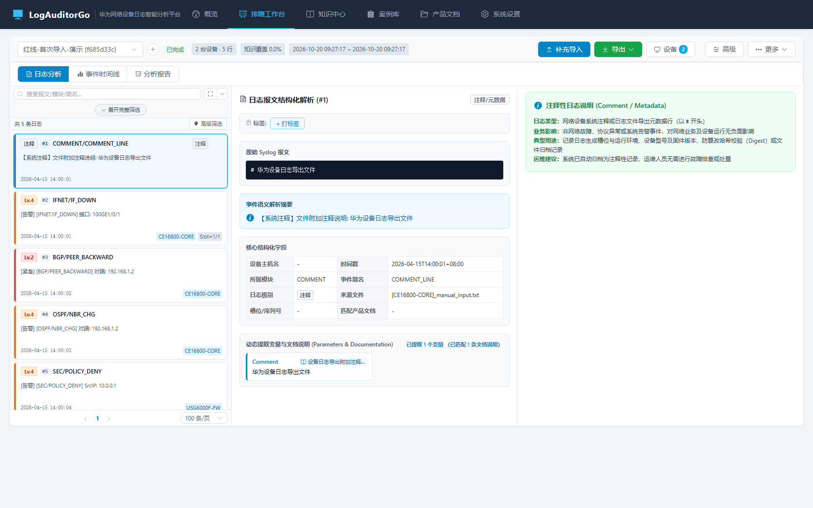
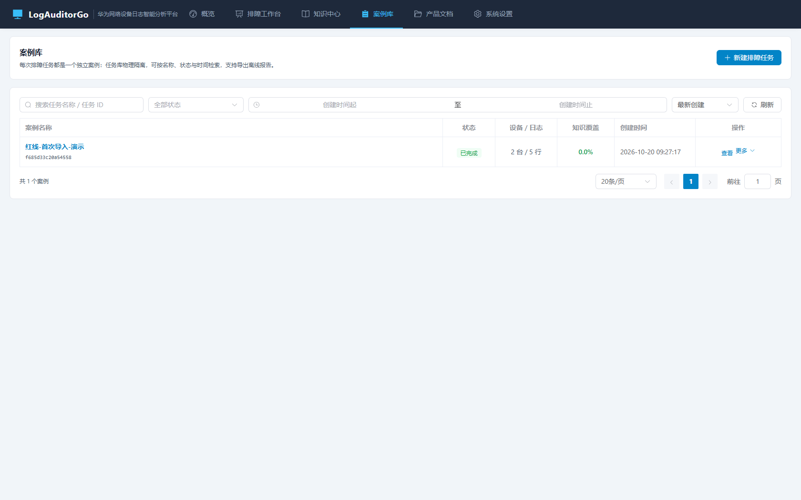
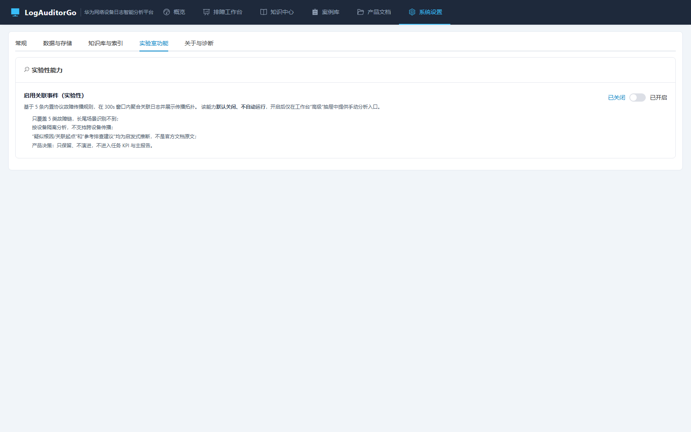

# Phase 0 实施记录与效果审视

> 依据：`Phase0-止血与降噪-规划.md` + `Phase0-止血与降噪-方案审视.md`
> 状态：已实施并完成自检
> 版本：v1.1.0

---

## 1. 交付清单

### 1.1 后端

| 交付项 | 关键实现 | 位置 |
| :-- | :-- | :-- |
| 功能开关 | `features` 配置段、`Features()` 快照、`UpdateFeatures()` 持久化；明确不做项返回错误 | `internal/config/config.go` |
| RCA 退出主航道 | `autoRCAEnabled()` 收口导入/重分析/删除文件三处自动派发；手动接口保留 | `internal/task/rca_scheduler.go`、`internal/task/service.go` |
| 知识库空结果修复 | 查询层 `MustNot DocID(__mapping_version__)`，Total 与 Hits 均不含哨兵 | `internal/search/bleve_indexer.go` |
| 案例库分页检索 | `TaskListQuery` + 白名单排序 + LIKE 转义 + 状态清洗 | `internal/task/task_list.go`、`internal/api/task_handler.go` |
| 功能开关/存储端点 | `GET/PUT /system/features`、`GET /system/storage`、`GET /tasks/query` | `internal/api/system_handler.go`、`internal/api/router.go` |
| 单实例保护 | Windows 命名互斥体 / 其他平台锁文件 + `instance.json` + 第二实例打开已有控制台 | `internal/singleinstance/*`、`cmd/LogAuditorGo/main.go` |
| 版本集中管理 | `internal/version`，替换 main/tray/router 三处硬编码 | `internal/version/version.go` |

### 1.2 前端

| 交付项 | 关键实现 | 位置 |
| :-- | :-- | :-- |
| 三 Tab IA | `LOGS/TIMELINE/REPORT` + `normalizeViewMode` 旧值迁移 | `constants/viewModes.js`、`WorkbenchNavBar.vue` |
| 设备抽屉 | `WorkbenchDeviceDrawer.vue` 内嵌 DeviceManager | `components/workbench/` |
| 高级抽屉 | 专家筛选入口 + 关联事件（懒挂载）+ 原始字段/诊断 + 批量导出 | `components/workbench/WorkbenchAdvancedDrawer.vue` |
| Header 收敛 | 任务/状态/设备/覆盖/时间 + 导入/导出/设备/高级/更多 | `components/workbench/WorkbenchHeader.vue` |
| 分析报告中枢 | 摘要、关键发现、导出、多设备报告折叠、方法与局限 | `components/workbench/ReportCenter.vue` |
| 右栏去 RCA | 只保留官方知识 + 匹配依据 + 未匹配行动建议 | `components/workbench/LogKnowledgePanel.vue` |
| 案例库 | 搜索/状态/时间/排序/分页、状态中文、操作收纳、删除二次确认 | `views/Tasks.vue` |
| 设置页 | 常规 / 数据与存储 / 知识库与索引 / 实验室功能 / 关于与诊断 | `views/Settings.vue` |
| 仪表盘快修 | 最近案例 + 需要关注 + 快速开始 + 空态行动 + 累计指标降级 | `views/Dashboard.vue` |
| 知识库错误态 | 错误与空结果分离、可重试；空结果不再显示计数 | `views/KnowledgeCenter.vue` |
| RCA 显示修复 | 证据强度 0/缺失显示“证据不足”；筛选包含 LOW；术语改为关联事件 | `components/RcaCenter.vue`、`utils/rca.js` |
| 状态组件 | 状态中文与颜色语义（PROCESSING 不再用危险色） | `components/TaskStatusTag.vue`、`constants/taskStatus.js` |
| 匹配依据 | 层级中文释义 + 来源文档 + 置信度 | `constants/matchTiers.js`、`LogKnowledgePanel.vue` |

### 1.3 测试与文档

| 类型 | 内容 |
| :-- | :-- |
| Go 单测 | `search` 哨兵排除、`config` 开关、`task` 列表检索、`singleinstance` 抢占/读写 |
| Go 红路线 | `internal/api/red_route_test.go`：导入→日志可见、命中→可解释、导出→可下载、检索→可找回；RCA 默认关闭与手动触发 |
| 前端契约 | `web/scripts/verify-ui-contract.mjs`（10 项断言，已并入 `npm run test:unit`） |
| 文档 | README、架构与模块说明书同步 v1.1 IA、API、配置与测试 |

---

## 2. 验收核对

| # | 验收项 | 结果 | 证据 |
| :-- | :-- | :--: | :-- |
| 1 | 默认界面无 RCA 一级入口、无右栏 RCA Tab | 通过 | `WorkbenchNavBar` 仅 3 Tab；`LogKnowledgePanel` 已删 RCA 页签；契约脚本断言 3 Tab |
| 2 | 关闭开关时导入不自动产生 RCA | 通过 | `TestRedRoutesSmoke` 断言 `rca_status=PENDING`、`rca_count=0`；`autoRCAEnabled()` 三处收口 |
| 3 | 开启后高级抽屉可手动触发 | 通过 | 红路线用例 PUT features→POST rca/reanalyze→终态；设置页截图“实验室功能” |
| 4 | 设备按钮 1 次点击打开抽屉 | 通过 | Header “设备”按钮 → `showDeviceDrawer`；设备抽屉截图/结构核对 |
| 5 | 知识库空库 total=0 | 通过 | `TestSearchExcludesMappingSentinelDocument` |
| 6 | 案例库检索/筛选/分页 | 通过 | `TestQueryTaskListFiltersSortAndPagination`；案例库截图 |
| 7 | 设置页索引/存储/实验室可见 | 通过 | `GET /system/storage` + 设置页截图 |
| 8 | 双开不启动第二个服务 | 通过 | `TestAcquireRejectsSecondInstance`；启动日志“检测到已有实例正在运行” |
| 9 | 四条红路线自动化 | 通过 | `go test ./internal/api -run TestRedRoutesSmoke` + `npm run test:unit` |

全量回归：`go test ./... -count=1` 全部通过（23 个包，含新增 `singleinstance`），`npm run build` 与 `npm run test:unit` 通过。

---

## 3. 实施中发现并修复的问题

| # | 问题 | 根因 | 修复 |
| :-- | :-- | :-- | :-- |
| 1 | 红路线用例读到同包其他用例的 5 个任务 | `InitKnowledgeDB` 对已有单例直接复用，测试间共享了库 | 用例启动前 `CloseAllTaskDBs` + `CloseKnowledgeDB` |
| 2 | `server_test` 开启 feature 后 RCA 仍为 0 | 自动派发读 `config.GlobalConfig`，测试只构造了局部 cfg | 测试显式发布全局配置 |
| 3 | 知识库/RCA 空态按钮与提示不渲染 | Element Plus `el-empty` 无 `#extra` 插槽，内容被静默丢弃 | 改用默认插槽 |
| 4 | 仪表盘卡片图标与标题被推到两端 | `.card-header` 的 `space-between` 作用于图标+标题两个直接子节点 | 包一层 `.card-header-left` |
| 5 | 空知识库仍显示“共 0 条”分页 | 分页未按总数隐藏 | `v-if="total > 0"` |
| 6 | 工作台 NavBar 与 Header 重复展示设备/日志数 | 收敛 Tab 后信息冗余 | 删除 NavBar 右侧 meta |

---

## 4. 效果审视（实机走查）

截图为本地实例（Chrome headless，1680×1050）实拍：

- 
- 
- 

观察结论：

1. **默认路径变短**：进入工作台第一眼是“任务 → 状态 → 三 Tab → 三栏”，RCA 已不在任何一级入口；Header 只保留 5 个动作，删除/重分析收进“更多”。
2. **设备与专家能力可发现但不挡路**：设备按钮带数量徽标，高级抽屉内是专家筛选与实验能力。
3. **未匹配不再空白**：右栏给出“暂无官方知识 + 去知识库检索/复制模块助记符/补充本地知识（占位）”。
4. **状态可读**：案例库状态为“已完成/分析中/待导入/失败”，PROCESSING 不再使用危险色，失败可悬停看原因。
5. **设置页补全**：索引健康、存储占用、实验室开关、版本与路径都有出处。
6. **仍待后续阶段**：注释行仍默认混排、日志卡片仍只有 Lv.N、无导入后诊断摘要/结论、无 HDX 获取引导——分别属于 Phase 1/2/3 的排期，本阶段未越界实现。

---

## 5. 偏差说明

| 项 | 规划/审视口径 | 实际 | 说明 |
| :-- | :-- | :-- | :-- |
| 前端 E2E | 审视阶段已降级 | Go 红路线 + Node 契约脚本 | 无浏览器二进制依赖；真实浏览器回归推迟到 Phase 3 评估 |
| 产品文档导航 | 目标 IA 并入知识中心 | 仍为一级入口 | 属知识闭环阶段（Phase 2）范围 |
| 诊断摘要/结论/证据包 | Phase 1 | 报告 Tab 先提供指标/发现/导出中枢 | 不提前承诺结论字段 |
| 首启引导/HDX 提示 | Phase 2 | 设置页有实验室说明，无引导 | 按阶段推进 |

---

## 6. 结论

Phase 0 的 9 项验收全部通过，默认界面已无 RCA 主航道入口，设备/高级抽屉可用，知识库计数与错误态正确，设置页与单实例保护落地，四条红路线具备自动化回归。**准予进入 Phase 1。**
