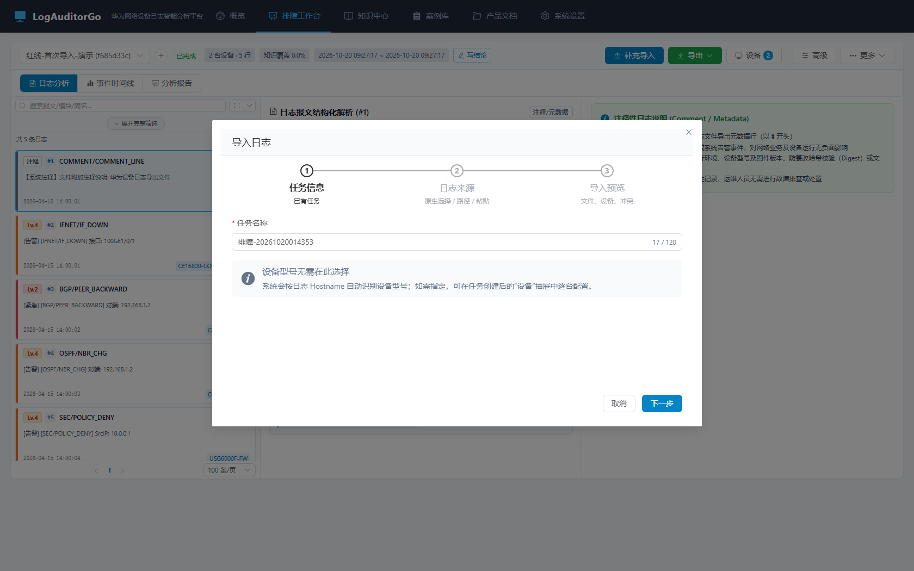
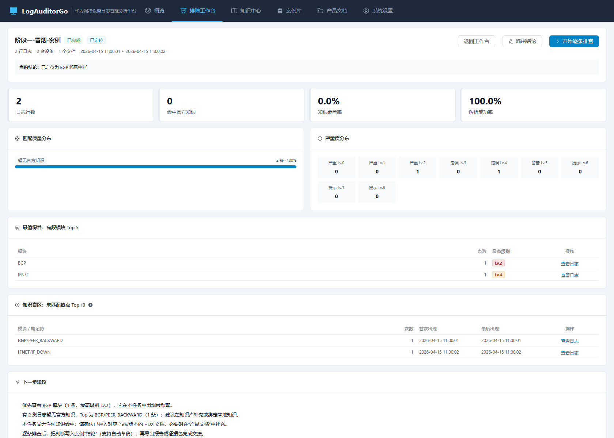
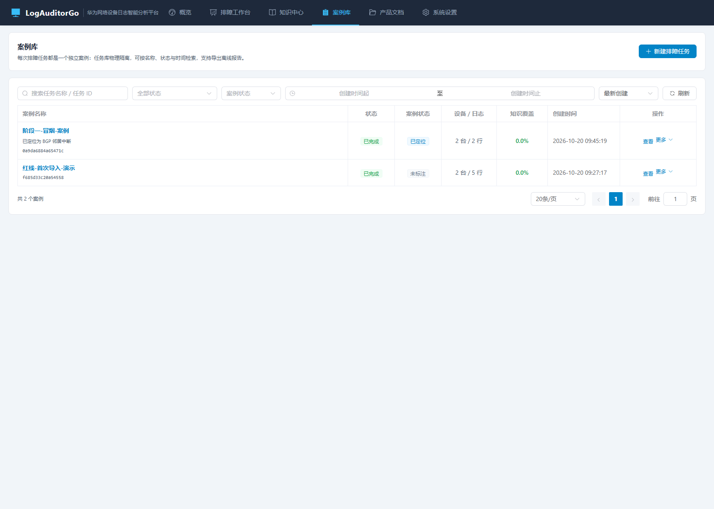

# Phase 1 实施记录与效果审视

> 依据：`Phase1-主链路打通-规划.md` + `Phase1-主链路打通-方案审视.md`
> 状态：已实施并完成自检
> 版本：v1.2.0

---

## 1. 交付清单

### 1.1 后端

| 交付项 | 关键实现 | 位置 |
| :-- | :-- | :-- |
| 原生文件/文件夹对话框 | `Opener` 接口 + Windows COM（STA/IFileOpenDialog）+ 非 Windows 降级；能力探测端点 | `internal/nativedialog/*`、`internal/api/fs_handler.go` |
| 统一导入预览 | 与导入同源清洗；单文件 10 万行 / 200 文件上限；设备分布、时间范围、冲突、预计耗时 | `internal/task/import_preview.go` |
| 诊断摘要 | 单表聚合：概览/严重度/匹配质量/Top5 模块/Top10 热点/建议/首条高优先级日志 | `internal/task/diagnosis.go` |
| 案例字段 | `case_status/conclusion/notes/external_ref/case_tags/last_opened_at` + 双写 + 标签归一化 | `internal/model/task.go`、`internal/task/case_service.go` |
| 结论草稿/交接摘要 | 确定性 Markdown，不调用模型、不自动落库 | `internal/task/case_service.go`、`diagnosis.go` |
| 逐行设备归属 | 批内按 Hostname 建/查设备并重匹配；显式指定设备的导入不参与 | `internal/task/device_reassign.go`、`pipeline_engine.go` |
| 报告升级 | 执行摘要/关键证据/未匹配/处置建议/方法与局限；RCA 章节受实验开关控制 | `internal/task/templates/report.html.tmpl`、`exporter.go` |
| 证据包与文件名 | 流式 ZIP（report.html/logs.csv/metadata.json/README.txt）；RFC 5987 友好文件名 | `internal/api/export_package.go`、`download_filename.go` |
| 版本 | v1.2.0 | `internal/version/version.go` |

### 1.2 前端

| 交付项 | 关键实现 | 位置 |
| :-- | :-- | :-- |
| 统一导入向导 | 任务信息 → 来源（原生/路径/文本）→ 预览 → 开始分析；新建与补充导入共用 | `components/workbench/ImportWizard.vue` |
| 原生对话框回退 | 能力探测 + 501 自动切换 `ServerPathPicker`；取消不报错 | 同上 |
| 诊断摘要页 | `/audit/:id/summary`：概览、匹配质量、严重度、Top 模块、热点、建议、开始排查 | `views/DiagnosisSummary.vue` |
| 结论抽屉 | 状态/结论/备注/工单号/标签 + 生成草稿（覆盖前确认） | `components/workbench/ConclusionDrawer.vue` |
| Header 结论摘要 | 一句话可点击编辑；更多菜单增加诊断摘要/编辑结论 | `WorkbenchHeader.vue` |
| 报告中枢 | 复制交接摘要、导出证据包、HTML/CSV 与多设备报告 | `ReportCenter.vue` |
| 案例库 | 案例状态列与筛选、结论摘要、删除二次确认 | `views/Tasks.vue` |
| 入口统一 | 概览/工作台/案例库统一到 `/audit/new` 与同一向导 | `router/index.js`、`Dashboard.vue` |
| 最小深链接 | `?module=&matched=false&log=<id>` 由工作台应用筛选并选中日志 | `useWorkbenchTaskContext.js` |

### 1.3 测试

| 测试 | 覆盖 |
| :-- | :-- |
| `internal/task/phase1_test.go` | 双 Hostname 归属、预览冲突、摘要聚合、案例字段/草稿/摘要 Markdown |
| `internal/api/phase1_test.go` | 对话框 capability/文件/文件夹/取消/501、案例 API、摘要、草稿、证据包解压、RFC 5987 文件名 |
| `internal/nativedialog/dialog_test.go` | 扩展名归一化、注入实现、错误传播 |
| `web/scripts/verify-ui-contract.mjs` | 新增案例状态断言（11 项） |

---

## 2. 验收核对

| # | 验收项 | 结果 | 证据 |
| :-- | :-- | :--: | :-- |
| 1 | 原生对话框可选文件/文件夹；取消返回 canceled | 通过 | Windows 实现 + API 测试（注入实现）；`/fs/dialog/capability` 实机返回 `supported=true` |
| 2 | 原生不可用自动回退路径选择器 | 通过 | 501 分支 + 前端 501 自动打开 `ServerPathPicker` |
| 3 | 预览展示文件/设备/时间/冲突/预计耗时 | 通过 | `TestImportPreviewReportsDevicesAndConflicts` + 实机 API |
| 4 | 导入完成进入诊断摘要，数据与任务库一致 | 通过 | 向导 `job-started` → 进度完成 → `/summary`；摘要聚合测试 |
| 5 | 摘要首屏 < 1s | 设计达标（待基准） | 全部为单表聚合 SQL；Phase 3 补 10 万行基准 |
| 6 | 单文件双 Hostname 归属正确 | 通过 | `TestImportAssignsPerHostnameDevice`；实机摘要显示 2 台设备 |
| 7 | 结论保存/刷新不丢；案例库筛选 | 通过 | 双写测试 + `TestPhase1ExportAndCase` + 案例库截图 |
| 8 | 报告含结论/证据/未匹配/建议/局限；证据包可解压 | 通过 | 证据包 ZIP 解压断言 + report.html 关键章节断言 |
| 9 | 复制摘要含任务/时间/设备/关键事件/建议/局限 | 通过 | Markdown 生成测试与实机 API 校验 |
| 10 | 全量测试与前端构建通过 | 通过 | `go test ./...`、`npm run build`、`npm run test:unit` |

---

## 3. 实施中发现并修复的问题

| # | 问题 | 根因 | 修复 |
| :-- | :-- | :-- | :-- |
| 1 | 诊断摘要时间字段 Scan 报错 | SQLite 以字符串存时间，`*time.Time` 直接 Scan 不支持 | 改取字符串并复用 `parseSQLTime` |
| 2 | 逐行归属完全不生效 | `prepareBundles` 自动模式也会写 `bundle.deviceID`，原判断误以为显式导入 | 新增 `explicitDevice` 标记，仅显式导入跳过逐行归属 |
| 3 | 对话框 API 测试 403 | httptest 请求 `RemoteAddr` 为空，被 `RequireLoopback` 拒绝 | 测试统一模拟 `127.0.0.1` |
| 4 | 报告 RCA 章节回归 | RCA 默认关闭后模板不渲染，旧测试仍断言旧文案 | 直接调用保持兼容默认；服务路径显式传入；测试开启开关并改用新术语 |
| 5 | 新建向导首步显示“已有任务” | `isExisting` 只看 taskId，未考虑 createMode | 改为 `!createMode && taskId` |
| 6 | 临时目录清理失败 | Windows WAL/句柄释放有毫秒级延迟 | 关闭连接后重试删除（测试侧） |

---

## 4. 效果审视（实机走查）

- 
- 
- 

观察结论：

1. **导入入口统一**：概览/工作台/案例库都落到 `/audit/new`，向导四步清晰；原生对话框能力可探测，失败可回退，不再要求用户手抄绝对路径。
2. **摘要先于明细**：导入完成进入摘要，首屏回答“多少日志、多少设备、哪些模块最多、哪些没知识、下一步做什么”，到日志只需 1 次点击。
3. **案例可交接**：结论摘要出现在 Header 与案例库列表；状态、标签、工单号可检索；报告与证据包包含结论与局限。
4. **双设备归属修复**：实机导入含两个 Hostname 的日志后，摘要显示 2 台设备，不再出现 10/0。
5. **仍待后续阶段**：10 万行性能基准与浏览器级 E2E 在 Phase 3；首启引导、HDX 获取卡片、未匹配热点补知识在 Phase 2；日志注释隐藏/直方图/聚合在 Phase 3。

---

## 5. 偏差说明

| 项 | 规划/审视口径 | 实际 | 说明 |
| :-- | :-- | :-- | :-- |
| 原生对话框自动化 | 手工验证 | 能力端点 + 注入实现单测 + 实机能力探测 | 无法在无头浏览器点击系统模态框 |
| 10 万行摘要性能 | < 1s | 聚合 SQL 设计，未压测 | Phase 3 性能基准统一覆盖 |
| 设备导入弹窗 | 统一走向导 | `TaskImportDialog` 仅保留给设备专用导入 | 避免与"向指定设备导入"语义冲突，文档标注边界 |
| 快速预览耗时 | 精确估算 | 保守经验值 + UI 标注“预计” | 不写入验收 |

---

## 6. 结论

Phase 1 十项验收全部通过：原生选路、统一向导、导入预览、诊断摘要、双设备归属、案例结论、报告与证据包均已落地并有自动化覆盖。**准予进入 Phase 2。**
