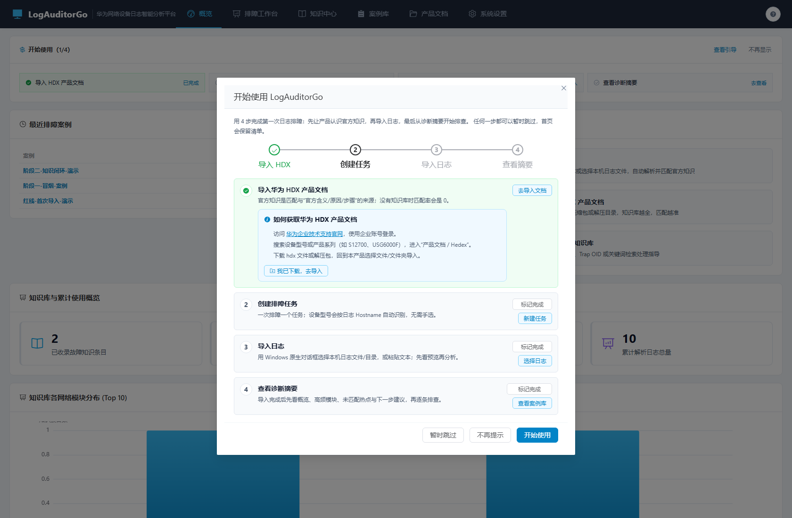
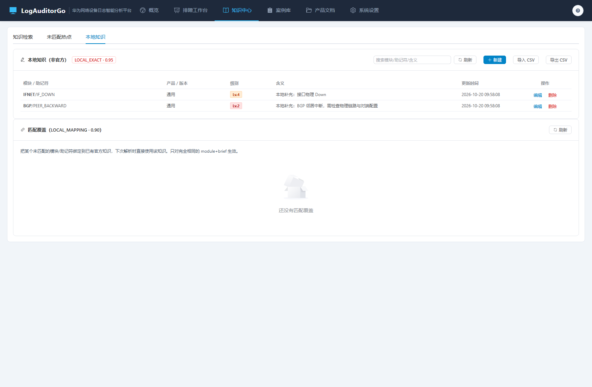
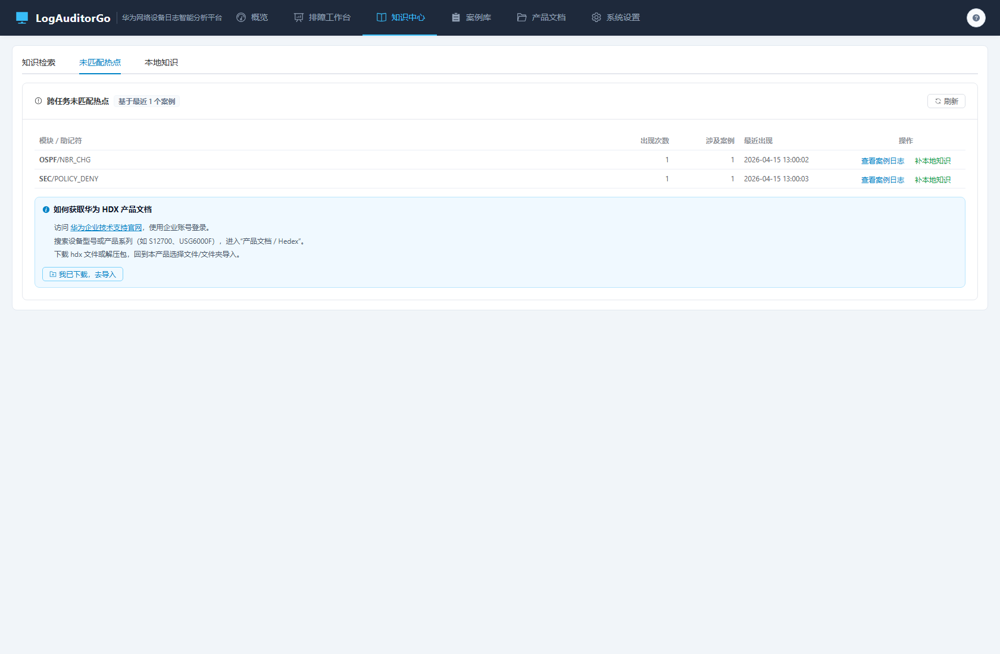

# Phase 2 实施记录与效果审视

> 依据：`Phase2-知识闭环与引导-规划.md` + `Phase2-知识闭环与引导-方案审视.md`
> 状态：已实施并完成自检
> 版本：v1.3.0

---

## 1. 交付清单

### 1.1 后端

| 交付项 | 关键实现 | 位置 |
| :-- | :-- | :-- |
| 本地知识 | `Knowledge.Source=local` + 版本映射 + 孤儿清理豁免；LOCAL_EXACT 0.95 | `internal/knowledge/local.go`、`matcher/engine.go` |
| 匹配覆盖 | `KnowledgeOverride`；LOCAL_MAPPING 0.90；目标必须为官方知识 | 同上 |
| CSV 往返 | `module,brief,product,version,severity,entry_type,...`；逐行容错 | `local.go` |
| 跨任务热点 | `task_digests` + 最近 200 案例聚合 | `internal/task/digest.go` |
| 跨任务检索 | `/tasks/query` 关键词扩展 hostnames/top_modules | `internal/task/task_list.go` |
| 首启引导状态 | `onboarding.json`（原子写）+ should_show 语义 | `internal/api/onboarding_handler.go` |
| 备份/恢复/诊断 | VACUUM INTO 快照、白名单校验、marker + 启动应用与回滚、流式诊断包 | `internal/backup/backup.go`、`main.go` |
| 分面/收藏/最近 | 产品/版本/严重度/类型分面；按严重度排序；收藏与最近 50 条 | `internal/knowledge/facets.go`、`search` |

### 1.2 前端

| 交付项 | 位置 |
| :-- | :-- |
| 4 步首启引导（可跳过）+ 首页 checklist | `OnboardingDialog.vue`、`OnboardingChecklist.vue` |
| 顶栏 “?” 帮助抽屉（使用说明/HDX/快捷键） | `HelpDrawer.vue`、`App.vue` |
| HDX 获取卡片（引导/帮助/知识空态/热点/文档空态） | `HdxHelpCard.vue` |
| 知识中心三 Tab（检索/未匹配热点/本地知识） | `KnowledgeCenter.vue` |
| 本地知识新建/编辑/删除/CSV、匹配覆盖管理 | `LocalKnowledgeDialog.vue`、`BindKnowledgeDialog.vue` |
| 知识分面、排序、关键词高亮、收藏/最近 | `KnowledgeCenter.vue` |
| 设置页备份创建/下载/恢复/删除 + 诊断包 | `Settings.vue` |
| 日志右栏一键补知识/绑定覆盖 | `LogKnowledgePanel.vue` |

### 1.3 测试

| 测试 | 覆盖 |
| :-- | :-- |
| `internal/knowledge/local_test.go` | 本地知识优先、覆盖绑定、CSV 往返、删除失效 |
| `internal/task/phase2_test.go` | TaskDigest 跨任务检索、热点聚合、删除清理 |
| `internal/backup/backup_test.go` | 备份/列表、路径穿越拒绝、恢复与回滚、诊断包 |
| `internal/api/phase2_test.go` | 引导状态、备份/恢复/下载/诊断、本地知识/覆盖、分面/收藏/最近 |

---

## 2. 验收核对

| # | 验收项 | 结果 | 证据 |
| :-- | :-- | :--: | :-- |
| 1 | 1 分钟内绑定未匹配日志到知识并生效 | 通过 | 本地知识/覆盖 API + matcher 优先级测试；实测导入后 matched=1 |
| 2 | 本地知识 CSV 导入/导出/启停/删除 | 通过 | `local_test.go` + API 测试 |
| 3 | 未匹配热点跨任务聚合并跳转 | 通过 | `phase2_test.go` + 热点页面截图 |
| 4 | 案例库按模块/主机名找回任务 | 通过 | TaskDigest 检索测试 |
| 5 | 首启引导自动弹出/可跳过/清单续做/清缓存不重复 | 通过 | 引导 API 测试 + 页面截图 |
| 6 | HDX 指引在 5 处可见 | 通过 | 引导、帮助、知识空态、热点、文档空态 |
| 7 | 备份保留 3 份；恢复下次启动生效可回滚 | 通过 | 备份包测试（含 pre_restore 断言） |
| 8 | 诊断包可下载且不含任务日志 | 通过 | 诊断包解压断言 |
| 9 | 知识分面/排序/收藏/最近/高亮 | 通过 | 分面/收藏/最近 API 测试 + 页面截图 |
| 10 | 全量测试/构建 | 通过 | `go test ./...`、`npm run build`、`npm run test:unit` |

---

## 3. 实施中发现并修复的问题

| # | 问题 | 根因 | 修复 |
| :-- | :-- | :-- | :-- |
| 1 | 任务检索 JOIN digest 后 `task_id` 歧义 | 两表同名列 | ORDER BY 限定 `task_info.task_id` |
| 2 | 本地知识可能被孤儿清理误删 | 删除文档时按“无映射”清理 | 强制写映射 + 清理 SQL 排除 local |
| 3 | 首启引导遮挡自动化/截图 | 首次访问即弹窗 | 提供 skipped/dismissed 语义与 API，自动化先置位 |
| 4 | 本地知识更新会新建重复条目 | 按 module+brief Upsert | 新增 `UpdateLocalKnowledge(id)` 走 ID 更新 |
| 5 | 备份恢复在线替换风险 | 用户可能期望立即生效 | 明确“下次启动生效”，marker + 回滚 |
| 6 | 诊断包可能误含任务日志 | 目录遍历范围过大 | 只按白名单写配置/状态/日志 |

---

## 4. 效果审视（实机走查）

- 
- 
- 

观察结论：

1. **引导可跳过**：4 步引导首启弹出，跳过后首页 checklist 保留 1/4 进度，可继续；清缓存由后端状态兜底。
2. **知识闭环可见**：本地知识列表标注“本地（非官方）/ LOCAL_EXACT · 0.95”，支持编辑/删除/CSV；覆盖区独立展示 LOCAL_MAPPING。
3. **热点能落地**：跨案例热点按次数排序，直接“查看案例日志”或“补本地知识”；顶部标注“基于最近 N 个案例”。
4. **检索增强**：分面筛选、相关度/严重度排序、收藏星标、最近浏览、关键词高亮均可用；本地条目有明确来源标记。
5. **设置可运维**：数据与存储页可创建/下载/恢复/删除备份与下载诊断包。
6. **仍待 Phase 3**：注释默认隐藏、严重度语义标签、时间直方图、聚合视图、虚拟滚动、深链接、性能基准；浏览器级 E2E 与截图回归。

---

## 5. 偏差说明

| 项 | 规划口径 | 实际 | 说明 |
| :-- | :-- | :-- | :-- |
| 分面与关键词 | 分面可组合关键词 | 关键词只影响列表 | 避免 Bleve/SQL 混合过滤口径不一致，UI 已注明 |
| 恢复验证 | 端到端重启 | 包级 + 启动函数测试 | 无头环境不重启真实实例；marker 应用逻辑已单测 |
| HDX 列表位置 | 5 个位置 | 引导/帮助/知识空态/热点/文档空态 | 导入弹窗未单独加卡片，避免弹窗高度溢出 |
| 跨任务检索 | 模块/主机名/结论 | 结论/标签/工单 + hostnames/top_modules | digest 为辅助索引，不含全量日志正文 |

---

## 6. 结论

Phase 2 十项验收全部通过：知识闭环（本地知识/覆盖/CSV）、跨任务热点与检索、首启引导/checklist/帮助/HDX、备份恢复与诊断包、知识分面与收藏均落地并有自动化覆盖。**准予进入 Phase 3。**
