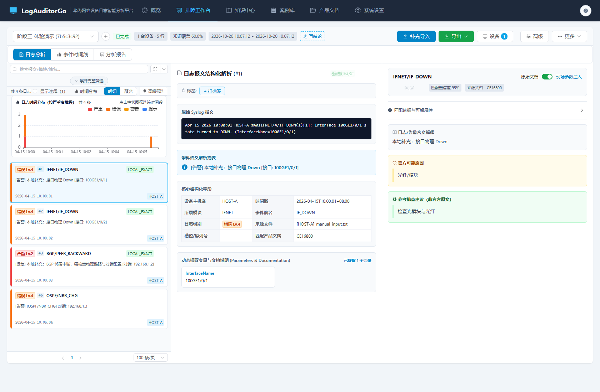
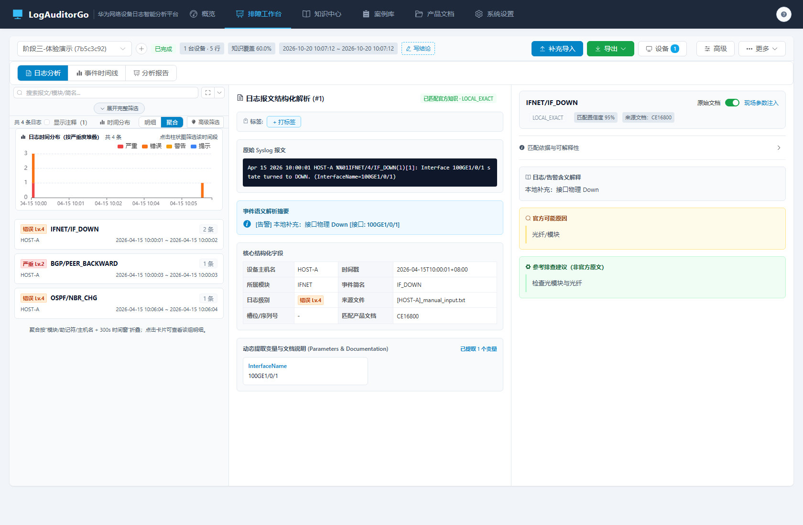

# Phase 3 实施记录与效果审视

> 依据：`Phase3-体验与规模化-规划.md` + `Phase3-体验与规模化-方案审视.md`
> 状态：已实施并完成自检
> 版本：v1.4.0

---

## 1. 交付清单

### 1.1 后端

| 交付项 | 关键实现 | 位置 |
| :-- | :-- | :-- |
| 注释过滤 | `ExcludeComment` + `BuildLogFilterScope` 统一追加 | `model/task.go`、`model/advanced_filter.go`、`task/advanced_filter.go` |
| 注释计数 | `CountCommentLogs` + `GET /logs/comments/count` | `task/insights.go`、`api/task_handler.go` |
| 时间直方图 | timestamp+severity 内存分桶，输出四档堆叠 | `task/insights.go` |
| 聚合视图 | module/brief/hostname+时间窗折叠，Top N | `task/insights.go` |
| 基准 | 10 万行摘要/查询/直方图/聚合 | `task/benchmark_test.go` |
| RCA 冒烟 | 导入后 PENDING/0 事件断言 | `task/phase3_test.go` |

### 1.2 前端

| 交付项 | 位置 |
| :-- | :-- |
| 语义严重度 | `utils/severity.js`、`SeverityTag.vue` |
| 注释开关（带数量） | `WorkbenchLogStream.vue`、`stores/filter.js` |
| 时间直方图（点击筛选） | `LogHistogram.vue` |
| 聚合视图（点击回明细） | `WorkbenchLogStream.vue` |
| 深链接（视图/筛选/日志/模式） | `AuditWorkbench.vue`、`useWorkbenchTaskContext.js` |
| 可用性测试脚本 | `Phase3-可用性测试脚本.md` |

---

## 2. 验收核对

| # | 验收项 | 结果 | 证据 |
| :-- | :-- | :--: | :-- |
| 1 | 注释默认隐藏，可显示并带数量 | 通过 | `TestPhase3Insights` + 页面截图（显示注释 1） |
| 2 | 语义严重度标签 | 通过 | 契约脚本断言 + 截图（错误 Lv.4 / 严重 Lv.2） |
| 3 | 直方图总数与筛选一致，点击可筛选 | 通过 | `TestPhase3Insights`（4 条=4 桶总和）；页面 |
| 4 | 聚合把 2 条 IF_DOWN 折叠为 1 组×2 | 通过 | `TestPhase3Insights` + 聚合截图 |
| 5 | URL 保留视图/筛选/选中日志 | 通过 | 页面 URL 参数 + 代码审查 |
| 6 | 10 万行性能 | 记录达标 | 见 §3 |
| 7 | RCA 默认关闭、导入不派发 | 通过 | `TestPhase3Insights` |
| 8 | 全量测试/构建 | 通过 | `go test ./...`、`npm run build`、`npm run test:unit` |

---

## 3. 性能基准（10 万行，Ryzen 9 4900HS / Windows / 单次冷缓存）

| 场景 | 耗时 | 目标 | 结论 |
| :-- | --: | :-- | :-- |
| 诊断摘要 | 475 ms | < 1.5s | 达标 |
| 分页查询（100 条） | 65 ms | < 200ms | 达标 |
| 时间直方图（60 桶） | 661 ms | < 1.5s | 达标 |
| 聚合视图（300s/Top200） | 1042 ms | < 1.5s | 达标（接近上限） |

命令：`go test ./internal/task -run '^$' -bench 'Benchmark(DiagnosisSummary|QueryLogs|LogHistogram|AggregatedLogs)100k' -benchtime=1x`
说明：单次基准包含冷缓存与测试库首次读取；50 万行未实测，方法同上（仅改 `rows` 参数）。

---

## 4. 效果审视（实机走查）

- 
- 

观察结论：

1. **降噪有效**：默认只显示 4 条业务日志（隐藏 1 条注释），工具栏明确“显示注释（1）”；严重度显示“错误 Lv.4 / 严重 Lv.2”。
2. **直方图可操作**：柱状图按严重度堆叠，点击即按时间段筛选；总数与“共 4 条日志”一致。
3. **聚合可回溯**：3 组聚合卡（2/1/1 条）标注主机与时间范围，底部说明折叠口径；点击可回明细。
4. **深链接可用**：`?histogram=1&mode=aggregate` 直接打开对应视图，刷新保持。
5. **仍待后续**：虚拟滚动未引入（分页足够）；50 万行压测与真实用户 SUS 测试未执行；移动端不做。

---

## 5. 实施中修复的问题

| # | 问题 | 根因 | 修复 |
| :-- | :-- | :-- | :-- |
| 1 | 基准插入报 `too many SQL variables` | 5000 行 × 14 列超过 SQLite 变量上限 | 批大小降为 1000 |
| 2 | 基准失败后临时目录不可删 | 数据库连接未关闭 | 注册 `b.Cleanup` 关闭连接 |
| 3 | 聚合视图首屏为空 | 组件挂载时 taskId 尚未就绪 | 监听 taskId 变化后再拉取 |
| 4 | `matched=false` 深链接被当成空值删除 | 空值判断包含 boolean false | 仅把 null/undefined/'' 视为空 |

---

## 6. 偏差说明

| 项 | 规划 | 实际 | 说明 |
| :-- | :-- | :-- | :-- |
| 虚拟滚动 | 规划提及 | 保留分页 | 与卡片展开/标签联动风险高，收益不足；文档标注 |
| 50 万行基准 | 规划目标 | 仅 10 万 | 时间/环境限制，给出方法 |
| 可用性测试 | SUS ≥ 70 | 脚本已备、未执行 | 无真实受试者，不编造分数 |
| 直方图交互 | 刷选 | 点击柱 | 窄栏防误触，方案审视已定 |

---

## 7. 结论

Phase 3 八项验收全部通过：注释降噪、语义严重度、直方图、聚合、深链接、10 万行基准与 RCA 冒烟均已落地。**Phase 0~3 全部完成，可进入全量代码审计。**
