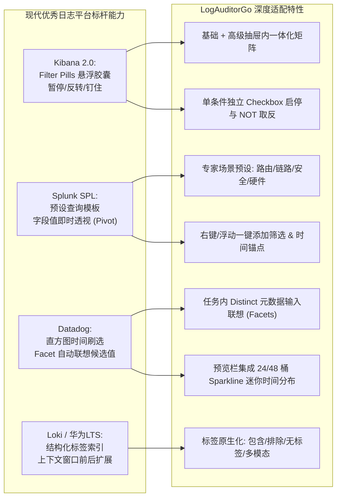
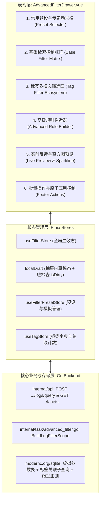
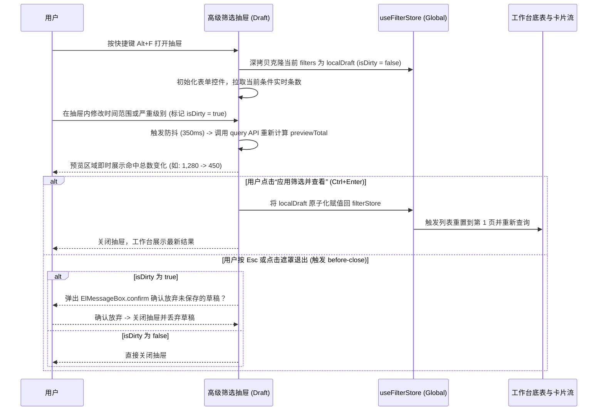
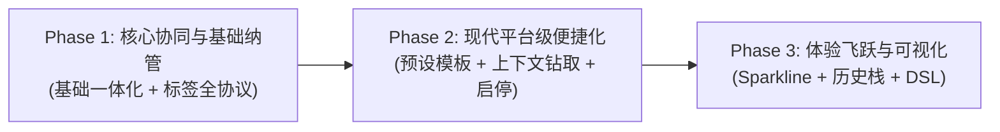

# LogAuditor 工作台高级筛选深度优化设计方案

> 文档编号：LOG-DOC-2026-FILTER-01  
> 适用版本：LogAuditorGo v1.2+  
> 修订版本：v1.1.0（依据架构与样式规范二次审计彻底修正）  
> 生效日期：2026-10  
> 状态：正式技术规划方案  
> 配套规范：[架构与模块说明书.md](file:///d:/Document/GO/LogAuditorGo/docs/架构与模块说明书.md)、[前端样式规范.md](file:///d:/Document/GO/LogAuditorGo/docs/前端样式规范.md)

---

## 1. 背景与设计目标

### 1.1 现状复盘与核心痛点

在现有的 `LogAuditorGo` 架构中，工作台左栏配备了 `AuditFilterBar`（基础筛选栏），并通过抽屉组件 `AdvancedFilterDrawer` 提供了多字段的高级规则圈选能力。然而，在日常网络故障排查与海量日志审计的实际使用中，当前高级筛选存在以下三个维度的突出痛点：

1. **基础筛选与高级筛选交互割裂（无回溯调整通道）**：
   - 当前 `AdvancedFilterDrawer` 仅以只读的 `baseFilterSummary`（Alert 提示条）展示外部基础筛选；
   - 用户在抽屉中配置复杂规则时，若发现时间窗口过宽/过窄、想切换设备、或调整严重级别阈值，**必须关闭抽屉 -> 在左栏重新点击筛选 -> 再次打开抽屉**，排查思路被反复打断，缺乏一体化的全局掌控感。
2. **标签筛选能力未深入高级规则体系**：
   - 现有高级条件构造器的字段枚举（`field`）局限于报文正文、模块、简名、槽位及动态 KV 参数，**未将“标签（Tag）”作为一等公民筛选维度**纳入条件构造器；
   - 现有接口虽然支持基础的标签正向包含（`tag_ids`），但无法表达“**排除某标签（如已确认误报）**”、“**未打标日志（查找漏网之鱼）**”等关键审计诉求。
3. **现代日志审计平台便捷性特性的缺失**：
   - 缺乏常用条件组的“**保存预设/场景模板（Presets）**”，典型网络故障（如 OSPF 邻居振荡、接口频繁 Up/Down、安全 ACL 拦截）每次都需运维人员从零配置多行规则；
   - 缺乏“**从日志上下文一键钻取（Pivot / One-Click Filter）**”；
   - 缺乏条件的“**临时启用/禁用（Toggle Enable）**”与“**取反（Invert/NOT）**”开关，调试条件时只能粗暴删除后重新输入；
   - 字段值输入全靠手动键入，缺乏当前任务已入库元数据（如存在的模块名、设备名）的**动态候选联想**。

### 1.2 核心设计目标

围绕上述痛点，本优化方案设定三大核心升级目标：

| 目标维度 | 目标定义 | 价值衡量标准 |
| :--- | :--- | :--- |
| **基础筛选一体化 (Unified Base Filter)** | 高级筛选抽屉全量纳管基础筛选（时间、设备、级别、关键字、状态、排序），支持双向实时同步与在抽屉内无缝微调。 | 杜绝“关抽屉-改筛选-开抽屉”的割裂交互，在抽屉内即可闭环调整全局检索范围。 |
| **全维度标签筛选 (Tag Filter Matrix)** | 赋予标签完整的集合与布尔表达能力：支持包含、排除、仅看未打标、多标签 AND/OR，并在高级构造器中作为原生字段参与运算。 | 满足故障排查中“精准圈选已知故障”与“降噪过滤已知误报”的双向诉求。 |
| **现代平台级便捷化 (Modern Ergonomics)** | 深度对标 Splunk、Elasticsearch/Kibana、Datadog 等标杆平台，引入预设模板、上下文钻取、条件启停、候选词联想、迷你命中直方图与全键盘驱动。 | 典型复合排查从平均 **12 次点击/输入** 精简至 **3 步以内**，形成流畅的沉浸式日志审计与取证体验。 |

### 1.3 核心设计原则

- **架构一致性与零破坏性升级**：保持现有 Go 后端无 CGO、任务级 SQLite 物理隔离的架构底座不变，API 接口向后兼容，平滑升级查询构造器。
- **双向数据流确定性**：明确“草稿态（Draft）”与“生效态（Committed）”，打开抽屉独立编辑，实时防抖预览条数，点击“应用”原子化生效，避免全局状态污染。
- **全键盘与无障碍体验**：遵循项目全屏沉浸（Zen Mode）的优良传统，主推 `Alt + F` 呼出/收起，支持回车执行与行级快捷操作。
- **样式规范 100% 遵从**：严格执行《前端样式规范.md》的七大铁律，**全站严禁 Emoji 充当图标或状态符号**，统一使用 `@element-plus/icons-vue` SVG 矢量图标与设计令牌系统，保障 WCAG AA 级高对比度。

---

## 2. 现代优秀日志审计平台对标与借鉴

通过对业界主流日志审计与可观测性平台（Elasticsearch/Kibana Discover、Splunk Enterprise、Datadog Log Explorer、Grafana Loki、华为云 LTS/云日志服务）进行深入调研，结合 `LogAuditorGo` 的华为网络设备离线审计定位，提炼出以下核心适配特性：



### 2.1 对标能力与落地设计映射表

| 标杆产品功能 | 标杆平台实现方式 | 在 LogAuditorGo 中的工程落地设计 |
| :--- | :--- | :--- |
| **Kibana Filter Pills 交互** | 顶部药丸组件支持单项 Enable/Disable、Invert (IS NOT)、Pin、Edit。 | 高级条件构造器每一行增加 **激活开关（Checkbox）** 与 **取反操作符切换**，无需删除即可对比规则效果。 |
| **Splunk Saved Searches / Macros** | 支持将常用的长串复杂检索式保存为宏或 Saved Search。 | 新增 **“筛选预设中心（Filter Presets）”**，基于任务库实体持久化，并预置 6 大华为网络典型排查模板。 |
| **Datadog Facet Explorer** | 检索侧边栏自动汇总各字段的 top values 及其百分比分布。 | 扩展通用元数据聚合接口 `GET /api/v1/tasks/:id/facets`，在模块、主机名、简名输入时提供真实存在的枚举与计数提示。 |
| **Grafana Loki Context Lookback** | 点击某条日志可一键查看其“前后 N 分钟的全部原始报文”。 | 提供 **“以此时刻为时间锚点（Pivot Context）”** 快捷项，一键将时间设为该日志 $T \pm 5\text{m}$ 或 $T \pm 15\text{m}$。 |
| **CloudWatch / Kibana Histogram** | 筛选栏下方实时展示命中日志随时间的密度直方图（Sparkline）。 | 抽屉底部预览栏升级为 **“数量统计 + 迷你时间分布直方图”**，直观展示故障波峰分布。 |

---

## 3. 功能架构与信息架构设计

### 3.1 总体功能架构

优化后的高级筛选模块在逻辑上划分为四个协同层级：



### 3.2 筛选条件三层模型与布尔运算规则

全局日志查询条件在底层统一定义为以下数学布尔模型：

$$\text{FinalFilter} = \text{BaseFilter} \land \text{TagFilter} \land \text{AdvancedFilter}$$

其中：
1. **基础筛选（$\text{BaseFilter}$）**：包含全局关键词、设备 ID、时间区间、严重级别上限、知识库匹配状态。各属性之间为严格的 **AND** 关系。
2. **标签筛选（$\text{TagFilter}$）**：
   - 互斥语义约束：`UntaggedOnly`（仅看未打标）与正向标签（`TagIDs`）、反向排除标签（`ExcludeTagIDs`）在业务语义上互斥；
   - 当 `UntaggedOnly = true` 时：$\text{Log} \notin \text{AllTaggedLogs}$；
   - 当模式为 **“包含任一 (Any)”**：$\text{Log} \in \bigcup_{t \in \text{IncludeTags}} \text{Logs}(t)$；
   - 当模式为 **“同时包含 (All)”**：$\text{Log} \in \bigcap_{t \in \text{IncludeTags}} \text{Logs}(t)$；
   - 当指定 **“排除标签 (Exclude)”** 时：$\text{Log} \notin \bigcup_{t \in \text{ExcludeTags}} \text{Logs}(t)$。
3. **高级规则（$\text{AdvancedFilter}$）**：
   - 包含多条独立的字段规则行，支持单条启用状态 $E_i \in \{0, 1\}$；
   - 组合逻辑支持 **全部满足（AND）**：$\bigwedge_{i, E_i=1} C_i$ 或 **满足任一（OR）**：$\bigvee_{i, E_i=1} C_i$。

---

## 4. 详细功能与交互设计

### 4.1 基础筛选一体化整合（在高级筛选内无缝调整）

抽屉顶部不再仅仅放置只读的 `baseFilterSummary`，而是以结构化的折叠/平铺卡片提供**可直接交互的基础条件矩阵**：

#### 4.1.1 界面布局与组件编排

- **时间维度矩阵**：
  - **起止绝对时间选择器**：双输入联动，保持 `YYYY-MM-DD HH:mm:ss` 格式；
  - **快捷时间药丸组（Quick Time Pills）**：
    - `全部跨度`：自动重置为任务最早与最晚日志时间；
    - `发生高峰 15m`：前端基于 Sparkline 直方图最大计数桶（argmax bucket）中心点自动设置 $\pm 7.5\text{m}$ 窗口；若直方图尚未加载则自动回退至 RCA 首个高危根因事件时间戳；
    - `近 1 小时` / `近 24 小时`：以任务最新一条日志时间戳为基准向后推移；
    - `锚点扩展 ±5m / ±15m`：当从某条日志右键进入时激活。
- **设备与网络拓扑**：
  - 当任务包含多台设备时，提供带设备日志计数的下拉选择器，支持“全部设备”或单选指定设备（支持模糊拼音/名称搜索）。
- **严重级别矩阵**：
  - 提供分段按钮：`全部级别`、`≤2 (紧急/告警)`、`≤4 (错误及以上)`、`≤6 (通知及以上)`；
  - 支持“反选/仅看指定级别”复选胶囊，方便单独定位 Level 3 或 Level 4。
- **报文全局检索与匹配状态**：
  - 核心关键词输入框（实时同步）；
  - 知识库收录状态三态切换：`全部` / `仅看已匹配 (KnowledgeID > 0)` / `仅看未匹配 (KnowledgeID = 0)`。
- **排序规则联动**：
  - 提供 `时间正序 (time_asc)`、`时间倒序 (time_desc)`、`原始入库序 (id_asc)` 切换，所见即所得。

#### 4.1.2 双向同步与状态生命周期



### 4.2 深度标签筛选体系（Tag Filter Ecosystem）

#### 4.2.1 抽屉内基础标签选择区（快捷多模态）

在基础筛选区域提供专门的“标签综合约束面板”：

1. **包含标签（Include Tags）**：
   - 多选下拉框，展示标签名、对应色块指示圆点与该标签名下日志计数；
   - 逻辑切换按钮：`任一满足 (OR)` vs `全部满足 (AND)`。
2. **排除标签（Exclude Tags）**：
   - 独立的排除标签选择框（以设计令牌 `--danger-text` / `--danger-bg` 渲染），命中包含这些标签的日志将被严格剔除；
   - **典型应用**：排除标记为“已知误报”、“计划内巡检测试”、“已恢复”的日志。
3. **未打标过滤开关（Untagged Only Toggle）**：
   - 一键开启“仅看未打标日志”开关；
   - **严格互斥契约**：当开启此项时，前端自动禁用并清空“包含标签”与“排除标签”控件；后端在接口层若收到 `untagged_only = true` 且附带非空 `tag_ids` 或 `exclude_tag_ids` 时，立即返回 `400 Bad Request`，杜绝逻辑冲突。

#### 4.2.2 高级规则构造器原生集成标签字段与「名称 $\rightarrow$ ID」解析协议

在多条件列表（`conditions-list`）的字段下拉菜单中，正式新增 **“标签关联 (tag)”** 维度。

##### 协议契约与数据流定义

为杜绝标签名含逗号引起的 CSV 解析歧义、标签重命名或物理删除导致的查询崩溃，高级构造器建立以下**强类型协议规范**：

1. **传输格式与值规范**：
   - 在前后端传输中，`AdvancedCondition` 中 `field: "tag"` 时，`value` 必须传递**以半角逗号分隔的合法无符号整数 ID 列表**（例如 `"1,3,5"`），禁止直接传递易歧义的标签名称；
   - 对于 `is_empty`（未打标）与 `is_not_empty`（已有标签），`value` 传递空字符串 `""` 即可，前端禁用输入框。
2. **前端交互与标签字典映射**：
   - 前端 UI 将普通输入框自动替换为由 `useTagStore.tags` 驱动的 `el-select` 多选下拉；
   - 前端组件内部通过 `v-model` 双向同步 ID 数组，并在生成草稿模型时将其序列化为 `"1,3,5"`；
   - 选项渲染展示标签颜色指示器与日志数：`<span class="tag-dot" :style="{ backgroundColor: t.color }" /> {{ t.name }} ({{ t.log_count }})`。
3. **预设快照序列化与失效容错（Graceful Degradation）**：
   - 预设快照保存时，为增强可读性与任务间迁移能力，扩展附带标签快照元数据：`{ tag_id: 1, tag_name: "BGP振荡" }`；
   - 载入预设时，前端对比当前任务中实际存在的标签列表：
     - 若 `tag_id` 在当前任务中依然有效：正常显示标签胶囊；
     - 若 `tag_id` 已被删除但同名标签存在：自动修复映射至新 ID；
     - 若标签已被彻底物理删除：UI 渲染为中性失效药丸（带横线并提示“该标签已移除”），用户可一键清除；后端在执行 SQL 编译时自动过滤掉无效的 `tag_id`，绝不因脏 ID 抛出 500 异常。

| 字段名称 | 推荐操作符 | 输入值形式 | SQL 转换逻辑 (三值逻辑安全) |
| :--- | :--- | :--- | :--- |
| **标签 (tag)** | `has_any` (包含任一) | 逗号分隔的合法 Tag ID (如 `"1,2"`) | `id IN (SELECT log_id FROM log_tag_relations WHERE tag_id IN (?))` |
| **标签 (tag)** | `has_all` (同时具备) | 逗号分隔的合法 Tag ID (如 `"1,2"`) | `id IN (SELECT log_id FROM log_tag_relations WHERE tag_id IN (?) GROUP BY log_id HAVING COUNT(DISTINCT tag_id) = ?)` |
| **标签 (tag)** | `not_has` (排除包含) | 逗号分隔的合法 Tag ID (如 `"3"`) | `id NOT IN (SELECT log_id FROM log_tag_relations WHERE log_id IS NOT NULL AND tag_id IN (?))` |
| **标签 (tag)** | `is_empty` (未打标) | 无需输入值（`""`） | `id NOT IN (SELECT log_id FROM log_tag_relations WHERE log_id IS NOT NULL)` |
| **标签 (tag)** | `is_not_empty` (已有标签) | 无需输入值（`""`） | `id IN (SELECT log_id FROM log_tag_relations)` |

由此，用户可以构造出高度灵活的复合场景，例如：
$$\text{Module} = \text{"BGP"} \land \text{Parameters} \ (\text{PeerIP} \ \text{contains} \ \text{"10.1."}) \land \text{Tag} \ \text{not\_has} \ [3] \land \text{Severity} \le 3$$

### 4.3 现代平台级人性化与便捷化功能

#### 4.3.1 常用筛选预设（Presets）与内置 6 大网络审计专家场景

在高级抽屉顶栏设置“预设方案”选择器，全面遵守《前端样式规范.md》铁律 5，**所有模板与操作统一采用 Element Plus SVG 矢量图标，杜绝 Emoji**：

- **系统内置 6 大专家排查模板**：
  1. **核心链路震荡排查**（图标：`<WarningFilled />`，语义色：`var(--warning-strong)`）：
     - 适用场景：网口频繁抖动、生成树拓扑变更排查；
     - 条件：`module in [IFNET, MSTP, ETH-TRUNK]` 且 `brief contains [DOWN, FLAP]` 且 `severity <= 4`。
  2. **动态路由邻居异常**（图标：`<Connection />`，语义色：`var(--brand-600)`）：
     - 适用场景：BGP/OSPF/ISIS 邻居状态 Down 与重协商；
     - 条件：`module in [BGP, OSPF, ISIS]` 且 `raw_log regex "(?i)(down|fail|reset|expire)"` 且 `severity <= 4`。
  3. **安全攻防与 ACL 拦截**（图标：`<Lock />`，语义色：`var(--danger-strong)`）：
     - 适用场景：防火墙黑名单封禁、攻击防御与安全策略丢包；
     - 条件：`module in [SEC, ACL, FW, FILTER]` 且 `severity <= 3`。
  4. **未收录知识库日志定位**（图标：`<QuestionFilled />`，语义色：`var(--info-strong)`）：
     - 适用场景：排查官方 HDX 字典未覆盖的边缘日志；
     - 条件：`match_tier eq UNMATCHED` 或 `knowledge_id = 0` 且 `severity <= 4`。
  5. **设备硬件与环境隐患**（图标：`<Cpu />`，语义色：`var(--warning-text)`）：
     - 适用场景：电源故障、风扇转速异常、光模块收发光衰减；
     - 条件：`module in [DEV, POWER, FAN, ENVMON, SFP]` 且 `severity <= 3`。
  6. **待复核存疑日志清单**（图标：`<CollectionTag />`，语义色：`var(--brand-600)`）：
     - 适用场景：人工跟进核查重点事件；
     - 条件：`tag has_any` 包含关联为“待复核”的标签 ID。

- **预设持久化架构**：
  - **系统预设（System Presets）**：前端静态固化（只读，无法被任务覆盖删除）；
  - **任务专属预设（Task Presets）**：持久化在当前任务 SQLite 库的 `filter_presets` 表中，随任务数据导出迁移，保障团队协同一致性；
  - **剥离运行期瞬态字段**：保存预设时，自动剔除 `page`、`page_size`、`after_id` 等浏览状态字段，仅固化纯业务筛选维度。

#### 4.3.2 上下文探索性钻取（One-Click Pivot / Filter From Log）

解决“看日志时发现可疑点，需要繁琐手工输入”的问题：
1. **日志卡片与详情右键/悬浮操作**（全部使用 SVG 图标）：
   - 鼠标悬浮在卡片上的模块名、主机名、助记符、来源文件，或详情面板中的 KV 参数行时，浮现快捷操作图标：
     - `<Filter />` **过滤包含此项 (Include)**：将该条件直接加入筛选并即刻刷新；
     - `<CircleClose />` **排除此项 (Exclude)**：将对应字段加入高级筛选并设为 `not_contains` 或 `not_in`；
     - `<Timer />` **以此时刻为时间锚点 (Pivot Context)**：一键将工作台时间轴聚焦至该日志前 5 分钟至后 5 分钟（$T \pm 5\text{m}$）。
2. **工作台顶部过滤药丸（Filter Pills）**：
   - 沉浸式与常规模式下，所有已生效条件在顶部渲染为清晰的彩色药丸，支持单项一键点击快速移除（`x`），或点击弹出就地修改气泡。

#### 4.3.3 条件级“临时禁用（Toggle Enable）”与“一键取反（Invert/NOT）”

- **单行 Checkbox 启用/禁用**：
  - 条件构造器每行行首放置 Checkbox 开关；
  - 取消勾选时，整行条件变为灰显失活态，其参数不计入 SQL 构建，也不触发正则校验；
  - 便于运维人员在保留复杂正则表达式的前提下，临时排查“去掉该条件后命中了多少条”。
- **单行 Invert (取反) 按钮**：
  - 点击操作符旁边的取反小按钮（图标：`<RefreshRight />`），快速在 `contains` $\leftrightarrow$ `not_contains`、`regex` $\leftrightarrow$ `not_regex`、`eq` $\leftrightarrow$ `not_eq` 之间一键切换。

#### 4.3.4 动态候选值发现与自动补全（Distinct Facets Autocomplete）

- 在配置 `module`、`hostname`、`brief`、`source_file` 时，将原本枯燥的普通 `el-input` 升级为 `el-autocomplete`；
- 输入框激活或输入字母时，前端调用后端轻量 Facets 接口，展示当前任务实际包含的前 15 个候选项及匹配频次，如：
  - `BGP (1,420 条)`
  - `IFNET (890 条)`
  - `MSTP (156 条)`
- 彻底避免由于人工打错大小写、漏输下划线导致筛选结果为空的问题。

#### 4.3.5 实时预览增强：命中数 + 迷你时间分布直方图（Sparkline）

- 抽屉底部中央的预览区域不仅显示文本数字（`当前条件命中: 852 条`），在其上方展示一条高度为 28px 的 **SVG 迷你时间柱状图（Mini Sparkline）**；
- 将当前选定时间范围平分为 24 个时间桶（Bucket），展示日志时间分布密度；
- **排查收益**：如果柱状图在特定时间桶呈现陡峭高峰，运维可立刻断定该筛选规则精确命中了故障突发点；如果是均匀分布，则可能为周期性心跳日志。

#### 4.3.6 筛选历史栈与快速回溯（Filter History & Recall）

- 系统在会话级别自动记录最近 10 次成功应用的筛选状态历史；
- 在抽屉顶部提供“撤销上一步（Undo）”与“历史记录”下拉菜单，运维误清空条件或改乱复杂正则时可一键瞬间还原。

#### 4.3.7 人类可读自然语言摘要与复制（Readable DSL Summary）

- 抽屉底部与详情展示区提供“复制筛选描述”快捷操作（图标：`<CopyDocument />`）；
- 自动将多维条件格式化为人类可读的结构化中文说明，例如：
  > `[设备: 核心交换机-A] AND [级别 ≤ 4] AND [时间: 2026-10-10 08:00~10:00] AND [标签: 包含"链路震荡" 且 排除"已忽略"] AND [正文 正则匹配 "(?i)BGP.*Down"]`
- 便于值班交接班、故障复盘报告直接粘贴引用。

#### 4.3.8 全键盘流与无障碍交互支持（Hotkeys & A11y）

| 快捷键 | 作用域 | 行为定义与设计避障 |
| :--- | :--- | :--- |
| **`Alt + F`** | 全局工作台 | **主快捷键**：呼出或收起高级筛选抽屉（避开浏览器原生 `Ctrl + F` 页面搜索冲突） |
| **`Ctrl + Shift + F`** | 全局工作台 | 备选快捷键，适应专业 IDE 习惯 |
| **`Ctrl + Enter`** | 抽屉打开时 | 应用当前所有筛选并立即关闭抽屉 |
| **`Alt + A`** | 抽屉打开时 | 快速添加一行新的高级筛选条件 |
| **`Alt + C`** | 抽屉打开时 | 清空高级条件并重置表单 |
| **`Esc`** | 抽屉打开时 | 关闭抽屉（若 `isDirty` 为 true 则拦截弹出确认框，防止误丢失） |

---

## 5. 前后端数据模型与接口协议规范

### 5.1 数据模型扩展

#### 5.1.1 后端领域模型扩展 (`internal/model/advanced_filter.go`)

明确区分**存量代码**与**本次新增增量**，杜绝重复开发与覆盖破坏：

```go
package model

// AdvancedCondition 高级筛选单条条件
type AdvancedCondition struct {
	Field    string `json:"field"`              // 白名单字段: raw_log, module, brief, parameters, tag 等
	Op       string `json:"op"`                 // 操作符: contains, regex, kv_contains, has_any, has_all, not_has, is_empty 等
	Value    string `json:"value"`              // 统一字符串值 (tag 字段时为逗号分隔的合法 uint ID 列表)
	Disabled bool   `json:"disabled,omitempty"` // 【增量】单条条件是否处于临时禁用态
}

// AdvancedFilter 高级筛选条件组合
type AdvancedFilter struct {
	Logic      string              `json:"logic"`      // "AND" | "OR"，默认为 "AND"
	Conditions []AdvancedCondition `json:"conditions"` // 条件列表，上限由 10 扩充至 15 条
}

// LogQueryRequestBody 统一查询请求体 (明确存量与增量标注)
type LogQueryRequestBody struct {
	// --- 存量字段 (保持 100% 兼容) ---
	Page       int             `json:"page"`
	PageSize   int             `json:"page_size"`
	AfterID    uint            `json:"after_id,omitempty"`
	SortBy     string          `json:"sort_by,omitempty"`
	Order      string          `json:"order,omitempty"`
	Keyword    string          `json:"keyword,omitempty"`
	Severity   *int            `json:"severity,omitempty"`
	Matched    *bool           `json:"matched,omitempty"`
	DeviceID   *uint           `json:"device_id,omitempty"`
	Module     string          `json:"module,omitempty"`
	Brief      string          `json:"brief,omitempty"`
	Hostname   string          `json:"hostname,omitempty"`
	SourceFile string          `json:"source_file,omitempty"`
	TimeStart  *CustomTime     `json:"time_start,omitempty"`
	TimeEnd    *CustomTime     `json:"time_end,omitempty"`
	Advanced   *AdvancedFilter `json:"advanced,omitempty"`
	TagIDs     []uint          `json:"tag_ids,omitempty"`         // 存量: 包含标签
	TagLogic   string          `json:"tag_logic,omitempty"`       // 存量: "any" | "all"

	// --- 【增量字段】 ---
	ExcludeTagIDs []uint `json:"exclude_tag_ids,omitempty"` // 【增量】严格排除的标签ID列表
	UntaggedOnly  bool   `json:"untagged_only,omitempty"`   // 【增量】是否仅查询未打标日志 (与 TagIDs 互斥)
}

// FilterPreset 任务数据库中的筛选预设实体
type FilterPreset struct {
	ID          uint      `gorm:"primaryKey;autoIncrement" json:"id"`
	TaskID      string    `gorm:"size:64;index" json:"task_id"`
	Name        string    `gorm:"size:64;not null" json:"name"`
	Description string    `gorm:"size:255" json:"description,omitempty"`
	IsSystem    bool      `gorm:"default:false" json:"is_system"` // 是否为系统内置专家场景
	Scope       string    `gorm:"size:16;default:'task'" json:"scope"` // "task" | "system"
	ConfigJSON  string    `gorm:"type:text" json:"-"`             // 序列化存储 (已剥离 page/pageSize)
	Filters     *LogQueryRequestBody `gorm:"-" json:"filters"`
	CreatedAt   time.Time `json:"created_at"`
	UpdatedAt   time.Time `json:"updated_at"`
}

func (FilterPreset) TableName() string { return "filter_presets" }

// FacetValueItem 字段枚举聚合项
type FacetValueItem struct {
	Value string `json:"value"`
	Count int64  `json:"count"`
}
```

### 5.2 后端 SQL 编译引擎升级 (`internal/task/advanced_filter.go`)

在 `BuildLogFilterScope` 中严格落实互斥契约、三值逻辑防御与标签编译：

```go
// 1. 互斥语义强契约校验
if req.UntaggedOnly {
    if len(req.TagIDs) > 0 || len(req.ExcludeTagIDs) > 0 {
        return nil, fmt.Errorf("untagged_only is mutually exclusive with tag_ids and exclude_tag_ids")
    }
    // 采用 NOT EXISTS 或 NOT IN 配合 NOT NULL 过滤，彻底杜绝 SQLite NULL 穿透
    query = query.Where("id NOT IN (SELECT log_id FROM log_tag_relations WHERE log_id IS NOT NULL)")
} else {
    // 存量继承: 正向包含标签 (保持现有成熟的去重与 id > 0 防御)
    if len(req.TagIDs) > 0 {
        uniqueTagIDs := filterPositiveUintSlice(req.TagIDs)
        if len(uniqueTagIDs) > 0 {
            if strings.EqualFold(req.TagLogic, "all") {
                query = query.Where(
                    "id IN (SELECT log_id FROM log_tag_relations WHERE tag_id IN (?) GROUP BY log_id HAVING COUNT(DISTINCT tag_id) = ?)",
                    uniqueTagIDs, len(uniqueTagIDs),
                )
            } else {
                query = query.Where(
                    "id IN (SELECT log_id FROM log_tag_relations WHERE tag_id IN (?))",
                    uniqueTagIDs,
                )
            }
        }
    }

    // 【增量】反向排除标签 (ExcludeTagIDs)
    if len(req.ExcludeTagIDs) > 0 {
        uniqueExcludeIDs := filterPositiveUintSlice(req.ExcludeTagIDs)
        if len(uniqueExcludeIDs) > 0 {
            query = query.Where(
                "id NOT IN (SELECT log_id FROM log_tag_relations WHERE log_id IS NOT NULL AND tag_id IN (?))",
                uniqueExcludeIDs,
            )
        }
    }
}

// 2. 高级条件上限校验同步扩展至 15 条
if req.Advanced != nil && len(req.Advanced.Conditions) > 0 {
    if len(req.Advanced.Conditions) > 15 {
        return nil, fmt.Errorf("advanced conditions count %d exceeds maximum limit of 15", len(req.Advanced.Conditions))
    }
    // 逐条编译时跳过 Disabled == true 的条件
    for i, cond := range req.Advanced.Conditions {
        if cond.Disabled {
            continue
        }
        // ... 编译逻辑
    }
}
```

针对高级构造器中的 `field == "tag"`，编译逻辑严格解析 ID 列表：

```go
func compileTagCondition(cond model.AdvancedCondition, idx int) (*conditionSQL, error) {
    op := strings.TrimSpace(cond.Op)
    if op == "is_empty" {
        return &conditionSQL{SQL: "id NOT IN (SELECT log_id FROM log_tag_relations WHERE log_id IS NOT NULL)"}, nil
    }
    if op == "is_not_empty" {
        return &conditionSQL{SQL: "id IN (SELECT log_id FROM log_tag_relations WHERE log_id IS NOT NULL)"}, nil
    }

    tagIDs := parseUintCSVList(cond.Value)
    if len(tagIDs) == 0 {
        // 空 ID 列表防崩兜底
        if op == "not_has" {
            return &conditionSQL{SQL: "1 = 1"}, nil
        }
        return &conditionSQL{SQL: "1 = 0"}, nil
    }

    switch op {
    case "has_any":
        return &conditionSQL{
            SQL:  "id IN (SELECT log_id FROM log_tag_relations WHERE tag_id IN (?))",
            Args: []any{tagIDs},
        }, nil
    case "has_all":
        return &conditionSQL{
            SQL:  "id IN (SELECT log_id FROM log_tag_relations WHERE tag_id IN (?) GROUP BY log_id HAVING COUNT(DISTINCT tag_id) = ?)",
            Args: []any{tagIDs, len(tagIDs)},
        }, nil
    case "not_has":
        return &conditionSQL{
            SQL:  "id NOT IN (SELECT log_id FROM log_tag_relations WHERE log_id IS NOT NULL AND tag_id IN (?))",
            Args: []any{tagIDs},
        }, nil
    }
    return nil, fmt.Errorf("condition #%d: unsupported tag op '%s'", idx+1, op)
}
```

### 5.3 RESTful API 接口扩展清单

| 请求方式 | 路由路径 | 接口说明 | 策略与复用定义 |
| :--- | :--- | :--- | :--- |
| `POST` | `/api/v1/tasks/:id/logs/query` | 统一日志检索与多维筛选 | 核心接口，支持增量标签与启停字段 |
| `POST` | `/api/v1/tasks/:id/logs/sparkline` | 查询当前筛选条件下的 24 桶时序分布 | 独立延时异步接口，避免与 COUNT 并发争锁 |
| `GET` | `/api/v1/tasks/:id/modules` | 获取任务日志出现的模块名称列表 | **完全保留**，向前兼容存量组件 |
| `GET` | `/api/v1/tasks/:id/facets` | 通用元数据字段候选枚举与计数 | **扩展通用接口**（参数 `field=module\|hostname\|brief`） |
| `GET` | `/api/v1/tasks/:id/presets` | 获取当前任务可用预设清单 | 聚合当前任务库预设与代码固化的系统预设 |
| `POST` | `/api/v1/tasks/:id/presets` | 保存或更新自定义筛选预设 | 自动剥离 `page`/`pageSize` 后落盘至任务 SQLite |
| `DELETE`| `/api/v1/tasks/:id/presets/:preset_id`| 删除指定自定义预设 | 系统预设禁止删除（返回 403） |

---

## 6. UI / UX 原型布局与视觉规范

抽屉宽度设定为 `720px`，严格遵循《前端样式规范.md》设计令牌，**全站统一使用 Element Plus 矢量图标组件，零硬编码色，零 Emoji**：

```text
+-----------------------------------------------------------------------------------------+
| [图标: Aim] 高级筛选与规则圈选            [图标: Star] 预设场景: 动态路由异常 ▾ [另存预设] [X]|
+-----------------------------------------------------------------------------------------+
| 1. 基础检索维度 (Base Filter Matrix)                               [重置基础] [收起/展开]  |
| +-------------------------------------------------------------------------------------+ |
| | 全局搜索: [ 键入报文关键字/模块名...                                       ] [清空]   |
| | 时间范围: [ 2026-10-10 08:00:00 ] ~ [ 2026-10-10 12:00:00 ]                           |
| | 快捷时间: ( 全部时间 )  ( 近1小时 )  ( 发生高峰15m )  ( 锚点前后±5m )                  |
| | 设备选择: [ 全部设备 (4台) ▾ ]        严重级别: ( 全部 ) ( ≤2 紧急 ) [ ≤4 错误 ] ( ≤6 ) |
| | 匹配状态: ( 全部 ) [ 仅看已匹配 ] ( 仅看未匹配 )     排序: [ 时间正序 ▾ ]              |
| +-------------------------------------------------------------------------------------+ |
|                                                                                         |
| 2. 标签多模态筛选 (Tag Matrix)                                                           |
| +-------------------------------------------------------------------------------------+ |
| | 包含标签: [ BGP振荡 (142) x ] [ 核心接口 (58) x ] [ ▾ ]    关系: [ 任一 (OR) ] ( 全部 )|
| | 排除标签: [ 已确认误报 (310) x ] [ ▾ ]                [ ] 仅看未打标日志               |
| +-------------------------------------------------------------------------------------+ |
|                                                                                         |
| 3. 高级规则构造器 (Advanced Rule Builder)                         逻辑: [ 全部满足(AND) ]|
| +-------------------------------------------------------------------------------------+ |
| | [x] #1  [ 模块 (module)  ▾ ]  [ 多值包含 (in) ▾ ]  [ BGP, OSPF, ISIS        ]  [x]   |
| | [x] #2  [ 动态参数 (KV)   ▾ ]  [ KV正则匹配    ▾ ]  [ PeerIP=^10\.244\.      ]  [x]   |
| | [x] #3  [ 标签 (tag)     ▾ ]  [ 排除包含(not_has)▾][ 周期巡检 (ID:3)        ]  [x]   |
| | [ ] #4  [ 原始报文(raw)  ▾ ]  [ 正则匹配 (regex)▾][ (?i)session.*reset     ]  [x]   |
| | + 添加新条件 (4/15)                                                                  |
| +-------------------------------------------------------------------------------------+ |
|                                                                                         |
| 4. 实时匹配预览与时间分布 (Live Preview & Sparkline)                                     |
| +-------------------------------------------------------------------------------------+ |
| | [SVG 迷你柱状图: 24桶密度分布曲线]                                                    |
| | [图标: Opportunity] 当前条件命中预览: 486 条日志 (约占 12.4%)    [图标: Copy] 复制条件描述|
+-----------------------------------------------------------------------------------------+
| [ 清空全部条件 ]           [ 批量打标... ]    [ 批量摘标... ]     [ 应用筛选并查看 (Enter) ]    |
+-----------------------------------------------------------------------------------------+
```

### 6.1 关键 UI 交互细节规范

1. **层级与间距体系**：
   - 抽屉内各区块间距统一采用 `var(--spacing-md)`（16px）；
   - 卡片内衬底采用设计令牌 `var(--bg-subtle)`（`--gray-50`），边框采用 `var(--border-base)`；
   - 交互卡片圆角严格使用 `var(--radius-lg)`（8px）。
2. **标签状态指示**：
   - 标签选择框内选项必须使用 `tagColors.js` 预设色板渲染小圆点指示器（`tag-dot-indicator`）；
   - 排除标签以弱警示色 `--danger-bg` / `--danger-text` 渲染 Tag，防止与包含标签视觉混淆。
3. **禁用与取反状态呈现**：
   - 处于禁用态（`disabled: true`）的条件行整体透明度降为 `0.45`，输入框变为只读禁用态；
   - 正则错误校验行内红字提示（采用 `--danger-text`），并屏蔽非法状态下的预览计算。

---

## 7. 性能考量、并发控制与安全防御

### 7.1 SQLite 多条件查询性能与并发压力控制

本项目定位于**单机离线式网络设备日志审计平台**，单任务库的典型数据量级为 **10 万 ~ 100 万条日志**（极值场景 200 万条）。针对 SQLite 的嵌入式单写多读特性，制定以下真实、严谨的性能与并发策略：

1. **消除伪优化，立足真实索引覆盖**：
   - SQLite 采用基于成本的优化器（CBO），WHERE 子句书写顺序不影响计划生成；
   - 性能核心在于索引覆盖：任务表已具备 `(device_id)`、`(timestamp)`、`(severity)`、`(module)` 等 B-Tree 索引；
   - 针对标签关系，已建有 `(tag_id, log_id)` 复合唯一索引及 `(log_id)` 独立索引，支撑子查询走快速索引查找（Covering Index Scan）。
2. **三接口并发降噪与分级防抖（防锁防争抢）**：
   - 在用户键入条件时，**严禁并发发起 COUNT(*) + Sparkline + Facets**，避免导致 CPU 密集与 SQLite 连接争锁；
   - **分级调度策略**：
     - **实时计数（COUNT）**：350ms 防抖，只执行 `SELECT COUNT(*) FROM log_records WHERE ...`，耗时通常 $< 50\text{ms}$；
     - **时序分布（Sparkline）**：设置更长防抖（600ms）或按需懒加载，仅在用户停止输入后异步触发；
     - **候选词（Facets）**：任务级只读缓存，抽屉打开时预取一次并维持 30 秒缓存，禁止随按键重复请求；
     - **请求熔断（Request Abort）**：所有异步预览均接入 `AbortController`，新请求触发时自动中止前序请求。
3. **子查询防行膨胀**：
   - 标签筛选严格采用 `id IN (SELECT log_id ...)` 子查询，严禁主表与关联表直接使用 `LEFT JOIN`，防止行膨胀破坏分页与计数准确性。

### 7.2 正则表达式安全防御 (ReDoS Prevention)

1. **RE2 引擎自动机保证**：
   - 后端使用 Go 原生 `regexp` 库（基于 RE2 自动机），在线性时间内完成匹配，天然免疫指数级回溯爆炸（ReDoS）；
   - 前端在客户端提供实时静态语法检查，拦截不支持的零宽断言（如 `(?<=...)`、`(?=...)`）并给出即时提示。
2. **长度截断约束**：
   - 单条规则的值字符串长度严格限制在 256 字符以内，防止超长字符串拖慢解析编译。

---

## 8. 演进路线图与实施规划



### Phase 1：核心协同与基础纳管（预计工期：1.5 周）
- [x] **架构设计与文档彻底修正**：输出严谨方案至 `docs/工作台高级筛选深度优化设计方案.md`。
- [ ] **基础筛选纳管到抽屉**：
  - 重构 `AdvancedFilterDrawer.vue`，实现时间、设备、级别、关键字、匹配状态的双向联动草稿编辑；
  - 改造应用与重置按钮，实现一站式原子生效；
  - 覆盖 `el-drawer` 的 `before-close` 钩子，加入 `isDirty` 脏检查防护。
- [ ] **标签筛选全维度打通与协议落地**：
  - 在抽屉增加包含标签、排除标签与未打标过滤控件，落实互斥禁用逻辑；
  - 高级条件构造器增加 `tag` 字段及 `has_any`, `has_all`, `not_has`, `is_empty`, `is_not_empty` 操作符，前端绑定 ID 并在预设中保留容错；
  - 后端 `internal/task/advanced_filter.go` 扩展对应 SQL 编译分支与单元测试。

### Phase 2：现代平台级便捷化（预计工期：1 周）
- [ ] **预设与专家场景库**：
  - 实现内置 6 大网络审计专家场景一键加载（采用 Element Plus SVG 图标，无 Emoji）；
  - 创建任务级 SQLite `filter_presets` 表及 RESTful API，实现自定义预设落盘持久化。
- [ ] **上下文一键钻取**：
  - 在 `AuditLogCard.vue` 与详情面板增加“过滤此项”、“排除此项”及“时间锚点”操作。
- [ ] **单条件启停与取反**：
  - 条件构造器行级增加 Checkbox 启用开关与 Invert 取反快捷按钮。
- [ ] **元数据联想补全**：
  - 后端扩展 `GET /api/v1/tasks/:id/facets` 聚合接口，前端为模块名、简名接入自动补全输入框。

### Phase 3：体验飞跃与可视化（预计工期：1 周）
- [ ] **迷你时间分布柱状图（Sparkline）**：
  - 后端提供独立延时聚合接口，前端在抽屉内绘制轻量 SVG 24 桶直方图。
- [ ] **筛选历史与回溯**：
  - 接入会话历史栈，支持撤销与重载历史筛选。
- [ ] **DSL / 中文描述一键复制**：
  - 自动拼装人类可读的结构化筛选描述，支持一键复制到剪贴板。

---

## 9. 测试验收与质量保障方案

### 9.1 核心测试用例矩阵

| 用例 ID | 测试模块 | 测试场景与操作步骤 | 预期结果 |
| :--- | :--- | :--- | :--- |
| **TC-FIL-01** | 基础筛选联动 | 在抽屉内将严重级别调整为 `≤2`，修改时间区间，点击“应用筛选” | 工作台底表即刻按新条件刷新，外部 FilterBar 同步显示新状态，分页重置为第 1 页。 |
| **TC-FIL-02** | 草稿态取消隔离 | 打开抽屉修改多个条件后按 `Esc`，在弹窗中选择“放弃修改” | 工作台底表与 FilterBar 维持原状，未提交修改被安全丢弃。 |
| **TC-FIL-03** | 排除标签测试 | 选择排除标签“已知误报”（ID: 2），点击应用 | 查询结果严格过滤掉带有该标签的日志，无论其是否满足其他高级条件。 |
| **TC-FIL-04** | 未打标互斥测试 | 开启“仅看未打标日志”开关 | 包含与排除标签控件自动禁用清空；若接口被强行同时传入标签 ID 则返回 HTTP 400。 |
| **TC-FIL-05** | 高级标签字段 | 条件配置：`模块 in [BGP]` 且 `标签 not_has [3]` 且 `级别 ≤ 4` | 后端生成带 `log_id IS NOT NULL` 的安全嵌套子查询，执行耗时 $< 50\text{ms}$。 |
| **TC-FIL-06** | 条件临时禁用 | 配置 3 条高级条件，将其中第 2 条取消勾选，观察预览数量 | 预览数量即时更新为仅考虑第 1、3 条条件时的命中数，透明度降为 0.45。 |
| **TC-FIL-07** | 专家模板载入 | 点击“核心链路震荡排查”模板（渲染 WarningFilled 图标，无 Emoji） | 自动填充模块包含 `IFNET, MSTP`、级别 `≤4` 等条件，预览条数自动刷新。 |
| **TC-FIL-08** | 大数据量响应基准 | 在 50 万条日志的任务中执行多条件复合高级筛选 | 首次渲染完成时间 $< 300\text{ms}$，防抖预览计算完成时间 $< 100\text{ms}$。 |

---

## 10. 总结

本修订版设计方案彻底纠正了初稿中的样式规范违规（消除所有 Emoji 隐患）、补齐了标签 ID 交互与容错协议、厘清了模型增量边界，并建立了科学严谨的 SQLite 并发与索引优化机制。方案既满足了在高级筛选中一体化微调基础维度的连贯操作诉求，又建立了完整的标签审计过滤闭环，将全面提升 `LogAuditorGo` 的日志取证分析效率与工程健壮度。
