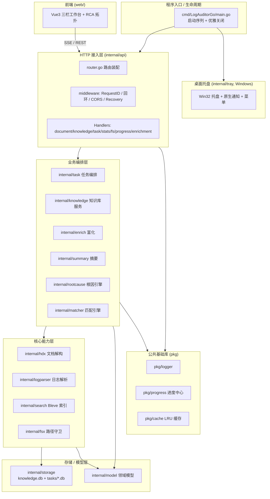

# LogAuditorGo 架构与模块说明书

> 本文档对 `LogAuditorGo`（华为网络设备日志智能分析平台）进行逐模块的详尽说明，涵盖启动流程、后端各 `internal`/`pkg` 包、前端 `web` 工程、核心数据流、配置、API 总表、安全设计与测试体系。
> 配套文档：`前端样式规范.md`、`RCA演进计划.md`、`WLAN与无线AC设备日志解析与知识匹配适配方案.md`。

---

## 目录

1. [项目概览](#1-项目概览)
2. [整体分层架构](#2-整体分层架构)
3. [工程目录结构详解](#3-工程目录结构详解)
4. [启动流程（Bootstrap）](#4-启动流程bootstrap)
5. [后端模块说明书](#5-后端模块说明书)
   - 5.1 [`cmd/LogAuditorGo`](#51-cmdlogauditogo-程序入口)
   - 5.2 [`internal/config`](#52-internalconfig-配置中心)
   - 5.3 [`pkg`（公共基础库）](#53-pkg公共基础库)
   - 5.4 [`internal/fsx`](#54-internalfsx-路径安全守卫)
   - 5.5 [`internal/hdx`](#55-internalhdx-hdx-文档解构引擎)
   - 5.6 [`internal/knowledge`](#56-internalknowledge-知识库服务)
   - 5.7 [`internal/search`](#57-internalsearch-bleve-全文检索引擎)
   - 5.8 [`internal/logparser`](#58-internallogparser-华为日志解析引擎)
   - 5.9 [`internal/matcher`](#59-internalmatcher-四级知识匹配流水线)
   - 5.10 [`internal/summary`](#510-internalsummary-日志语义摘要引擎)
   - 5.11 [`internal/enrich`](#511-internalenrich-日志富化服务)
   - 5.12 [`internal/rootcause`](#512-internalrootcause-根因分析引擎)
   - 5.13 [`internal/model`](#513-internalmodel-领域数据模型)
   - 5.14 [`internal/storage`](#514-internalstorage-sqlite-存储管理)
   - 5.15 [`internal/task`](#515-internaltask-任务业务层)
   - 5.16 [`internal/api`](#516-internalapi-http-api-层)
   - 5.17 [`internal/tray`](#517-internaltray-windows-系统托盘)
   - 5.18 [`internal/netutil`](#518-internalnetutil-端口冲突自愈)
   - 5.19 [`internal/browser`](#519-internalbrowser-系统默认浏览器拉起)
6. [前端模块说明书（`web/`）](#6-前端模块说明书web)
7. [核心数据流](#7-核心数据流)
8. [配置说明](#8-配置说明)
9. [RESTful API 总表](#9-restful-api-总表)
10. [安全设计](#10-安全设计)
11. [测试与质量保障](#11-测试与质量保障)

---

## 1. 项目概览

`LogAuditorGo` 是一款**离线、纯 Go 原生、单二进制分发**的华为网络设备日志智能分析平台，面向 CloudEngine 交换机、HiSecEngine / USG 防火墙、NetEngine 路由器等。其核心价值是把"海量日志检索"升级为"带官方知识库语义关联 + 根因推导（RCA）"的故障定位能力。

**关键特征**

- **零 CGO 依赖**：使用 `modernc.org/sqlite`（`glebarez/sqlite`）纯 Go SQLite 驱动 + Bleve 纯 Go 倒排索引，可在任意平台交叉编译为单一可执行文件。
- **前端内嵌**：通过 Go `embed.FS` 将 `web/dist` 打包进二进制，部署零外部文件。
- **任务级物理隔离**：每个审计任务独占一个 SQLite 库文件（`tasks/task_xxx.db`），归档/导出/删除无残留。
- **四级知识匹配 + RCA**：从精确匹配到 Bleve 语义召回的逐级降级，叠加基于故障传播 DAG 的根因推导。

**技术栈**

| 层 | 选型 |
| :-- | :-- |
| 后端语言 | Go 1.26+ |
| Web 框架 | Gin (`gin-gonic/gin`) |
| ORM | GORM (`gorm.io/gorm`) |
| 嵌入式 DB | modernc.org/sqlite（无 CGO） |
| 全文检索 | Bleve v2 (`blevesearch/bleve/v2`) |
| HTML 解析 | goquery (`PuerkitoBio/goquery`) |
| 编码转换 | `golang.org/x/text`（GBK/GB2312） |
| 配置 | Viper (`spf13/viper`) |
| 日志 | Zap (`uber.org/zap`) |
| 前端 | Vue 3.5 + Vite 6 + Element Plus 2.9 + ECharts 5.6 + Pinia 2.3 + vue-router 4.5 |

---

## 2. 整体分层架构



---

## 3. 工程目录结构详解

```text
LogAuditorGo/
├── assets/                        # 托盘图标候选资产（*.ico / *.png，程序化生成为主）
├── cmd/
│   └── LogAuditorGo/
│       ├── main.go                # 程序主入口：启动序列 + 托盘 + 信号优雅关闭
│       └── server_test.go         # 端到端集成与路由测试
├── internal/
│   ├── api/                       # HTTP API 路由与控制器（见 5.16）
│   │   ├── router.go              # Gin 路由与中间件装配（约 60 条路由 + SPA NoRoute）
│   │   ├── middleware.go          # RequestID、回环校验、CORS 中间件
│   │   ├── response.go            # 统一 API 返回结构封装（5xx 脱敏）
│   │   ├── document_handler.go    # 文档扫描/导入/列表/删除/批量删除
│   │   ├── knowledge_handler.go   # 知识检索/详情/索引状态/重建
│   │   ├── task_handler.go        # 任务生命周期、设备、多设备、RCA 处理
│   │   ├── tag_handler.go         # 日志标签系统 8 个 handler
│   │   ├── system_handler.go      # 系统配置与日志管理（config/logs）
│   │   ├── stats_handler.go       # 仪表盘统计处理（15s TTL 缓存）
│   │   ├── fs_handler.go          # 服务端本地文件系统只读浏览
│   │   ├── progress_handler.go    # 长任务进度查询/SSE/终止
│   │   ├── enrichment.go          # 富化类型别名与转发（业务在 internal/enrich）
│   │   └── api_test.go / enrichment_test.go
│   ├── browser/                   # 跨平台系统默认浏览器拉起（见 5.19）
│   │   ├── browser.go             # Open(url) 统一入口
│   │   ├── browser_windows.go     # Windows ShellExecute 直调（无黑框）
│   │   ├── browser_other.go       # macOS open / Linux xdg-open 回退
│   │   └── browser_test.go
│   ├── config/                    # 系统配置解析（Viper + goccy/go-yaml，见 5.2）
│   ├── fsx/                       # 路径安全守卫 + 文件系统浏览（见 5.4）
│   │   ├── guard.go               # 白名单根目录校验 (SecurePathGuard)
│   │   ├── fsx.go                 # 浏览数据结构与 Roots/Browse/Stat/CollectFiles
│   │   ├── roots_windows.go       # Windows 逻辑盘符枚举（位掩码）
│   │   └── roots_other.go         # 非 Windows 根目录枚举
│   ├── hdx/                       # HDX 文档解构引擎（见 5.5）
│   │   ├── scanner.go             # 递归扫描 .hdx/.zip 与解压目录元数据
│   │   ├── source.go              # 目录/压缩包双源抽象 + 压缩包内存索引
│   │   ├── archive.go             # 并发解压（Worker Pool + Zip Slip/炸弹防护）
│   │   ├── extractor.go           # profile.xml 解析与 HDX 文档目录发现
│   │   ├── navigator.go           # navi.xml 导航树递归与叶子过滤
│   │   ├── html_parser.go         # goquery HTML 日志/告警字段抽取
│   │   └── charset.go             # GBK/GB2312/GB18030 自动转码
│   ├── knowledge/                 # 知识库服务与去重逻辑（见 5.6）
│   ├── search/                    # Bleve 全文检索引擎（见 5.7）
│   ├── logparser/                 # 华为日志解析引擎（见 5.8）
│   │   ├── sanitizer.go           # 行前置清洗（BOM/ANSI/C0 控制符/非法 UTF-8）
│   │   └── ...                    # parser/vrp_parser/sec_parser/comment_parser/
│   │                              #   param_extractor/time_parser + testdata/ac_ap_samples.log
│   ├── matcher/                   # 四级知识匹配流水线（见 5.9）
│   ├── summary/                   # 日志语义摘要引擎（见 5.10）
│   │   ├── comment_summary.go     # 注释行中文友好文案
│   │   └── template_capture.go    # 知识库模板反向抽取现场参数
│   ├── enrich/                    # 日志富化服务（见 5.11）
│   ├── rootcause/                 # 根因分析 RCA 引擎（见 5.12）
│   ├── model/                     # 全局领域数据模型（见 5.13）
│   ├── nativedialog/              # Windows 原生文件/文件夹对话框（见 5.20）
│   ├── singleinstance/            # 单实例命名互斥体/锁文件 + instance.json
│   ├── version/                   # 统一版本号（main/tray/API 共用）
│   ├── netutil/                   # TCP 端口冲突自愈（见 5.18）
│   │   ├── port.go                # ListenWithPortRetry 端口顺延重试
│   │   └── port_test.go
│   ├── storage/                   # SQLite 存储管理（见 5.14）
│   │   └── sqlite_funcs.go        # SQLite REGEXP 自定义函数（有界编译缓存）
│   ├── task/                      # 任务业务层（见 5.15）
│   │   ├── rca_scheduler.go       # RCA 异步调度器（信号量 + 代数机制 + 重启自愈）
│   │   ├── advanced_filter.go     # 专家级组合筛选（白名单 field/op + KV json_extract）
│   │   ├── tag_service.go         # 标签领域服务（9 个方法）
│   │   └── templates/             # 外置 HTML 报告模板（go:embed）
│   └── tray/                      # Windows 系统托盘（Win32 直调，见 5.17）
│       ├── tray.go                # Tray 接口与公共骨架
│       ├── tray_windows.go        # Win32 实现（消息循环 + Shell_NotifyIconW）
│       ├── tray_other.go          # 非 Windows 空实现（编译期降级）
│       └── icon.go                # 程序化图标生成（PNG/ICO 自绘 + 主题）
├── pkg/
│   ├── cache/                     # 泛型无 TTL LRU 缓存（TTL 由调用方实现，见 5.3.1）
│   ├── logger/                    # Zap 日志工具库（含自实现轮转写入器，见 5.3.2）
│   └── progress/                  # 长任务进度追踪器（JobTracker + Hub，见 5.3.3）
├── web/                           # Vue 3 前端工程（见 6）
├── build.bat / build.sh           # 前端构建 + 单二进制打包脚本
├── go.mod / go.sum
└── docs/                          # 架构与专题文档
    ├── 架构与模块说明书.md         # 本文档（权威参考）
    ├── 前端样式规范.md
    ├── RCA演进计划.md
    └── WLAN与无线AC设备日志解析与知识匹配适配方案.md
```

---

## 4. 启动流程（Bootstrap）

入口文件 `cmd/LogAuditorGo/main.go`（包 `main`）。启动序列严格有序，确保依赖先就绪：

1. **命令行参数解析**（优先级：命令行 > 配置 > 默认）
   - `-config <path>`：指定配置文件，默认 `<data_dir>/config.yaml`
   - `-host <addr>`：覆盖监听主机地址（默认 `127.0.0.1`，设为 `0.0.0.0` 可监听全部网卡）
   - `-port <n>`：覆盖监听端口（1–65535，否则报错退出）
   - `-version`：打印 `LogAuditorGo v1.0.0` 后退出
   - `-no-tray`：禁用 Windows 系统托盘（无头服务器/容器场景）
   - `-no-browser`：禁用启动后自动调用系统默认浏览器打开 Web 控制台
   - `-tray-theme <name>`：托盘图标主题（`blue_shield` / `emerald_terminal` / `indigo_radar`）
   - `-icon <path>`：外部托盘图标文件覆盖
2. **配置加载**：`cfg, err := config.Load(*configPath)`，失败 `os.Exit(1)`。
2.5 **单实例保护**（`internal/singleinstance`，v1.1 新增）：日志初始化后、打开任何数据库之前抢占命名互斥体（Windows `Local\LogAuditorGo-<dataDirHash>`）或锁文件（非 Windows）。使用 `instance.json` 记录 pid/URL；第二个实例读取后打开已运行控制台并退出，不启动第二个服务。`LOGAUDITORGO_DISABLE_SINGLE_INSTANCE=1` 可禁用（调试/自动化），锁初始化失败只告警不阻断。
3. **日志子系统初始化 + 热更新钩子**
   - `logger.InitWithConfig(...)` 按 `cfg.Log` 初始化 Zap。
   - `config.RegisterLogUpdateHook(...)` 注册日志留存策略/级别/格式运行时热更新钩子（ARCH-13，补充原未生效的 `format` 切换）。
4. **全局知识库 SQLite 初始化**：`storage.InitKnowledgeDB(cfg.Storage.KnowledgeDB)` → `*gorm.DB`，并写入包级单例 `storage.GlobalKnowledgeDB`。失败 `log.Fatalf`。
5. **Bleve 全文检索引擎初始化**：`search.InitIndexer(cfg.Storage.BleveIndex)`。失败 `log.Fatalf`。
6. **业务引擎装配**（依赖顺序刻意设计）
   ```go
   knowledgeSvc := knowledge.NewService(globalDB, indexer)
   knowledgeSvc.SetExtractDir(cfg.Storage.UploadDir)
   matchEngine  := matcher.NewMatchEngine(globalDB, indexer)
   knowledgeSvc.SetMatchEngine(matchEngine)   // 知识服务持有匹配引擎，导入后触发 Reload
   rcaEngine    := rootcause.NewEngine()
   taskSvc      := task.NewService(globalDB, cfg.Storage.TaskDir, matchEngine, rcaEngine)
   task.InitRCAScheduler(taskSvc, rcaEngine)  // RCA 异步调度器（信号量默认 2）
   taskSvc.RecoverDanglingTasks()             // 重启自愈：把异常中断遗留的 PROCESSING 任务回置 FAILED
   taskSvc.RecoverDanglingRCATasks()          // 重启自愈：重置上次异常退出的 RUNNING/QUEUED 任务
   ```
7. **路由与 HTTP 服务器构建**：`r := api.SetupRouter(cfg, globalDB, knowledgeSvc, indexer, taskSvc)`。监听套接字经 `netutil.ListenWithPortRetry`（`internal/netutil`，见 5.18）创建——若起始端口被占用，自动累加端口重试（默认最多 5 次），全部失败才退出；绑定成功后把 `actualPort` 回写配置对象与访问地址，确保托盘/浏览器跳转地址一致。随后构造 `http.Server`。
8. **HTTP 超时常量**（ARCH-05，防御 Slowloris）
   - `ReadHeaderTimeout = 10s`、`ReadTimeout = 60s`、`IdleTimeout = 120s`
   - `WriteTimeout = 0`：**刻意不限制写入超时**，因为 SSE 进度流与长耗时导入（可达数分钟）需长时间持有连接。
   - `shutdownTimeout = 15s` 优雅关闭超时。
9. **信号与启动 goroutine 设计**（ARCH-04）
   - `signal.Notify(quit, os.Interrupt, syscall.SIGTERM)`（`SIGINT`/`SIGTERM`，去除重复注册）。
   - 监听在独立 goroutine 内执行；启动失败时经 `serverErrCh` 记录错误并仅向 `quit` 发信号再优雅关闭，**不直接 `log.Fatalf`**，避免绕过 `defer` 造成 Bleve/SQLite 资源泄漏。
10. **系统托盘启动**（仅 Windows 且未指定 `-no-tray`，见 5.17）：`tray.New(...)` + `Start()` 在独立 OS 线程跑消息循环，约 600ms 后弹出就绪气泡通知；菜单「退出服务」经确认框后向主流程投递 SIGTERM，与信号优雅关闭链路合流。
11. **自动打开浏览器**（除非指定 `-no-browser`）：`server.Serve` 启动后，主流程在独立 goroutine 内延迟约 150ms 调用 `browser.Open("http://<host>:<actualPort>")`（见 5.19）拉起系统默认浏览器访问 Web 控制台；`host` 为 `0.0.0.0`/空时自动回落 `127.0.0.1`。
11. **阻塞等待** `sig := <-quit`，随后按序优雅关闭：`tray.Stop()` → `server.Shutdown(ctx 15s)` → `progress.GetHub().Stop()` → `storage.CloseAllTaskDBs()` → `indexer.Close()` → `storage.CloseKnowledgeDB()`（WAL checkpoint）→ `logger.Shutdown()`；最终依据 `serverErrCh` 决定 `os.Exit(1)`。

---

## 5. 后端模块说明书

### 5.1 `cmd/LogAuditorGo/` 程序入口

| 文件 | 职责 |
| :-- | :-- |
| `main.go` | 引导编排：参数 → 配置 → 日志 → DB → 索引 → 引擎 → 路由 → 服务器 → 信号/优雅关闭 |
| `server_test.go` | 端到端集成测试：启动 `httptest` 服务器、验证路由装配与统一响应契约 |

---

### 5.2 `internal/config/` 配置中心

基于 Viper 的 YAML 配置加载，支持默认值回退与环境覆盖。关键能力：

- `config.Load(path)`：读取 `config.yaml`，缺失时使用内置默认模板；首次启动在 `<data_dir>/config.yaml` 自动生成。
- 包级配置热更新钩子：`config.RegisterLogUpdateHook(func(maxSizeMB, maxDays int, level, format string))`，供运行时（通过 API `PUT /system/config/log`）动态切换日志级别/格式/留存策略。
- 配置结构覆盖 `server`（port/mode）、`storage`（data_dir/knowledge_db/bleve_index/task_dir/upload_dir/allowed_roots）、`log`（level/format/dir/max_size_mb/max_days）。

---

### 5.3 `pkg/`（公共基础库）

#### 5.3.1 `pkg/cache/` — 泛型 LRU 内存缓存
提供带过期时间的并发安全内存缓存，用于全局统计快照等热点数据（如仪表盘统计 15s 缓存）。避免对知识库/任务库的高频聚合查询。

#### 5.3.2 `pkg/logger/` — Zap 日志工具库
- `logger.InitWithConfig(Config{Level, Format, Dir, MaxSizeMB, MaxDays})`：初始化 Zap，支持 `console`（彩色）与 `json` 两种格式。
- `logger.UpdatePolicy(maxSizeMB, maxDays)` / `logger.SetLevel(level)` / `logger.SetFormat(format)`：运行时热更新（配合 `config.RegisterLogUpdateHook`）。
- 按大小/天数轮转，落盘至 `LogAuditorGoData/log`。

#### 5.3.3 `pkg/progress/` — 长任务进度追踪器
- 核心类型 `progress.JobTracker`：以 `job_id` 标识一次长任务（文档导入、重分析、索引重建、日志导入等）。
- 支持 `context` 级联取消：提供协作式终止能力（API `DELETE /progress/:job_id` 触发），阶段检查点轮询 `ctx.Err()` 决定是否中止。
- 进度快照可被 `internal/api/progress_handler.go` 通过 HTTP 轮询或 SSE 推送；`pkg/progress` 是两者的数据底座。

---

### 5.4 `internal/fsx/` 路径安全守卫与文件系统浏览

- 核心类型 `fsx.SecurePathGuard`，由 `fsx.NewSecurePathGuard(allowedRoots []string)` 构造。
- `ValidateAll(paths ...string) error`：当配置了 `storage.allowed_roots` 白名单时，任何跳出白名单根目录的路径都会被拒绝（`filepath.Rel` 判越界，返回错误由 API 层转 403）；留空则不限制（本地单机默认行为）。
- `fsx.go`：文件系统浏览数据结构与实现——`Root`/`Entry`/`RootsResult`/`BrowseOptions`/`BrowseResult`、`Normalize`、`LongPathSafe`（Windows 长路径 `\\?\` 前缀）、`Roots`/`Browse`/`Stat`/`CollectFiles`，支撑 `/api/v1/fs/*` 三个只读浏览接口。
- `roots_windows.go` / `roots_other.go`：根目录枚举的平台适配（Windows 用 `GetLogicalDrives` 位掩码枚举盘符；非 Windows 走 `/` 等常规根）。
- 该守卫在 `api.router.go` 中作为**包级单例** `pathGuard` 创建，被所有导入类接口与 `/fs` 浏览共用（ARCH-02）。

---

### 5.5 `internal/hdx/` HDX 文档解构引擎

华为官方 HDX 文档（`.hdx`/`.zip` 压缩包或含 `profile.xml` 的解压目录）的解构流水线：

| 文件 | 职责 |
| :-- | :-- |
| `scanner.go` | 递归扫描 `.hdx`/`.zip` 与已解压目录的元数据发现（`ScanHDXDirectory`/`ScanHDXPaths`，供「选择文件夹自动扫描」接口） |
| `source.go` | 统一「目录 / 压缩包」双源抽象：接口 `DocSource`（ID/Label/Origin/Root/Kind/Open/Close）；`OpenArchive` 建立压缩包**内存索引**（不落盘），`NewDirSource` 包装解压目录；`DocRoots` 在包内发现多个文档根 |
| `archive.go` | 自适应 Worker Pool 并发解压（`UnzipConcurrent`/`ExtractAllArchivesWithTracker`），防 Zip Slip 与解压炸弹 |
| `extractor.go` | `profile.xml` 解析与 HDX 文档目录发现（`ParseProfileXML(From)`、`FindHDXDocDirs`） |
| `navigator.go` | `navi.xml` 导航树递归解析；按叶子节点过滤出 Log Reference / Alarm Reference |
| `html_parser.go` | 基于 `goquery` 的 HTML 字段抽取：日志标识、模板、含义、动态参数、可能原因、处理步骤、Trap OID、MIB 模块等 |
| `charset.go` | GBK/GB2312/GB18030 → UTF-8 自动转码（`DecodeGBK`/`XMLCharsetReader`，挂在两处 XML 解码器上） |

**安全与资源上限常量**：单文件 2GB、包内总量 20GB、条目数 20 万、压缩比 1000:1；嵌套包深度 2 / 数量 8 / 256MB / 512MB；navi 深度 16、navi 64MB；profile.xml 8MB；单个 HTML 10MB。

**并发参数**：解压 worker = `clamp(NumCPU×2, 4, 32)`，解压前批量预建目录，每 50 个文件上报一次进度。

**叶子判别规则**：`TopicID` 含 `LOGREF_` → 日志，`ALARMREF_`/`ALARM_` → 告警；日志 txt 必须为 `Module/Severity/Brief` 三段且 severity ∈ [1,8]，否则丢弃；告警模块由中文链「…日志/…告警」反推。

**路径清洗统一管线**：剥 `?#` → `url.PathUnescape` → 反斜杠归一 → `normalizeRelPath` 拒绝 `..`/盘符/绝对路径。

**解析产物**：归一化的知识条目（`model.Knowledge` 候选集），交由 `internal/knowledge` 做去重与入库。`hdx.ScanHDXPaths` 亦被文档扫描接口复用。

---

### 5.6 `internal/knowledge/` 知识库服务

知识库 CRUD、SHA256 去重、版本映射与索引管理的中枢。

- **两级去重与指纹**（`deduplicator.go`）：`CalculateStableKey`（标识字段判重，剔除 Severity）+ `CalculateContentHash`（全字段快照 SHA-256），均用 `len:value` 长度前缀编码防哈希碰撞（KB-08）；导入时按 `content_hash` 查重并持久化唯一索引。
- **导入编排 `importSingleDocUnlocked(src, conflictMode, tr)`**（按 `src.ID()` 经 `docLocks` 加锁串行化，7 阶段 `HDXImportStages`）：
  1. `readDocumentMetadata` — 读取文档元数据（命中 `skipped` 则直接返回）；
  2. `parseHTMLKnowledgeItems` — 解析 HTML 知识条目（失败按哈希去重收集）；
  3. `persistKnowledgeAndMappings(tx, ...)` — 单事务内：文档 upsert（命中旧版先删旧版本映射）、**分批查重（每 500 个 `content_hash` 一批）**、`CreateInBatches(newKnowledges, 100)`、版本映射 `CreateInBatches(100)`（KB-15 修复：查重失败上抛，避免撞唯一索引导致整批回滚）；
  4. `indexDocumentKnowledge` — **索引本文档关联的全部知识（含历史，KB-04 修复）**，刷新版本列表。
- **导入自愈（KB-01）**：索引失败不再仅打 Warn，而是 `markDocumentIndexDirty`（落 `index_dirty=true`，前端提示重建）；成功则 `clearDocumentIndexDirty`。
- **删除与孤儿清理 `DeleteDocuments(docIDs)`**：
  1. Pluck 本批文档关联的 `knowledge_id`（Distinct）；
  2. 事务内删 `KnowledgeVersionMapping`（按 `document_id IN ?`）→ 删 `Document`；
  3. **孤儿清理（KB-07）**：重查仍被引用的 `knowledge_id` 计算差集得孤儿 → **先删 Bleve 索引 `DeleteBatch`，后删 DB**（避免"索引已删/DB 仍在"的反向不一致）；索引删失败返回含"请全量重建索引"的提示，不阻断 DB 清理。
  4. `matchEngine.Reload()` 触发匹配引擎重载。
- **查询**：`GetDocumentList()`、`GetKnowledgeByID`、`GetKnowledgeByIDs`（批量避免 N+1）、`GetKnowledgeMapByIDs`（ID→实体映射）。
- **匹配桥接**：`FindBestKnowledgeMatch(candidates, targetProduct, targetVersion)` → `matcher.FindBestKnowledgeMatch`（多版本回退：同型号最新 → 同系列相近 → 全局通用协议）。
- **索引重建**：`reindex.go` 在临时目录全量重建 Bleve 索引后**原子热替换**，重建期间不影响现有检索；`TryReindex`/`reindexMu` 保证非阻塞单实例；`IsReindexDirty` 供前端提示。
- **本地知识与覆盖（v1.3，`local.go`）**：`Knowledge.Source=local` 与官方同表复用检索/富化；本地条目强制写入版本映射并豁免孤儿清理；`KnowledgeOverride` 把 module/brief 绑定到官方知识。匹配优先级 override(0.90) → local(0.95) → 官方 Tier1~4，由 matcher 单独索引实现。
- **分面与收藏（v1.3，`facets.go`）**：产品/版本/严重度/类型分面（受 module/type 约束，关键词不参与）；`knowledge_favorites`/`knowledge_recent`（最近 50 条）。

---

### 5.7 `internal/search/` Bleve 全文检索引擎

| 文件 | 职责 |
| :-- | :-- |
| `bleve_indexer.go` | 倒排索引构建、文档分词、多字段布尔组合检索（支持 `keyword`/`module`/`entry_type`/`severity` 等） |
| `rebuild.go` | 索引重建底座：临时目录构建 + 原子替换 + 失败回滚 |

- `search.InitIndexer(path)` 在启动时初始化/打开或新建 Bleve 索引。
- `IndexMappingVersion = 2` 哨兵文档：映射版本不匹配时自动触发全量重建，避免新旧分词/字段契约混用。
- 默认 cjk 中文分词；`brief` 建多字段（keyword + cjk 子字段）；`product`/`version` 改 keyword + `TermQuery`；`severity` 用开区间（sev±0.5）实现"等于"语义（KB-10）。
- 所有字段 `Store=true`，命中即回填免 N+1（KB-02）；`indexBatchSize = 500`；全局 `indexerMap` 按路径复用实例。
- 支持中文关键词分词匹配与错误代码秒级召回。
- `IndexKnowledge(items)` 幂等，覆盖写即可刷新版本列表（供 KB-04 全量重索引使用）。
- `GetIndexStatus` 提供索引健康状态（索引文档数与数据库记录数一致性），供系统设置页展示。
- `RebuildFromDB`（`rebuild.go`）：PageSize 1000 流式灌入临时目录 → 关旧句柄 → 旧目录改名 `.old_<ts>` → 临时转正 → 重开，失败回滚。

---

### 5.8 `internal/logparser/` 华为日志解析引擎

| 文件 | 行数 | 职责 |
| :-- | :-- | :-- |
| `parser.go` | 87 | 统一接口 `LogParser` + 无锁注册表 + 自动分发 |
| `vrp_parser.go` | 164 | 华为 VRP Syslog 正则解析器（主 + 兜底） |
| `sec_parser.go` | 128 | USG 防火墙安全日志解析器 |
| `comment_parser.go` | 122 | `#` 开头的设备注释/元数据（文件头/摘要/防篡改校验）解析 |
| `sanitizer.go` | — | 行前置清洗管线：BOM → ANSI（CSI/OSC/字符集切换三类）→ C0/NUL 转空格、DEL 剥离、非法 UTF-8 → U+FFFD；带 fast-path 快探；`IsBlankOrGarbageLine` 判定垃圾行 |
| `param_extractor.go` | 293 | 消息正文 `Key=Value` 动态参数提取（手写扫描器） |
| `time_parser.go` | 354 | 多格式时间戳标准化 |
| `testdata/ac_ap_samples.log` | — | 无线 AC/AP 变体日志回归样本 |

**统一接口**（`parser.go`）
```go
type LogParser interface {
    Name() string
    Support(line string) bool
    Parse(line string) (*model.NormalizedLog, error)
}
```

**注册与分发机制**
- 注册表 `parserList atomic.Value` 持有 `[]LogParser`，无锁并发读；写时经 `regMu sync.Mutex` 复制出新切片存入，保证 `ParseLine` 不会读到半更新状态。
- `init()` 固定顺序注册：`CommentParser` → `USGSecurityParser` → `VRPParser`；`defaultVRP = &VRPParser{}` 为全局兜底。
- `ParseLine(line)`：遍历解析器，对 `Support(line)` 为真者调用 `Parse`，**成功即硬短路**；全部失败则 `defaultVRP.Parse` 兜底。panic 经 `recover` 转 error。
- `ParseBatch(lines)`：逐行 `ParseLine`，跳过空行，收集日志与带行号的错误。
- `RegisterParser(p)` 为可导出扩展点，支持运行时追加自定义解析器。

**VRP 解析器**
- 主正则 `vrpRegex` 命名捕获组：`pri / time / host / version / module / severity / brief / type / seq / slot / msg`。
- PARSE-10 修正：severity 由 `[1-8]` 放宽到 `[0-8]`（部分产品 Emergency 为 0）；类型组 `(?i:\((?P<type>[a-z])\))` 由必选改为可选（变体日志省略 `(l)/(s)`）。
- `vrpSimpleRegex` 处理丢弃 header 的变体；`vrpSupportRegex` 用 `%%\d{0,2}[A-Za-z0-9_\-]+/[0-8]/...` 预匹配 header。
- 输出 `NormalizedLog{DeviceType:"Huawei-VRP", ...}`，末步 `ExtractParameters(MessageBody)`。

**USG 解析器**
- `usgSecRegex` / `usgSecSupportRegex` 限定安全类模块（`SEC|UTM|IPS|AV|FW|SSLVPN|ATTACK|POLICY`）。
- 输出 `DeviceType:"Huawei-USG-Firewall"`，默认 `LogType:"s"`；正则失配时降级。

**参数与时间**
- `param_extractor.go`：手写扫描器抽取 `Key=Value`（`scanKVPairs`/`scanKeyAt`/`scanValue`/`scanDelimited`），键名上限 64 rune、支持中文键与最多 3 词复合键；块内允许覆盖、全局不覆盖，同名异值合并为 JSON 数组；括号内保留空值（`Reason= Code=5` → `Reason:""`），全局散落扫描过滤空值。
- `time_parser.go`：`timePatterns` 表 16 组 layout+regex，配 ISO/BSD 两条 fast-path；`normalizeSubsecondSeq` 把 AC/AP 的 `07:38:47.170.2` 归一为 `07:38:47.170002`（毫秒补 3 位 + 序号映射 3 位微秒）；`normalizeUTCOffset` 容 `+8/+08/+0800/+08:00`；`inferYear` 用"当前年 / 上一年"双候选 + 24h 容忍 + 闰日校验，杜绝跨年错位与 Feb 29 静默挪日；所有结果归一到 `time.Local`。
- 依赖仅 `internal/model` + `pkg/logger`，零外部库。

---

### 5.9 `internal/matcher/` 四级知识匹配流水线

| 文件 | 职责 |
| :-- | :-- |
| `engine.go` | 匹配调度器：Tier1~Tier4 逐级降级 |
| `scoring.go` | 置信度评分模型 |

**四级流水线**（逐级降级，命中即返回，置信度自上而下）

| 层级 | 名称 | 置信度 | 策略 |
| :-- | :-- | :-- | :-- |
| Tier 1 | EXACT | 1.0 | 模块与助记符（Brief）完全一致 |
| Tier 2 | MNEMONIC | 0.90 | 助记符别名与常见状态后缀（`_active`/`_fail`/`_down` 等）模糊匹配 |
| Tier 3 | TEMPLATE | 0.80 | 参数占位符转义与日志正文模板反向正则匹配 |
| Tier 4 | BLEVE | 0.50~0.75 | 基于 Bleve 倒排索引的语义打分召回 |
| Tier 5 | UNMATCHED | — | 标记未匹配 |

**内存索引**（`engine.go`）：一次全量 Preload 进内存——`exactMap`（UPPER(MODULE)+":"+UPPER(BRIEF)）、`moduleMap`、`idMap`、`templateBuckets`（MODULE → 模板首 token → 候选）。

**三级 LRU 缓存**（PARSE-01/17）：`baseKey`（模块/助记符/产品/版本，`strconv.Quote` 防冒号碰撞）供 Tier1/2；`bodyKey` = baseKey + FNV-64a 正文指纹供 Tier3/4；负缓存按正文粒度记账。容量 100000 / 50000 / 10000。

- **Tier1 软短路降级**：`Tier1Consistency` 从 1.0 起扣——severity 每差 1 级扣 0.10（封顶 0.40）、知识有模板但与正文完全不匹配扣 0.25（`scoring.go`）；≥ `MinTier1Confidence=0.60` 立即返回 1.0，否则记为 `fallbackK` 并令 conf = 1.0×consistency，继续下探 Tier2/3/4，四层全空才退回该候选。
- **Tier2 极性约束**：`mnemonicStem` 先转大写再剥离状态后缀并返回极性（+1: UP/ACTIVE/CLEAR/RESUME；-1: DOWN/FAIL/ERROR/INACTIVE；较长后缀优先），`polarityAllowed` 禁止 `IF_down ↔ IF_up` 互配。
- **Tier3 占位符遮盖**：首 token 倒排分桶预筛，只测"首 token 相同"与 `""` 桶；`matchTemplate` 先用 `placeholderMaskRegex` 遮盖 `<[]{}` 与 `%s/%d` 为哨兵，再 `QuoteMeta`，最后回替 `(?s:.*?)`——规避 `QuoteMeta` 不转义 `<` `>` 导致模板 100% 失效的缺陷；`Peek()` 读锁快路径避免 LRU 热点。
- **Tier4 加权选优**：Bleve 检索 PageSize=10，`BleveMinScoreThreshold=0.25`，按 `0.6×归一化相关度 + 0.4×版本贴合度` 加权选优；置信度用 Log1p 归一化后线性映射到 [0.50, 0.75]。
- **版本分档打分**（`scoring.go`）：ExactProductExactVersion 150 > Newer 120 > SameFamily 50 > CrossProduct 10 > NoVersionFallback 5。
- `FindBestKnowledgeMatch(candidates, targetProduct, targetVersion)` 供 `knowledge` 服务做多版本回退选优。
- **互斥产品族硬过滤（型号解耦改造）**：`isFamilyConflict` 依据**日志正文**判定无线/有线协议特征，`filterExcludedCandidates(candidates, isWireless, isWired, strict)` 在选优前剔除跨族候选（Tier1~3 带 `suspect` 豁免，Tier4 严格剔除），从根上消除"无线报文因产品字段完全一致而碾压有线候选"的错配；无可选合规候选时降级为 `TierFamilySuspect`（`conf <= ConfidenceFamilySuspectMax`）而非误报高置信匹配。过滤结果参与族缓存键，与 `Reload()` 同步失效。行为可通过 `matcher.family_filter_mode`（`off`/`suspect`/`strict`）灰度与回退。
- `ResolveSpecificModelOrFamily(hostname)`：上下文决议链的嗅探实现——优先提取具体型号（`AC6508`/`CE16800`/`S12700`，可命中 120/150 分档），退化为规范族名（`CloudEngine`/`Campus-Switch`/`HiSecEngine-USG`/`NetEngine`/`WLAN`），无法识别返回**空串**（契约：不提前兜底为中性值，否则调用方的显式覆盖分支永不可达）。型号探针在 `init()` 预编译，热路径零 `MustCompile`。
- `BestDocumentIDFor(...)`：与选优**同源复算**胜出文档 ID，供 `LogRecord.MatchedDocumentID` 落库。

---

### 5.10 `internal/summary/` 日志语义摘要引擎

**唯一真入口**：包级函数 `summary.GenerateSummary(module, brief, severity, rawMsg, params, kb)`，外部不直接构造 `Engine`（`Engine`/`DefaultEngine` 仅供该函数内部使用）。

| 文件 | 职责 |
| :-- | :-- |
| `engine.go` | 摘要编排与调度（含 severity ≤2 `[紧急]` / ≤4 `[告警]` 前缀） |
| `kb_summarizer.go` | 知识库驱动摘要 + 通用自适应摘要 + 模板渲染（`BuildKnowledgeSummary`/`BuildAdaptiveGenericSummary`/`CleanDescriptionTitle`/`ExtractCoreContextParams`/`RenderTemplateWithParams`） |
| `alias_groups.go` | 语义角色同义词池与反查索引（`AliasGroups`/`ResolveAliasRole`/`ResolveParam`/`ExtractTopParams`） |
| `comment_summary.go` | 注释行中文友好文案（`BuildCommentSummary`） |
| `template_capture.go` | 知识库模板反向抽取现场参数（`CaptureTemplateParams(WithProvenance)`） |

**三级优先级生成策略**
1. **COMMENT 短路**：`module == "COMMENT"` → `BuildCommentSummary`（文件头/摘要/防篡改校验注释）。
2. **知识库语义**（kb != nil）：`BuildKnowledgeSummary` → `CleanDescriptionTitle`（剥 HTML → 取首句 → "，可能/，由于" 截断 → 剥"该日志表示…"类口癖 → 限 60 rune）→ `ExtractCoreContextParams`（显式声明诊断优先级 reason(0) > interface(1) > peer(2) > ip(3) > state(4) > evpninstance(5) > mac(6) > trunk(7)，取前 3，保证"原因/接口/对端"永不被砍；user+command 命中则整体返回）→ 拼 `"%s [%s]"`；否则用 `kb.Message` 经 5 方言占位符（`精确→规范化→别名反查`）模板渲染（限 120 字）。
3. **通用自适应兜底** `BuildAdaptiveGenericSummary`：核心参数 → Top4 参数 → 原文截断（限 100 字）。

**模板反向抽取容错（`template_capture.go`）**：一级策略用模板编译命名捕获正则——剥离头、拒绝"纯占位符退化模板"、尾部占位符用 `[^,;()\r\n]+` 防吞尾部元数据、连续空白转 `\s+`；二级策略降级为"模板括号块 ↔ 正文括号块"按位置映射，要求词集兼容（编辑距离 ≤1）与数值语义检查；LRU 512 缓存编译结果；同名占位符合并 JSON 数组。

**确定性保证（RCA-11/15）**：输出反向索引 + 全处 `sort.Strings`/`SliceStable`，对相同输入完全确定；任意输入均返回非空（最坏 `"—"`）。

**别名分档 `alias_groups.go`**：18 组语义角色同义词池（peer/local/reason/count/slot/cpu/state/interface/routerid/trunk/server/user/component/mac/evpninstance/ip/command/threshold），构建期生成 `aliasRoleIndex` 与 `AliasRolePriority`（先按角色名排序再按组内序），把协议差异吸收为"语义角色"（如 BGP/OSPF/EVPN 的"对端"统一为 `peer`），消除 Go map 随机遍历导致的摘要不可复现，引擎核心零协议硬编码。

**集成方式**
- 被 `internal/enrich.Service.EnrichLogs` 作为核心部件复用（单设备日志富化）。
- 被 `internal/task.Service` 在多设备时间线 `QueryMultiDeviceLogs` 中内联调用（`summary.GenerateSummary` 直接算 `EventSummary`）。
- 产物 `EventSummary` 经 `model` 流出到 Web Workbench / 多设备时间线 / JSON 导出；**未进入 HTML 报告模板与 CSV 导出**（当前集成缺口）。

---

### 5.11 `internal/enrich/` 日志富化服务

将匹配结果与日志记录装配为前端可用的富化结构（ARCH-12：原逻辑下沉自 `api/task_handler.go`，使 CLI 与报告导出可复用）。

- `Service.EnrichLogs(records)`：批量收 `KnowledgeID`（一次 `IN` 查询 `GetKnowledgeMapByIDs`，不在循环内逐条查库）→ `ParseParametersJSON(rec.ParametersJSON)` → 计算 `er.EventSummary`（`summaryFor`）、`EnrichedParameters`、`ContextualizedKB`、`RenderedMessage`。
- **`MatchedDocName` 来源（型号解耦改造）**：`extractMatchedDocName(kb, matchedDocID)` 按**匹配当时胜出的文档 ID**（`LogRecord.MatchedDocumentID`）精确解析文档名——不再盲目取 `kb.Versions[0]`，杜绝"知识条目命中了 A 文档、却展示 B 文档名"的张冠李戴。三级平滑回退：精确命中 → 首个非空 `DocName` → `ProductType` → 空串，因此历史行（`matched_document_id = 0`）行为与改造前完全一致。
- 复用 `summary.PlaceholderRegex` / `summary.NormalizeKey`，并包一层 `enrich.GenerateEventSummary(...)`.
- `internal/api/enrichment.go` 仅做类型别名与转发（`EnrichedParameter = enrich.EnrichedParameter` 等），保证既有 API 契约与前端字段不变。

---

### 5.12 `internal/rootcause/` 关联事件（实验性）引擎

> **产品决策（v1.1）**：该引擎只保留、不演进。默认由 `features.rca=false` 关闭；关闭时导入/重分析/删除文件都不会自动派发，也不写 `RCAStatus=QUEUED`。开启后仅在工作台“高级”抽屉中由用户手动触发，不入主导航、任务 KPI 与主报告。前端展示口径为“关联事件 / 疑似根因 / 关联起点 / 证据强度”，证据强度为 0 或缺失时显示“证据不足”。

| 文件 | 行数 | 职责 |
| :-- | :-- | :-- |
| `engine.go` | 867 | 索引构建、规则匹配、BFS 传播、置信度评分、影响等级、RCA 事件产出 |
| `topology_dag.go` | 153 | 故障传播 DAG 规则库（`DefaultRules`）、`Pattern`/`DAGEdge`/`ProtocolFaultRule`、检环 |
| `cluster.go` | 126 | 重叠滑动窗口时间聚类（`ClusterByOverlappingWindow`） |

**RCA 数据模型**（`model/rca.go`）

```go
type ImpactEvent struct {           // 单条衍生影响事件（链上节点）
    LogID, FromLogID uint
    FromModule, Module, Brief, Timestamp string
    DelayMs int64                     // 相对根因的延迟
}
type RCAEvent struct {              // 根因事件（GORM 持久化主表）
    ID uint
    RootLogID uint `gorm:"index"`
    RootModule, RootBrief, RootTimestamp, RootCauseSummary string
    CorrelatedLogIDs string          // JSON: [105,108,112]
    ImpactEventsJSON  string          // JSON: []ImpactEvent（完整传播链）
    ImpactLevel string               // CRITICAL / HIGH / MEDIUM / LOW
    Confidence float64
    RecommendedAction string
}
type EnrichedRCAEvent struct { RCAEvent; RootLog *LogRecord; ImpactDetails []ImpactLogDetail; ... }
```

**异步状态机 `model.RCAStatus`**（`task.go`）：PENDING / QUEUED / RUNNING / COMPLETED / TIMEOUT / FAILED。开启实验开关后由 `task.RCAScheduler`（见 5.15）异步执行；计算超时时返回部分结果并落 `AnalyzedUntil` 水位。

**算法流程**（`AnalyzeWithContext`）
1. **重叠滑动窗口聚类**（`cluster.go`）：300s 窗口 + 60s 边缘重叠，O(n log n) 稳定排序 + 步进回退 overlap，避免硬边界切断跨窗口长因果链。
2. **倒排索引 BFS 推导**（`engine.go`）：基于故障传播 DAG，以 O(k·m) BFS 从候选事件推导根因。
3. **实例维度校验（RCA-04）**：对传播链上的每条日志做实例（接口、对端 IP、会话 ID）一致性校验；恢复事件过滤（RCA-14）剔除误报。
4. **全局排他认领**：每条日志唯一归属一个根因（`claimed` map，避免重复认领）。
5. **多因子置信度评分**：base 0.50 + depth×0.09（封顶 0.27）+ evidence×0.03（封顶 0.18）+ 时间衰减 0.15（半衰期 150s）+ 实例一致 ±(0.08/0.10)，封顶 0.98 下限 0.05。
6. **四级影响等级**（`impactLevelOf`）：CRITICAL / HIGH / MEDIUM / LOW。
7. **超时熔断**：context 超时返回部分结果（`RCAResult`/`AnalyzedUntil`）；单次事件上限 2000、单事件衍生上限 500（`ErrEventCap`）；扫描水位剪枝 + 未命中缓存。

**故障传播 DAG（`topology_dag.go` `DefaultRules`）** 内置 5 条规则：
- LINK_ROUTING_CASCADE：物理链路中断 → BFD Down → 路由邻居中断 → 路由撤销
- OPTICAL_CRC_DOWN：光模块异常 → CRC 错包 → 端口 Down
- RADIUS_AUTH_CASCADE：RADIUS 故障 → 认证失败 → 批量下线
- MLAG_PEERLINK_DAD：M-LAG Peerlink → DAD → 端口隔离
- RESOURCE_OVERLOAD_TIMEOUT：资源过载 → 会话超时

规则以 `ProtocolFaultRule`/`DAGEdge`/`Pattern` 数据结构编码，Pattern 大小写归一匹配；加载期经 `hasCycle`（Kahn 拓扑排序）**检环**，成环规则记入 `cyclicRules` 并告警（RCA-16）；`isChainHead`（RCA-03）避免中间节点误判为根。

---

### 5.13 `internal/model/` 领域数据模型

全局领域模型，同一份 struct 定义被全局库与任务库共享（不同 DB 实例）。关键实体：

- **`TaskInfo`**：任务元信息（`TaskID` 主键、`DeviceType`、`DeviceVersion`、`FileCount`、`DeviceCount`、`LogCount`、`MatchedCount`、`RcaCount`、`DBPath`、`Status`(PENDING/PROCESSING/COMPLETED/FAILED)、`StartTime`、`FinishTime`）。**双写**全局库（任务列表）与任务库（自包含）。**型号解耦后语义变更**：`DeviceType`/`DeviceVersion` 已**不再参与任何日志匹配**（原 PARSE-04 的"任务级透传版本参与分档"被废止），仅作任务级展示元数据保留以维持 API 兼容；匹配上下文改由 `Device.DeviceType`/`Device.DeviceVersion` 逐台决定（见 §5.15）。
- **`RCAStatus`**（`task.go`）：RCA 异步分析独立状态枚举（PENDING/QUEUED/RUNNING/COMPLETED/TIMEOUT/FAILED），与任务 `Status` 解耦，支撑后台调度与重启自愈。
- **`TaskFile`**：已上传文件记录。
- **`LogQueryFilter`**：分页（含 `AfterID` 游标分页，TASK-13 避免深翻页 offset 开销）+ 多维过滤（severity/module/hostname/sourceFile/matched/timeRange）。
- **`Device`**：见上文 `internal/model/device.go`；`DeviceType` 语义为"**产品族或具体型号**"（`WLAN` / `AC6508` / `CloudEngine`…，不再是 Router/Switch 形态分类），`DeviceVersion` 为软件版本（可选）。两者共同构成该设备日志的匹配上下文。历史遗留的形态分类值（`Router`/`Switch`/`Firewall`/`Other`）在决议时被视作"型号未配置"（`normalizeDeviceProduct`），回落主机名嗅探。
- **`LogRecord`**：落到任务库的实体；`Parameters` 以 `ParametersJSON` 字符串持久化，`EventSummary`/`Tags` 标记 `gorm:"-"` 不持久化（查询期实时算）。`DeviceID=0` 表示"未归属"。`MatchedDocumentID` 记录**匹配当时胜出的产品文档 ID**（刻意不加索引，不参与任何 WHERE/ORDER BY），供 `enrich` 精确解析文档名；历史行为 `0`，走回退链。
- **`LogTag` / `LogTagRelation`**（`tag.go`）：日志标签多对多模型（`log_tags` / `log_tag_relations`，`(TagID,LogID)` 复合唯一索引）。
- **`FilterPreset`**（`advanced_filter.go`）：专家级筛选预设（`filter_presets`）。
- **`LogQueryRequestBody` / `AdvancedFilter`**：查询 DTO；`AdvancedFilter` 以白名单 field/op 约束，防注入。
- **`NormalizedLog`**：解析期标准结构（`RawLog/Timestamp/Hostname/DeviceType/Module/Severity/Brief/LogType/Sequence/SlotInfo/SourceFile/MessageBody/Parameters`，以及匹配结果 `KnowledgeID/MatchTier/MatchConfidence/DeviceID/EventSummary`）。
- **`Knowledge`**：知识库条目（全局库），含 `EntryType`(LOG/ALARM)、`Module`、`Severity`、`Brief`、`TrapOID`、`MIBName`、`AlarmID`、`Message`、`Description`、`Parameters`、`Impact`、`Cause`、`ContentHash`、版本映射 `Versions`。
- **`Document`**：HDX 文档元数据（`LibID`/`LibName`/`ProductType`/`ProductVersion`/`LogCount`/`AlarmCount`/`IndexDirty` 脏标记）。
- **`KnowledgeVersionMapping`**：知识条目 ↔ 文档的版本适用映射。
- **`RCAEvent` / `ImpactEvent` / `EnrichedRCAEvent` / `ImpactLogDetail`**（见 5.12）。
- **`MultiDeviceReport`**：多设备协同影响面报告 DTO。
- **`DeviceTimelineEvent`**：多设备时间线事件，含 `EventSummary`。
- `custom_time.go`：多格式时间解析辅助；所有模型均显式声明 `TableName()`。

---

### 5.14 `internal/storage/` SQLite 存储管理

| 文件 | 职责 |
| :-- | :-- |
| `knowledge_db.go` | 全局知识库连接与自动迁移；`InitKnowledgeDB(path)` 返回 `*gorm.DB` 并写入包级单例 `storage.GlobalKnowledgeDB` |
| `task_db.go` | 任务库**引用计数连接池**：按 `task_<id>.db` 缓存 `*gorm.DB`，引用计数归零方可关闭/驱逐；删除任务时**先关句柄后删文件**，保证 Windows 下无句柄残留 |
| `sqlite_funcs.go` | `RegisterSQLiteFunctions`：注册 SQLite `REGEXP` 自定义函数，带容量 256 的有界正则编译缓存（双检锁、超限整体清空），NULL 安全防御 |

**DSN 统一参数**（两库一致）：`busy_timeout(10000)` / `WAL` / `synchronous(NORMAL)` / `foreign_keys(1)` / `_txlock=immediate`；知识库 `cache_size=-64000`（64MB）、MaxOpen=10/Idle=5；任务库 `cache_size=-32000`（32MB）。停机前 `wal_checkpoint(TRUNCATE)`。

**任务级物理隔离**：每个审计任务独立 SQLite 文件，归档/导出/删除互不影响。

**连接池设计**（`TaskDBPool`）：`dbEntry{refCount,lastUsed,elem,closing}`，常量 maxSize=64、evictTarget=48、idleTimeout=10min、evictWaitTimeout=5s；`AcquireTaskDB/ReleaseTaskDB` 成对使用；`EvictTaskDB` 关闭+删文件（Windows 无句柄残留）；`IsValidTaskID` 正则 `^[a-zA-Z0-9_-]{8,64}$` 防路径注入。

**迁移策略**：GORM AutoMigrate 9 张任务表（含降级迁移兜底 `migrationDegradedCount`、孤儿清理、级联删除触发器 `ensureTaskTriggers`、复合索引 `idx_log_records_device_time` 等）；迁移期强制单连接（MaxOpen=1）防连接参数分叉，完成后恢复 MaxOpen=4。

---

### 5.15 `internal/task/` 任务业务层

任务编排、设备与多设备协同、导入流水线、重分析、RCA 异步调度、标签、高级筛选、报告聚合与流式导出的核心业务层。

| 文件 | 职责 |
| :-- | :-- |
| `service.go` | 任务编排、设备 CRUD、多设备协同业务（时间线/联合查询/报告）、`AutoAssignDevices` |
| `import_pipeline.go` | 导入流水线：`openDecodedReader`（BOM 剥离 + GB18030 探测）、`parseAndMatchChunk`、`parseLogLine`、`alignChunkTimestamps`、`persistFileBundle` |
| `import_prepare.go` | 导入前置：`prepareBundles`、`persistTaskInfo`（字段白名单双写）、`failTask`、`finalizeTaskInfo` |
| `reanalyze_update.go` | 重分析批量回写（`batchUpdateLogRecords`/`batchUpdateChunk`，CASE WHEN 批量 UPDATE） |
| `rca_scheduler.go` | RCA 异步调度器（见下） |
| `advanced_filter.go` | 专家级组合筛选（见下） |
| `tag_service.go` | 标签领域服务（9 个方法） |
| `report_aggregate.go` | 报告指标 SQL 预聚合（采样范围由聚合得出，非前 N 条截断） |
| `conclusion.go` | 结论文案数据驱动生成（`conclusionRules` 7 类模块白名单 + `strings.Builder` 动态编号） |
| `exporter.go` | HTML / JSON / CSV **流式导出**（内存占用恒定） |
| `templates/` | 外置 HTML 报告模板（`report.html.tmpl` / `multi_device.html.tmpl`，`go:embed`） |

**导入流程（两遍扫描）**：磁盘文件先 `scanLineSource` 计数采样（内存与文件大小无关），再按 `importChunkLines=5000` 行分块流式重读；每块 `parseAndMatchChunk` 起 `clamp(NumCPU,2,32)` 个 worker 并发解析匹配（`importJobBuffer=512` 缓冲），`CreateInBatches(records,1000)`，首批与 TaskFile 同事务，失败执行 `cleanup()` 补偿。单行上限 `maxScanLineBytes=1MB`，重命名上限 `maxRenameSeq=1000`，Hostname 采样 `hostnameProbeLines=100`。

**重分析**：`ReanalyzeTask` 复用同一 `parseLogLine`，按 `reanalyzeBatchSize=1000` 读、`reanalyzeUpdateChunk=200` 行一条 CASE WHEN SQL 回写（13 列，约 2800 绑定参数，规避 SQLite 32766 上限）。

**匹配上下文决议链（型号解耦改造，两条链路统一）**：

优先级 **设备行库内属性 > 主机名嗅探 > 调用方显式覆盖 > 中性兜底（`Huawei-VRP`）**，型号与版本**独立**决议。

- 导入链路：`prepareBundles` 逐文件采样主机名 → `matcher.ResolveSpecificModelOrFamily` 嗅探 → `getOrCreateDevice(taskDB, taskID, name, hostname, resolvedProduct)` 把真实型号落库（新建设备**绝不**再写死 `Router`）→ 决议结果写入 `fileBundle.targetProduct/targetVersion`；`persistFileBundle`/`IngestStreamingPipeline` 不再接收型号/版本形参，统一读 bundle，杜绝第二上下文来源。
- 重分析链路：循环外单次加载 `devMap`，`resolveLineContext(rec, devMap, overrideProduct, overrideVersion)` 按记录决议。`ReanalyzeOptions.DeviceType/DeviceVersion` 语义收敛为**仅对 `device_id == 0` 的未归属日志兜底**，且只取本次显式传入值（任务级存量型号不再泄漏进匹配链）。
- `normalizeDeviceProduct`：把历史遗留形态分类（`Router`/`Switch`/`Firewall`/`Other`）与空白值归一为"型号未配置"，使存量设备无需人工订正即可通过主机名嗅探恢复真实匹配上下文。
- `CreateEmptyTask` 的任务级默认型号为中性 `Huawei-VRP`（原为 `CloudEngine`，会造成系统性产品偏置）。

**关联事件异步调度器（`rca_scheduler.go`）**：
- `GlobalRCAScheduler` 单例 + `InitRCAScheduler(taskSvc, rcaEngine)` 装配；信号量默认 2（可经 `rca.concurrency` 配置），`genSeq` 代数机制防两代 worker 并发。
- `autoRCAEnabled()`（读取 `config.Features().RCA`）收口所有**自动**派发点：导入完成、重新分析完成、删除文件后重算；关闭时不写 QUEUED、不派发 worker。`TriggerTaskRCA` 保留为手动入口（`POST /tasks/:id/rca/reanalyze`）。
- `TriggerTaskRCA` / `executeRCAPipeline`：落 `RCAStatus` 状态机；`maxRCALogs=100000` + `(timestamp,id)` keyset 分页；计算超时 5min（`rca.timeout`）、总超时 +5min，三类截断分别给文案。
- `RecoverDanglingRCATasks`：重启时将上次异常退出的 RUNNING/QUEUED 任务重置，保证状态机自愈。

**专家级组合筛选（`advanced_filter.go`）**：`BuildLogFilterScope` / `compileSingleCondition` 以白名单 field/op 编译条件，KV 字段经 SQLite `json_extract` 过滤；`FilterPreset` 支持保存/复用筛选预设。

**标签系统（`tag_service.go`）**：任务内日志打标/取消/批量操作/按标签过滤，`LogTag`↔`LogRecord` 多对多。

**多设备协同**：`service.go` 支持设备建模、`auto-assign`（按 Hostname 自动归属未绑定记录，不覆盖人工设置）、联合时间线（按绝对时间升序归并）、跨设备影响面报告。

**导入预览**（`import_preview.go`，v1.2）：与真实导入共用空行/垃圾行判定、清洗与单行上限；单文件最多扫描 10 万行（超出标记 `sampled` 并按字节外推），最多预览 200 个文件；返回文件、设备行数分布、时间范围、同名冲突与预计耗时；只读不写。

**诊断摘要**（`diagnosis.go`，v1.2）：任务库单表聚合——概览（日志/匹配/解析率/设备/文件/时间范围）、严重度分布、匹配质量六档、Top5 模块、Top10 未匹配热点、`first_high_log_id` 与确定性建议；不加载明细。

**案例服务**（`case_service.go`，v1.2）：`case_status/conclusion/notes/external_ref/case_tags` 双写全局库与任务库（任务库先行），标签归一化去重；`GenerateConclusionDraft` 只返回 Markdown，不落库、不调用模型；`GenerateSummaryMarkdown` 生成交接摘要。

**任务摘要索引（`digest.go`，v1.3）**：`task_digests` 保存主机名、高频模块、未匹配热点 JSON 与计数；导入/重分析完成后刷新（失败只告警），删除任务时同步清理；`/tasks/query` 关键词额外检索 digest 的 hostnames/top_modules，`GetGlobalUnmatchedHotspots` 聚合最近 200 个案例。

**逐行设备归属**（`device_reassign.go`，v1.2）：批内按 Hostname 去重建/查设备（显式指定设备的导入不参与），仅对非主 Hostname 记录重跑 `Match` 并更新知识字段，修复单文件多设备全部错挂的问题。

**证据包**（`api/export_package.go`）：`zip.Writer` 直接写 HTTP 响应，包含 report.html / logs.csv / metadata.json / README.txt，不落临时文件、不脱敏。

**文件名**（`api/download_filename.go`）：任务名过滤 Windows 非法字符并限长 80，`mime.FormatMediaType` 输出 RFC 5987 `filename*`，中文任务名不乱码。

---

### 5.16 `internal/api/` HTTP API 层

| 文件 | 职责 |
| :-- | :-- |
| `router.go` | Gin 路由与中间件装配（`SetupRouter`，约 60 条路由 + SPA NoRoute） |
| `response.go` | 统一响应信封（`SuccessResponse`/`ErrorResponse`） |
| `middleware.go` | `RequestIDMiddleware`、`RequireLoopback`、CORS 内联中间件 |
| `document_handler.go` | 文档扫描/导入/列表/删除/批量删除 |
| `knowledge_handler.go` | 知识检索/详情/索引状态/重建 |
| `task_handler.go` | 任务生命周期、设备、多设备查询、RCA、标签、预设（34 个 handler） |
| `tag_handler.go` | 日志标签系统 8 个 handler |
| `system_handler.go` | 系统配置读取与日志策略热更新/日志清单/清理 |
| `stats_handler.go` | 仪表盘统计（15s TTL 缓存） |
| `fs_handler.go` | 服务端本地文件系统只读浏览 |
| `progress_handler.go` | 长任务进度查询/SSE/终止 |
| `enrichment.go` | 富化类型别名与转发（业务在 `internal/enrich`，ARCH-12） |

**Gin 运行模式（ARCH-15）**：依据 `cfg.Server.Mode` 显式 `switch`（`debug`/`test`/`release`/`info`），未知值回退 `ReleaseMode` 并告警，避免误停留在 debug。

**中间件链（注册顺序）**
1. `RequestIDMiddleware()` — 最前，使所有中间件/handler 的 5xx 均带同一可追溯 ID（`X-Request-ID`）。
2. `r.SetTrustedProxies(nil)` — 禁用 `X-Forwarded-For`/`X-Real-IP` 信任（ARCH-01，本地单机最安全）。
3. `gin.CustomRecovery(...)` — panic 栈写入 Zap 并返回 500（ARCH-09）。
4. 内联 CORS 中间件 — 仅回环/同主机来源设置 `Access-Control-Allow-Origin` + `Vary: Origin`；未通过来源不设 ACAO（ARCH-08，原兜底 `*`）。`OPTIONS` 返回 204。
5. `/fs` 子组再叠加 `RequireLoopback()`（用 `c.RemoteIP()` 防 XFF 伪造）；`NoRoute` 置于最外层。

**统一响应信封**（`response.go`）：`{"code":0,"message":"success","data":...}`（成功） / `{"code":<code>,"message":<msg>,"data":nil}`（失败）。**错误脱敏（ARCH-06）**：`httpStatus >= 500` 时完整错误仅写 Zap，对外统一返回 `"Internal Server Error (request_id: <id>)"`；4xx 回具体原因。

**SPA/静态资源兜底**：通过 `web.DistFS()`（embed）托管前端；API 未命中返回 404 JSON（带 `data:nil` 契约一致）；具体静态文件直接 `fileServer.ServeHTTP`；前端路由返回 `index.html`；未打包前端则降级 JSON 状态提示。

**包级单例协作**：`pathGuard`（全局路径守卫，三处导入入口 + `/fs` 浏览共用）、`globalStatsHandler`（供业务层主动失效统计缓存）、`fsHandler`。

---

### 5.17 `internal/tray/` Windows 系统托盘

为 GUI-less 的后端服务提供桌面运维体验：托盘常驻、原生气泡通知、右键菜单（打开控制台/打开数据目录/复制访问 URL/退出服务等 9 个命令）。

| 文件 | 职责 |
| :-- | :-- |
| `tray.go` | `Config`、`Tray` 接口（`Start/Stop/ShowNotification/GetURL`）与 `baseTray` 公共骨架 |
| `tray_windows.go` | Win32 实现（577 行，`//go:build windows`） |
| `tray_other.go` | 非 Windows 空实现（`//go:build !windows`，编译期降级为 no-op） |
| `icon.go` | 程序化图标生成（见下） |

**实现方式**：纯 Win32 API 直调，**零第三方 GUI 库**（未用 getlantern/systray），仅依赖 `golang.org/x/sys/windows` + 标准库 `image/*`。

- `user32/shell32/kernel32` LazyDLL + 28 个 proc：`RegisterClassExW`/`CreateWindowExW`/`Shell_NotifyIconW`/`TrackPopupMenu`/`MessageBoxW` 等；自定义 `wndClassExW`/`msg`/`notifyIconDataW` 结构体。
- `Start()` 内 `runtime.LockOSThread()` 并跑标准 `GetMessageW` 消息循环；`wndProc` 全局分发（左键开控制台、右键弹菜单）；剪贴板经 `GlobalAlloc/GlobalLock/SetClipboardData(CF_UNICODETEXT)` 写入；`Stop()` 用 `stopOnce` + 1s 超时等待。

**图标完全程序化生成**（`icon.go`）：`IconTheme` 三种主题（`ThemeBlueShield` 盾牌 / `ThemeEmeraldTerminal` 终端 / `ThemeIndigoRadar` 雷达），`GenerateIconPNG(theme, 32)` 手绘位图，`EncodeICO` 自封装 ICO 容器；`LoadIconFromFile` 支持外部覆盖，仓库 `assets/*.ico|png` 仅作备选。

**平台限制**：仅 Windows 生效；非 Windows 编译期即退化为空实现。`main.go` 仅在 `!*noTray` 时创建，`--no-tray` 供无头服务器使用。退出链路：菜单「退出服务」→ `MessageBoxW` 确认 → `Stop()` → `cfg.OnExit()` → 非阻塞向 `quit` 投递 SIGTERM，与主程序优雅关闭链路合流。

---

### 5.18 `internal/netutil/` 端口冲突自愈

极简的 TCP 监听辅助包，解决单机常驻服务因端口被占用而启动失败的问题。

- `ListenWithPortRetry(host string, startPort, maxRetries int, log Logger) (net.Listener, int, error)`：
  - 从 `startPort` 起逐次 `net.Listen("tcp", host:port)`，命中即返回 `Listener` 与实际绑定端口 `actualPort`；失败则累加端口继续尝试，最多 `maxRetries` 次（`DefaultMaxPortRetries = 5`，入参 ≤0 时回退该值）。
  - 端口越界（`<1` 或 `>65535`）立即终止并带明确错误；全部尝试失败返回可终止程序的错误，供 `main.go` 据此 `os.Exit(1)`。
  - 仅依赖标准库 `net` 与一个极小的 `Logger` 接口（`Infof/Warnf/Errorf`）解耦具体日志组件，便于测试；启动成功/端口顺延时均输出可读日志，方便运维定位。
- 被 `cmd/LogAuditorGo/main.go` 在构造 `http.Server` 之前调用，使 `cfg.Server.Port` 与最终监听端口解耦（详见 §4 步骤 7）。

---

### 5.20 `internal/nativedialog/` Windows 原生文件对话框（v1.2）

- 接口：`Opener{OpenFiles/OpenFolder/Supported}`，`nativedialog.Default()` 返回平台实现，`SetForTest` 供 API 层注入假实现。
- Windows（`dialog_windows.go`）：`runtime.LockOSThread` + `CoInitializeEx(STA)` → `CoCreateInstance(IFileOpenDialog)` → `SetOptions/SetFileTypes/SetTitle/Show` → `GetResults/GetResult` → `GetDisplayName(SIGDN_FILESYSPATH)`；所有 COM 对象显式 `Release`，`CoTaskMemFree` 释放字符串。文件夹模式使用 `FOS_PICKFOLDERS`；取消返回 `ErrCanceled`，初始化失败返回 `ErrUnsupported`。
- 非 Windows：`ErrUnsupported`，前端自动回退 `ServerPathPicker`。
- API：`GET /api/v1/fs/dialog/capability`（只读探测）、`POST /api/v1/fs/dialog`（仅回环，路径仍过 `SecurePathGuard`）。

### 5.21 `internal/backup/` 备份、恢复与诊断（v1.3）

- `Create`：检查长任务空闲后，`VACUUM INTO` 生成 knowledge.db 一致快照（失败回退文件复制），关闭任务库连接后复制 tasks/bleve/config/onboarding，写 `backups/backup_<时间>.zip`（先 .tmp 后原子改名），保留最近 3 份。
- `ValidateArchive`：条目白名单（knowledge.db/-wal/-shm、config.yaml、onboarding.json、bleve/、tasks/）、拒绝绝对路径与 `..`、单文件 20GB/总量 64GB 上限。
- `PrepareRestore`：校验后写 `restore.zip` + `restore.pending`；`ApplyPendingRestore` 在启动阶段解压到 staging、现有数据改名 `.pre_restore_<时间>`、原子替换、写 `restore.log`，失败回滚。
- `WriteDiagnostics`：流式 ZIP（README/config.yaml/system.json/最近 3 个日志），不含任务日志与知识正文。

### 5.19 `internal/browser/` 系统默认浏览器拉起

跨平台"打开系统默认浏览器访问指定 URL"的薄封装，供程序启动后一键进入 Web 控制台。

- `browser.Open(url string) error`：统一入口，内部按平台分派 `openURL`。
- `browser_windows.go`（`//go:build windows`）：使用 `golang.org/x/sys/windows.ShellExecute` 以 `open` 动词关联系统默认浏览器，**静默无黑框**且响应迅速（对比 `cmd /c start` 会闪控制台窗口）。
- `browser_other.go`（`//go:build !windows`）：macOS 走 `open`、其余（Linux 等）走 `xdg-open`，均仅 `Start()` 后台拉起。
- 被 `cmd/LogAuditorGo/main.go` 在 `server.Serve` 后延迟约 150ms 调用（详见 §4 步骤 11），`-no-browser` 可禁用；与系统托盘"打开控制台"菜单共用同一能力。

---

## 6. 前端模块说明书（`web/`）

**技术栈**：Vue 3.5（`<script setup>`）+ Vite 6.4 + Element Plus 2.14（中文 locale `zh-cn`）+ ECharts 5.6（按需注册）+ Pinia 2.3 + vue-router 4.6 + Axios 1.19。

**构建要点**（`vite.config.js`）
- `base: './'` 相对路径，支持任意子目录部署与 `embed.FS` 打包。
- `chunkSizeWarningLimit: 1000`；`manualChunks` 四拆：`echarts` / `vue`(vue,vue-router,pinia) / `element`(element-plus+icons) / `vendor`(axios)。
- `server.proxy`：`/api` → `http://localhost:8080`；alias `@` → `src`。
- `plugins/echarts.js` 仅注册 `BarChart`+`GraphChart`（原全量 1MB+）；`plugins/icons.js` 仅注册 46 个字符串名图标。

**路由地图**（`router/index.js`，`createWebHistory`，全部懒加载 + catch-all 404 + `scrollBehavior` 回顶）

| 路径 | 名称 | 组件 | 说明 |
| :-- | :-- | :-- | :-- |
| `/` | Dashboard | `Dashboard.vue` | 最近案例 + 需要关注 + 快速开始 + 降级的累计指标 |
| `/audit` `/audit/:id` | AuditWorkbench / AuditTaskDetail | `AuditWorkbench.vue` | 三 Tab 工作台 + 设备/高级抽屉（`watch` params 复用实例刷新） |
| `/audit/new` | AuditNewTask | `AuditWorkbench.vue` | 同一个工作台组件，挂载后自动打开统一导入向导 |
| `/audit/:id/summary` | AuditTaskSummary | `DiagnosisSummary.vue` | 导入完成后的诊断摘要（聚合指标/热点/建议） |
| `/knowledge` | KnowledgeCenter | `KnowledgeCenter.vue` | 知识检索（分面/排序/收藏/最近）+ 未匹配热点 + 本地知识/覆盖 |
| `/documents` | Documents | `Documents.vue` | HDX 文档管理 |
| `/tasks` | Tasks | `Tasks.vue` | 案例库（检索/筛选/排序/分页/操作收纳） |
| `/settings` | Settings | `Settings.vue` | 常规 / 数据与存储 / 知识库与索引 / 实验室功能 / 关于与诊断 |
| `/:pathMatch(.*)*` | NotFound | `NotFound.vue` | 404 兜底（最后） |

**工作台信息架构（v1.1）**（`AuditWorkbench.vue`）
- **Header**：任务选择 + 新建 + 状态标签 + 设备/日志 + 知识覆盖率 + 时间范围；右侧 导入 / 导出 / 设备 / 高级 / 更多（刷新、文件、重新分析、删除）。
- **一级 Tab（3 个）**：日志分析（默认）/ 事件时间线 / 分析报告；`constants/viewModes.js` 提供 `normalizeViewMode` 把 v1.0 的五个旧值映射到新枚举，避免 localStorage 脏值渲染空白。
- **设备抽屉**：`WorkbenchDeviceDrawer.vue` 内嵌 `DeviceManager`，设备不再是视图。
- **高级抽屉**：`WorkbenchAdvancedDrawer.vue` = 专家筛选入口 + 关联事件（实验开关开启时懒挂载 `RcaCenter`）+ 原始字段/诊断 + 批量导出。
- **日志分析三栏**：左栏筛选 + 日志流；中栏结构化解析（RCA 提示仅在实验开关开启时显示）；右栏“官方知识 + 匹配依据 + 未匹配行动建议”，删除原 RCA 页签。
- 未激活 Tab 用 `v-if` 不挂载（WEB-02 避免无效请求）。

**目录结构**（`web/src/`）
```text
src/
├─ main.js / App.vue          # 应用装配（Pinia+Router+ElementPlus zh-cn，6 个样式入口，顶栏任务徽标 + 60s prune）
├─ router/index.js            # 7 条路由
├─ api/index.js               # 唯一 axios 实例封装（约 40 个方法）
├─ views/                     # Dashboard / AuditWorkbench / KnowledgeCenter / Documents / Tasks / Settings / NotFound
├─ components/                # 通用组件（含 OnboardingDialog / OnboardingChecklist / HelpDrawer / HdxHelpCard /
│                             # LocalKnowledgeDialog / BindKnowledgeDialog）+ workbench/ 子组件
│  └─ workbench/              # Header / NavBar / EmptyGuide / LogStream / LogDetailPanel / LogKnowledgePanel /
│                             # TaskFilesDialog / ImportWizard(v1.2) / ReportCenter / WorkbenchDeviceDrawer /
│                             # WorkbenchAdvancedDrawer / ConclusionDrawer(v1.2) / TaskImportDialog(仅设备导入)
├─ stores/                    # task / filter / tag / progress / workbenchUI / features(v1.1)
├─ composables/               # useWorkbenchTaskContext(核心编排) / useWorkbenchHotkeys / useRequest / useRcaPolling / useReanalyze / useSubViewRouter / useSeverity
├─ plugins/                   # echarts.js(仅 Bar+Graph) / icons.js(46 个)
├─ constants/                 # viewModes / taskStatus / caseStatus / matchTiers / deviceTypes / filterPresets / tagColors
├─ utils/                     # format.js / logFormatter.js(结构化报文解析 + WeakMap 上下文)
└─ styles/                    # tokens / element-theme / base / severity / panels / dialog / import-dialog 共 7 个 CSS
```

**状态管理（Pinia）**
- `useFeatureStore`（id `features`，v1.1）：`features.rca` 开关；关闭时工作台不拉取 RCA 事件、不渲染任何 RCA 入口。
- `useTaskStore`（id `task`）：`taskList/currentTask/taskFiles/taskDevices/logRecords/logTotal/rcaEvents` + `rcaIndexByLogId`（logId→RCA 预建索引，WEB-13）；actions：fetchTasks/fetchTaskFiles/fetchTaskDevices/fetchRCA/switchTask(Promise.all 并发)/setLogs/updateLogTags/reset。
- `useFilterStore`（id `filter`）：keyword/severity/matched/deviceId/时间/sort/advanced/tagIds/excludeTagIds/untaggedOnly/viewMode；localStorage 持久化（排除 page/pageSize/tagIds/deviceId 防串味）；`toLogQueryBody/toLogQueryParams/activeFilterCount`。
- `useProgressStore`（id `progress`）：`activeJobs`(Map)/`visibleJobId`/`dialogVisible`；registerJob/updateJob/finishJob/cancelJob/prune；关闭弹窗不终止任务（UI-01）。
- `useTagStore`（id `tag`）：tags/tagMap + fetchTags/createTag/updateTag/deleteTag。
- `useWorkbenchUIStore`（id `workbenchUI`）：isFilterCollapsed/isZenMode/zenColumns(3~7)+物理全屏监听 → isImmersive 计算。

**与后端通信**（`api/index.js`）
- `axios.create({ baseURL:'/api/v1', timeout:30000 })`；长耗时 `LONG_TIMEOUT=300000`（createTask/import*/reanalyzeTask/importDocumentsByPaths），导出 `EXPORT_TIMEOUT=600000`（Blob 下载），scanHDXDocuments 60s。
- 响应拦截：`code !== 0` 报错 reject；Blob 错误体解析出 message；静默忽略 `CanceledError`/`ERR_CANCELED`（WEB-08）。
- 进度：`getProgress`(GET) / `cancelProgress`(DELETE) / `createProgressStream`(EventSource SSE)。
- 支持末参 `{signal}` 注入 AbortController，配合 `useRequest` 做取消+序号竞态守卫。
- 完整端点覆盖：进度、文件系统（只读本机）、系统（stats/config/logs/index）、文档、知识库、任务、设备管理、标签、筛选预设、多设备（logs/timeline/report/export）。详见 [API 总表](#9-restful-api-总表)。

**关键组件**（`components/`）
- `ImportProgressModal.vue`（核心）：全流程阶段进度弹窗，接入 SSE→轮询降级、后台运行/终止/重试/复制；三处复用。
- `RcaGraph.vue`：ECharts `GraphChart` 渲染 RCA 故障传播 DAG（红色根因 + 橙色衍生 + `+delay_ms` 边）。
- `RcaCenter.vue`：独立 RCA 联动中心（KPI 看板 + 事件列表 + DAG/详情 Tab，处理 TIMEOUT/FAILED/QUEUED 状态）。
- `ServerPathPicker.vue`：服务端只读路径选择器，`el-tree` 懒加载 + 段式折叠路径条 + 收藏 + 最近访问。
- `DeviceManager.vue`：设备管理表格 + 新建/编辑/删除 + 按 Hostname 自动识别 + 单设备导入（fsStat 预校验）。
- `MultiDeviceTimeline.vue`：多设备协同时间线，设备勾选(2~5)+模块/级别/时间筛选，时间线/明细双视图、CSV 导出、500 条截断提示。
- `MultiDeviceReport.vue`：多设备对比诊断报告导出 HTML。
- `AdvancedFilterModal.vue`：专家筛选（预设/facets/sparkline 预览/批量打标）；`AdvancedFilterDrawer.vue` 薄封装转发。
- `AuditFilterBar` / `AuditLogDetailModal` / `QuickTagModal` / `TagManagerModal` / `NewTaskDialog` / `StatCard` / `SeverityTag` / `LogQuickLookPopover`。

**可复用逻辑与插件**
- `composables/useRequest`：AbortController + 请求序号竞态守卫（WEB-08）。
- `composables/useReanalyze`：收敛 Tasks 与 AuditWorkbench 的"重新分析"流程（WEB-16）。**型号解耦后为"一键确认"**：不再要求先选任务级型号，payload 也不再携带 `device_type`/`device_version`，匹配上下文由各设备的型号/版本逐台决议。
- `composables/useWorkbenchTaskContext`（11KB）：工作台任务上下文编排核心。
- `plugins/icons.js`：按需注册 46 个图标（解决全量膨胀）。
- `plugins/echarts.js`：按需 `use([BarChart, GraphChart])`。
- `constants/deviceTypes.js`（`TASK_DEVICE_TYPE_OPTIONS` 任务级展示元数据 + `DEVICE_PRODUCT_OPTIONS` 设备行型号/产品族，消费入口收口为 `deviceTypeLabel`；原 `DEVICE_FORM_TYPE_OPTIONS` 已下线）、`constants/viewModes.js`、`constants/tagColors.js`、`constants/filterPresets.js`。
- `utils/format.js`：`formatTime`（含 Go 零值保护）/ `formatSize`；`utils/logFormatter.js`：结构化报文解析 + WeakMap 上下文缓存。

---

## 7. 核心数据流

### 7.1 HDX 文档入库流
```
.hdx/.zip（流式读）或 解压目录
  → hdx.extractor（profile.xml / 目录扫描）
  → hdx.navigator（navi.xml 叶子过滤）
  → hdx.html_parser（goquery 字段抽取）+ charset（GBK 转 UTF-8）
  → knowledge.importSingleDocUnlocked
       ├─ CalculateContentHash（SHA256 去重）
       ├─ persistKnowledgeAndMappings（事务 + 分批查重/写入）
       └─ indexDocumentKnowledge（全量重索引 + 自愈标记）
  → Bleve 索引 + knowledge.db
```

### 7.2 日志审计流
```
原始日志（文件/文本/服务端路径）
  → task.import_prepare（流式扫描 + GBK 解码 + 设备嗅探）
  → task.import_pipeline（并发解析 + 分批事务落库）
  → logparser.ParseBatch（VRP/USG/Comment 解析 → NormalizedLog + Parameters）
  → matcher（Tier1~4 逐级降级，写入 KnowledgeID/MatchTier/Confidence）
  → storage（task_xxx.db 的 LogRecord）
  → enrich.EnrichLogs（summary 摘要 + 知识装配）→ API 返回富化记录
```

### 7.3 RCA 根因推导流
```
任务日志（按时间有序）
  → task.rca_scheduler（异步调度：信号量限流 + RCAStatus 状态机）
  → rootcause.cluster（300s 重叠窗口聚类）
  → rootcause.engine（倒排索引 BFS + 实例校验 + 排他认领）
  → topology_dag（故障传播规则匹配）
  → RCAEvent（ImpactEventsJSON + ImpactLevel + Confidence + RecommendedAction）
  → 持久化（超时保存部分结果 + AnalyzedUntil 水位）
  → API /getRCA + 前端 RcaGraph/RcaCenter 可视化
```

### 7.4 多设备协同流
```
设备管理（名称/Hostname/型号/角色）
  → auto-assign（按 Hostname 绑定未归属记录，不覆盖人工）
  → 联合时间线（绝对时间升序归并）
  → 协同影响面报告（MultiDeviceReport）
  → 导出 HTML/CSV（流式）
```

### 7.5 导出流
```
reports/exporter.go
  ├─ CSV：游标逐行流式写出
  ├─ JSON：流式数组拼装
  └─ HTML：report_aggregate 指标 SQL 预聚合 + 明细采样 + templates 渲染
```

---

## 8. 配置说明

默认配置文件 `LogAuditorGoData/config.yaml`（首次启动自动生成）：

```yaml
server:
  host: 127.0.0.1        # 监听主机（127.0.0.1 仅本机；0.0.0.0 监听全部网卡）
  port: 8080            # 端口冲突时自动顺延（netutil.ListenWithPortRetry，最多 5 次）
  mode: release          # debug / release / test / info（未知值回退 release）
storage:
  data_dir: "LogAuditorGoData"
  knowledge_db: "LogAuditorGoData/knowledge.db"
  bleve_index: "LogAuditorGoData/bleve/knowledge.bleve"
  task_dir: "LogAuditorGoData/tasks"
  upload_dir: "LogAuditorGoData/uploads"
  allowed_roots:         # 导入类接口根目录白名单（留空=不限制）
    - "D:/logs"
    - "D:/hdx"
log:
  level: info            # debug/info/warn/error
  format: console        # console/json
  dir: "LogAuditorGoData/log"
  max_size_mb: 1024
  max_days: 180
rca:
  timeout: 300           # RCA 单次计算超时（秒，默认 5min）
  concurrency: 2         # RCA 异步调度信号量（同时执行的任务数）
task:
  parse_workers: 0       # 日志分行解析并发协程数，0 = 自适应 CPU 核心数
features:
  rca: false                 # 关联事件（实验性）默认关闭；开启后仅手动触发
  native_file_dialog: true   # Windows 原生文件/文件夹对话框
  browser_upload: false      # 产品明确不做
  lan_mode: false            # 产品明确不做
  masking: false             # 产品明确不做
```

> 安全提示：`storage.allowed_roots` 留空时与旧版一致（不限制）；多用户/受限环境请显式配置，启动时校验并忽略无效项。
>
> `features.rca` 控制是否允许自动派发关联事件（默认 false），见 5.15；`GET/PUT /system/features` 可在运行时切换并持久化，明确不做项会被拒绝。
>
> `rca` 节仍控制调度器预算（见 5.15）：`timeout` 超时后保存部分结果并标记 `TIMEOUT`；`concurrency` 限制并发任务数。

---

## 9. RESTful API 总表

### 系统与文档管理
| 方法 | 路径 | 描述 |
| :-- | :-- | :-- |
| GET | `/api/v1/system/stats` | 全局统计（文档/知识/任务/日志总量，15s 缓存） |
| GET | `/api/v1/system/config` | 当前配置 + 日志状态 |
| PUT/POST | `/api/v1/system/config/log` | 动态更新日志留存/级别/格式 |
| GET | `/api/v1/system/logs` | 日志文件统计与清单 |
| POST | `/api/v1/system/logs/clean` | 手动清理日志 |
| GET/PUT | `/api/v1/system/features` | 功能开关（实验室功能）读取/更新 |
| GET/PUT | `/api/v1/system/onboarding` | 首启引导状态 |
| POST | `/api/v1/system/backup` | 创建备份（长任务运行中返回 409） |
| GET/DELETE | `/api/v1/system/backups[/:name]` | 备份列表/下载/删除 |
| POST | `/api/v1/system/restore` | 准备恢复（下次启动生效） |
| GET | `/api/v1/system/diagnostics` | 诊断包（ZIP） |
| GET | `/api/v1/system/storage` | 存储占用与运行环境概览 |
| GET | `/api/v1/fs/dialog/capability` | 原生对话框能力探测（不弹窗） |
| POST | `/api/v1/fs/dialog` | 打开原生文件/文件夹对话框（仅回环，返回绝对路径） |
| GET | `/api/v1/system/knowledge-index/status` | Bleve 索引健康状态 |
| POST | `/api/v1/documents/scan` | 递归扫描 `.hdx`/`profile.xml` 并解析元数据 |
| POST | `/api/v1/documents/import-dir` | 指定目录/压缩包导入（流式，返回 `job_id`） |
| GET | `/api/v1/documents` | 已导入文档列表 |
| DELETE | `/api/v1/documents/:id` | 删除文档及版本映射（含孤儿清理） |
| POST | `/api/v1/documents/batch-delete` | 批量删除 |

### 知识库检索
| 方法 | 路径 | 描述 |
| :-- | :-- | :-- |
| GET | `/api/v1/knowledge/search` | 多字段组合检索 |
| GET | `/api/v1/knowledge/:id` | 单条知识详情（含版本映射，记录最近浏览） |
| GET | `/api/v1/knowledge/facets` | 产品/版本/严重度/类型分面 |
| GET/POST/PUT/DELETE | `/api/v1/knowledge/local[/:id]` | 本地知识 CRUD（另含 import/export） |
| GET/POST/PATCH/DELETE | `/api/v1/knowledge/overrides[/:id]` | 匹配覆盖 CRUD |
| GET | `/api/v1/knowledge/unmatched-hotspots` | 跨任务未匹配热点聚合 |
| GET/POST/DELETE | `/api/v1/knowledge/favorites`、`/:id/favorite` | 收藏与取消 |
| GET | `/api/v1/knowledge/recent` | 最近浏览 |
| POST | `/api/v1/knowledge/reindex?async=true` | 触发索引物理重建（返回 `job_id`） |

### 任务审计与 RCA
| 方法 | 路径 | 描述 |
| :-- | :-- | :-- |
| POST | `/api/v1/tasks` | 创建任务（空任务/文本/路径导入） |
| GET | `/api/v1/tasks` | 任务列表（裸数组，兼容工作台选择器） |
| GET | `/api/v1/tasks/query` | 案例库分页检索（keyword/status/case_status/时间范围/排序） |
| POST | `/api/v1/tasks/:id/import/preview` | 导入预览（文件/设备/时间范围/冲突/预计耗时，只读） |
| GET | `/api/v1/tasks/:id/summary` | 诊断摘要（概览/匹配质量/严重度/高频模块/未匹配热点/建议） |
| GET | `/api/v1/tasks/:id/summary/markdown` | Markdown 交接摘要 |
| PATCH | `/api/v1/tasks/:id/case` | 更新案例字段（结论/状态/备注/工单号/标签） |
| GET | `/api/v1/tasks/:id/conclusion/draft` | 确定性结论草稿（不落库） |
| GET | `/api/v1/tasks/:id/export/package` | 流式 ZIP 证据包 |
| GET | `/api/v1/tasks/:id` | 任务元信息 |
| PATCH/PUT | `/api/v1/tasks/:id` | 更新任务元信息（PATCH 与 PUT 等价） |
| GET | `/api/v1/tasks/:id/files` | 已导入文件列表 |
| DELETE | `/api/v1/tasks/:id/files/:file_id` | 删除任务内单个已导入文件 |
| POST | `/api/v1/tasks/:id/import` | 追加导入（conflict_mode=overwrite/skip/rename） |
| GET | `/api/v1/tasks/:id/logs` | 分页多维过滤查询日志与匹配结果 |
| POST | `/api/v1/tasks/:id/logs/query` | 统一日志查询（高级筛选 body） |
| POST | `/api/v1/tasks/:id/logs/sparkline` | 日志时序迷你图（按粒度聚合） |
| GET | `/api/v1/tasks/:id/modules` | 任务内模块清单 |
| GET | `/api/v1/tasks/:id/facets` | 筛选项聚合（模块/级别/主机名等计数） |
| GET | `/api/v1/tasks/:id/presets` | 筛选预设列表 |
| POST | `/api/v1/tasks/:id/presets` | 保存筛选预设 |
| DELETE | `/api/v1/tasks/:id/presets/:preset_id` | 删除筛选预设 |
| POST | `/api/v1/tasks/:id/reanalyze` | 重分析（批量回写，返回 `job_id`） |
| GET | `/api/v1/tasks/:id/rca` | 关联事件（实验性）与影响链路 |
| POST | `/api/v1/tasks/:id/rca/reanalyze` | 手动触发关联事件分析（默认不自动运行） |
| GET | `/api/v1/tasks/:id/export` | 导出报告（html/json/csv，流式） |
| POST | `/api/v1/tasks/:id/export` | 统一导出入口 |
| DELETE | `/api/v1/tasks/:id` | 删除任务及物理 SQLite 文件 |

### 日志标签
| 方法 | 路径 | 描述 |
| :-- | :-- | :-- |
| GET | `/api/v1/tasks/:id/tags` | 任务标签列表 |
| POST | `/api/v1/tasks/:id/tags` | 创建标签 |
| PUT | `/api/v1/tasks/:id/tags/:tag_id` | 更新标签 |
| DELETE | `/api/v1/tasks/:id/tags/:tag_id` | 删除标签 |
| POST | `/api/v1/tasks/:id/tags/:tag_id/logs` | 批量打标 |
| DELETE | `/api/v1/tasks/:id/tags/:tag_id/logs` | 批量取消标签 |
| POST | `/api/v1/tasks/:id/logs/:log_id/tags` | 单条日志打标 |
| DELETE | `/api/v1/tasks/:id/logs/:log_id/tags/:tag_id` | 单条日志取消标签 |

### 设备与多设备协同
| 方法 | 路径 | 描述 |
| :-- | :-- | :-- |
| POST/GET/GET/PUT/DELETE | `/api/v1/tasks/:id/devices[/:device_id]` | 设备 CRUD（`device_type` = 产品族或具体型号，`device_version` = 软件版本；两者即匹配上下文权威来源） |
| POST | `/api/v1/tasks/:id/devices/:device_id/import` | 向设备导入日志 |
| POST | `/api/v1/tasks/:id/devices/auto-assign` | 按 Hostname 自动归属 |
| POST | `/api/v1/tasks/:id/multi-device/logs` | 多设备联合日志查询 |
| POST | `/api/v1/tasks/:id/multi-device/timeline` | 多设备联合时间线 |
| POST | `/api/v1/tasks/:id/multi-device/report` | 多设备协同影响面报告 |
| GET | `/api/v1/tasks/:id/multi-device/export` | 导出多设备报表（html/csv） |

### 进度与文件系统
| 方法 | 路径 | 描述 |
| :-- | :-- | :-- |
| GET | `/api/v1/progress/:job_id` | 进度快照（轮询） |
| GET | `/api/v1/progress/:job_id/stream` | 进度 SSE 实时推送 |
| DELETE | `/api/v1/progress/:job_id` | 终止长任务（协作式） |
| GET | `/api/v1/fs/roots` | 可浏览根目录（**仅本机回环**） |
| GET | `/api/v1/fs/browse` | 目录浏览（回环 + 白名单） |
| POST | `/api/v1/fs/stat` | 批量路径元信息 |

> `/api/v1/fs/*` 全部经 `RequireLoopback()` 限定本机回环；导入类接口另经 `storage.allowed_roots` 白名单守卫。

---

## 10. 安全设计

- **路径白名单守卫**（`fsx.SecurePathGuard` + `storage.allowed_roots`）：导入类接口所有路径经 `ValidateAll` 校验，跳出白名单返回 403。
- **回环限定**：`/api/v1/fs/*` 经 `RequireLoopback()`，仅本机可访问服务端文件系统浏览。
- **5xx 错误脱敏（ARCH-06）**：完整错误仅落 Zap，对外统一 `Internal Server Error (request_id: <id>)`，`X-Request-ID` 全程可追溯。
- **CORS 白名单（ARCH-08）**：仅白名单来源设置 ACAO + `Vary: Origin`，未通过来源不设头。
- **禁用代理头信任（ARCH-01）**：`SetTrustedProxies(nil)`。
- **自定义 Recovery（ARCH-09）**：panic 栈写入轮转日志文件而非仅 stderr。
- **HTTP 超时防御（ARCH-05）**：`ReadHeader/Read/Idle` 超时防御 Slowloris，`WriteTimeout=0` 支撑 SSE/长导入。
- **Gin 模式强制（ARCH-15）**：未知 mode 回退 release，杜绝误留 debug。
- **单实例保护（v1.1）**：命名互斥体/锁文件 + `instance.json`，避免双进程并发写同一任务库 WAL；第二个实例仅打开已有控制台。

---

## 11. 测试与质量保障

**后端测试**（Go）
```bash
go test ./... -count=1                              # 全量套件
go test -v ./internal/rootcause/...                 # RCA 回归
go test -v ./internal/matcher/...                   # 匹配回归
CGO_ENABLED=1 go test ./... -race -count=1          # 竞态检测（需 gcc）
go vet ./...                                        # 静态检查
```

**关键回归锚点**

| 测试文件 | 覆盖内容 |
| :-- | :-- |
| `logparser/time_parser_regression_test.go` | 多格式时间戳与时区边界 |
| `logparser/variant_test.go` / `export_variant_test.go` | 华为变体（severity 0、缺省 type、多行粘包） |
| `logparser/param_extractor_test.go` | KV 空值/空格/中文键名/同名键 |
| `matcher/export_test.go` | Tier1 软短路降级与版本分档打分 |
| `rootcause/rca_regression_test.go` | 重叠窗口聚类、跨窗口链路完整性、排他认领 |
| `task/task_test.go` | 导入流水线、冲突策略、任务删除生命周期 |
| `summary/*_test.go` | 三级优先级、别名组、确定性输出 |
| `tray/tray_test.go` / `tray/icon_test.go` | 托盘生命周期与图标编解码 |
| `api/api_test.go` | 路由装配、中间件、统一响应契约 |
| `api/red_route_test.go` | 四条红路线冒烟 + RCA 默认关闭/实验室开关手动触发 |
| `api/phase1_test.go` | 原生对话框能力/取消/回退、案例 API、诊断摘要、证据包解压、友好文件名 |
| `task/phase1_test.go` | 单文件多 Hostname 归属、导入预览、诊断摘要、案例字段与草稿 |
| `nativedialog/dialog_test.go` | 扩展名归一化、注入实现与错误传播 |
| `knowledge/local_test.go` | 本地知识优先、覆盖绑定、CSV 往返、删除失效 |
| `task/phase2_test.go` | TaskDigest 检索、热点聚合、删除清理 |
| `backup/backup_test.go` | 备份创建、路径穿越拒绝、恢复与回滚、诊断包 |
| `api/phase2_test.go` | 引导、备份/恢复/诊断、本地知识/覆盖、分面/收藏/最近 |
| `config/features_test.go` | 功能开关默认值、切换、持久化与拒绝未实现项 |
| `task/task_list_test.go` | 案例库检索、排序、分页、LIKE 转义 |
| `singleinstance/singleinstance_test.go` | 单实例抢占、instance.json 读写与释放 |

**前端构建与契约校验**
```bash
cd web && npm install && npm run build && npm run test:unit
```

> `verify-ui-contract.mjs` 断言三 Tab 与旧视图迁移、状态中文化、证据强度（0 不显示 80%）、LOW 等级筛选、匹配层级释义；浏览器级 E2E 推迟到后续阶段评估。

---

> 本文档由对全仓代码的逐模块精读合成，覆盖 `cmd/`、`internal/`（17 个包）、`pkg/`（3 个库）、`web/`（Vue 工程）的全部关键类型、函数与数据流，可作为系统维护、二次开发与架构演进的权威参考。
