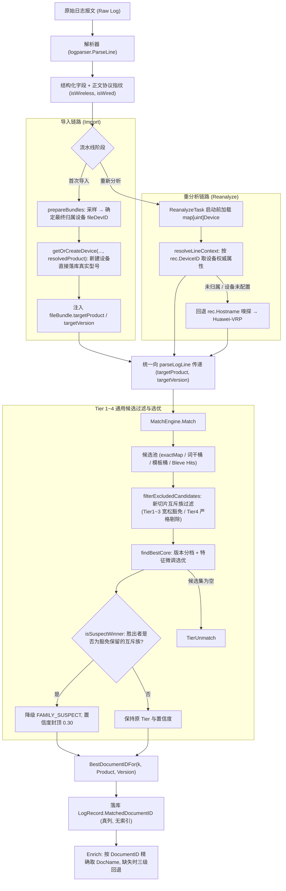

# LogAuditorGo 设备型号解耦与知识库匹配重构方案

> 本文档定义"任务级设备型号解耦 + 产品文档精准匹配"的最终实施方案，已历经 5 轮代码级审计收敛，可作为阶段一/阶段二两个 PR 的实施依据。
> 配套文档：`架构与模块说明书.md`（§5.9 matcher / §5.11 enrich / §5.13 model / §5.15 task 需同步更新）、`RCA演进计划.md`。
> 涉及核心代码：`internal/matcher/{scoring.go,engine.go}`、`internal/task/{import_pipeline.go,import_prepare.go,pipeline_engine.go,service.go,reanalyze_update.go}`、`internal/enrich/service.go`、`internal/api/task_handler.go`、`internal/model/{log.go,device.go}`。

---

## 一、问题诊断

### 1.1 已确证的缺陷

| 编号 | 缺陷 | 代码证据 |
| :-- | :-- | :-- |
| D1 | 任务级单一型号被当作全局匹配上下文，多设备混合故障域下必然错配 | `TaskInfo.DeviceType/DeviceVersion`（`model/task.go:30,36`）经 `service.go:497,588` 一路透传进 `Match` |
| D2 | 新建任务的型号默认值硬编码为 `CloudEngine`，形成系统性产品偏置 | `service.go:246-248` |
| D3 | 设备实体上的 `device_type` 完全不参与匹配，且自动建号时被写死为 `Router` | `service.go:1482-1484`、`1542-1550`；导入与重分析链路均不读设备属性 |
| D4 | 互斥协议族在**同分平局**时由条目 ID 升序仲裁，可能把无线报文挂到有线交换机文档 | `scoring.go:546-564`（无阈值、无族硬约束）、`scoring.go:511-531`（`betterCandidate` 末位 `cand.ID < cur.ID`） |
| D5 | Tier4（Bleve）选优只有 `0.6*相关度 + 0.4*版本贴合`，完全不含协议特征 | `engine.go:531-548` |
| D6 | 展示层取 `Versions` 中**第一个非空** `DocName`，与命中的目标产品无关 | `enrich/service.go:104-119` |
| D7 | "重新分析"被型号选择弹窗阻断，且该弹窗在单设备假设下本身就是错误交互 | `web/src/components/ReanalyzeDialog.vue`、`Tasks.vue:58-59` |

### 1.2 分值与平局的数学推演（关键）

对 `Module: CM, Brief: USER_OFFLINERESULT` 一类"同一助记符在多个产品族文档中各有一条知识"的场景（`matcher_test.go:604-618` 已固化该形态：#3823 CloudEngine、#8438 Campus、#11534 WLAN）：

| 场景 | CE 候选 | WLAN 候选 | 结果 |
| :-- | :-- | :-- | :-- |
| 上下文 = `CloudEngine`，CE 候选参数含 `wiredUserInfo` | `50 + (-20) = 30` | `10 + 30 = 40` | WLAN 胜出（**当前算法已自愈**） |
| 上下文 = `CloudEngine`，CE 候选无专属标记 | `50 + (-10) = 40` | `10 + 30 = 40` | **平局** → `betterCandidate` 按 ID 升序 → #3823 胜出（缺陷） |
| 上下文 = `CloudEngine 16800`（与文档 `ProductType` 完全一致） | `150 + (-20) = 130` | `10 + 30 = 40` | CE 碾压（缺陷，且型号越"精确"越危险） |

结论：单纯增大扣分（如 -200）只能缓解第二、三行，且会引出"负分仍作为最佳候选落库"的新问题——`FindBestKnowledgeMatchPtr` 没有准入阈值，`bestMatch` 即便总分极低也会被 `parseLogLine` 记为已匹配（`import_pipeline.go:312-327`）。**正确做法是在打分前做互斥族硬过滤，而不是调分数。**

### 1.3 待生产数据确认的事项（实施前置）

1. **复现固化**：在真实 `knowledge.db` 上取一条 AC6508 报文，记录 `Match` 的 `knowledge_id / tier / confidence / 胜出 DocumentID`，作为 fixture 落入测试。若结论是"`knowledge_id` 已经是 #11534 但展示的文档名是 CloudEngine 文档"，则主因是 D6 而非 D4，两者修复手段不同，必须先分清。
2. **误杀率预算**：阶段一上线前统计"无线报文过滤后无合规候选"的比例（即 `suspect` 触发率，见 §10.3）。该比例决定策略取舍，不应凭直觉选择。

---

## 二、目标与非目标

**目标**

1. `TaskInfo` 不再参与日志匹配，型号与版本权威下沉至 `Device`。
2. 匹配上下文按**设备**决议（导入按文件束、重分析按记录的设备归属），未归属日志回退主机名嗅探，最终兜底为中性类型。
3. 物理协议特征具备**候选集级否决权**：互斥族候选在打分前被剔除，而非仅扣分。
4. 命中的产品文档由匹配结果直接决定并落库，展示层不再二次猜测。
5. "重新分析"一键直达，去除型号选择阻断。

**非目标**

- 不改动 `logparser` 的解析逻辑与 `NormalizedLog` 结构。
- 不改动 `calcFeatureScore` 的软扣分语义（它与硬过滤职责分离，见 §4.3）。
- 不引入设备拓扑模型、不改变 RCA 算法（见 `RCA演进计划.md`）。
- 阶段一不做前端设备管理 UI 改版（留阶段二）。

---

## 三、总体架构



---

## 四、算法设计

### 4.1 互斥族判定与候选集硬过滤

```go
// isFamilyConflict 判定候选族是否与报文物理特征互斥（对称保护）
func isFamilyConflict(fam ProductFamily, isWireless, isWired bool) bool {
	if isWired && fam == FamilyWLAN {
		return true // 有线报文禁止匹配 WLAN 知识
	}
	if isWireless &&
		(fam == FamilyCloudEngine || fam == FamilyCampus ||
			fam == FamilyNetEngine || fam == FamilyHiSecEngine) {
		return true // 无线报文禁止匹配有线交换机 / 路由器 / 防火墙知识
	}
	return false
}

// filterExcludedCandidates 剔除互斥族候选。
//
// 不变式 1：输入切片来自全体 Worker 共享的 m.exactMap / m.moduleMap，
//           必须分配新切片，严禁原地压缩（原地会永久破坏内存索引并产生数据竞争）。
// 不变式 2（宽松模式 strict=false，Tier 1~3）：仅当窗口内存在"合规候选"时才硬剔除；
//           窗口内全是互斥族时全部保留，交由调用方标记 FAMILY_SUSPECT，
//           避免跨产品公共模块（AAA/IFNET 等仅交换机文档收录）出现假阴性。
// 不变式 3（严格模式 strict=true，Tier 4）：无条件剔除互斥族候选，不设豁免。
//           Tier 4 是无确定性模块/简名的全文模糊检索，跨族噪音极大，
//           若在 Tier1~3 已判定"该模块存在同族知识"的情况下，Tier4 又凭全文相关度
//           把跨族条目捞回来，属高置信度错配风险，因此 Tier4 不享受豁免。
func filterExcludedCandidates(candidates []*model.Knowledge, isWireless, isWired, strict bool) []*model.Knowledge {
	if len(candidates) == 0 || (!isWireless && !isWired) {
		return candidates
	}

	hasCompliant := false
	if !strict {
		for _, c := range candidates {
			if c != nil && !isFamilyConflict(resolveCandidateFamily(c), isWireless, isWired) {
				hasCompliant = true
				break
			}
		}
		if !hasCompliant {
			return candidates // 宽松模式豁免：全部保留，由调用方标记可疑
		}
	}

	kept := make([]*model.Knowledge, 0, len(candidates))
	for _, c := range candidates {
		if c == nil {
			continue
		}
		if isFamilyConflict(resolveCandidateFamily(c), isWireless, isWired) {
			continue
		}
		kept = append(kept, c)
	}
	return kept // 严格模式下可能为空切片，调用方需按"无候选"处理
}
```

### 4.2 选优核心与 `FAMILY_SUSPECT` 降级

```go
// findBestCore 选优唯一实现：先过滤（宽松模式），再打分。
// isWireless / isWired 由 engine.Match 计算后传入（与 exactBestKey 使用同一对布尔，物理同源）。
// 注意：本函数不返回 suspect —— suspect 必须由调用方在拿到 best 之后统一判定，
//       原因见下方"缓存命中一致性"说明。
func findBestCore(
	candidates []*model.Knowledge,
	product, version string,
	norm *model.NormalizedLog,
	isWireless, isWired bool,
) *model.Knowledge {
	kept := filterExcludedCandidates(candidates, isWireless, isWired, false)
	if len(kept) == 0 {
		return nil
	}
	return findBestByScore(kept, product, version, norm)
}

// isSuspectWinner 判定胜出者是否为"豁免保留的互斥族候选"。
//
// 数学等价性：严格模式下互斥候选必被剔除；宽松模式下互斥候选能胜出，
// 当且仅当窗口内不存在任何合规候选（即豁免模式生效）。
// 因此该判定只依赖 (胜出者族, isWireless, isWired)，与"是否命中缓存""走哪个 Tier"完全无关，
// 可在任意位置复算，是 suspect 状态的唯一权威来源。
func isSuspectWinner(winner *model.Knowledge, isWireless, isWired bool) bool {
	if winner == nil || (!isWireless && !isWired) {
		return false
	}
	return isFamilyConflict(resolveCandidateFamily(winner), isWireless, isWired)
}

// FindBestKnowledgeMatchPtr 公开签名保持不变（既有 12 处调用点零改动）。
func FindBestKnowledgeMatchPtr(candidates []*model.Knowledge, targetProduct, targetVersion string, norm ...*model.NormalizedLog) *model.Knowledge {
	var n *model.NormalizedLog
	if len(norm) > 0 {
		n = norm[0]
	}
	var isWireless, isWired bool
	if n != nil {
		isWireless = IsWirelessLog(n.MessageBody)
		isWired = IsWiredLog(n.MessageBody)
	}
	return findBestCore(candidates, targetProduct, targetVersion, n, isWireless, isWired)
}
```

**缓存命中一致性（必须遵守的写法）**

`exactBestCache`（`engine.go:381-395`）只缓存 `*model.Knowledge`。若把 suspect 作为选优函数的返回值，则**缓存命中路径不会执行选优函数**，suspect 会丢成默认 `false`，导致豁免条目以原 Tier、原置信度返回并写入 `m.cache`。因此四个 Tier 的调用点必须统一写成"先取 best（无论来自缓存还是实时选优），再判定 suspect"：

```go
var best *model.Knowledge
if cached, ok := m.exactBestCache.Get(exactBestKey); ok {
	best = cached
}
if best == nil {
	best = findBestCore(exactCandidates, product, version, norm, isWireless, isWired)
	// ... 写入 exactBestCache（只存 *model.Knowledge，不存 suspect）
}
if best == nil {
	// 进入下一 Tier（注意：宽松模式下"全为互斥族"不会返回空切片，
	// 只有 strict=true 或候选池本身为空时才会走到这里）
}
// 无论 best 来自缓存还是实时选优，suspect 都在此处统一判定
suspect := isSuspectWinner(best, isWireless, isWired)
tier, conf = applySuspectCap(TierExact, conf, suspect)
```

置信度收口（**Tier 1/2/3 与兜底路径共四处返回点必须统一**；Tier 4 因走严格剔除而 `suspect` 恒为 `false`，仍建议保留 `applySuspectCap` 调用以防御未来变更。写入 `m.cache` 的必须是封顶后的 `tier/conf`）：

```go
const (
	TierFamilySuspect          = "FAMILY_SUSPECT" // 豁免保留的互斥族候选
	ConfidenceFamilySuspectMax = 0.30
)

// applySuspectCap 胜出者若为豁免保留的互斥族，则降级 Tier 并封顶置信度
func applySuspectCap(tier string, conf float64, suspect bool) (string, float64) {
	if !suspect {
		return tier, conf
	}
	if conf > ConfidenceFamilySuspectMax {
		conf = ConfidenceFamilySuspectMax
	}
	return TierFamilySuspect, conf
}
```

`CalculateConfidence`（`scoring.go:232-252`）的 `switch` 必须补显式分支，否则新 Tier 会落入 `default: 0.0`：

```go
case TierFamilySuspect:
	return ConfidenceFamilySuspectMax // 0.30
```

`model/log.go:24` 的 Tier 取值注释需同步补 `FAMILY_SUSPECT`。

**注入点**

| Tier | 位置 | 过滤模式 | 改动 |
| :-- | :-- | :-- | :-- |
| 1 EXACT | `engine.go:381-400` | 宽松 | 缓存命中/实时选优**都**取到 `best` 后统一 `isSuspectWinner`；`applySuspectCap` 后返回；注意封顶在 `Tier1Consistency` 计算之后；写入 `m.cache` 的必须是封顶后的 `tier/conf` |
| 2 MNEMONIC | `engine.go:418,443` | 宽松 | 同上（无候选级缓存，同样统一在取到 `best` 后判定） |
| 3 TEMPLATE | `engine.go:458` | 宽松 | 同上 |
| 4 BLEVE | `engine.go:503-517` | **严格** | 在 `if len(bleveCandidates) > 0`（517 行）**之前**执行 `filterExcludedCandidates(..., strict=true)`；严格模式下胜出者必为合规候选，`suspect` 恒为 `false`，切片为空则自然回落到 `fallbackK` → 负缓存 → `UNMATCHED` |
| 兜底 | `engine.go:568-572` | — | `fallbackK` 返回路径同样执行 `isSuspectWinner` + `applySuspectCap`（`fallbackK` 可能来自宽松模式的 Tier1 窗口） |

> **Tier 4 为何不设豁免**：Tier 1~3 的候选窗口由 `module:brief`、词干、模板等确定性键约束，窗口内"只有互斥族候选"通常意味着该助记符确实只在其他产品族的文档中收录，属真实跨产品公共条目；Tier 4 是全文模糊召回（`bleveCandidates` 为 top-N 命中），"窗口内只有互斥族候选"更可能是跨模块噪音偶合。两者语义不同，故 Tier 4 走严格剔除——宁可 `UNMATCHED`，也不产出高置信跨族错配。

**缓存不变式**：过滤与 suspect 判定只依赖 `(候选族, isWireless, isWired)`，而 `isWireless/isWired` 已经是 `buildExactBestKey`（`engine.go:38-64`）的组成部分，`bodyKey` 又包含 `exactBestKey`，因此：
- `exactBestCache`（缓存 `*model.Knowledge`）与 `m.cache`（缓存 `k/tier/conf`）都不需要新增键；
- **但 `m.cache` 必须存封顶后的 `conf`**；
- 反过来，若未来把过滤条件扩展到依赖更多正文特征（如具体 token），**必须同步扩展 `buildExactBestKey`**，否则缓存串档（`engine.go:28-37` 记录过 PARSE-01/PARSE-17 的同类事故）。

### 4.3 与 `calcFeatureScore` 的职责划分

`calcFeatureScore`（`scoring.go:436-477`）**保持不动**，继续承担"合规候选之间的微调软排序"（无线 +30 / 有线族 -10~-20）。其现有用例必须继续通过：

- `matcher_test.go:741-790`（无版本条目的内容特征兜底族判定）
- `matcher_test.go:871-895`（`Reload()` 必须清空族缓存）
- `matcher_test.go:981-1003`（双特征报文有线优先，WLAN 候选 -20）

一句话原则：**过滤器负责"能不能进"，`calcFeatureScore` 负责"谁更靠前"。** 该注释必须写进代码，否则后继维护者会删掉其中一个。

### 4.4 版本映射的同源选取

```go
// bestVersionMapping 版本贴合度打分与最佳映射决定的唯一权威实现
func bestVersionMapping(k *model.Knowledge, targetProduct, targetVersion string) (int, *model.KnowledgeVersionMapping) {
	if k == nil || len(k.Versions) == 0 {
		return -1, nil
	}
	bestScore := -1
	var best *model.KnowledgeVersionMapping
	for i := range k.Versions {
		v := &k.Versions[i]
		s := scoreVersion(v.ProductType, v.ProductVersion, targetProduct, targetVersion)
		if s > bestScore || (s == bestScore && (best == nil || v.ID < best.ID)) {
			bestScore, best = s, v
		}
	}
	return bestScore, best
}

// ScoreKnowledgeVersion 行为与现实现完全一致（空版本映射返回 5，其余返回最高分）
func ScoreKnowledgeVersion(k *model.Knowledge, targetProduct, targetVersion string) int {
	if k == nil {
		return 0
	}
	if len(k.Versions) == 0 {
		return ScoreNoVersionFallback
	}
	if s, _ := bestVersionMapping(k, targetProduct, targetVersion); s > 0 {
		return s
	}
	return ScoreCrossProductGeneral
}

// BestDocumentIDFor 同源复算胜出映射的文档 ID，O(len(Versions))，不受两级缓存影响
func BestDocumentIDFor(k *model.Knowledge, targetProduct, targetVersion string) uint {
	if _, m := bestVersionMapping(k, targetProduct, targetVersion); m != nil {
		return m.DocumentID
	}
	return 0
}
```

> **为什么必须在落库点复算而不是让 `Match` 返回**：`Match` 有两条短路返回（`engine.go:351-356` 的 `bodyKey` 结果缓存、`engine.go:385-394` 的 `exactBestCache`）都只携带 `*model.Knowledge`，改造两级缓存才能带出映射信息；而 `BestDocumentIDFor` 与选优共用 `scoreVersion`，结论必然一致，代价可忽略，且**不动 `Match` 的三返回值签名**（`matcher_test.go` 约 21 处调用零改动）。
> **语义边界**：Tier4 的知识条目由"相关度 + 版本贴合"选出，此时该函数的含义是"版本贴合度最高的映射"，而非"决定 Tier 选优的那一个"，需在注释中写明。

### 4.5 上下文决议链（两条链路统一）

优先级：**设备库内属性 > 主机名嗅探 > 中性 `Huawei-VRP`**。版本与型号独立决议，型号为空不影响版本生效。

```go
// ResolveSpecificModelOrFamily 优先提取具体型号（可命中 120/150 分档），退化为规范族名
// 位置：internal/matcher（复用 familyRules 与 ResolveProductFamily）
// 规范串输出：CloudEngine / Campus-Switch / HiSecEngine-USG / NetEngine / WLAN / Huawei-VRP
// 预编译：ExtraPatterns 的正则在 init() 中编译，禁止在热路径重复 MustCompile
func ResolveSpecificModelOrFamily(hostname string) string

// resolveLineContext 重分析链路单行上下文决议
func resolveLineContext(rec *model.LogRecord, devMap map[uint]model.Device, overrideProduct, overrideVersion string) (string, string) {
	product, version := "", ""
	if rec.DeviceID > 0 {
		if d, ok := devMap[rec.DeviceID]; ok {
			product, version = strings.TrimSpace(d.DeviceType), strings.TrimSpace(d.DeviceVersion)
		}
	}
	if product == "" && rec.Hostname != "" {
		product = matcher.ResolveSpecificModelOrFamily(rec.Hostname)
	}
	// 兼容既有 API 契约：ReanalyzeOptions 的覆盖仅对"未归属日志"生效
	if product == "" && overrideProduct != "" {
		product, version = overrideProduct, overrideVersion
	}
	if product == "" {
		product = "Huawei-VRP"
	}
	return product, version
}
```

---

## 五、数据模型变更

```go
// internal/model/device.go —— 阶段一新增（DeviceVersion 必须与阶段一的读取代码同批上线）
type Device struct {
	// ... 既有字段 ...
	DeviceVersion string `gorm:"size:64" json:"device_version"` // 设备软件版本，如 V200R024C00
}

// internal/model/log.go —— 阶段一新增（无索引：该列不参与任何查询条件）
type LogRecord struct {
	// ... 既有字段 ...
	MatchedDocumentID uint `json:"matched_document_id"` // 胜出的产品文档 ID (documents.id)
}
```

- 加列由 `storage/task_db.go:594-603` 的 `AutoMigrate` 自动完成，`model.Device`/`model.LogRecord` 已在迁移列表中，零手工迁移。
- 存量行 `matched_document_id = 0` 属预期，展示层走回退链（§6.3）。
- **禁止**给该列加 `index`：它永不出现在 `WHERE`/`ORDER BY` 中，只会给历史大库白付一次索引构建与存储。
- **禁止**给 `LogRecord` 增加名为 `matched_doc_name` 的字段：`enrich.Record`（`enrich/service.go:21-28`）已嵌入 `model.LogRecord` 且自带同名字段，会造成嵌入字段遮蔽 + `omitempty` 吞值。

---

## 六、流水线改造

### 6.1 导入链路

`internal/task/import_pipeline.go` 的 `fileBundle` 扩展：

```go
type fileBundle struct {
	taskID        string
	item          FileUploadItem
	cleanName     string
	totalLines    int
	deviceID      uint
	targetProduct string // 决议后的权威型号/产品族
	targetVersion string // 决议后的权威软件版本
	lines         []string
}
```

`internal/task/import_prepare.go`（`prepareBundles`，约 228-333 行）决议并注入：

```go
inferredProduct := ""
if detectedHost != "" {
	inferredProduct = matcher.ResolveSpecificModelOrFamily(detectedHost)
}

fileDevID := deviceID
targetProduct, targetVersion := inferredProduct, ""
if targetDevName != "" {
	dev, devErr := getOrCreateDevice(taskDB, taskID, targetDevName, detectedHost, inferredProduct)
	if devErr != nil {
		logger.Log.Errorf("[Task Service] get or create device %s failed: %v", targetDevName, devErr)
		addLog("warning", "设备 %s 自动创建失败，该文件的日志将标记为未归属: %v", targetDevName, devErr)
	} else {
		fileDevID = dev.ID
		// 设备行即权威：新建时已写入真实型号；已存在时以库内配置为准（用户可改）
		targetProduct = strings.TrimSpace(dev.DeviceType)
		targetVersion = strings.TrimSpace(dev.DeviceVersion)
		if targetProduct == "" {
			targetProduct = inferredProduct
		}
	}
}
if targetProduct == "" {
	targetProduct = "Huawei-VRP"
}
```

> 说明：**不使用 `created` 标志参与决议**。`getOrCreateDevice` 落库真实型号后，设备行本身就是唯一权威来源，再维护第二条"新建走嗅探 / 已存在走库内"的分支只会制造新的漂移点（本方案前几轮反复出现的问题模式）。`created` 完全不出现在签名与调用点中。
> 注：当日志嗅探到 hostname 时，`prepareBundles` 的 `fileDevID` 会指向 **hostname 对应设备**（`import_prepare.go:228-247,312-323`），显式 `deviceID` 仅在无 hostname 时生效——这是既有行为且是正确的（按主机名归属），上述"以 `dev` 为准"与之自洽。

> **前提假设（沿用现状，不在本方案改造范围）**：**单个日志文件只由一台设备产生**。因此 `prepareBundles` 对单文件采样识别 `detectedHost` 并为整个 `fileBundle` 共享一个 `targetProduct` 是成立的。若出现多设备聚合的 Syslog 文本文件（同文件内交替出现不同设备日志），导入阶段的上下文会以采样到的第一台设备为准；该场景不在本方案保障范围内，且**重分析阶段会按行重新决议**（§6.2 `resolveLineContext`），可自行消除该偏差。

`getOrCreateDevice`（`service.go:1517-1555`）改为（**统一为 2 个返回值**）：

```go
func getOrCreateDevice(taskDB *gorm.DB, taskID, name, hostname, resolvedProduct string) (model.Device, error) {
	// ... 命中已有设备：仅补齐 hostname（保持既有逻辑） ...

	actualType := strings.TrimSpace(resolvedProduct)
	if actualType == "" {
		actualType = matcher.ResolveSpecificModelOrFamily(hostname)
	}
	if actualType == "" {
		actualType = "Huawei-VRP"
	}
	dev = model.Device{
		TaskID:     taskID,
		DeviceName: name,
		DeviceType: actualType, // 绝不写死 "Router"
		Hostname:   hostname,
		Color:      nextDeviceColor(taskDB),
		CreatedAt:  time.Now(),
		UpdatedAt:  time.Now(),
	}
	// ...
}
```

三处调用点同步：
1. `import_prepare.go:315` → 传 `inferredProduct`；
2. `service.go:1822`（`AutoAssignDevices`）→ 传 `matcher.ResolveSpecificModelOrFamily(h)`；
3. `service.go:1482-1484`（`CreateDevice`）→ `device_type` 为空时用 `matcher.ResolveSpecificModelOrFamily(device.Hostname)`，最终兜底 `Huawei-VRP`。

`persistFileBundle` / `IngestStreamingPipeline` **删除** `deviceType, deviceVersion` 形参，统一读 `bundle.targetProduct/targetVersion`；`parseLogLine` 保持 5 参签名不变，仅由调用方喂入 bundle 的值。

`internal/task/import_pipeline.go:312-327` 落库点：

```go
if k != nil && k.ID > 0 {
	norm.KnowledgeID = k.ID
	norm.MatchTier = tier
	norm.MatchConfidence = conf
	rec.MatchedDocumentID = matcher.BestDocumentIDFor(k, deviceType, deviceVersion)
	// ... 模板参数捕获（既有逻辑）...
}
```

### 6.2 重分析链路

`internal/task/service.go` 的 `ReanalyzeTask`（约 2305 行起）：

1. 循环外单次加载设备映射：

```go
var taskDevices []model.Device
if err := taskDB.Find(&taskDevices).Error; err != nil {
	return s.failTask(taskDB, &taskInfo, tr, fmt.Errorf("load devices failed: %w", err), "加载设备清单失败")
}
devMap := make(map[uint]model.Device, len(taskDevices))
for _, d := range taskDevices {
	devMap[d.ID] = d
}
```

2. Worker 内按行决议（替换 `service.go:2492`）：

```go
rec := &records[idx]
tProd, tVer := resolveLineContext(rec, devMap, overrideProduct, overrideVersion)
parsed := s.parseLogLine(cleanRaw, rec.SourceFile, rec.DeviceID, tProd, tVer)
```

3. 删除 `effectiveDeviceType` / `effectiveDeviceVersion`（`service.go:2354-2355`）与 `deviceVersion`（`2393`），避免未使用变量编译错误；
4. `ReanalyzeOptions.DeviceType/DeviceVersion`（`service.go:2340-2347`）**保留**，但语义收敛为"仅对 `DeviceID == 0` 的未归属日志兜底"，`api/task_handler.go:1350-1360` 保持校验与入参，`api_test.go:1851-1895` 的断言相应改写为"覆盖仅作用于未归属日志"。

### 6.3 文档归属落库与展示

1. `reanalyze_update.go`：`batchUpdateChunk` 增加第 13 列 `"matched_document_id"`，并把顶部注释的参数估算从 `200*12+200` 改为 `200*13+200`；
2. `enrich/service.go`：`extractMatchedDocName(kb, matchedDocID)` 三级回退，调用点（`enrich/service.go:94`）传入 `rec.MatchedDocumentID`：

```go
func extractMatchedDocName(kb *model.Knowledge, matchedDocID uint) string {
	if kb == nil || len(kb.Versions) == 0 {
		return ""
	}
	if matchedDocID > 0 {
		for _, v := range kb.Versions {
			if v.DocumentID == matchedDocID && strings.TrimSpace(v.DocName) != "" {
				return strings.TrimSpace(v.DocName)
			}
		}
	}
	for _, v := range kb.Versions { // 历史行 (docID == 0) 回退
		if s := strings.TrimSpace(v.DocName); s != "" {
			return s
		}
	}
	for _, v := range kb.Versions {
		if s := strings.TrimSpace(v.ProductType); s != "" {
			return s
		}
	}
	return ""
}
```

- 无需修改 `enrich.KnowledgeResolver` 接口：`GetKnowledgeMapByIDs` → `populateVersionDocNames`（`knowledge/service.go:1103-1147`）已回填 `Versions[].DocumentID` 与 `DocName`。
- 前端 `utils/logFormatter.js:372-378` 的三级回退链保持不变，`docID == 0` 时行为与现状一致。

---

## 七、API 与前端

### 7.1 遗留写入面处置矩阵

| 位置 | 阶段一处置 | 阶段二处置 |
| :-- | :-- | :-- |
| `service.go:246-248` `CreateEmptyTask` 默认 `CloudEngine` | 改为中性 `Huawei-VRP` | 保持 |
| `service.go:267-268` `CreateEmptyTask` 写入字段 | 保留写入（仅展示元数据，不参与匹配） | 随字段移除 |
| `service.go:688-692` `UpdateTask` | 保留写入与 `isValidDeviceType` 校验，保证非法值不入库 | 移除参数 |
| `service.go:738` `SetTaskDeviceVersion` + `api:341` | 保留端点（写库不阻断） | 下线 |
| `api:1311-1316` `PUT /tasks/:id` | 保留校验 | 移除参数 |
| `api:1350-1360` `POST /tasks/:id/reanalyze` | 保留入参，语义收敛为"未归属日志兜底"（见 §6.2） | 移除参数 |
| `POST /tasks` / `/import` 的 `device_type/device_version` | **静默忽略**（JSON 与表单双通道都接受但不写入匹配链），仅记 warning 日志，绝不返回 400 | 移除文档说明 |
| `web/.../WorkbenchHeader.vue:18` | 改为 `设备: {{ currentTask.device_count }} 台` | 保持 |

### 7.2 阶段二前端改造

1. 下线 `ReanalyzeDialog.vue`：`Tasks.vue`、`WorkbenchHeader.vue` 的"重新分析"改为 `ElMessageBox.confirm` 轻量确认后直接调用 `POST /api/v1/tasks/:id/reanalyze`；`composables/useReanalyze.js` 清理 `device_type/device_version` 提示与 payload。
2. `Tasks.vue` 的"编辑属性"改为独立的"重命名任务"轻量弹窗（仅 `task_name`）。
3. `DeviceManager.vue`：统一型号选项为 `DEVICE_PRODUCT_OPTIONS`，新增"软件版本（可选）"输入；`device_type` 语义明确为"产品族/具体型号"（不再是 Router/Switch 形态分类）。
4. `MultiDeviceReport.vue:77` 的 `d.device.device_type` 改走 `deviceTypeLabel()`。
5. `constants/deviceTypes.js`：`DEVICE_FORM_TYPE_OPTIONS` 收口；`deviceTypeLabel` 需覆盖嗅探产出的规范串。
6. 表格顶部提示："设备型号与版本决定该设备日志匹配的官方知识库，修改后点击【重新分析】生效。"

---

## 八、阶段一实施清单（PR-1）

| # | 文件 | 动作 |
| :-- | :-- | :-- |
| 1 | `internal/matcher/scoring.go` | `isFamilyConflict`、`filterExcludedCandidates(candidates, isWireless, isWired, strict)`、`findBestCore`（**不返回 suspect**）、`isSuspectWinner`、`applySuspectCap`；`bestVersionMapping` + 重构 `ScoreKnowledgeVersion` + `BestDocumentIDFor`；`TierFamilySuspect` / `ConfidenceFamilySuspectMax` 常量；`CalculateConfidence` 补 `case TierFamilySuspect`；`FindBestKnowledgeMatchPtr` / `FindBestKnowledgeMatch` 签名保持不变（薄包装委托 `findBestCore`）；补职责划分注释 |
| 2 | `internal/matcher/engine.go` | Tier1/2/3 取到 `best`（含 `exactBestCache` 命中）后统一 `isSuspectWinner` → `applySuspectCap`；Tier4 在 `517` 行前执行 `filterExcludedCandidates(..., strict=true)`；兜底路径 `568-572` 同样判定封顶；`m.cache` 缓存封顶后的 `tier/conf`；复用 `342-343` 的布尔（不重复计算） |
| 3 | `internal/model/device.go` + `internal/model/log.go` | 新增 `Device.DeviceVersion`、`LogRecord.MatchedDocumentID`（无索引） |
| 4 | `internal/task/import_pipeline.go` | `fileBundle` 加两个字段；`persistFileBundle`/`IngestStreamingPipeline` 删形参；`parseLogLine` 落 `MatchedDocumentID` |
| 5 | `internal/task/import_prepare.go` | `prepareBundles` 决议并注入；`getOrCreateDevice` 新签名 |
| 6 | `internal/task/service.go` | `getOrCreateDevice` 落库真实型号；`AutoAssignDevices:1822`、`CreateDevice:1482` 调用点；`ReanalyzeTask` 加载 `devMap` + `resolveLineContext`；删除 `effectiveDeviceType/deviceVersion`；`CreateEmptyTask:246-248` 中性默认值 |
| 7 | `internal/task/reanalyze_update.go` | 第 13 列 + 参数估算注释 |
| 8 | `internal/enrich/service.go` | `extractMatchedDocName(kb, docID)` 三级回退 + 调用点 |
| 9 | `internal/config/config.go`（可选但推荐） | 新增 `Matcher.MatcherConfig{FamilyFilterMode}`：`off`（现行为）/ `suspect`（默认，本文策略）/ `strict`（无条件剔除，全剔除即 `UNMATCHED`），便于灰度与回滚 |
| 10 | `internal/api/task_handler.go` | `POST /tasks` 静默忽略 `device_type`（warning 日志）；`ReanalyzeOptions` 语义收敛注释 |
| 11 | `web/src/components/workbench/WorkbenchHeader.vue` | 展示设备数 |
| 12 | 测试同步 | 见 §9.2 |

**落地顺序建议**：1 → 2（先跑通现有 matcher 全套，作为回归基线）→ 3 → 4/5/6 → 7 → 8 → 10/11 → 12。

---

## 九、阶段二实施清单（PR-2）

1. **受控历史回填**：仅当任务下**仅有 1 台设备**时，把 `TaskInfo.DeviceType` 回填为该设备的 `DeviceType`（且仅当该设备型号为空或为历史遗留 `Router`）；严禁多设备任务回填（会重新制造本案缺陷）。实现为一次性 schema-versioned 迁移，不放读路径。
2. `DeviceManager` 接管 `DeviceVersion` 与型号选项统一（§7.2 第 3~5 项）。
3. `ReanalyzeDialog.vue` 下线、一键重分析、任务重命名弹窗（§7.2 第 1~2 项）。
4. 物理移除 `TaskInfo.DeviceType/DeviceVersion` 与相关 API 参数/端点；同步 `docs/架构与模块说明书.md`（§5.13 领域模型、§5.15 任务业务层、PARSE-04 决策记录，当前位于 `:537`）。

---

## 十、测试计划

### 10.1 新增守护测试

| 用例 | 断言 |
| :-- | :-- |
| `TestMatcher_ExclusivityNoLeak` | WLAN 报文 + 混合候选（CE16800 + WLAN）：CE 被剔除，WLAN 胜出，`BestDocumentIDFor` 返回 WLAN 文档 ID，`tier` 未被降级 |
| `TestMatcher_SuspectFallbackConfidenceCap` | WLAN 报文 + **纯 CE** 候选池（替代早期"应返回 UNMATCHED"的断言）：返回 CE 条目、`tier == FAMILY_SUSPECT`、`conf <= 0.30` |
| `TestMatcher_WiredSideSymmetry` | 有线报文 + 纯 WLAN 候选池：同样走 suspect 降级而非 `UNMATCHED` |
| `TestMatcher_StrictModeAllExcluded` | `FamilyFilterMode = strict` 时，纯 CE 候选池在 Tier1~3 也返回 `nil / UNMATCHED`（过滤器 `strict=true` 分支） |
| `TestMatcher_NoVersionFallbackPreserved` | `Versions: nil` 的通用条目在无特征冲突时正常命中（守护 `ScoreNoVersionFallback = 5` 不被后续门限误杀） |
| `TestMatcher_ExclusionFamilyCacheInvalidation` | 复用 `matcher_test.go:871-895` 场景：知识原地更新 + `Reload()` 后，过滤判定随族缓存同步刷新（**陈旧族的代价是误剔除/丢匹配，必须有不变量测试**） |
| `TestMatcher_SuspectSurvivesExactCacheHit` | **同一 `module:brief` 连续匹配两次**：首次走实时选优、第二次命中 `exactBestCache`，两次都必须返回 `tier == FAMILY_SUSPECT` 且 `conf <= 0.30`（守护缓存命中路径的 suspect 状态不丢失） |
| `TestMatcher_Tier4StrictExclusion` | 纯 Bleve 召回路径下互斥族被**严格剔除**（不享受豁免）：混合候选时只保留合规候选；全为互斥族时过滤后为空并回落 `fallbackK` / `UNMATCHED`，绝不返回跨族条目 |
| `TestCalcFeatureScore_*`（既有） | 保持全部通过，证明软排序语义未变 |
| `TestPipeline_BundleDeviceContext` | 导入 `AC6508` 日志：`fileBundle.targetProduct == "AC6508"`，落库 `matched_document_id` 指向 WLAN 文档 |
| `TestPipeline_SecondImportNoDegrade` | 同一设备连续两次导入：第二次的匹配上下文与第一次一致（守护 §六 的"设备行即权威"） |
| `TestReanalyze_DeviceScopedContext` | 任务内两设备（CE + AC）分别配置型号后重分析：各自命中对应族文档，证明不再使用任务级单值 |
| `TestReanalyze_OverrideOnlyForUnassigned` | `ReanalyzeOptions.DeviceType` 仅影响 `device_id == 0` 的行 |

### 10.2 既有测试与实现同步清单

| 位置 | 修正内容 |
| :-- | :-- |
| `internal/task/pipeline_engine_test.go` | **9 处**调用点同步签名：61 / 158 / 226 / 334（`persistFileBundle`）/ 401 / 474 / 554 / 640 / 709 |
| `internal/api/api_test.go:1851-1895` | reanalyze 覆盖断言改为"仅作用于未归属日志"；`device_type` 写入语义变更 |
| `internal/task/task_test.go` | `:555, 628, 688-710, 1398`（fixture 参数）、`:1317`、`:1363-1373`（任务级字段断言） |
| `internal/task/fail_task_internal_test.go:40, 111` | 硬编码 `CloudEngine` 的任务 fixture |
| `internal/task/pipeline_engine_test.go:882` | 同上 |
| `internal/matcher/matcher_test.go` | `:336-366, 396, 733` 调用 `FindBestKnowledgeMatchPtr` 无需改动（签名不变）；新增上述用例 |
| `docs/架构与模块说明书.md` | §5.9（新增过滤器与 Tier 说明）、§5.11（文档名来源）、§5.13（模型字段）、§5.15（上下文决议）、§9（API 参数语义）、`:537`（PARSE-04 决策记录） |

### 10.3 上线前量化验证

1. `suspect` 触发率：生产知识库上统计无线报文中"窗口无合规候选"的比例；若显著偏高，需要让 `FAMILY_SUSPECT` 在前端筛选/统计中单独可见。
2. 过滤导致的净变化：抽样对比过滤前后的 `knowledge_id` 分布，确认变化集中在互斥族之间，没有大规模变为 `UNMATCHED`。

---

## 十一、风险、回滚与发布说明

| 风险 | 影响 | 缓解 |
| :-- | :-- | :-- |
| 过滤导致跨产品公共模块出现假阴性 | 匹配率下降 | `suspect` 豁免策略 + §10.3 量化 + `family_filter_mode` 可一键退回 `off` |
| 阶段一 `DeviceVersion` 恒为空 | 150/120 版本分档不生效 | 在发布说明中明确；管理界面录入留阶段二 |
| 缓存串档 | 结果随机错配 | 过滤只依赖 `isWireless/isWired`（已在缓存键中）；若未来扩展依赖项必须同步 `buildExactBestKey` |
| 缓存命中导致 suspect 状态丢失 | 豁免条目以原 Tier/原置信度返回并写入 `m.cache` | suspect 不由选优函数返回，而是在取到 `best` 后统一由 `isSuspectWinner` 判定（覆盖 `exactBestCache` 命中路径）；由 `TestMatcher_SuspectSurvivesExactCacheHit` 守护 |
| Tier4 全文召回绕过互斥约束 | 跨族条目被高置信度返回 | Tier4 使用严格剔除（不设豁免），全空即回落 `UNMATCHED`；由 `TestMatcher_Tier4StrictExclusion` 守护 |
| 历史行 `matched_document_id = 0` | 文档名显示 | 三级回退链，行为与现状一致，无需数据修复 |
| 存量任务结论不变 | 用户误以为已修复 | 发布说明写明：**必须对存量任务执行"重新分析"才会刷新 `knowledge_id` 与 `matched_document_id`** |

**回滚策略**：`matcher.family_filter_mode` 置为 `off` 即回到现行为（软扣分），无需回滚代码；`MatchedDocumentID` 列与 `Device.DeviceVersion` 列可安全保留（纯增列，不写不读即无影响）。

**发布说明（用户侧）**

1. 匹配不再依赖任务级设备类型，改为按设备（可在"设备管理"中配置型号与版本）逐台匹配。
2. 无线/有线协议特征具备候选集否决权；无同族知识时结果会标记为 `FAMILY_SUSPECT` 且置信度不超过 30%。
3. 日志详情中的"匹配产品文档"现由匹配结果直接给出，不再取该知识条目的第一条文档。
4. 存量任务需手动"重新分析"以应用新规则；重新分析不再弹出型号选择框。

---

## 十二、明确不做的事

1. 不引入 150/120 分的额外权重调整，不修改 `Score*` 常量（避免影响 Tier4 的 `versionFit` 归一化）。
2. 不移除 `calcFeatureScore`（软排序仍需要），不改变其现有用例期望值。
3. 不给 `MatchedDocumentID` 加索引，不在 `LogRecord` 上增加与 `enrich.Record` 同名的 `matched_doc_name` 字段。
4. 不在阶段一改动 `enrich.KnowledgeResolver` 接口，不新增文档名批量查询 SQL。
5. 不在阶段一改动前端设备管理 UI 与移除 `TaskInfo` 字段（避免与匹配改造混提，保证回滚粒度）。
6. **不支持单文件多设备**：本方案沿用"单个日志文件由一台设备产生"的既有前提，不为多设备聚合的 Syslog 文本文件设计采样之外的逐行归属逻辑（导入阶段按采样主机名统一，重分析阶段会按行修正，无需额外交付）。
